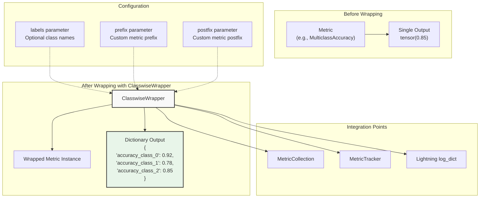
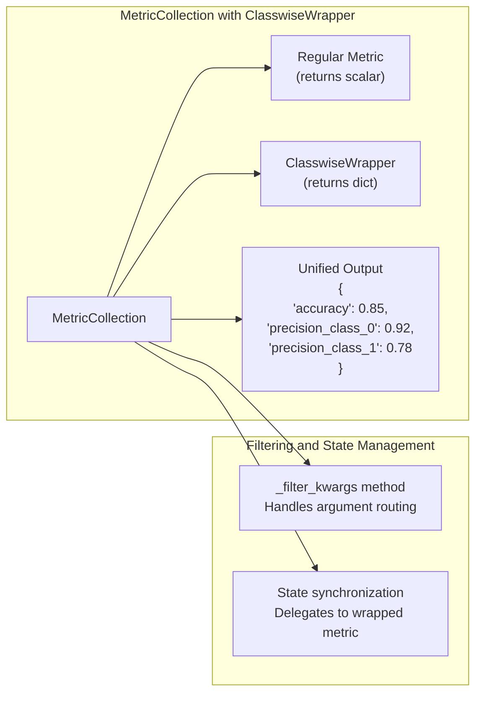
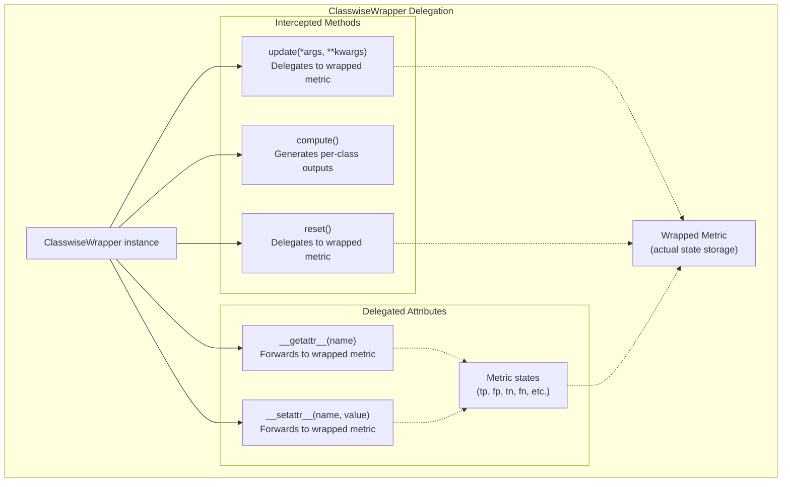

<!-- source: DeepWiki mcp.deepwiki.com · repo Lightning-AI/torchmetrics · page 12.1 ClasswiseWrapper and Output Modification · fetched 2026-10-21 -->

# ClasswiseWrapper and Output Modification

<details>
<summary>Relevant source files</summary>

The following files were used as context for generating this wiki page:

- [CHANGELOG.md](CHANGELOG.md)
- [LICENSE](LICENSE)
- [README.md](README.md)
- [docs/source/_templates/theme_variables.jinja](docs/source/_templates/theme_variables.jinja)
- [docs/source/all-metrics.rst](docs/source/all-metrics.rst)
- [docs/source/conf.py](docs/source/conf.py)
- [docs/source/index.rst](docs/source/index.rst)
- [docs/source/pages/implement.rst](docs/source/pages/implement.rst)
- [docs/source/pages/lightning.rst](docs/source/pages/lightning.rst)
- [docs/source/pages/overview.rst](docs/source/pages/overview.rst)
- [docs/source/pages/quickstart.rst](docs/source/pages/quickstart.rst)
- [requirements/integrate.txt](requirements/integrate.txt)
- [src/torchmetrics/__about__.py](src/torchmetrics/__about__.py)
- [tests/integrations/lightning/boring_model.py](tests/integrations/lightning/boring_model.py)
- [tests/integrations/test_lightning.py](tests/integrations/test_lightning.py)

</details>


## Purpose and Scope

This document covers the `ClasswiseWrapper`, a compositional wrapper that transforms classification metrics returning a single aggregated score into metrics that return per-class scores. This enables better observability and logging of class-specific performance during training.

For information about wrapping metrics for temporal tracking across epochs, see [MetricTracker and Temporal Tracking](#12.2). For statistical confidence intervals, see [BootStrapper and Statistical Analysis](#12.3). For handling multiple tasks or outputs, see [Multi-task and Multi-output Wrappers](#12.4).

**Sources:** [CHANGELOG.md:970]()

## Overview

Classification metrics like `Accuracy`, `Precision`, `Recall`, and `F1Score` typically return a single scalar value representing aggregated performance. However, in multi-class problems, it is often valuable to track per-class performance separately to identify which classes the model struggles with.

The `ClasswiseWrapper` solves this by:
1. Wrapping an existing metric instance
2. Computing the metric for each class separately
3. Returning a dictionary of per-class values instead of a single scalar
4. Supporting custom labels and prefixes for better logging integration

This is particularly useful when integrated with PyTorch Lightning's automatic logging, as each class's score becomes a separate logged metric.

**Sources:** [CHANGELOG.md:970](), [CHANGELOG.md:358]()

## ClasswiseWrapper Architecture



**Diagram: ClasswiseWrapper System Architecture**

The wrapper delegates `update()` calls to the underlying metric but intercepts `compute()` to generate per-class outputs. State management and device/dtype operations are delegated through `__getattr__` and `__setattr__`.

**Sources:** [CHANGELOG.md:970](), [CHANGELOG.md:358](), [CHANGELOG.md:572](), [CHANGELOG.md:843]()

## Configuration and Usage

### Basic Usage Pattern

The `ClasswiseWrapper` is instantiated by passing a metric instance along with optional configuration:

```python
from torchmetrics.wrappers import ClasswiseWrapper
from torchmetrics.classification import MulticlassAccuracy

# Wrap a multiclass accuracy metric
metric = ClasswiseWrapper(
    MulticlassAccuracy(num_classes=3, average='macro')
)

# Use like a normal metric
metric.update(preds, target)
result = metric.compute()
# Returns: {'accuracy_class_0': 0.92, 'accuracy_class_1': 0.78, 'accuracy_class_2': 0.85}
```

The wrapper works with any classification metric that supports per-class computation (typically those with an `average` parameter).

### Labels Parameter

The `labels` parameter allows customizing class names in the output dictionary instead of using numeric indices:

```python
metric = ClasswiseWrapper(
    MulticlassAccuracy(num_classes=3, average='macro'),
    labels=["cat", "dog", "bird"]
)

result = metric.compute()
# Returns: {'accuracy_cat': 0.92, 'accuracy_dog': 0.78, 'accuracy_bird': 0.85}
```

This improves readability when logging to experiment tracking systems.

### Prefix and Postfix Parameters

The `prefix` and `postfix` parameters control naming of output keys:

```python
metric = ClasswiseWrapper(
    MulticlassAccuracy(num_classes=3, average='macro'),
    labels=["cat", "dog", "bird"],
    prefix="train_",
    postfix="_top1"
)

result = metric.compute()
# Returns: {
#   'train_accuracy_cat_top1': 0.92,
#   'train_accuracy_dog_top1': 0.78,
#   'train_accuracy_bird_top1': 0.85
# }
```

These parameters are especially important when using `ClasswiseWrapper` within a `MetricCollection` to avoid key collisions.

**Sources:** [CHANGELOG.md:572](), [CHANGELOG.md:554](), [CHANGELOG.md:843]()

## Output Format

### Output Structure

| Configuration | Output Format | Example Key |
|--------------|---------------|-------------|
| Default | `{metric_name}_class_{idx}` | `accuracy_class_0` |
| With labels | `{metric_name}_{label}` | `accuracy_cat` |
| With prefix | `{prefix}{metric_name}_class_{idx}` | `train_accuracy_class_0` |
| With postfix | `{metric_name}_class_{idx}{postfix}` | `accuracy_class_0_top1` |
| All combined | `{prefix}{metric_name}_{label}{postfix}` | `train_accuracy_cat_top1` |

### Integration with Compute Groups

When used within a `MetricCollection`, the `ClasswiseWrapper` participates in compute group optimizations. However, it returns a dictionary while other metrics may return tensors, which is handled by `MetricCollection`'s output unification logic.

**Sources:** [CHANGELOG.md:335](), [CHANGELOG.md:843]()

## Integration with Other Components

### MetricCollection Integration



**Diagram: ClasswiseWrapper in MetricCollection**

The `MetricCollection` automatically merges outputs from regular metrics and `ClasswiseWrapper` instances into a single dictionary, making it seamless to log both aggregated and per-class metrics.

**Sources:** [CHANGELOG.md:335](), [CHANGELOG.md:843]()

### MetricTracker Integration

The `ClasswiseWrapper` can be nested within a `MetricTracker` to track per-class performance over time:

```python
from torchmetrics.wrappers import ClasswiseWrapper, MetricTracker

tracker = MetricTracker(
    ClasswiseWrapper(
        MulticlassAccuracy(num_classes=3),
        labels=["cat", "dog", "bird"]
    )
)
```

This produces nested dictionaries tracking each class's metric across steps/epochs.

**Sources:** [CHANGELOG.md:159](), [CHANGELOG.md:169]()

### PyTorch Lightning Logging

When used with PyTorch Lightning's `self.log_dict()`, each per-class metric is automatically logged as a separate scalar:

```python
class LitModel(pl.LightningModule):
    def __init__(self):
        super().__init__()
        self.accuracy = ClasswiseWrapper(
            MulticlassAccuracy(num_classes=3),
            labels=["cat", "dog", "bird"]
        )
    
    def training_step(self, batch, batch_idx):
        x, y = batch
        preds = self(x)
        self.accuracy.update(preds, y)
        return loss
    
    def on_train_epoch_end(self):
        # Logs 'accuracy_cat', 'accuracy_dog', 'accuracy_bird' separately
        self.log_dict(self.accuracy.compute())
        self.accuracy.reset()
```

This creates three separate curves in experiment tracking dashboards.

**Sources:** [CHANGELOG.md:970]()

## Implementation Details

### State Delegation Pattern

The `ClasswiseWrapper` does not maintain its own metric states. Instead, it delegates all state-related operations to the wrapped metric through `__getattr__` and `__setattr__`:



**Diagram: State Delegation in ClasswiseWrapper**

This design ensures that:
1. Device/dtype operations on the wrapper affect the wrapped metric
2. State persistence (`state_dict`/`load_state_dict`) works correctly
3. DDP synchronization is handled by the wrapped metric
4. No duplication of state tensors occurs

**Sources:** [CHANGELOG.md:358]()

### Reset Behavior

The wrapper's `reset()` method must properly delegate to the wrapped metric to clear accumulated state:

```python
def reset(self):
    """Reset wrapped metric state."""
    self.metric.reset()
```

Earlier versions had a bug where reset was not properly called, leading to incorrect accumulated values across epochs.

**Sources:** [CHANGELOG.md:858]()

### Compute Implementation

The `compute()` method internally:
1. Calls the wrapped metric's `compute()` with `average='none'` or equivalent to get per-class values
2. Constructs a dictionary mapping class names/indices to values
3. Applies prefix/postfix transformations
4. Returns the dictionary

The exact implementation depends on the wrapped metric's API for per-class computation.

**Sources:** [CHANGELOG.md:970]()

## Common Patterns and Examples

### Pattern: Per-Class Metrics in Multi-Class Classification

**Use Case:** Track which classes have poor performance during training.

```python
from torchmetrics import MetricCollection
from torchmetrics.classification import MulticlassAccuracy, MulticlassPrecision, MulticlassRecall
from torchmetrics.wrappers import ClasswiseWrapper

metrics = MetricCollection({
    'acc': MulticlassAccuracy(num_classes=10, average='macro'),
    'acc_per_class': ClasswiseWrapper(
        MulticlassAccuracy(num_classes=10, average='macro'),
        labels=[f"digit_{i}" for i in range(10)]
    ),
    'precision_per_class': ClasswiseWrapper(
        MulticlassPrecision(num_classes=10, average='macro')
    )
})
```

This configuration logs overall accuracy plus per-digit accuracy and precision.

### Pattern: Combining with Prefix for Multi-Stage Training

**Use Case:** Different training stages (pretraining, finetuning) with per-class tracking.

```python
pretrain_metrics = MetricCollection({
    'pretrain_acc': ClasswiseWrapper(
        MulticlassAccuracy(num_classes=100, average='macro'),
        prefix="pretrain_"
    )
})

finetune_metrics = MetricCollection({
    'finetune_acc': ClasswiseWrapper(
        MulticlassAccuracy(num_classes=10, average='macro'),
        prefix="finetune_"
    )
})
```

The prefix ensures metric keys don't collide when logging both stages.

### Pattern: Edge Case Handling

**Known Issues:**
1. Integration with `MetricTracker`: Fixed in version 1.7.0, but earlier versions had issues with nested dictionary structures.
2. Duplicate prefix/postfix: Fixed in version 1.0.2, earlier versions could duplicate these strings when used in `MetricCollection`.
3. Custom `_filter_kwargs`: Fixed in version 1.4.1, the wrapper now properly handles metrics with custom argument filtering.

**Workaround for older versions:** Avoid nesting `ClasswiseWrapper` inside `MetricTracker` if using versions < 1.7.0.

**Sources:** [CHANGELOG.md:159](), [CHANGELOG.md:169](), [CHANGELOG.md:335](), [CHANGELOG.md:554]()

## Performance Considerations

| Aspect | Impact | Notes |
|--------|--------|-------|
| Memory | Minimal overhead | No state duplication, only wraps existing metric |
| Computation | ~N times slower | Must compute metric N times for N classes |
| Logging overhead | Higher | Creates N separate logged values instead of 1 |
| DDP synchronization | No change | Delegates to wrapped metric |

For metrics with many classes (>100), consider whether per-class tracking is necessary or if sampling a subset of classes would suffice.

**Sources:** [CHANGELOG.md:970](), [CHANGELOG.md:358]()

---

**Key Takeaways:**
- `ClasswiseWrapper` transforms aggregated classification metrics into per-class metrics
- Supports custom `labels`, `prefix`, and `postfix` for better logging integration
- Integrates seamlessly with `MetricCollection`, `MetricTracker`, and Lightning's logging
- Uses delegation pattern to avoid state duplication
- Essential for debugging class-specific performance issues in multi-class problems

---

