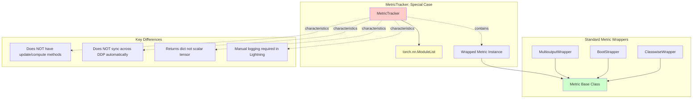
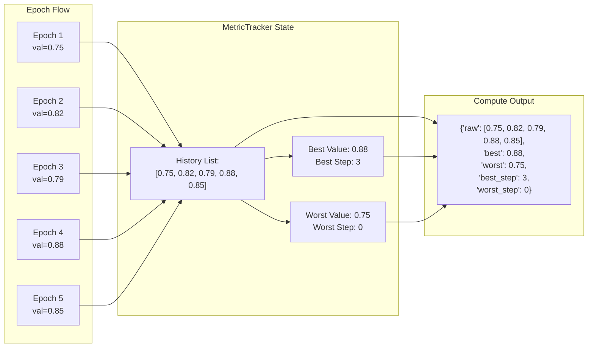
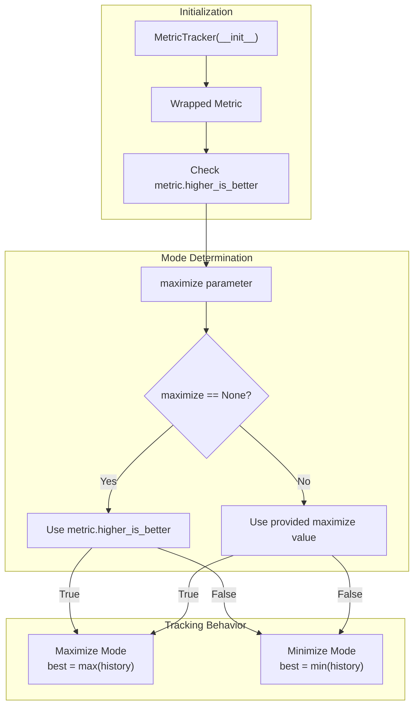
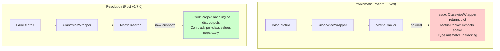
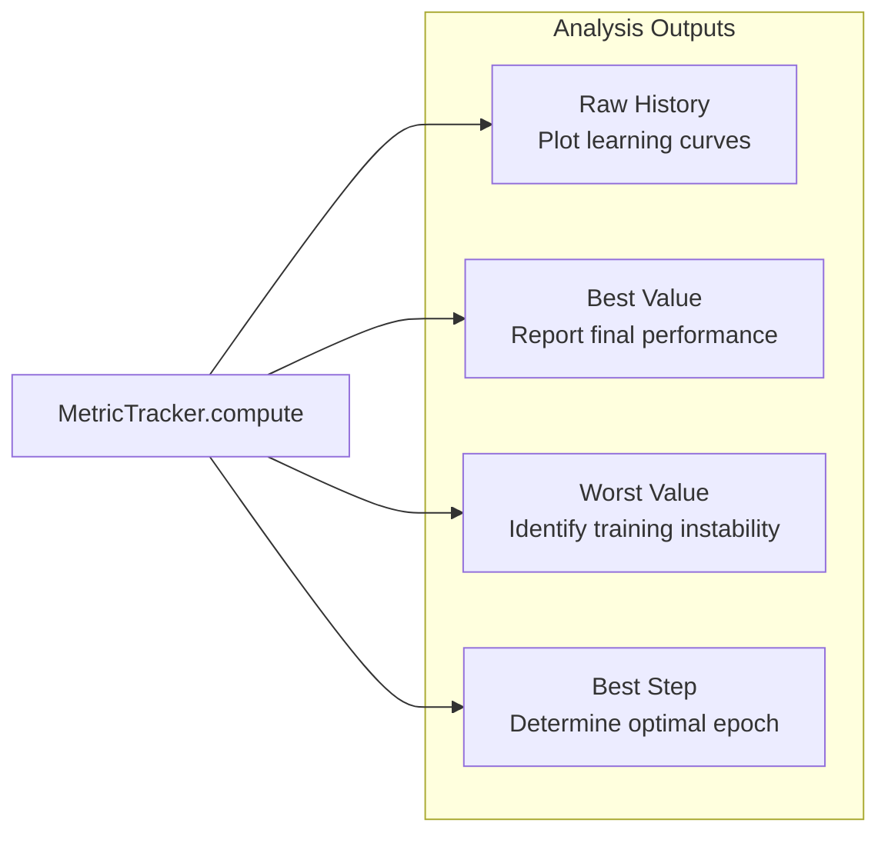

<!-- source: DeepWiki mcp.deepwiki.com · repo Lightning-AI/torchmetrics · page 12.2 MetricTracker and Temporal Tracking · fetched 2026-10-21 -->

# MetricTracker and Temporal Tracking

<details>
<summary>Relevant source files</summary>

The following files were used as context for generating this wiki page:

- [CHANGELOG.md](CHANGELOG.md)
- [LICENSE](LICENSE)
- [README.md](README.md)
- [docs/source/_templates/theme_variables.jinja](docs/source/_templates/theme_variables.jinja)
- [docs/source/all-metrics.rst](docs/source/all-metrics.rst)
- [docs/source/conf.py](docs/source/conf.py)
- [docs/source/index.rst](docs/source/index.rst)
- [docs/source/pages/implement.rst](docs/source/pages/implement.rst)
- [docs/source/pages/lightning.rst](docs/source/pages/lightning.rst)
- [docs/source/pages/overview.rst](docs/source/pages/overview.rst)
- [docs/source/pages/quickstart.rst](docs/source/pages/quickstart.rst)
- [requirements/integrate.txt](requirements/integrate.txt)
- [src/torchmetrics/__about__.py](src/torchmetrics/__about__.py)
- [tests/integrations/lightning/boring_model.py](tests/integrations/lightning/boring_model.py)
- [tests/integrations/test_lightning.py](tests/integrations/test_lightning.py)

</details>


## Purpose and Scope

This document describes the **MetricTracker** wrapper, a specialized utility for tracking metric values over time (typically epochs or training steps) and identifying best/worst values. Unlike other metric wrappers, MetricTracker does not inherit from `Metric` but from `torch.nn.ModuleList`, requiring special handling in training loops.

For information about wrapping metrics to modify their output format, see [ClasswiseWrapper and Output Modification](#12.1). For wrapping metrics to add statistical analysis, see [BootStrapper and Statistical Analysis](#12.3).

**Sources:** [docs/source/pages/lightning.rst:302-306](), [CHANGELOG.md:279]()

---

## Overview and Architecture

### What is MetricTracker?

`MetricTracker` is a wrapper class that:
- Maintains a temporal history of metric values across multiple evaluation points
- Tracks the best (maximum or minimum) value encountered
- Tracks the worst value encountered  
- Supports both `maximize=True` (higher is better) and `maximize=False` (lower is better) modes
- Integrates with the `higher_is_better` property of metrics to automatically determine optimization direction

### Unique Architecture: ModuleList Instead of Metric



**Diagram: MetricTracker Architecture Distinction**

**Sources:** [docs/source/pages/lightning.rst:302-306](), [CHANGELOG.md:169]()

---

## Core Functionality

### Temporal History Tracking

The tracker maintains metric values across evaluation points, allowing analysis of metric evolution over training:



**Diagram: Temporal Tracking and State Management**

**Sources:** [CHANGELOG.md:279]()

---

## Maximize vs Minimize Behavior

### Automatic Mode Detection

MetricTracker integrates with the `higher_is_better` property of the wrapped metric to determine optimization direction:

| Metric Type | `higher_is_better` | `maximize` Default | Best Determined By |
|-------------|-------------------|-------------------|-------------------|
| Accuracy | `True` | `True` | Maximum value |
| MSE, MAE | `False` | `False` | Minimum value |
| AUROC | `True` | `True` | Maximum value |
| Loss metrics | `False` | `False` | Minimum value |



**Diagram: Maximize/Minimize Mode Determination**

**Sources:** [CHANGELOG.md:279](), [docs/source/pages/overview.rst:506-515]()

---

## Usage Patterns

### Basic Standalone Usage

MetricTracker is typically used in epoch-based training loops:

```mermaid
sequenceDiagram
    participant Loop as Training Loop
    participant Tracker as MetricTracker
    participant Metric as Wrapped Metric
    participant State as Tracker State
    
    Note over Loop,State: Training Epoch
    Loop->>Metric: update(preds, target) [multiple batches]
    Loop->>Metric: compute()
    Metric-->>Loop: epoch_value
    Loop->>Tracker: tracker_metric.update(epoch_value)
    Tracker->>State: Append to history
    Tracker->>State: Update best/worst if needed
    
    Note over Loop,State: After All Epochs
    Loop->>Tracker: compute()
    Tracker->>State: Read history, best, worst
    State-->>Tracker: Complete tracking dict
    Tracker-->>Loop: {'raw': [...], 'best': x, 'worst': y, ...}
```

**Diagram: MetricTracker Lifecycle in Training Loop**

The key difference from regular metrics: MetricTracker's `update()` receives the **already computed** metric value for each epoch, not raw predictions/targets.

**Sources:** [docs/source/pages/lightning.rst:302-306]()

---

## Integration with PyTorch Lightning

### Special Logging Requirements

Because MetricTracker does not inherit from `Metric`, it requires manual logging in Lightning:

```mermaid
graph TB
    subgraph "Standard Metric Logging in Lightning"
        SM[Standard Metric]
        SLOG["self.log('metric', metric_obj)"]
        AUTO["Lightning auto-resets<br/>Lightning auto-computes"]
        SM --> SLOG
        SLOG --> AUTO
    end
    
    subgraph "MetricTracker Logging in Lightning"
        MT[MetricTracker]
        COMP["result = tracker.compute()"]
        MLOG["self.log_dict(result)"]
        MANUAL["Manual reset required<br/>Manual timing required"]
        
        MT --> COMP
        COMP --> MLOG
        MLOG --> MANUAL
    end
    
    subgraph "Recommended Pattern"
        VAL["validation_step:<br/>wrapped_metric.update(...)"]
        EPOCH["on_validation_epoch_end:<br/>val = wrapped_metric.compute()<br/>tracker.update(val)<br/>self.log_dict(tracker.compute())<br/>wrapped_metric.reset()"]
        
        VAL --> EPOCH
    end
    
    style MT fill:#ffcccc
    style SM fill:#ccffcc
```



**Diagram: MetricTracker Logging Pattern in Lightning**

**Important:** The wrapped metric must be manually reset, and the tracker should only be updated at epoch boundaries, not within `training_step` or `validation_step`.

**Sources:** [docs/source/pages/lightning.rst:302-306](), [tests/integrations/test_lightning.py:1-307]()

---

## Integration with Other Wrappers

### Edge Cases with ClasswiseWrapper

Historical integration issues existed between MetricTracker and ClasswiseWrapper:



**Diagram: ClasswiseWrapper + MetricTracker Integration Evolution**

**Sources:** [CHANGELOG.md:159](), [CHANGELOG.md:169]()

---

## Common Patterns and Best Practices

### Pattern 1: Epoch-Level Model Selection

| Use Case | Description | Example |
|----------|-------------|---------|
| **Early Stopping** | Track validation metric, stop when no improvement | Monitor `best_step` to detect plateaus |
| **Model Checkpointing** | Save model at best validation score | Use `best` value as checkpoint criterion |
| **Learning Rate Scheduling** | Adjust LR based on best seen performance | Reference `best` in scheduler logic |

### Pattern 2: Training Analysis



**Diagram: Analysis Use Cases for MetricTracker Output**

**Sources:** [CHANGELOG.md:279]()

---

## Implementation Considerations

### Memory Management

Because MetricTracker stores complete history, memory grows linearly with number of epochs:

| Training Duration | Memory Impact |
|------------------|---------------|
| 100 epochs | Minimal (100 scalar values) |
| 1000 epochs | Still acceptable (1000 scalars) |
| Very long training | Consider periodic pruning |

### State Management

The tracking state is **not** automatically synchronized across DDP processes. Users must ensure:
- Only one process (e.g., rank 0) updates the tracker
- Or aggregate results before updating tracker
- Manual synchronization if needed

**Sources:** [docs/source/pages/lightning.rst:302-306]()

---

## Known Limitations

1. **Not a true Metric subclass**: Cannot use standard metric interface (update on batches, auto-sync)
2. **Manual logging required**: Lightning cannot auto-log MetricTracker objects
3. **Epoch-level only**: Designed for epoch boundaries, not batch-level tracking
4. **No distributed sync**: Must manually handle multi-process scenarios

**Sources:** [docs/source/pages/lightning.rst:302-306](), [CHANGELOG.md:159](), [CHANGELOG.md:169]()

---

## Summary Table

| Feature | MetricTracker | Standard Metric |
|---------|--------------|----------------|
| Base class | `torch.nn.ModuleList` | `torchmetrics.Metric` |
| Update frequency | Once per epoch | Every batch |
| Input type | Computed scalar | Raw predictions/targets |
| Output type | Dict with history | Scalar tensor |
| Lightning auto-reset | No | Yes |
| Lightning auto-log | No (manual only) | Yes |
| DDP sync | Manual | Automatic |
| Primary use case | Best/worst tracking | Metric computation |

**Sources:** [docs/source/pages/lightning.rst:302-306](), [CHANGELOG.md:279]()

---

