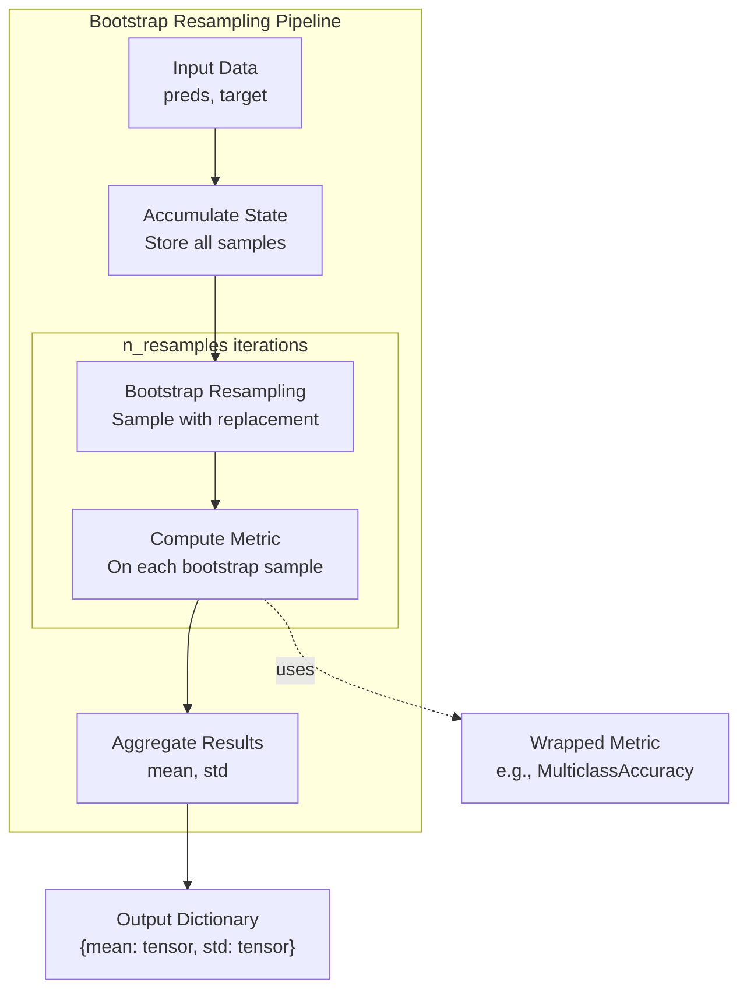
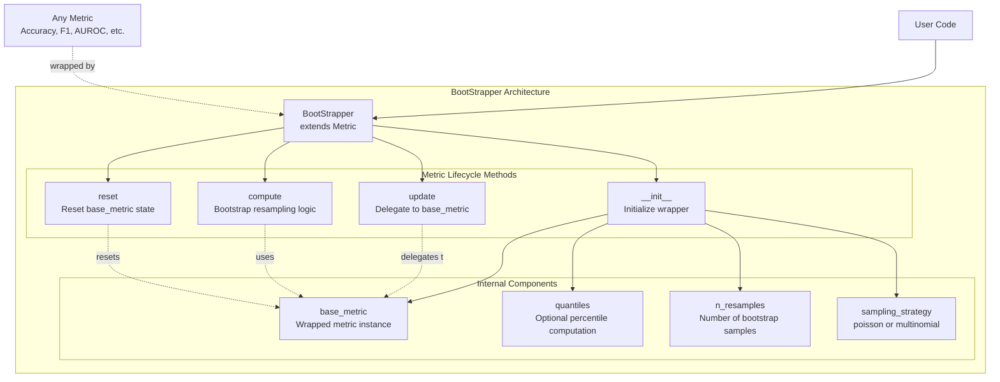
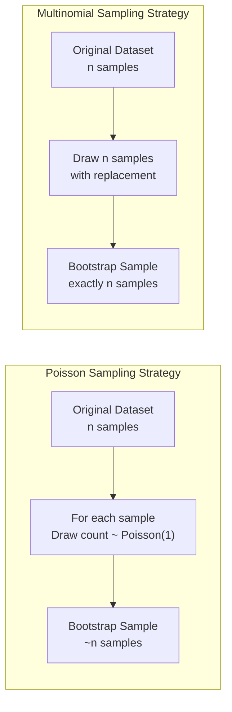
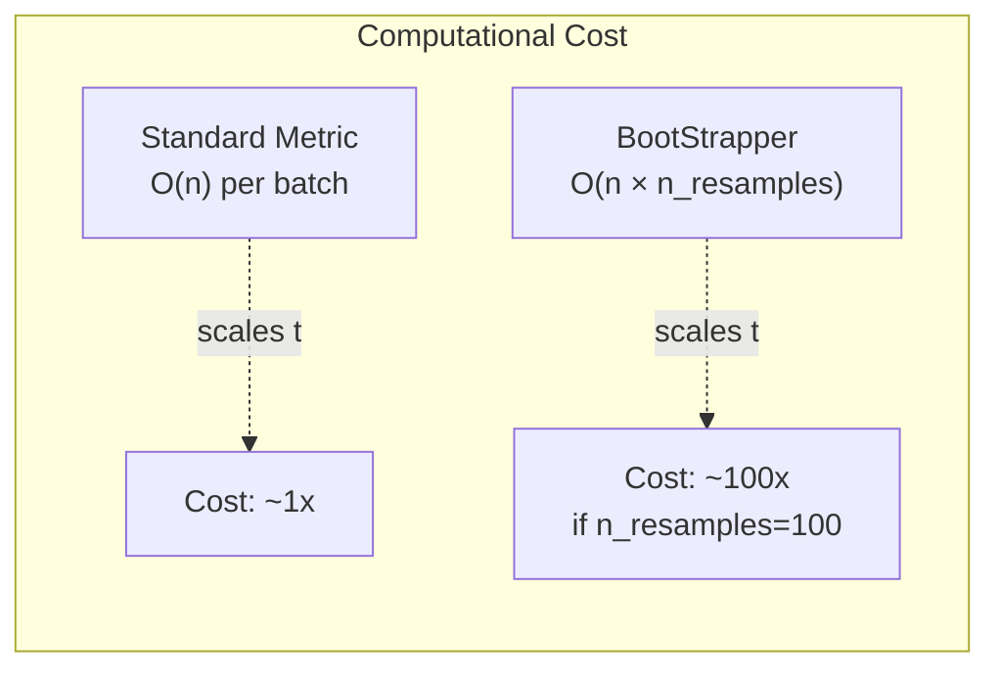
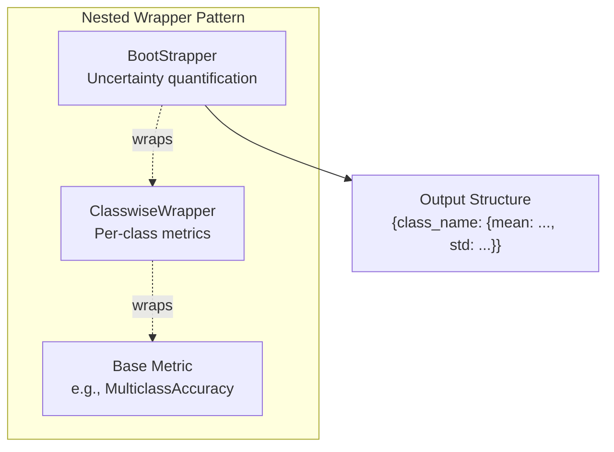

<!-- source: DeepWiki mcp.deepwiki.com · repo Lightning-AI/torchmetrics · page 12.3 BootStrapper and Statistical Analysis · fetched 2026-10-21 -->

# BootStrapper and Statistical Analysis

<details>
<summary>Relevant source files</summary>

The following files were used as context for generating this wiki page:

- [CHANGELOG.md](CHANGELOG.md)
- [LICENSE](LICENSE)
- [README.md](README.md)
- [docs/source/_templates/theme_variables.jinja](docs/source/_templates/theme_variables.jinja)
- [docs/source/all-metrics.rst](docs/source/all-metrics.rst)
- [docs/source/conf.py](docs/source/conf.py)
- [docs/source/index.rst](docs/source/index.rst)
- [docs/source/pages/implement.rst](docs/source/pages/implement.rst)
- [docs/source/pages/lightning.rst](docs/source/pages/lightning.rst)
- [docs/source/pages/overview.rst](docs/source/pages/overview.rst)
- [docs/source/pages/quickstart.rst](docs/source/pages/quickstart.rst)
- [requirements/integrate.txt](requirements/integrate.txt)
- [src/torchmetrics/__about__.py](src/torchmetrics/__about__.py)
- [tests/integrations/lightning/boring_model.py](tests/integrations/lightning/boring_model.py)
- [tests/integrations/test_lightning.py](tests/integrations/test_lightning.py)

</details>


## Purpose and Scope

The `BootStrapper` wrapper extends any TorchMetrics `Metric` to compute confidence intervals and statistical uncertainty estimates through bootstrap resampling. Instead of returning a single point estimate, `BootStrapper` performs multiple metric computations on resampled data to produce mean and standard deviation statistics, enabling rigorous uncertainty quantification for model evaluation.

For general information about metric wrappers, see [12](#12). For other wrapper types like `ClasswiseWrapper` and `MetricTracker`, see [12.1](#12.1) and [12.2](#12.2) respectively.

**Sources:** [docs/source/pages/overview.rst:438-456](), [CHANGELOG.md:367](), [CHANGELOG.md:489]()

## Bootstrap Resampling Fundamentals

Bootstrap resampling is a statistical technique that estimates the sampling distribution of a statistic by repeatedly resampling (with replacement) from the observed data. The `BootStrapper` applies this technique to metric computation:

1. **Data Collection Phase**: Accumulates all predictions and targets across batches
2. **Resampling Phase**: Creates multiple bootstrap samples by randomly sampling with replacement
3. **Computation Phase**: Computes the wrapped metric on each bootstrap sample
4. **Aggregation Phase**: Returns mean and standard deviation of bootstrap estimates



**Diagram: Bootstrap Resampling Process Flow**

The standard deviation provides a measure of uncertainty: larger values indicate more variability in the metric estimate across different potential samples from the underlying distribution.

**Sources:** [docs/source/pages/overview.rst:438-456]()

## Class Architecture

The `BootStrapper` inherits from the base `Metric` class but wraps another metric instance internally. It overrides the standard metric lifecycle to implement bootstrap resampling:



**Diagram: BootStrapper Class Structure and Relationships**

The `BootStrapper` does not maintain separate metric states—it delegates all state management to the wrapped `base_metric`. During the `compute` phase, it accesses the accumulated state, performs resampling, and computes the metric multiple times to derive statistical estimates.

**Sources:** [docs/source/pages/overview.rst:438-456](), [CHANGELOG.md:367]()

## Basic Usage Patterns

### Simple Bootstrapping

The most straightforward usage wraps a single metric:

```python
from torchmetrics.classification import MulticlassAccuracy
from torchmetrics.wrappers import BootStrapper

# Wrap any metric
metric = BootStrapper(MulticlassAccuracy(num_classes=3), n_resamples=100)

# Use like any other metric
preds = torch.tensor([2, 1, 2, 0, 1, 2, 2, 2])
target = torch.tensor([0, 2, 0, 2, 0, 1, 0, 2])

result = metric(preds, target)
# result = {'mean': tensor(0.1333), 'std': tensor(0.1554)}
```

### Constructor Parameters

| Parameter | Type | Description |
|-----------|------|-------------|
| `base_metric` | `Metric` | The metric to wrap for bootstrapping |
| `n_resamples` | `int` | Number of bootstrap samples to draw (default: 100) |
| `quantiles` | `Optional[List[float]]` | If provided, compute these percentiles instead of mean/std |
| `sampling_strategy` | `str` | Either `'poisson'` or `'multinomial'` (default: `'poisson'`) |

**Sources:** [docs/source/pages/overview.rst:438-456]()

### Integration with MetricCollection

`BootStrapper` can wrap a `MetricCollection` to bootstrap multiple metrics simultaneously:

```python
from torchmetrics import MetricCollection
from torchmetrics.classification import MulticlassAccuracy, MulticlassPrecision, MulticlassRecall
from torchmetrics.wrappers import BootStrapper

# Create collection
collection = MetricCollection([
    MulticlassAccuracy(num_classes=5),
    MulticlassPrecision(num_classes=5),
    MulticlassRecall(num_classes=5)
])

# Wrap entire collection
bootstrapped = BootStrapper(collection, n_resamples=200)

# Returns nested dict: {metric_name: {mean: ..., std: ...}, ...}
```

**Sources:** [docs/source/pages/overview.rst:438-456]()

## Output Format and Interpretation

### Standard Output (Mean and Std)

By default, `BootStrapper.compute()` returns a dictionary with two keys:

```python
{
    'mean': tensor(0.8542),  # Mean of bootstrap estimates
    'std': tensor(0.0234)    # Standard deviation of bootstrap estimates
}
```

The `mean` provides a point estimate similar to the unwrapped metric. The `std` quantifies uncertainty:
- **Low std**: Stable metric estimate, high confidence
- **High std**: Volatile metric estimate, lower confidence (may indicate insufficient data or high model variance)

### Quantile-Based Output

When `quantiles` parameter is provided, the output changes to specified percentiles:

```python
bootstrapped = BootStrapper(metric, n_resamples=100, quantiles=[0.025, 0.5, 0.975])
result = bootstrapped.compute()
# result = {
#     'quantile_0.025': tensor(0.81),  # 2.5th percentile (lower confidence bound)
#     'quantile_0.500': tensor(0.85),  # Median
#     'quantile_0.975': tensor(0.89)   # 97.5th percentile (upper confidence bound)
# }
```

This is useful for constructing confidence intervals: `[quantile_0.025, quantile_0.975]` forms a 95% confidence interval.

**Sources:** [docs/source/pages/overview.rst:438-456]()

## Sampling Strategies



**Diagram: Bootstrap Sampling Strategy Comparison**

| Strategy | Sample Size | Distribution | Use Case |
|----------|-------------|--------------|----------|
| `poisson` | Variable (~n) | Each sample drawn ~Poisson(1) times | Default, computationally efficient |
| `multinomial` | Exact n | Exactly n samples with replacement | Classical bootstrap, fixed size |

**Sources:** Based on statistical bootstrap methodology

## Integration with Training Loops

### PyTorch Lightning Integration

In Lightning modules, `BootStrapper` behaves like any wrapper metric but requires careful consideration of when to compute:

```python
class MyModule(LightningModule):
    def __init__(self):
        super().__init__()
        self.val_metric = BootStrapper(
            MulticlassAccuracy(num_classes=10),
            n_resamples=100
        )
    
    def validation_step(self, batch, batch_idx):
        preds, target = self(batch), batch['target']
        # Only update, don't compute yet
        self.val_metric.update(preds, target)
    
    def on_validation_epoch_end(self):
        # Compute once per epoch to get bootstrap statistics
        result = self.val_metric.compute()
        self.log('val_acc_mean', result['mean'])
        self.log('val_acc_std', result['std'])
        self.val_metric.reset()
```

**Important**: Do not call `self.log` with the `BootStrapper` object directly during `validation_step` because the bootstrap computation is expensive and should only happen once per epoch.

**Sources:** [docs/source/pages/lightning.rst:1-307](), [docs/source/pages/overview.rst:438-456]()

## Known Issues and Considerations

### Issue: Very Few Samples

**Problem**: When evaluating on datasets with very few samples, bootstrap resampling can fail or produce unreliable estimates.

**Fix**: [CHANGELOG.md:489]() - The wrapper now handles edge cases with minimal samples more gracefully. Recommended minimum: ~30 samples for meaningful bootstrap statistics.

```python
# Avoid with small batches
if len(preds) < 30:
    # Use standard metric instead
    result = metric(preds, target)
else:
    # Safe to use BootStrapper
    result = bootstrapped_metric(preds, target)
```

### Issue: Reset Behavior

**Problem**: The wrapper's reset logic was not correctly resetting the wrapped metric's state.

**Fix**: [CHANGELOG.md:334]() - `BootStrapper.reset()` now properly delegates to the base metric's reset method, ensuring clean state between epochs.

### Issue: Kwargs Handling

**Problem**: When the wrapped metric required keyword arguments in its `update` method, `BootStrapper` failed to pass them correctly.

**Fix**: [CHANGELOG.md:367]() - The wrapper now correctly forwards keyword arguments to the base metric during bootstrap resampling.

```python
# Now works correctly
bootstrapped = BootStrapper(MetricWithKwargs())
result = bootstrapped(preds, target, sample_weight=weights)
```

**Sources:** [CHANGELOG.md:334](), [CHANGELOG.md:367](), [CHANGELOG.md:489]()

## Computational Considerations

### Performance Characteristics

Bootstrap resampling is computationally expensive:



**Diagram: Computational Cost Comparison**

**Recommendations**:
1. **Use only at validation/test time**: Avoid in training loops where frequent computation is needed
2. **Adjust n_resamples**: Start with 50-100 for validation, increase to 1000+ for final test evaluation
3. **Combine with update-only strategy**: Call `update()` during steps, `compute()` only at epoch end

**Sources:** Based on computational complexity analysis

## Advanced Usage: Nested Wrappers

`BootStrapper` can be combined with other wrappers for sophisticated analysis:



**Diagram: Nested Wrapper Composition**

```python
# Bootstrap per-class accuracy with uncertainty
base = MulticlassAccuracy(num_classes=5, average=None)
classwise = ClasswiseWrapper(base, labels=["cat", "dog", "bird", "fish", "horse"])
bootstrapped = BootStrapper(classwise, n_resamples=100)

result = bootstrapped(preds, target)
# result = {
#     'multiclassaccuracy_cat': {'mean': tensor(0.85), 'std': tensor(0.03)},
#     'multiclassaccuracy_dog': {'mean': tensor(0.78), 'std': tensor(0.05)},
#     ...
# }
```

**Sources:** [docs/source/pages/overview.rst:438-456](), [CHANGELOG.md:492]()

## Statistical Interpretation Guidelines

### Confidence Intervals

Using quantiles to construct 95% confidence intervals:

```python
bootstrapped = BootStrapper(metric, quantiles=[0.025, 0.975])
result = bootstrapped.compute()

lower_bound = result['quantile_0.025']  # 2.5th percentile
upper_bound = result['quantile_0.975']  # 97.5th percentile

print(f"95% CI: [{lower_bound:.3f}, {upper_bound:.3f}]")
```

**Interpretation**: We can be 95% confident that the true metric value lies within this interval.

### Hypothesis Testing

Comparing two models using bootstrap estimates:

```python
model_a_result = bootstrapped_metric_a.compute()
model_b_result = bootstrapped_metric_b.compute()

# Models are significantly different if confidence intervals don't overlap
diff = model_a_result['mean'] - model_b_result['mean']
combined_std = torch.sqrt(
    model_a_result['std']**2 + model_b_result['std']**2
)

# Approximate z-score
z_score = diff / combined_std
# If |z_score| > 1.96, difference is significant at p < 0.05
```

**Sources:** Based on statistical hypothesis testing principles

## Summary

The `BootStrapper` wrapper provides a statistically rigorous approach to metric uncertainty quantification through bootstrap resampling. Key takeaways:

1. **Use for validation/test evaluation**: Not suitable for training loops due to computational cost
2. **Interprets uncertainty**: Standard deviation indicates confidence in metric estimates
3. **Flexible configuration**: Adjustable resampling count and sampling strategy
4. **Composable**: Works with any metric and can be combined with other wrappers
5. **Statistical rigor**: Enables confidence intervals and hypothesis testing

For related wrapper functionality, see `ClasswiseWrapper` [12.1](#12.1) for per-class analysis and `MetricTracker` [12.2](#12.2) for temporal tracking.

**Sources:** [docs/source/pages/overview.rst:438-456](), [CHANGELOG.md:334](), [CHANGELOG.md:367](), [CHANGELOG.md:489]()

---

