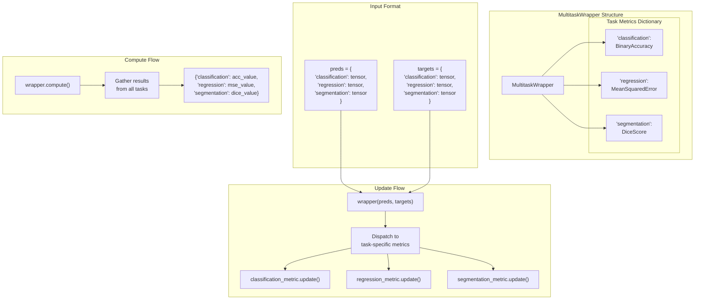
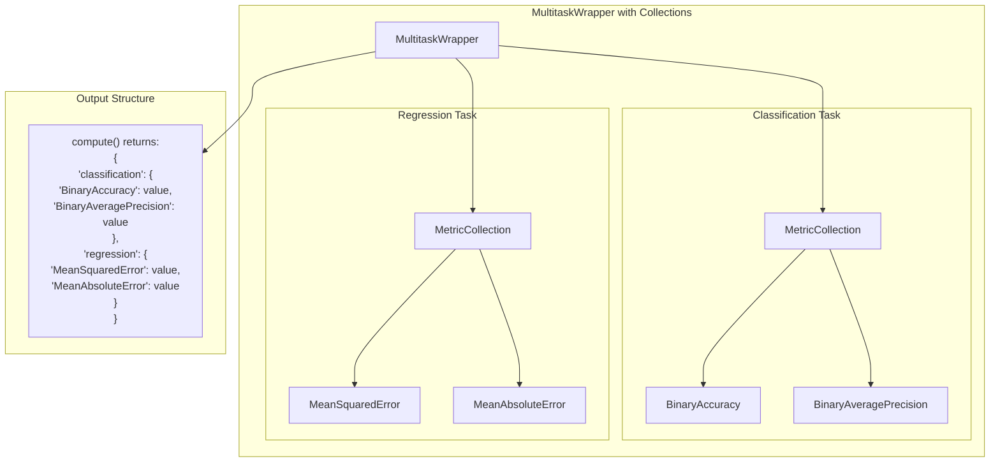
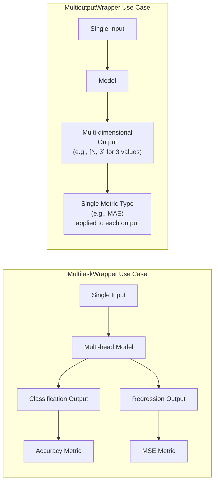
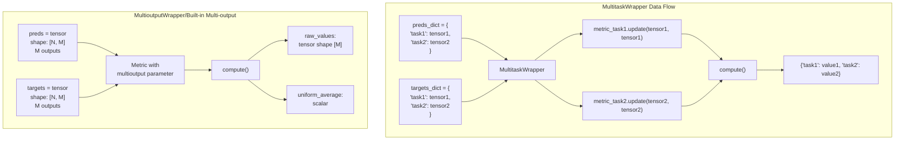
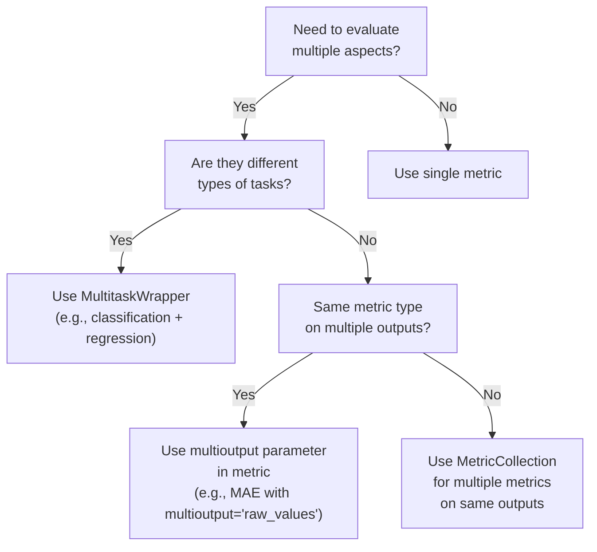

<!-- source: DeepWiki mcp.deepwiki.com · repo Lightning-AI/torchmetrics · page 12.4 Multi-task and Multi-output Wrappers · fetched 2026-10-21 -->

# Multi-task and Multi-output Wrappers

<details>
<summary>Relevant source files</summary>

The following files were used as context for generating this wiki page:

- [CHANGELOG.md](CHANGELOG.md)
- [LICENSE](LICENSE)
- [README.md](README.md)
- [docs/source/_templates/theme_variables.jinja](docs/source/_templates/theme_variables.jinja)
- [docs/source/all-metrics.rst](docs/source/all-metrics.rst)
- [docs/source/conf.py](docs/source/conf.py)
- [docs/source/index.rst](docs/source/index.rst)
- [docs/source/pages/implement.rst](docs/source/pages/implement.rst)
- [docs/source/pages/lightning.rst](docs/source/pages/lightning.rst)
- [docs/source/pages/overview.rst](docs/source/pages/overview.rst)
- [docs/source/pages/quickstart.rst](docs/source/pages/quickstart.rst)
- [requirements/integrate.txt](requirements/integrate.txt)
- [src/torchmetrics/__about__.py](src/torchmetrics/__about__.py)
- [tests/integrations/lightning/boring_model.py](tests/integrations/lightning/boring_model.py)
- [tests/integrations/test_lightning.py](tests/integrations/test_lightning.py)

</details>


This document describes wrapper metrics designed for complex learning scenarios involving multiple tasks or multiple outputs. These wrappers enable efficient metric computation when a single model produces predictions for different tasks (e.g., classification + regression) or when metrics need to handle multi-dimensional outputs.

For other wrapper functionality, see:
- Per-class metric analysis: [ClasswiseWrapper and Output Modification](#12.1)
- Temporal metric tracking: [MetricTracker and Temporal Tracking](#12.2)
- Statistical confidence intervals: [BootStrapper and Statistical Analysis](#12.3)
- Shared feature extractors: [FeatureShare and MetricInputTransformer](#12.6)

---

## Overview

TorchMetrics provides two specialized wrappers for complex model architectures:

| Wrapper | Purpose | Input Format | Use Case |
|---------|---------|--------------|----------|
| `MultitaskWrapper` | Wraps multiple metrics for different tasks | Dictionary of task → predictions/targets | Multi-task learning (e.g., classification + segmentation) |
| `MultioutputWrapper` | Handles metrics with multiple output dimensions | Multi-dimensional tensors | Multi-output regression, multi-label classification |

**Sources:** [CHANGELOG.md:626](), [tests/integrations/test_lightning.py:369-428]()

---

## MultitaskWrapper Architecture

### Purpose and Design

`MultitaskWrapper` manages metrics for multi-task learning scenarios where a single model produces outputs for multiple distinct tasks. Instead of manually managing separate metrics and calling each with task-specific data, this wrapper provides a unified interface.



**Sources:** [tests/integrations/test_lightning.py:372-379](), [CHANGELOG.md:626]()

### Basic Usage Pattern

The `MultitaskWrapper` constructor accepts a dictionary mapping task names (strings) to metric instances:

```python
from torchmetrics.wrappers import MultitaskWrapper
from torchmetrics.classification import BinaryAccuracy
from torchmetrics.regression import MeanSquaredError

wrapper = MultitaskWrapper({
    "classification": BinaryAccuracy(),
    "regression": MeanSquaredError()
})
```

During training, call the wrapper with dictionaries of predictions and targets:

```python
# Model produces outputs for both tasks
preds = {
    "classification": classification_logits,
    "regression": regression_outputs
}
targets = {
    "classification": class_labels,
    "regression": regression_targets
}

# Update all task metrics simultaneously
wrapper(preds, targets)

# Compute returns dict with all task results
results = wrapper.compute()  # {"classification": 0.85, "regression": 0.12}
```

**Sources:** [tests/integrations/test_lightning.py:384-390]()

---

## Integration with MetricCollection

`MultitaskWrapper` supports wrapping `MetricCollection` objects for tasks that require multiple metrics:



Example implementation:

```python
from torchmetrics import MetricCollection
from torchmetrics.wrappers import MultitaskWrapper
from torchmetrics.classification import BinaryAccuracy, BinaryAveragePrecision
from torchmetrics.regression import MeanSquaredError, MeanAbsoluteError

wrapper = MultitaskWrapper({
    "classification": MetricCollection([
        BinaryAccuracy(),
        BinaryAveragePrecision()
    ]),
    "regression": MetricCollection([
        MeanSquaredError(),
        MeanAbsoluteError()
    ])
})

# Usage remains the same
wrapper(preds_dict, targets_dict)
results = wrapper.compute()
# results = {
#     "classification": {"BinaryAccuracy": 0.85, "BinaryAveragePrecision": 0.78},
#     "regression": {"MeanSquaredError": 0.12, "MeanAbsoluteError": 0.08}
# }
```

**Sources:** [tests/integrations/test_lightning.py:376-379](), [CHANGELOG.md:2349]()

---

## PyTorch Lightning Integration

### Direct Logging Support

As of the changes in [CHANGELOG.md:404](), `MultitaskWrapper` can be logged directly with Lightning's `log_dict` method:

```python
from lightning.pytorch import LightningModule
from torchmetrics.wrappers import MultitaskWrapper
from torchmetrics.classification import BinaryAccuracy
from torchmetrics.regression import MeanSquaredError

class MultiTaskModel(LightningModule):
    def __init__(self):
        super().__init__()
        self.metrics = MultitaskWrapper({
            "classification": BinaryAccuracy(),
            "regression": MeanSquaredError()
        })
    
    def training_step(self, batch, batch_idx):
        # Model forward pass produces multiple outputs
        cls_out, reg_out = self.model(batch)
        
        # Update wrapper with task-specific predictions
        self.metrics(
            {"classification": cls_out, "regression": reg_out},
            {"classification": batch["cls_target"], "regression": batch["reg_target"]}
        )
        
        # Log directly - no manual dict construction needed
        self.log_dict(self.metrics.compute())
        
        return loss
```

**Sources:** [tests/integrations/test_lightning.py:369-428](), [CHANGELOG.md:404]()

### Prefix and Postfix Support

The `prefix` and `postfix` arguments work with `MultitaskWrapper` to automatically add prefixes/postfixes to logged metric names:

```python
# Metrics will be logged as "train_classification", "train_regression"
self.train_metrics = MultitaskWrapper({
    "classification": BinaryAccuracy(),
    "regression": MeanSquaredError()
}, prefix="train_")

# Metrics will be logged as "classification_epoch", "regression_epoch"
self.val_metrics = MultitaskWrapper({
    "classification": BinaryAccuracy(),
    "regression": MeanSquaredError()
}, postfix="_epoch")
```

A bug fix in [CHANGELOG.md:314]() corrected how prefix/postfix are applied to ensure consistent naming.

**Sources:** [CHANGELOG.md:314](), [CHANGELOG.md:2722]()

---

## MultioutputWrapper

### Purpose and Distinction

While `MultitaskWrapper` handles separate tasks with independent metrics, `MultioutputWrapper` handles scenarios where a single task produces multiple outputs that should be evaluated together or separately. This is common in:

- **Multi-output regression**: Predicting multiple continuous values (e.g., x, y, z coordinates)
- **Multi-label classification**: Multiple binary classifications per sample
- **Time series forecasting**: Predicting multiple future timesteps



**Sources:** [CHANGELOG.md:274](), [CHANGELOG.md:520]()

### Multi-output Support in Core Metrics

Several core metrics have built-in multi-output support without requiring a wrapper:

| Metric | Multi-output Support | Configuration |
|--------|---------------------|---------------|
| `MeanSquaredError` | Yes | `multioutput` parameter controls reduction |
| `MeanAbsoluteError` | Yes | `multioutput` parameter controls reduction |
| `R2Score` | Yes (deprecated `num_outputs`) | Use `multioutput` parameter |

Example usage with built-in multi-output support:

```python
from torchmetrics.regression import MeanAbsoluteError

# For multi-output regression with 3 targets
mae = MeanAbsoluteError(multioutput='uniform_average')  # Average across outputs
# or
mae = MeanAbsoluteError(multioutput='raw_values')  # Return separate MAE per output

preds = torch.randn(100, 3)   # 100 samples, 3 outputs
target = torch.randn(100, 3)

result = mae(preds, target)
# uniform_average: scalar tensor
# raw_values: tensor of shape (3,) with MAE for each output
```

**Sources:** [CHANGELOG.md:274](), [CHANGELOG.md:520](), [CHANGELOG.md:235]()

---

## Data Flow Comparison

The following diagram illustrates how data flows through each wrapper type:



**Sources:** [tests/integrations/test_lightning.py:384-395]()

---

## Key Differences Summary

| Aspect | MultitaskWrapper | Multi-output Metrics |
|--------|------------------|---------------------|
| **Input Format** | Dictionary of task names → tensors | Single multi-dimensional tensor |
| **Metric Types** | Different metric types per task | Same metric type across outputs |
| **Use Case** | Heterogeneous tasks (classification + regression) | Homogeneous multi-dimensional predictions |
| **Output Format** | Dictionary with task names as keys | Tensor (per-output) or scalar (averaged) |
| **Wrapper Required** | Yes - `MultitaskWrapper` | No - built into metrics like MAE, MSE |
| **Lightning Logging** | Supported via `log_dict` | Standard logging with `log` |

**Sources:** [tests/integrations/test_lightning.py:369-428](), [CHANGELOG.md:274]()

---

## Reset and State Management

Both wrapper types properly handle metric state reset:

- **MultitaskWrapper**: Calling `reset()` resets all wrapped task metrics
- **Multi-output metrics**: Standard `reset()` behavior applies

```python
# MultitaskWrapper reset
wrapper = MultitaskWrapper({"task1": metric1, "task2": metric2})
wrapper.reset()  # Resets both metric1 and metric2

# After training epoch in Lightning
def on_train_epoch_end(self):
    self.multitask_metrics.reset()  # Automatic in Lightning, but can be manual
```

Lightning automatically resets metrics at the end of training/validation/test epochs when metrics are logged via `self.log` or `self.log_dict`.

**Sources:** [docs/source/pages/lightning.rst:28](), [CHANGELOG.md:105]()

---

## Common Pitfalls and Best Practices

### Pitfall 1: Mismatched Dictionary Keys

When using `MultitaskWrapper`, ensure prediction and target dictionaries have matching keys:

```python
# ❌ BAD - mismatched keys will cause errors
wrapper(
    {"classification": cls_pred, "regression": reg_pred},
    {"clf": cls_target, "reg": reg_target}  # Different keys!
)

# ✅ GOOD - matching keys
wrapper(
    {"classification": cls_pred, "regression": reg_pred},
    {"classification": cls_target, "regression": reg_target}
)
```

### Pitfall 2: Choosing Wrong Wrapper Type

Use the decision tree:



### Pitfall 3: Lightning Logging with Nested Collections

When using `MultitaskWrapper` with `MetricCollection` that contains wrapper metrics (e.g., `ClasswiseWrapper`, `MinMaxMetric`), direct logging may fail because nested structures return non-scalar tensors. Compute manually and flatten:

```python
def training_step(self, batch, batch_idx):
    # This may fail if collections contain wrappers returning dicts
    # self.log_dict(self.multitask_metrics(preds, targets))
    
    # Better: compute and manually flatten if needed
    results = self.multitask_metrics(preds, targets)
    flat_results = self._flatten_nested_dict(results)
    self.log_dict(flat_results)
```

**Sources:** [docs/source/pages/lightning.rst:200-234](), [CHANGELOG.md:2349]()

---

## Performance Considerations

- **MultitaskWrapper** adds minimal overhead - it simply dispatches to individual metrics
- **Multi-output metrics** are more efficient than wrapping multiple single-output metrics separately
- When using `MetricCollection` inside `MultitaskWrapper`, compute groups optimization still applies per task

**Sources:** [docs/source/pages/overview.rst:390-401]()

---

