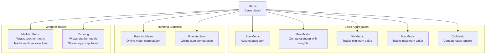
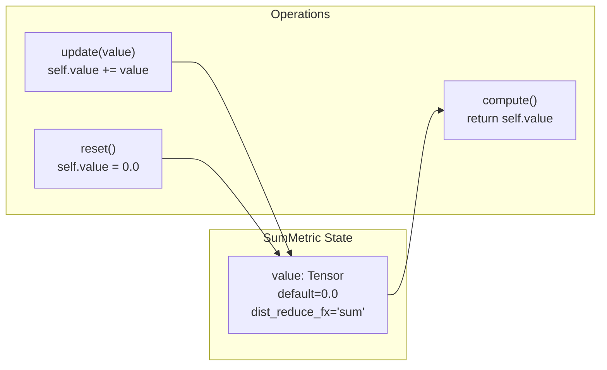
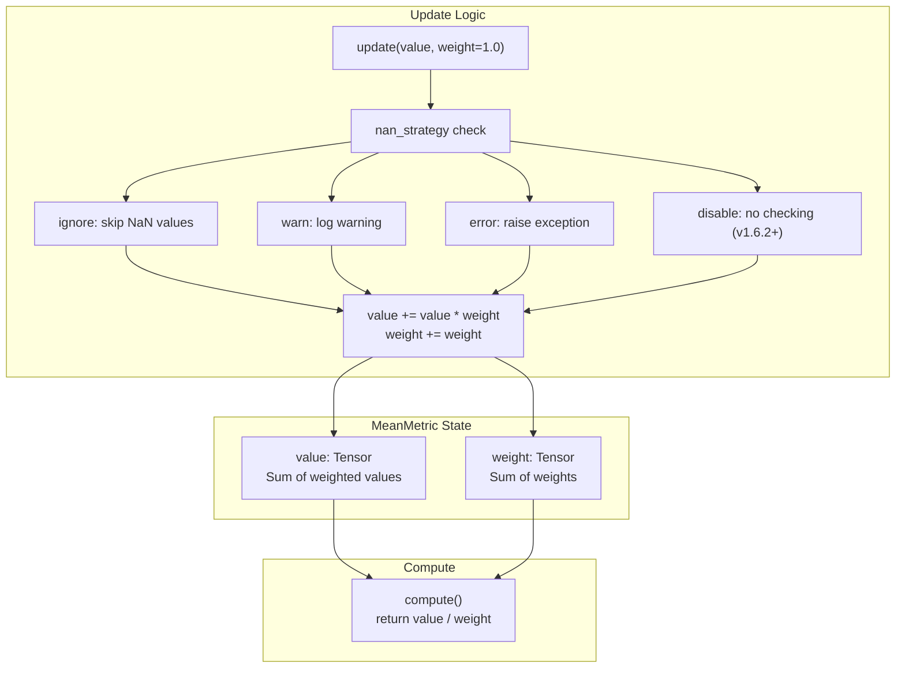
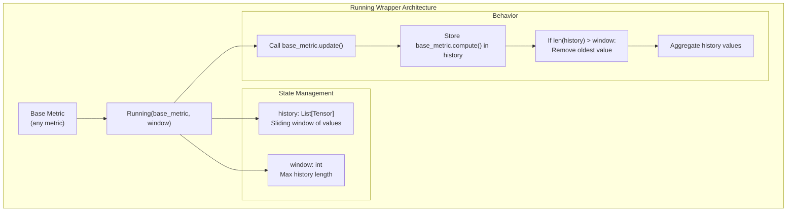
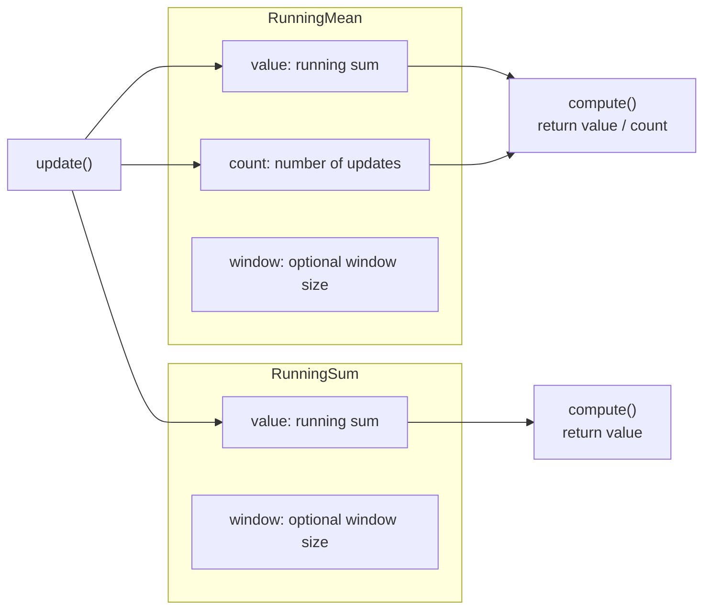
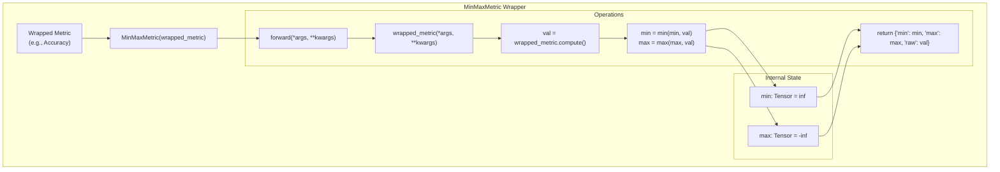
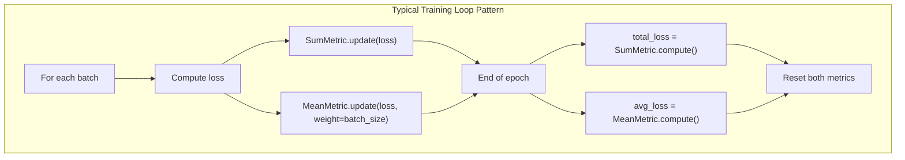
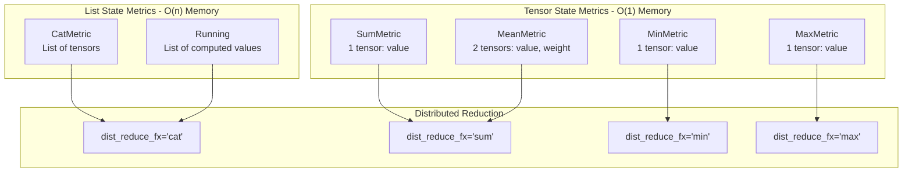

<!-- source: DeepWiki mcp.deepwiki.com · repo Lightning-AI/torchmetrics · page 12.5 Running Statistics and Aggregation Metrics · fetched 2026-10-21 -->

# Running Statistics and Aggregation Metrics

<details>
<summary>Relevant source files</summary>

The following files were used as context for generating this wiki page:

- [CHANGELOG.md](CHANGELOG.md)
- [LICENSE](LICENSE)
- [README.md](README.md)
- [docs/source/_templates/theme_variables.jinja](docs/source/_templates/theme_variables.jinja)
- [docs/source/all-metrics.rst](docs/source/all-metrics.rst)
- [docs/source/conf.py](docs/source/conf.py)
- [docs/source/index.rst](docs/source/index.rst)
- [docs/source/links.rst](docs/source/links.rst)
- [docs/source/pages/implement.rst](docs/source/pages/implement.rst)
- [docs/source/pages/lightning.rst](docs/source/pages/lightning.rst)
- [docs/source/pages/overview.rst](docs/source/pages/overview.rst)
- [docs/source/pages/quickstart.rst](docs/source/pages/quickstart.rst)
- [requirements/integrate.txt](requirements/integrate.txt)
- [src/torchmetrics/__about__.py](src/torchmetrics/__about__.py)
- [src/torchmetrics/__init__.py](src/torchmetrics/__init__.py)
- [src/torchmetrics/classification/__init__.py](src/torchmetrics/classification/__init__.py)
- [src/torchmetrics/functional/__init__.py](src/torchmetrics/functional/__init__.py)
- [src/torchmetrics/functional/classification/__init__.py](src/torchmetrics/functional/classification/__init__.py)
- [src/torchmetrics/functional/pairwise/__init__.py](src/torchmetrics/functional/pairwise/__init__.py)
- [src/torchmetrics/functional/regression/__init__.py](src/torchmetrics/functional/regression/__init__.py)
- [src/torchmetrics/regression/__init__.py](src/torchmetrics/regression/__init__.py)
- [tests/integrations/lightning/boring_model.py](tests/integrations/lightning/boring_model.py)
- [tests/integrations/test_lightning.py](tests/integrations/test_lightning.py)

</details>


## Purpose and Scope

This page documents TorchMetrics' **aggregation utilities** and the **Running wrapper** for computing running statistics. These are specialized metrics designed for accumulating and aggregating values across batches without requiring complex domain-specific logic. Unlike domain-specific metrics (e.g., classification, regression), aggregation metrics provide basic statistical operations like summing, averaging, and tracking min/max values.

For information about other metric wrappers (ClasswiseWrapper, MetricTracker, BootStrapper, etc.), see [Metric Wrappers](#12). For multi-task and multi-output wrappers, see [Multi-task and Multi-output Wrappers](#12.4).

---

## System Architecture

### Aggregation Metrics Class Hierarchy



**Sources:** [src/torchmetrics/__init__.py:38-46](), [CHANGELOG.md:576]()

---

## Basic Aggregation Metrics

### Overview Table

| Metric | Purpose | State Type | Common Use Cases |
|--------|---------|------------|------------------|
| `SumMetric` | Accumulates sum of values | Tensor (O(1)) | Total loss, total count |
| `MeanMetric` | Computes weighted mean | Tensor (O(1)) | Average loss, average accuracy |
| `MinMetric` | Tracks minimum value | Tensor (O(1)) | Best loss value |
| `MaxMetric` | Tracks maximum value | Tensor (O(1)) | Worst loss value |
| `CatMetric` | Concatenates values | List (O(n)) | Collecting embeddings |
| `RunningMean` | Online mean computation | Tensor (O(1)) | Streaming mean |
| `RunningSum` | Online sum computation | Tensor (O(1)) | Streaming sum |

### SumMetric

Simplest aggregation metric that accumulates the sum of all values passed to it.



**Key Characteristics:**
- Single tensor state: `value`
- In-place accumulation via `+=`
- Constant memory footprint O(1)
- Distributed reduction: sum across processes

**Example Usage:**
```python
# Tracking total loss across batches
from torchmetrics import SumMetric

total_loss = SumMetric()
for batch in dataloader:
    loss = compute_loss(batch)
    total_loss.update(loss)

print(total_loss.compute())  # Total accumulated loss
```

**Sources:** [src/torchmetrics/__init__.py:45](), [src/torchmetrics/aggregation/__init__.py]()

---

### MeanMetric

Computes weighted mean with support for NaN handling strategies.



**Key Features:**
- Supports weighted averaging
- NaN handling strategies: `"ignore"`, `"warn"`, `"error"`, `"disable"` (added v1.6.2)
- Two tensor states: `value` and `weight`
- Useful for batch-size weighted averaging

**Example Usage:**
```python
from torchmetrics import MeanMetric

avg_loss = MeanMetric(nan_strategy='warn')

# Update with different batch sizes
avg_loss.update(loss1, weight=32)  # batch_size=32
avg_loss.update(loss2, weight=16)  # batch_size=16

print(avg_loss.compute())  # Weighted mean
```

**Sources:** [CHANGELOG.md:178](), [src/torchmetrics/aggregation/__init__.py]()

---

### MinMetric and MaxMetric

Track minimum and maximum values seen across updates.

**State Management:**
- `MinMetric`: Uses `value` initialized to `float('inf')`
- `MaxMetric`: Uses `value` initialized to `float('-inf')`
- Update: `self.value = min/max(self.value, input)`

**Common Use Case - Tracking Best Metrics:**
```python
from torchmetrics import MinMetric

best_val_loss = MinMetric()

for epoch in range(num_epochs):
    val_loss = validate()
    best_val_loss.update(val_loss)
    
print(f"Best validation loss: {best_val_loss.compute()}")
```

**Sources:** [src/torchmetrics/__init__.py:42-44](), [src/torchmetrics/aggregation/__init__.py]()

---

### CatMetric

Concatenates tensors along dimension 0, useful for collecting embeddings or predictions.

**Key Difference from Other Aggregation Metrics:**
- Uses **list state** (O(n) memory) instead of tensor state
- State grows with each batch
- `dist_reduce_fx="cat"` for distributed concatenation

**Example Usage:**
```python
from torchmetrics import CatMetric

embeddings = CatMetric()

for batch in dataloader:
    emb = model.get_embeddings(batch)
    embeddings.update(emb)

all_embeddings = embeddings.compute()  # Shape: [total_samples, embedding_dim]
```

**Sources:** [src/torchmetrics/__init__.py:39](), [src/torchmetrics/aggregation/__init__.py]()

---

## Running Wrapper and Running Statistics

The `Running` wrapper and `RunningMean`/`RunningSum` metrics enable **online/streaming statistics** computation where the metric is continuously updated without needing to store all historical values.

### Running Wrapper



**Key Features:**
- Wraps any existing metric
- Maintains sliding window of computed values
- Configurable window size (default: unlimited)
- Enables streaming/online computation

**Example Usage:**
```python
from torchmetrics.wrappers import Running
from torchmetrics.regression import MeanAbsoluteError

# Create running MAE over last 100 batches
running_mae = Running(MeanAbsoluteError(), window=100)

for batch in dataloader:
    preds, target = batch
    running_mae.update(preds, target)
    
    # Get MAE over last 100 batches
    current_mae = running_mae.compute()
```

**Sources:** [CHANGELOG.md:576](), [CHANGELOG.md:2256]()

---

### RunningMean and RunningSum

Specialized implementations of running statistics without wrapping.



**RunningMean vs MeanMetric:**
- `MeanMetric`: Accumulates across entire epoch/session
- `RunningMean`: Maintains sliding window, can have infinite history

**Sources:** [src/torchmetrics/__init__.py:43-44]()

---

## MinMaxMetric Wrapper

The `MinMaxMetric` wrapper tracks both the minimum and maximum values of another metric over time. Unlike `MinMetric` or `MaxMetric` which track raw values, `MinMaxMetric` tracks the computed results of a wrapped metric.



**Return Format:**
The `compute()` method returns a dictionary with three keys:
- `"min"`: Minimum value seen
- `"max"`: Maximum value seen  
- `"raw"`: Current/latest metric value

**Example Usage:**
```python
from torchmetrics.wrappers import MinMaxMetric
from torchmetrics.classification import MulticlassAccuracy

# Track min/max accuracy over training
minmax_acc = MinMaxMetric(MulticlassAccuracy(num_classes=10))

for epoch in range(num_epochs):
    for batch in train_loader:
        preds, target = batch
        minmax_acc.update(preds, target)
    
    result = minmax_acc.compute()
    print(f"Epoch {epoch}: "
          f"current={result['raw']:.3f}, "
          f"min={result['min']:.3f}, "
          f"max={result['max']:.3f}")
    
    minmax_acc.reset()  # Reset for next epoch
```

**Integration with Lightning:**
```python
from lightning.pytorch import LightningModule
from torchmetrics.wrappers import MinMaxMetric, MetricCollection
from torchmetrics.classification import MulticlassAccuracy

class MyModel(LightningModule):
    def __init__(self):
        super().__init__()
        self.train_metrics = MetricCollection({
            'accuracy': MinMaxMetric(MulticlassAccuracy(num_classes=10))
        })
    
    def training_step(self, batch, batch_idx):
        # MinMaxMetric returns dict, manually log each value
        result = self.train_metrics(preds, target)
        for name, value_dict in result.items():
            for key, value in value_dict.items():
                self.log(f'train_{name}_{key}', value)
```

**Important Notes:**
1. **Logging with Lightning:** `MinMaxMetric` returns a dictionary, which cannot be logged directly with `self.log()`. You must manually log each component as shown above.
2. **Nested in MetricCollection:** When used inside `MetricCollection`, the collection will flatten the nested dictionaries for easier access.
3. **Reset Behavior:** `reset()` clears the min/max history and the wrapped metric's state.

**Sources:** [src/torchmetrics/__init__.py:164](), [src/torchmetrics/wrappers/__init__.py](), [docs/source/pages/overview.rst:204-206]()

---

## Use Cases and Patterns

### Pattern 1: Training Loss Tracking



**Example Implementation:**
```python
from torchmetrics import SumMetric, MeanMetric

total_loss = SumMetric()
avg_loss = MeanMetric()

for batch in train_loader:
    loss = model.training_step(batch)
    batch_size = len(batch)
    
    total_loss.update(loss)
    avg_loss.update(loss, weight=batch_size)

print(f"Total loss: {total_loss.compute()}")
print(f"Average loss: {avg_loss.compute()}")

total_loss.reset()
avg_loss.reset()
```

**Sources:** [tests/integrations/test_lightning.py:47-80]()

---

### Pattern 2: Best Model Checkpointing

Track the best validation metric using `MinMetric`:

```python
from torchmetrics import MinMetric

best_val_loss = MinMetric()

for epoch in range(num_epochs):
    val_loss = validate_epoch()
    best_val_loss.update(val_loss)
    
    if val_loss == best_val_loss.compute():
        save_checkpoint(model, f"best_model_epoch_{epoch}.pt")
```

**Sources:** [src/torchmetrics/__init__.py:42]()

---

### Pattern 3: Streaming Statistics with Window

Use `Running` wrapper for metrics over a sliding window:

```python
from torchmetrics.wrappers import Running
from torchmetrics.regression import PearsonCorrCoef

# Track correlation over last 1000 samples
running_corr = Running(PearsonCorrCoef(), window=1000)

for batch in data_stream:
    running_corr.update(predictions, targets)
    
    # Always get correlation over last 1000 samples
    current_corr = running_corr.compute()
    print(f"Rolling correlation: {current_corr:.3f}")
```

**Sources:** [CHANGELOG.md:576]()

---

## Implementation Details

### State Types and Memory Characteristics



**Key Differences:**

1. **Tensor State (Constant Memory):**
   - Fixed memory footprint regardless of batch count
   - Efficient in-place updates
   - Preferred for most use cases

2. **List State (Growing Memory):**
   - Memory grows with number of batches/updates
   - Required when all individual values needed
   - Use cautiously in long-running loops

**Sources:** [docs/source/pages/overview.rst:137-168]()

---

### NaN Handling Strategies

`MeanMetric` supports multiple strategies for handling NaN values (added in v1.6.2):

| Strategy | Behavior |
|----------|----------|
| `"ignore"` | Skip NaN values, don't update metric state |
| `"warn"` | Log warning but continue computation |
| `"error"` | Raise exception when NaN encountered |
| `"disable"` | No NaN checking (fastest, added v1.6.2) |

**Example:**
```python
from torchmetrics import MeanMetric

# Different strategies
strict_mean = MeanMetric(nan_strategy='error')    # Fail fast
lenient_mean = MeanMetric(nan_strategy='ignore')  # Skip NaNs
fast_mean = MeanMetric(nan_strategy='disable')    # No checking
```

**Sources:** [CHANGELOG.md:178]()

---

### Distributed Training Considerations

All aggregation metrics support distributed training through the `dist_reduce_fx` parameter:

```python
# Automatic synchronization in DDP
metric = MeanMetric()  # Uses dist_reduce_fx='sum' internally

# In multi-GPU training
for batch in train_loader:
    loss = model.training_step(batch)
    metric.update(loss)  # Updates local state

# At epoch end
final_metric = metric.compute()  # Automatically syncs across GPUs
```

**Synchronization Behavior:**
1. Each process maintains local state
2. `compute()` triggers synchronization
3. States are gathered and reduced according to `dist_reduce_fx`
4. Same final value on all processes

**Sources:** [docs/source/pages/overview.rst:19-22]()

---

## Comparison Summary

| Feature | SumMetric | MeanMetric | MinMetric/MaxMetric | CatMetric | Running |
|---------|-----------|------------|---------------------|-----------|---------|
| Memory | O(1) | O(1) | O(1) | O(n) | O(window) |
| Use Case | Total sum | Weighted avg | Best/worst | Collect all | Streaming |
| NaN Handling | No | Yes | No | No | Depends on wrapped |
| Weights | No | Yes | No | No | Depends on wrapped |
| Window | No | No | No | No | Yes |
| Wrapper | No | No | No | No | Yes |

**Sources:** [src/torchmetrics/aggregation/__init__.py](), [CHANGELOG.md:576]()

---

