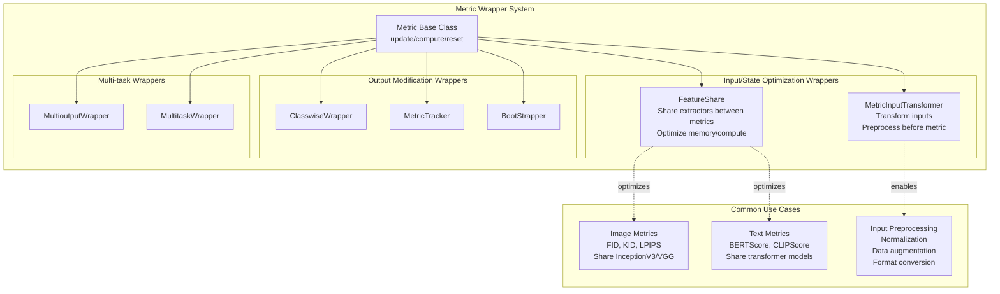
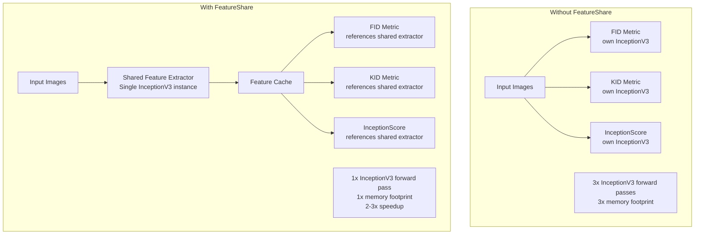
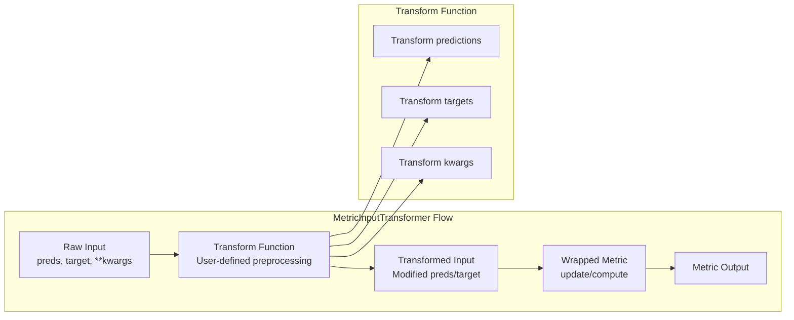
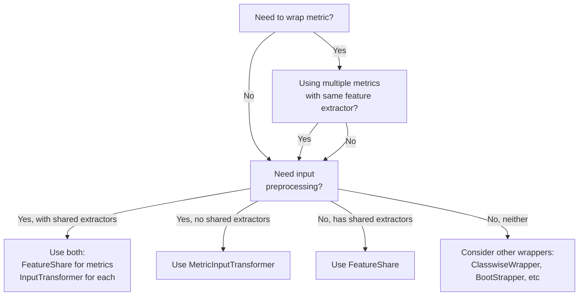

<!-- source: DeepWiki mcp.deepwiki.com · repo Lightning-AI/torchmetrics · page 12.6 FeatureShare and MetricInputTransformer · fetched 2026-10-21 -->

# FeatureShare and MetricInputTransformer

<details>
<summary>Relevant source files</summary>

The following files were used as context for generating this wiki page:

- [CHANGELOG.md](CHANGELOG.md)
- [LICENSE](LICENSE)
- [README.md](README.md)
- [docs/source/_templates/theme_variables.jinja](docs/source/_templates/theme_variables.jinja)
- [docs/source/all-metrics.rst](docs/source/all-metrics.rst)
- [docs/source/conf.py](docs/source/conf.py)
- [docs/source/index.rst](docs/source/index.rst)
- [docs/source/pages/implement.rst](docs/source/pages/implement.rst)
- [docs/source/pages/lightning.rst](docs/source/pages/lightning.rst)
- [docs/source/pages/overview.rst](docs/source/pages/overview.rst)
- [docs/source/pages/quickstart.rst](docs/source/pages/quickstart.rst)
- [requirements/integrate.txt](requirements/integrate.txt)
- [src/torchmetrics/__about__.py](src/torchmetrics/__about__.py)
- [tests/integrations/lightning/boring_model.py](tests/integrations/lightning/boring_model.py)
- [tests/integrations/test_lightning.py](tests/integrations/test_lightning.py)

</details>


## Purpose and Scope

This page documents two specialized wrapper classes designed to optimize metric computation: `FeatureShare` and `MetricInputTransformer`. These wrappers serve distinct purposes:

- **FeatureShare**: Optimizes memory and computation by sharing expensive feature extractors (e.g., neural networks) across multiple metrics
- **MetricInputTransformer**: Enables preprocessing and transformation of inputs before they reach the wrapped metric

For general information about the wrapper system, see [Metric Wrappers](#12). For other wrapper types like `ClasswiseWrapper` and `BootStrapper`, see [ClasswiseWrapper and Output Modification](#12.1) and [BootStrapper and Statistical Analysis](#12.3).

**Sources**: [CHANGELOG.md:405](), [CHANGELOG.md:272]()

---

## System Architecture

The following diagram shows how these wrappers fit into the broader metric wrapper ecosystem and their relationships to the core metric system:



**Sources**: [CHANGELOG.md:405](), [CHANGELOG.md:272](), [docs/source/pages/overview.rst:407-458]()

---

## FeatureShare Wrapper

### Purpose and Motivation

The `FeatureShare` wrapper addresses a critical performance issue when using multiple metrics that rely on the same expensive feature extractor. Many image and multimodal metrics require extracting features from neural networks (e.g., InceptionV3 for FID/KID, VGG for LPIPS, BERT/CLIP for text/multimodal metrics). Without sharing, each metric independently runs the feature extractor, leading to:

- **Redundant computation**: The same network processes the same input multiple times
- **Memory overhead**: Multiple copies of the same large network are loaded
- **Slower evaluation**: Linear scaling with number of metrics instead of constant time

`FeatureShare` solves this by maintaining a single shared feature extractor instance that multiple metrics can reference, computing features only once per input batch.

**Sources**: [CHANGELOG.md:405](), [docs/source/pages/overview.rst:407-458]()

### Architecture and Implementation



The wrapper works by:

1. **Extractor Registration**: Metrics register their feature extractor submodules with `FeatureShare`
2. **Deduplication**: `FeatureShare` identifies identical extractors and consolidates them
3. **Shared Forward Pass**: On `update()`, the shared extractor runs once and caches results
4. **Distribution**: Cached features are distributed to all metrics that need them
5. **State Management**: The shared extractor is properly moved to device and included in state_dict

**Sources**: [CHANGELOG.md:405](), [CHANGELOG.md:392]()

### Key Components

The `FeatureShare` wrapper is located in the wrappers package and consists of:

| Component | Purpose | Location |
|-----------|---------|----------|
| `FeatureShare` class | Main wrapper implementation | `src/torchmetrics/wrappers/` |
| Extractor registration | Identifies and deduplicates feature extractors | Internal method |
| Cache mechanism | Stores computed features per batch | Internal state |
| Device handling | Ensures shared networks move correctly | Fixed in v1.3.1 |

**Sources**: [CHANGELOG.md:405](), [CHANGELOG.md:392]()

### Common Use Cases

#### Image Quality Metrics with InceptionV3

The most common use case is sharing InceptionV3 between `FID`, `KID`, and `InceptionScore`:

```python
# Metrics that share InceptionV3 feature extractor
from torchmetrics.wrappers import FeatureShare
from torchmetrics.image import FrechetInceptionDistance, KernelInceptionDistance, InceptionScore

# Without FeatureShare: 3 separate InceptionV3 instances
fid = FrechetInceptionDistance()
kid = KernelInceptionDistance()
inception = InceptionScore()

# With FeatureShare: 1 shared InceptionV3 instance
shared_metrics = FeatureShare([
    FrechetInceptionDistance(),
    KernelInceptionDistance(), 
    InceptionScore()
])
```

Based on the CHANGELOG, this provides a **2-3x speedup** for compute group optimization scenarios.

**Sources**: [CHANGELOG.md:405](), [docs/source/pages/overview.rst:390-401]()

#### Perceptual Metrics with VGG

LPIPS (Learned Perceptual Image Patch Similarity) uses VGG networks for feature extraction:

```python
from torchmetrics.wrappers import FeatureShare
from torchmetrics.image import LearnedPerceptualImagePatchSimilarity

# Share VGG backbone across multiple LPIPS instances with different settings
shared_lpips = FeatureShare([
    LearnedPerceptualImagePatchSimilarity(net_type='vgg'),
    # Other metrics using same VGG network
])
```

**Sources**: [CHANGELOG.md:405]()

#### Multimodal Metrics with Transformers

Text and multimodal metrics that use BERT, CLIP, or other transformer models:

```python
from torchmetrics.wrappers import FeatureShare
from torchmetrics.text import BERTScore
from torchmetrics.multimodal import CLIPScore

# Share BERT/CLIP encoders across multiple metric instances
shared_multimodal = FeatureShare([
    BERTScore(model_name_or_path='bert-base-uncased'),
    CLIPScore(model_name_or_path='openai/clip-vit-base-patch32'),
])
```

**Sources**: [CHANGELOG.md:405]()

### Device Handling

A critical bug fix in v1.3.1 addressed device placement issues:

**Issue**: The cached network in `FeatureShare` was not being moved to the correct device, causing device mismatch errors in multi-GPU or CPU/GPU mixed scenarios.

**Fix**: Proper device management ensures that when metrics are moved via `.to(device)`, the shared feature extractor is also moved and maintains consistency.

**Sources**: [CHANGELOG.md:392]()

### Integration with MetricCollection

`FeatureShare` works seamlessly with `MetricCollection` for comprehensive metric suites:

```python
from torchmetrics import MetricCollection
from torchmetrics.wrappers import FeatureShare

# Combine with MetricCollection for organized metric groups
metrics = MetricCollection({
    'image_quality': FeatureShare([
        FrechetInceptionDistance(),
        KernelInceptionDistance(),
    ]),
    'other_metrics': SomeOtherMetric(),
})
```

This pattern appears in the integration tests and documentation examples.

**Sources**: [docs/source/pages/overview.rst:317-405]()

### Performance Characteristics

The performance benefits of `FeatureShare` depend on:

| Factor | Impact |
|--------|--------|
| **Number of metrics** | Linear savings: N metrics → N-1 fewer forward passes |
| **Feature extractor cost** | Higher network cost → higher absolute savings |
| **Batch size** | No impact (features cached per batch) |
| **Feature extractor complexity** | InceptionV3/VGG/BERT → significant savings |

**Expected speedup**: 2-3x when using 3+ metrics with shared extractors

**Sources**: [CHANGELOG.md:405](), [docs/source/pages/overview.rst:390-401]()

---

## MetricInputTransformer Wrapper

### Purpose and Motivation

The `MetricInputTransformer` wrapper enables preprocessing and transformation of metric inputs without modifying the underlying metric implementation. This addresses several use cases:

- **Data normalization**: Apply standardization or normalization before metric computation
- **Format conversion**: Convert between data formats (e.g., probabilities to logits)
- **Data augmentation**: Apply transformations for robustness testing
- **Input adaptation**: Adapt data to match metric requirements

By separating preprocessing logic from metric logic, `MetricInputTransformer` promotes code reuse and composability.

**Sources**: [CHANGELOG.md:272]()

### Architecture and Implementation



The wrapper mechanism:

1. **Initialization**: User provides a metric and a transformation function
2. **Interception**: `MetricInputTransformer` intercepts `update()` calls
3. **Transformation**: User-defined function transforms inputs
4. **Delegation**: Transformed inputs are passed to the wrapped metric
5. **Pass-through**: `compute()`, `reset()`, and other methods delegate directly

**Sources**: [CHANGELOG.md:272]()

### Key Components

The `MetricInputTransformer` wrapper structure:

| Component | Purpose |
|-----------|---------|
| `MetricInputTransformer` class | Main wrapper implementation |
| Transform function | User-provided callable for input preprocessing |
| Input forwarding | Passes transformed inputs to wrapped metric |
| Method delegation | Delegates compute/reset/plot to wrapped metric |

**Sources**: [CHANGELOG.md:272]()

### Common Use Cases

#### Input Normalization

Normalize inputs to a specific range or distribution:

```python
from torchmetrics.wrappers import MetricInputTransformer
from torchmetrics.image import PeakSignalNoiseRatio

def normalize_transform(preds, target):
    """Normalize to [0, 1] range."""
    preds = (preds - preds.min()) / (preds.max() - preds.min())
    target = (target - target.min()) / (target.max() - target.min())
    return preds, target

# Wrap PSNR with normalization
normalized_psnr = MetricInputTransformer(
    PeakSignalNoiseRatio(),
    transform=normalize_transform
)
```

**Sources**: [CHANGELOG.md:272]()

#### Format Conversion

Convert between probability and logit representations:

```python
from torchmetrics.wrappers import MetricInputTransformer
from torchmetrics.classification import MulticlassAccuracy
import torch.nn.functional as F

def logits_to_probs(preds, target):
    """Convert logits to probabilities."""
    preds = F.softmax(preds, dim=-1)
    return preds, target

# Metric expects probabilities but receives logits
accuracy = MetricInputTransformer(
    MulticlassAccuracy(num_classes=10),
    transform=logits_to_probs
)
```

**Sources**: [CHANGELOG.md:272]()

#### Input Adaptation

Adapt inputs to match specific metric requirements:

```python
from torchmetrics.wrappers import MetricInputTransformer

def adapt_segmentation_format(preds, target):
    """Convert from 'mixed' to 'one-hot' format."""
    # Segmentation metrics support multiple input formats
    # Transform can standardize to preferred format
    if preds.dim() == 3:  # [B, H, W] -> [B, C, H, W]
        preds = F.one_hot(preds, num_classes=num_classes).permute(0, 3, 1, 2)
    return preds, target

# Wrap segmentation metric with format adapter
adapted_metric = MetricInputTransformer(
    DiceScore(num_classes=num_classes),
    transform=adapt_segmentation_format
)
```

This relates to the `input_format` argument added to segmentation metrics in v1.5.0.

**Sources**: [CHANGELOG.md:272](), [CHANGELOG.md:273]()

#### Keyword Argument Transformation

The transform function can also modify keyword arguments:

```python
def transform_with_kwargs(preds, target, **kwargs):
    """Transform inputs and modify kwargs."""
    # Modify predictions and targets
    preds = some_transform(preds)
    target = some_transform(target)
    
    # Modify or add keyword arguments
    kwargs['sample_weight'] = compute_weights(target)
    
    return preds, target, kwargs
```

**Sources**: [CHANGELOG.md:272]()

### Integration Patterns

#### Combining with Other Wrappers

`MetricInputTransformer` composes well with other wrappers:

```python
from torchmetrics.wrappers import MetricInputTransformer, ClasswiseWrapper

# Transform inputs then compute classwise metrics
metric = MetricInputTransformer(
    ClasswiseWrapper(
        MulticlassAccuracy(num_classes=5, average=None),
        labels=['cat', 'dog', 'fish', 'bird', 'horse']
    ),
    transform=normalize_transform
)
```

**Sources**: [CHANGELOG.md:272](), [docs/source/pages/overview.rst:407-458]()

#### Use in Training Loops

Seamless integration with PyTorch training:

```python
# Initialize with transformer
metric = MetricInputTransformer(base_metric, transform=preprocess)

for batch in dataloader:
    preds = model(batch)
    # Transform applied automatically
    metric.update(preds, batch['target'])
    
# Compute as usual
result = metric.compute()
metric.reset()
```

**Sources**: [CHANGELOG.md:272]()

---

## Comparison and Selection Guide

The following table summarizes when to use each wrapper:

| Wrapper | Primary Use Case | Key Benefit | Performance Impact |
|---------|------------------|-------------|-------------------|
| **FeatureShare** | Multiple metrics sharing expensive extractors | Reduces redundant computation and memory | 2-3x speedup, 1/N memory |
| **MetricInputTransformer** | Preprocessing inputs before metrics | Separates transformation from metric logic | Depends on transform cost |

### Decision Matrix



**Sources**: [CHANGELOG.md:405](), [CHANGELOG.md:272]()

### Combined Usage Example

Both wrappers can be used together for maximum flexibility:

```python
from torchmetrics.wrappers import FeatureShare, MetricInputTransformer

def normalize_images(preds, target):
    """Normalize images to [0, 1]."""
    return (preds / 255.0), (target / 255.0)

# Apply transformation, then share feature extractors
metrics = FeatureShare([
    MetricInputTransformer(FrechetInceptionDistance(), normalize_images),
    MetricInputTransformer(KernelInceptionDistance(), normalize_images),
])
```

This pattern:
1. Normalizes inputs via `MetricInputTransformer`
2. Shares InceptionV3 extractor via `FeatureShare`
3. Provides both preprocessing flexibility and computational efficiency

**Sources**: [CHANGELOG.md:405](), [CHANGELOG.md:272]()

---

## Version History and Evolution

Timeline of wrapper development:

| Version | Date | Change |
|---------|------|--------|
| v1.3.0 | 2024-01-10 | `FeatureShare` added ([#2120](https://github.com/Lightning-AI/torchmetrics/pull/2120)) |
| v1.3.1 | 2024-02-12 | Fixed `FeatureShare` device handling ([#2348](https://github.com/Lightning-AI/torchmetrics/pull/2348)) |
| v1.5.0 | 2024-10-18 | `MetricInputTransformer` added ([#2392](https://github.com/Lightning-AI/torchmetrics/pull/2392)) |

Both wrappers are relatively recent additions, reflecting the library's evolution toward more sophisticated optimization and composition patterns.

**Sources**: [CHANGELOG.md:405](), [CHANGELOG.md:392](), [CHANGELOG.md:272]()

---

## Related Wrapper Classes

For information about other metric wrappers, see:

- [ClasswiseWrapper and Output Modification](#12.1): Per-class metric logging
- [MetricTracker and Temporal Tracking](#12.2): Best/worst value tracking over epochs
- [BootStrapper and Statistical Analysis](#12.3): Confidence interval computation
- [Multi-task and Multi-output Wrappers](#12.4): Multi-task learning scenarios
- [Running Statistics and Aggregation Metrics](#12.5): Online statistics computation

**Sources**: [docs/source/index.rst:260-264]()

---

