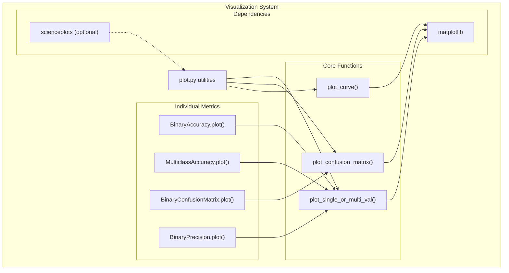
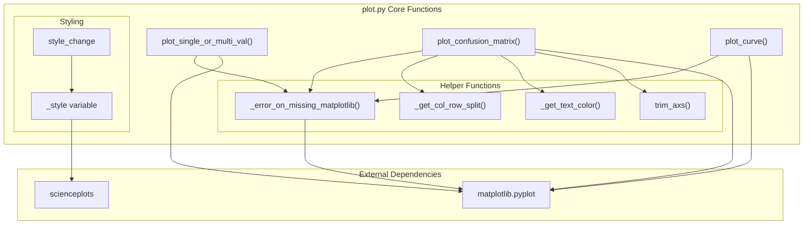
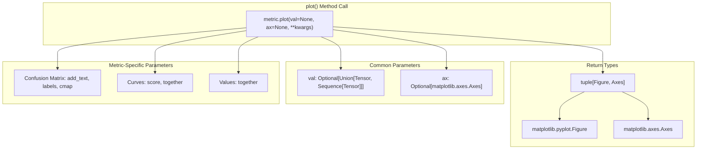
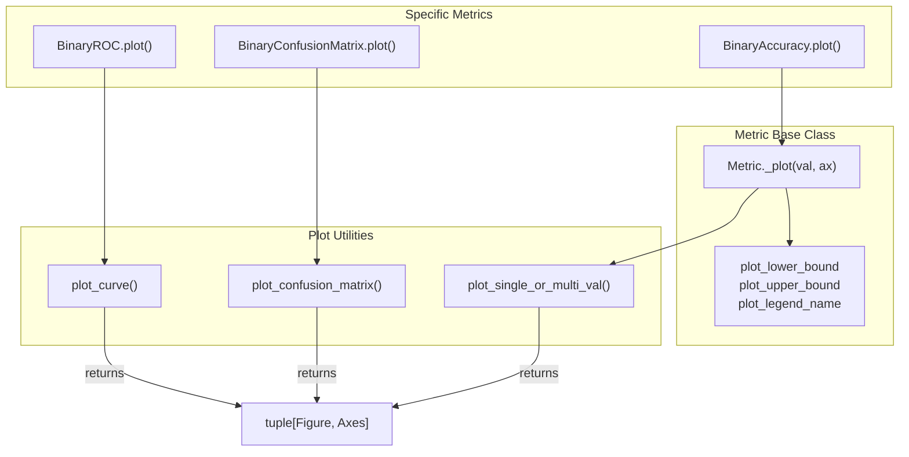
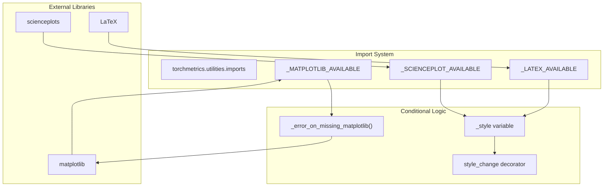

<!-- source: DeepWiki mcp.deepwiki.com · repo Lightning-AI/torchmetrics · page 13 Visualization and Plotting · fetched 2026-10-21 -->

# Visualization and Plotting

<details>
<summary>Relevant source files</summary>

The following files were used as context for generating this wiki page:

- [CHANGELOG.md](CHANGELOG.md)
- [docs/source/regression/critical_success_index.rst](docs/source/regression/critical_success_index.rst)
- [examples/audio/text_to_speech.py](examples/audio/text_to_speech.py)
- [requirements/_docs.txt](requirements/_docs.txt)
- [requirements/classification_test.txt](requirements/classification_test.txt)
- [requirements/image_test.txt](requirements/image_test.txt)
- [requirements/multimodal.txt](requirements/multimodal.txt)
- [requirements/nominal_test.txt](requirements/nominal_test.txt)
- [requirements/segmentation_test.txt](requirements/segmentation_test.txt)
- [requirements/text.txt](requirements/text.txt)
- [requirements/text_test.txt](requirements/text_test.txt)
- [requirements/visual.txt](requirements/visual.txt)
- [src/torchmetrics/functional/image/__init__.py](src/torchmetrics/functional/image/__init__.py)
- [src/torchmetrics/functional/regression/csi.py](src/torchmetrics/functional/regression/csi.py)
- [src/torchmetrics/image/__init__.py](src/torchmetrics/image/__init__.py)
- [src/torchmetrics/regression/csi.py](src/torchmetrics/regression/csi.py)
- [tests/unittests/_helpers/__init__.py](tests/unittests/_helpers/__init__.py)
- [tests/unittests/image/test_csi.py](tests/unittests/image/test_csi.py)
- [tests/unittests/multimodal/test_clip_score.py](tests/unittests/multimodal/test_clip_score.py)
- [tests/unittests/text/test_bertscore.py](tests/unittests/text/test_bertscore.py)
- [tests/unittests/text/test_infolm.py](tests/unittests/text/test_infolm.py)
- [tests/unittests/utilities/test_plot.py](tests/unittests/utilities/test_plot.py)

</details>


This document covers the `plot()` method available on TorchMetrics metrics, which enables visualization of metric values, confusion matrices, curves, and other metric outputs. The `plot()` method provides a standardized interface across all metrics, returning matplotlib Figure and Axes objects that can be further customized.

For information about the underlying metrics themselves, see [Classification Metrics](#3), [Regression Metrics](#4), and other domain-specific metric pages.

## Overview

All metrics in TorchMetrics that support visualization provide a `plot()` method. This method returns a tuple of `(matplotlib.pyplot.Figure, matplotlib.axes.Axes)` objects, allowing users to:
- Visualize single metric values or multiple values over time
- Plot confusion matrices with annotations
- Display ROC curves, precision-recall curves, and other threshold-based visualizations
- Customize plots using standard matplotlib operations

**Sources:** [tests/unittests/utilities/test_plot.py:698-716](), [src/torchmetrics/utilities/plot.py:1-367]()

## Architecture Overview

The TorchMetrics visualization system is built around a centralized utilities module with individual metrics providing standardized plotting interfaces. The architecture separates plotting utilities from metric logic while maintaining consistent APIs across all metric types.



**Sources:** [src/torchmetrics/utilities/plot.py:1-367](), [src/torchmetrics/classification/accuracy.py:109-149](), [src/torchmetrics/classification/confusion_matrix.py:148-188]()

## Core Plotting Utilities

The visualization system centers around three main plotting functions in the utilities module, each designed for specific types of metric visualizations.

### Plot Functions Architecture



**Sources:** [src/torchmetrics/utilities/plot.py:56-89](), [src/torchmetrics/utilities/plot.py:175-182](), [src/torchmetrics/utilities/plot.py:185-201]()

### Function Specifications

| Function | Purpose | Input Types | Return Type |
|----------|---------|-------------|-------------|
| `plot_single_or_multi_val()` | Plot metric values over time or as single points | `Tensor`, `Sequence[Tensor]`, `dict[str, Tensor]` | `tuple[plt.Figure, matplotlib.axes.Axes]` |
| `plot_confusion_matrix()` | Visualize confusion matrices with optional text annotations | `Tensor` (2D or 3D) | `tuple[plt.Figure, matplotlib.axes.Axes]` |
| `plot_curve()` | Draw ROC curves, precision-recall curves, etc. | `tuple[Tensor, Tensor, Tensor]` | `tuple[plt.Figure, matplotlib.axes.Axes]` |

**Sources:** [src/torchmetrics/utilities/plot.py:64-172](), [src/torchmetrics/utilities/plot.py:219-293](), [src/torchmetrics/utilities/plot.py:296-366]()

## plot() Method Interface

The `plot()` method provides a consistent interface across all metrics, with parameters that vary based on the metric type.

### Method Signature and Return Types



**Sources:** [tests/unittests/utilities/test_plot.py:698-716](), [src/torchmetrics/utilities/plot.py:64-172]()

### Return Type Details

All `plot()` methods return a tuple containing:

| Return Type | Description | Usage |
|-------------|-------------|-------|
| `matplotlib.pyplot.Figure` | The figure object containing the plot | Can be saved with `fig.savefig()` or displayed with `plt.show()` |
| `matplotlib.axes.Axes` | The axes object containing the plot elements | Can be customized with matplotlib methods like `ax.set_title()` |

The returned objects can be further customized using standard matplotlib operations:

```python
metric = BinaryAccuracy()
fig, ax = metric.plot()
ax.set_title("Custom Title")
ax.set_ylabel("Custom Y Label")
fig.savefig("custom_plot.png")
```

**Sources:** [tests/unittests/utilities/test_plot.py:713-715]()

### Common Parameters

#### val Parameter

The `val` parameter accepts metric values to plot. It can be:

| Input Type | Description | Use Case |
|------------|-------------|----------|
| `None` | Plots the current computed metric value | Single evaluation visualization |
| `Tensor` | Single tensor value | Plotting a specific pre-computed value |
| `Sequence[Tensor]` | List or tuple of tensors | Time series visualization across epochs/steps |
| `dict[str, Tensor]` | Dictionary mapping names to tensors | Multi-class or multi-metric visualization |

**Example:**
```python
# Plot current value (after metric.update() calls)
fig, ax = metric.plot()

# Plot multiple values over time
vals = []
for preds, targets in data_loader:
    val = metric(preds, targets)
    vals.append(val)
fig, ax = metric.plot(vals)
```

**Sources:** [tests/unittests/utilities/test_plot.py:703-711](), [src/torchmetrics/utilities/plot.py:78-116]()

#### ax Parameter

The `ax` parameter accepts an existing matplotlib Axes object for plotting on a specific subplot:

```python
# Create custom subplot layout
fig, (ax1, ax2) = plt.subplots(1, 2)
metric1.plot(ax=ax1)
metric2.plot(ax=ax2)
```

**Sources:** [src/torchmetrics/utilities/plot.py:119-128]()

## Metric-Specific Plot Parameters

Different metric types support additional parameters for specialized visualizations.

### Confusion Matrix Parameters

Confusion matrix metrics (e.g., `BinaryConfusionMatrix`, `MulticlassConfusionMatrix`) support:

| Parameter | Type | Description | Default |
|-----------|------|-------------|---------|
| `add_text` | `bool` | Display cell values as text annotations | `True` |
| `labels` | `Optional[list[str]]` | Custom labels for classes | `None` |
| `cmap` | `Optional[str]` | Matplotlib colormap name | `None` |

**Example:**
```python
confmat = MulticlassConfusionMatrix(num_classes=3)
fig, ax = confmat.plot(
    add_text=True,
    labels=["Cat", "Dog", "Bird"],
    cmap="Blues"
)
```

**Sources:** [src/torchmetrics/classification/confusion_matrix.py:148-188](), [tests/unittests/utilities/test_plot.py:858-883]()

### Curve Plot Parameters

ROC, precision-recall, and other curve-based metrics support:

| Parameter | Type | Description |
|-----------|------|-------------|
| `score` | `bool` | Display AUC or other summary scores on the plot |
| `together` | `bool` | Plot all classes together on the same axes (for multiclass) |

**Example:**
```python
roc = MulticlassROC(num_classes=3)
# Plot with AUC scores displayed
fig, ax = roc.plot(score=True)

# Plot all classes on same axes
fig, ax = roc.plot(together=True)
```

**Sources:** [src/torchmetrics/utilities/plot.py:296-366](), [tests/unittests/utilities/test_plot.py:885-951]()

### Value Plot Parameters

Metrics that plot scalar values over time support:

| Parameter | Type | Description |
|-----------|------|-------------|
| `together` | `bool` | Plot all classes/outputs together on the same axes |

**Sources:** [src/torchmetrics/utilities/plot.py:64-172]()

## Metric Plot Integration

Individual metrics implement standardized `plot()` methods that delegate to core utilities while maintaining metric-specific behavior.

### Plot Method Architecture



**Sources:** [src/torchmetrics/classification/accuracy.py:109-149](), [src/torchmetrics/classification/confusion_matrix.py:148-188](), [src/torchmetrics/classification/stat_scores.py:1-500]()

### Metric-Specific Implementations

Different metric types utilize different plotting functions based on their output format:

| Metric Type | Plot Function | Special Features | Example Metrics |
|-------------|---------------|------------------|-----------------|
| Scalar metrics | `plot_single_or_multi_val()` | Time series support, class-wise plotting | `BinaryAccuracy`, `MulticlassAccuracy`, `MeanSquaredError` |
| Confusion matrices | `plot_confusion_matrix()` | Cell value annotations, custom colormaps | `BinaryConfusionMatrix`, `MulticlassConfusionMatrix` |
| Threshold curves | `plot_curve()` | AUC scores, multi-class overlay | `BinaryROC`, `BinaryPrecisionRecallCurve` |

**Sources:** [src/torchmetrics/classification/accuracy.py:148-149](), [src/torchmetrics/classification/confusion_matrix.py:184-188](), [tests/unittests/utilities/test_plot.py:214-696]()

## Dependencies and Styling

The visualization system uses conditional imports to handle optional dependencies gracefully, with matplotlib as the core requirement and additional styling options available through scienceplots.

### Dependency Management



**Sources:** [src/torchmetrics/utilities/plot.py:23-54](), [src/torchmetrics/utilities/plot.py:56-61]()

### Style Configuration

The system automatically configures plot styling based on available dependencies:

- **Default styling**: `["default"]` when no additional packages available
- **Science styling**: `["science", "no-latex"]` when scienceplots available but no LaTeX  
- **Full science styling**: `["science"]` when both scienceplots and LaTeX available

**Sources:** [src/torchmetrics/utilities/plot.py:48-53]()

## Usage Patterns

### Basic Metric Plotting

All metrics support the same basic plotting interface:

```python
# Single value plotting
metric = BinaryAccuracy()
fig, ax = metric.plot()  # Plots current computed value

# Time series plotting  
values = [metric(preds, targets) for preds, targets in data_loader]
fig, ax = metric.plot(values)
```

### Confusion Matrix Plotting

Confusion matrix metrics provide specialized plotting with customization options:

```python
confmat = BinaryConfusionMatrix()
fig, ax = confmat.plot(
    add_text=True,           # Show cell values
    labels=["Negative", "Positive"],  # Custom labels
    cmap="Blues"            # Custom colormap
)
```

**Sources:** [src/torchmetrics/classification/confusion_matrix.py:148-188]()

### Plot Customization Properties

Metrics define plotting behavior through class attributes:

| Property | Purpose | Example Values |
|----------|---------|----------------|
| `plot_lower_bound` | Y-axis lower bound | `0.0` for accuracy metrics |
| `plot_upper_bound` | Y-axis upper bound | `1.0` for normalized metrics |
| `plot_legend_name` | Legend prefix for multi-class | `"Class"`, `"Label"` |
| `higher_is_better` | Optimal value indicator | `True` for accuracy, `False` for loss |

**Sources:** [src/torchmetrics/classification/accuracy.py:101-102](), [src/torchmetrics/classification/accuracy.py:253-255]()

---

