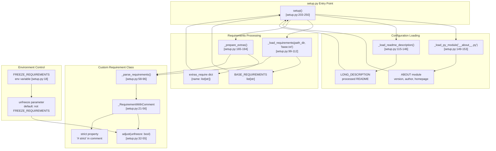
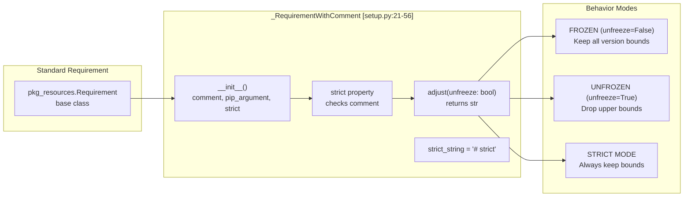
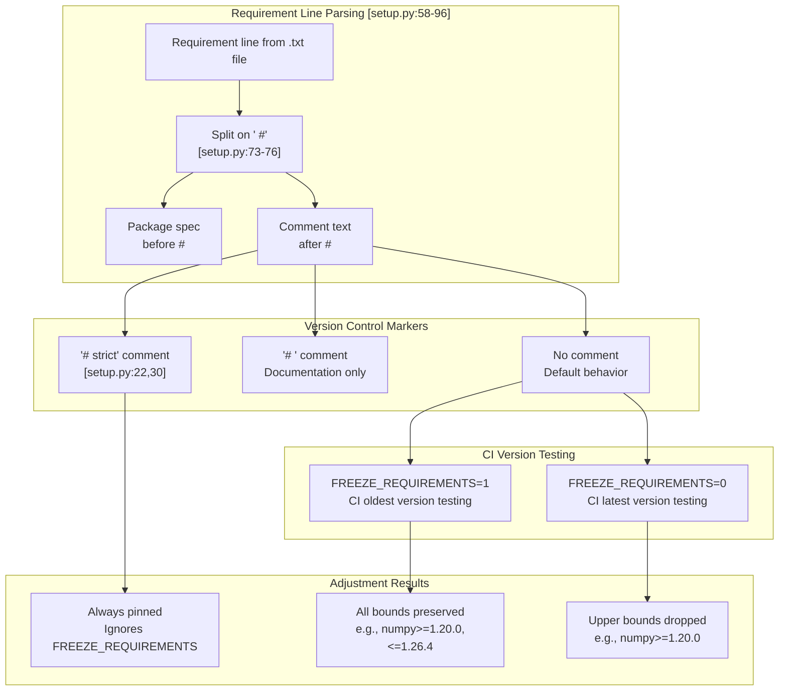
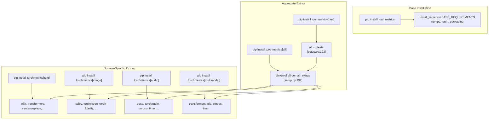
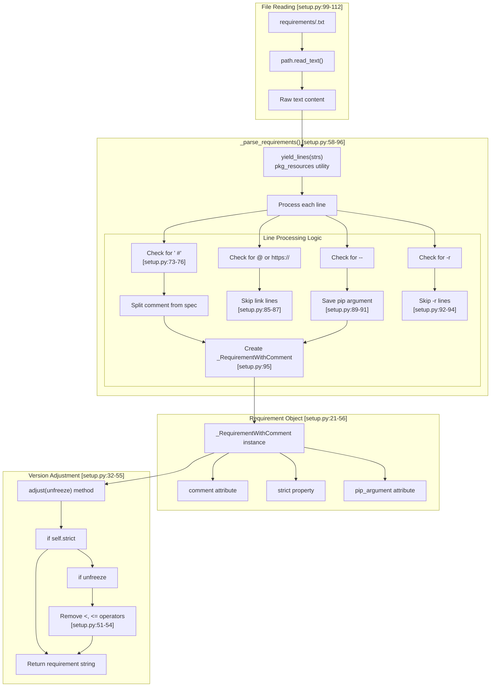
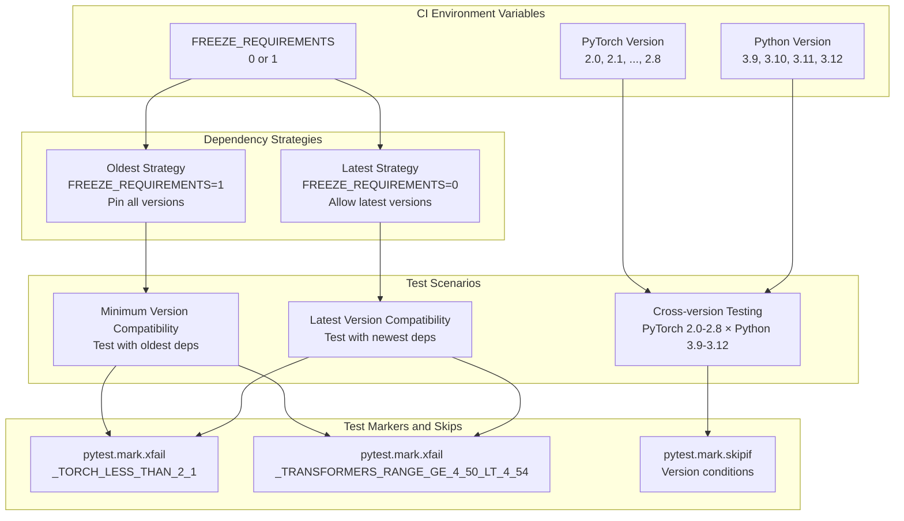
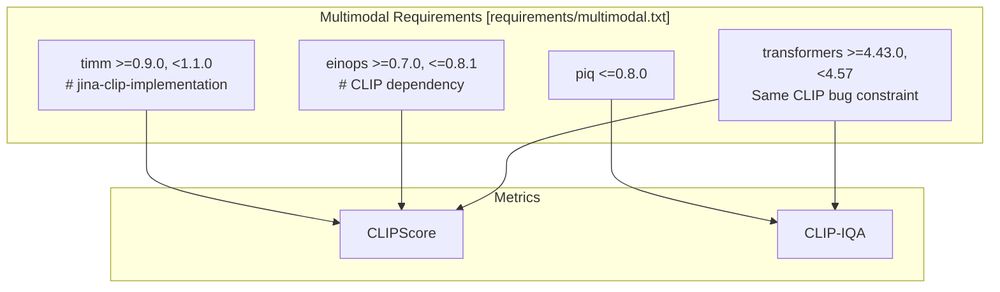

<!-- source: DeepWiki mcp.deepwiki.com · repo Lightning-AI/torchmetrics · page 14 Dependency Management · fetched 2026-10-21 -->

# Dependency Management

<details>
<summary>Relevant source files</summary>

The following files were used as context for generating this wiki page:

- [.azure/gpu-integrations.yml](.azure/gpu-integrations.yml)
- [.azure/gpu-unittests.yml](.azure/gpu-unittests.yml)
- [.github/workflows/ci-tests.yml](.github/workflows/ci-tests.yml)
- [.github/workflows/docker-build.yml](.github/workflows/docker-build.yml)
- [docs/source/regression/critical_success_index.rst](docs/source/regression/critical_success_index.rst)
- [examples/audio/text_to_speech.py](examples/audio/text_to_speech.py)
- [requirements.txt](requirements.txt)
- [requirements/_docs.txt](requirements/_docs.txt)
- [requirements/audio.txt](requirements/audio.txt)
- [requirements/base.txt](requirements/base.txt)
- [requirements/classification_test.txt](requirements/classification_test.txt)
- [requirements/detection.txt](requirements/detection.txt)
- [requirements/image.txt](requirements/image.txt)
- [requirements/image_test.txt](requirements/image_test.txt)
- [requirements/nominal_test.txt](requirements/nominal_test.txt)
- [requirements/segmentation_test.txt](requirements/segmentation_test.txt)
- [requirements/typing.txt](requirements/typing.txt)
- [requirements/visual.txt](requirements/visual.txt)
- [setup.py](setup.py)
- [src/torchmetrics/functional/image/__init__.py](src/torchmetrics/functional/image/__init__.py)
- [src/torchmetrics/functional/regression/csi.py](src/torchmetrics/functional/regression/csi.py)
- [src/torchmetrics/image/__init__.py](src/torchmetrics/image/__init__.py)
- [src/torchmetrics/regression/csi.py](src/torchmetrics/regression/csi.py)
- [tests/unittests/image/test_csi.py](tests/unittests/image/test_csi.py)

</details>


## Purpose and Scope

This document describes the dependency management system in TorchMetrics, which implements a sophisticated modular requirements architecture supporting flexible installation profiles and version testing strategies. The system balances user convenience (allowing installation of only needed dependencies) with rigorous CI testing across multiple dependency versions.

For information about CI/CD testing infrastructure that uses these dependency configurations, see [CI/CD Pipeline](#15.1). For package publishing workflows, see [Package Publishing](#16).

---

## Overview

TorchMetrics uses a custom dependency management system built around three core concepts:

1. **Modular Requirements**: Domain-specific dependency files (`requirements/*.txt`) that users can selectively install
2. **Version Adjustment**: A custom `_RequirementWithComment` class that supports flexible version pinning strategies
3. **Installation Profiles**: Multiple extras configurations (base, domain-specific, all, dev) for different use cases

The system is controlled by [setup.py:1-251]() which orchestrates requirement parsing, version adjustment, and package configuration.

**Sources:** [setup.py:1-251](), [requirements.txt:1-2]()

---

## Package Configuration Architecture

### Core Components

The following diagram shows the key classes and functions in `setup.py` that implement the dependency management system:



**Sources:** [setup.py:1-251]()

### _RequirementWithComment Class

The core of the version management system is the `_RequirementWithComment` class, which extends `pkg_resources.Requirement` to support comment-based version control:



Key method implementation:

| Mode | Condition | Example Input | Example Output |
|------|-----------|---------------|----------------|
| Frozen | `unfreeze=False` | `arrow<=1.2.2,>=1.2.0` | `arrow<=1.2.2,>=1.2.0` |
| Unfrozen | `unfreeze=True` | `arrow<=1.2.2,>=1.2.0` | `arrow>=1.2.0` |
| Strict (frozen) | `strict=True, unfreeze=False` | `arrow<=1.2.2,>=1.2.0  # strict` | `arrow<=1.2.2,>=1.2.0  # strict` |
| Strict (unfrozen) | `strict=True, unfreeze=True` | `arrow<=1.2.2,>=1.2.0  # strict` | `arrow<=1.2.2,>=1.2.0  # strict` |

The `adjust()` method [setup.py:32-55]() implements this logic by:
1. Checking if requirement is marked strict via `self.strict` property [setup.py:30]()
2. If strict, preserving all version bounds regardless of `unfreeze` parameter
3. If unfrozen and not strict, removing operators `<` and `<=` from specs [setup.py:51-54]()

**Sources:** [setup.py:21-56]()

---

## Requirements File Organization

### Directory Structure

TorchMetrics organizes dependencies in `requirements/*.txt` files following a specific naming convention:

```mermaid
graph TB
    subgraph "requirements/ Directory [_PATH_REQUIRE]"
        BASE["base.txt<br/>Core dependencies<br/>numpy, torch, packaging"]
        
        subgraph "Domain Requirements"
            AUDIO["audio.txt<br/>pesq, torchaudio, onnxruntime"]
            IMAGE["image.txt<br/>scipy, torchvision, torch-fidelity"]
            TEXT["text.txt<br/>nltk, transformers, sentencepiece"]
            MULTIMODAL["multimodal.txt<br/>transformers, timm, einops, piq"]
            DETECTION["detection.txt<br/>torchvision, pycocotools"]
            OTHER["clustering.txt, nominal.txt, ..."]
        end
        
        subgraph "Development Requirements (_prefix)"
            TESTS["_tests.txt<br/>pytest, coverage, scikit-learn"]
            DEVEL["_devel.txt<br/>Full dev environment"]
            INTEGRATE["_integrate.txt<br/>Integration testing"]
            DOCS["_docs.txt<br/>Sphinx, theme, extensions"]
            DOCTEST["_doctest.txt<br/>Documentation testing"]
        end
        
        subgraph "Test Reference Requirements (*_test suffix)"
            AUDIO_TEST["audio_test.txt<br/>Reference implementations"]
            IMAGE_TEST["image_test.txt<br/>scikit-image, kornia, lpips"]
            TEXT_TEST["text_test.txt<br/>jiwer, rouge-score, bert_score"]
            CLASS_TEST["classification_test.txt<br/>pandas, netcal, fairlearn"]
            NOMINAL_TEST["nominal_test.txt<br/>pandas, dython, scipy"]
        end
    end
    
    subgraph "_prepare_extras() Processing [setup.py:165-194]"
        FILTER["Filter files<br/>skip_pattern='^_'<br/>skip_files=['base.txt']"]
        AGGREGATE["Aggregate *_test.txt<br/>into '_tests' extra"]
        CREATE_ALL["Create 'all' extra<br/>Union of all domains"]
        CREATE_DEV["Create 'dev' extra<br/>all + _tests"]
    end
    
    BASE & AUDIO & IMAGE & TEXT & MULTIMODAL & DETECTION --> FILTER
    TESTS & DEVEL & INTEGRATE & DOCS --> AGGREGATE
    AUDIO_TEST & IMAGE_TEST & TEXT_TEST --> AGGREGATE
    
    FILTER --> CREATE_ALL
    AGGREGATE --> CREATE_DEV
```



**Sources:** [setup.py:165-194](), [requirements/base.txt](), [requirements/text.txt:1-12](), [requirements/text_test.txt:1-12](), [requirements/multimodal.txt:1-9]()

### File Naming Conventions

The `_prepare_extras()` function [setup.py:165-194]() implements these rules:

| Pattern | Purpose | Accessible as Extra? | Example |
|---------|---------|---------------------|---------|
| `base.txt` | Core dependencies installed by default | No (in `install_requires`) | [requirements/base.txt]() |
| `<domain>.txt` | Domain-specific dependencies | Yes: `torchmetrics[<domain>]` | [requirements/text.txt:1-12]() |
| `_<name>.txt` | Internal/development dependencies | No (filtered by `skip_pattern`) | `_tests.txt`, `_devel.txt` |
| `<domain>_test.txt` | Test reference implementations | No (aggregated into `_tests`) | [requirements/text_test.txt:1-12]() |

The filtering logic [setup.py:179-180]():
```python
found_req_files = [n for n in found_req_files if not re.match(skip_pattern, n)]
found_req_files = [n for n in found_req_files if n not in skip_files]
```

**Sources:** [setup.py:165-194]()

---

## Version Management Strategy

### Comment-Based Version Control

Requirements files use inline comments to control version pinning behavior:



**Examples from requirements files:**

| Requirement Line | `FREEZE_REQUIREMENTS=0` | `FREEZE_REQUIREMENTS=1` |
|------------------|-------------------------|-------------------------|
| `nltk >3.8.1, <=3.9.1` [requirements/text.txt:4]() | `nltk >3.8.1` | `nltk >3.8.1, <=3.9.1` |
| `transformers >=4.43.0,<4.57` [requirements/text.txt:8]() | `transformers >=4.43.0` | `transformers >=4.43.0,<4.57` |
| `bert_score ==0.3.13` [requirements/text_test.txt:6]() | `bert_score ==0.3.13` (exact pin) | `bert_score ==0.3.13` (exact pin) |
| `mecab-ko >=1.0.0, <1.1.0  # strict` [requirements/text_test.txt:10]() | `mecab-ko >=1.0.0, <1.1.0  # strict` | `mecab-ko >=1.0.0, <1.1.0  # strict` |

**Sources:** [setup.py:18](), [setup.py:32-55](), [setup.py:73-76](), [requirements/text.txt:1-12](), [requirements/text_test.txt:1-12]()

### Rationale for Version Bounds

Requirements files include explanatory comments for version constraints:

```
# NOTE: the upper bound for the package version is only set for CI stability, 
# and it is dropped while installing this package
```
[requirements/text.txt:1-2]()

```
# transformers==4.52 and 4.53 has a bug with the clip model loading
transformers >=4.43.0,<4.57
```
[requirements/text.txt:7-8](), [requirements/multimodal.txt:4-5]()

This approach allows:
- **CI**: Test with pinned versions for reproducibility (`FREEZE_REQUIREMENTS=1`)
- **Users**: Get latest compatible versions by default (`FREEZE_REQUIREMENTS=0`)
- **Critical pins**: Use `# strict` or exact `==` for known incompatibilities

**Sources:** [requirements/text.txt:1-8](), [requirements/multimodal.txt:1-9]()

---

## Installation Profiles

### Extras Configuration

The `_prepare_extras()` function [setup.py:165-194]() generates multiple installation profiles:



**Implementation:**

The `_prepare_extras()` function [setup.py:165-194]() builds the extras dictionary:

1. **Domain extras** [setup.py:184-188](): Each `<domain>.txt` file becomes an extra
   ```python
   if name.endswith("_test"):
       extras_req["_tests"] += _load_req(file_name=fname)
   else:
       extras_req[name] = _load_req(file_name=fname)
   ```

2. **`all` extra** [setup.py:192](): Union of all non-test, non-internal extras
   ```python
   extras_req["all"] = list(chain([pkgs for k, pkgs in extras_req.items() if k not in ("_test", "_tests")]))
   ```

3. **`dev` extra** [setup.py:193](): Combines `all` + `_tests`
   ```python
   extras_req["dev"] = extras_req["all"] + extras_req["_tests"]
   ```

4. **Filtering** [setup.py:194](): Remove internal extras (starting with `_`)
   ```python
   return {k: v for k, v in extras_req.items() if not k.startswith("_")}
   ```

**Sources:** [setup.py:165-194](), [setup.py:221-222]()

---

## Dependency Parsing and Processing

### Requirement Parsing Flow

The following diagram shows how requirement lines are parsed and processed:



**Sources:** [setup.py:58-112]()

### Special Line Handling

The `_parse_requirements()` function [setup.py:58-96]() handles several special cases:

| Line Type | Pattern | Action | Example |
|-----------|---------|--------|---------|
| Comment | `# text` | Skip entire line | `# NOTE: upper bound for CI stability` |
| Inline comment | `spec  # text` | Split and preserve | `nltk >3.8.1  # strict` |
| Direct link | `@ https://...` | Skip line [setup.py:85-87]() | `pesq @ git+https://...` |
| Pip argument | `--option` | Save for next requirement [setup.py:89-91]() | `--extra-index-url ...` |
| Requirement file | `-r file.txt` | Skip (unsupported) [setup.py:92-94]() | `-r different/file.txt` |
| Continuation | Line ends with `\` | Append next line [setup.py:79-84]() | `package >=1.0,\n <=2.0` |

**Sources:** [setup.py:73-94]()

---

## CI Integration and Testing Strategy

### Version Testing Matrix

The dependency system supports CI testing across multiple dependency configurations:



**Examples from test files:**

```python
@pytest.mark.xfail(
    RuntimeError,
    condition=_TORCH_LESS_THAN_2_1 and _TRANSFORMERS_RANGE_GE_4_50_LT_4_54,
    reason="could be due to torch compatibility issues with transformers",
)
```
[tests/unittests/text/test_bertscore.py:101-107](), [tests/unittests/multimodal/test_clip_score.py:96-101]()

These markers allow tests to:
1. **Fail gracefully** with known incompatibilities (xfail)
2. **Skip entirely** when dependencies unavailable (skipif)
3. **Document reasons** for version-specific behavior

**Sources:** [tests/unittests/_helpers/__init__.py:35-41](), [tests/unittests/text/test_bertscore.py:101-112](), [tests/unittests/multimodal/test_clip_score.py:96-101](), [tests/unittests/text/test_infolm.py:106-117]()

---

## Domain-Specific Dependencies

### Text Metrics Dependencies

The text domain has complex dependency requirements due to transformer models:

```mermaid
graph TB
    subgraph "Text Domain Requirements [requirements/text.txt]"
        NLTK["nltk >3.8.1, <=3.9.1"]
        TQDM["tqdm <4.68.0"]
        REGEX["regex >=2021.9.24, <=2025.9.1"]
        TRANSFORMERS["transformers >=4.43.0,<4.57<br/># 4.52-4.53 has CLIP bug"]
        MECAB["mecab-python3 >=1.0.6, <1.1.0"]
        IPADIC["ipadic >=1.0.0, <1.1.0"]
        SENTENCEPIECE["sentencepiece >=0.2.0, <0.3.0"]
    end
    
    subgraph "Text Test Requirements [requirements/text_test.txt]"
        JIWER["jiwer >=2.3.0, <4.1.0"]
        ROUGE["rouge-score >0.1.0, <=0.1.2"]
        BERT_SCORE["bert_score ==0.3.13<br/>(exact pin)"]
        HF_HUB["huggingface-hub <0.35"]
        SACREBLEU["sacrebleu >=2.3.0, <2.6.0"]
        MECAB_KO["mecab-ko >=1.0.0, <1.1.0  # strict"]
    end
    
    subgraph "Metrics Using These Dependencies"
        BLEU["BLEUScore<br/>SacreBLEUScore"]
        ROUGE_M["ROUGEScore"]
        BERT["BERTScore"]
        INFO_LM["InfoLM"]
        WER["WordErrorRate<br/>CharErrorRate"]
    end
    
    NLTK --> BLEU
    TRANSFORMERS --> BERT & INFO_LM
    SENTENCEPIECE --> BERT
    
    JIWER --> WER
    ROUGE --> ROUGE_M
    BERT_SCORE --> BERT
    SACREBLEU --> BLEU
```



**Special considerations:**

1. **Transformer version constraint** [requirements/text.txt:7-8]():
   - Bug in transformers 4.52-4.53 affects CLIP model loading
   - Upper bound prevents installation of broken versions

2. **Exact pins for reproducibility** [requirements/text_test.txt:6]():
   - `bert_score ==0.3.13` ensures consistent reference implementation
   - Critical for validating metric correctness

3. **Platform-specific dependencies** [requirements/text_test.txt:10-11]():
   - `mecab-ko` restricted to Python <3.12 with `# strict` comment
   - Prevents installation where incompatible

**Sources:** [requirements/text.txt:1-12](), [requirements/text_test.txt:1-12]()

### Multimodal Dependencies



**Notes:**
- Shares transformer constraint with text domain [requirements/multimodal.txt:4-5]()
- `timm` required for Jina CLIP implementation [requirements/multimodal.txt:8]()
- `einops` needed as CLIP dependency [requirements/multimodal.txt:7]()

**Sources:** [requirements/multimodal.txt:1-9]()

---

## Best Practices

### Adding New Dependencies

When adding a new dependency to TorchMetrics:

1. **Choose the appropriate requirements file**:
   - Domain-specific metric? Add to `requirements/<domain>.txt`
   - Reference implementation? Add to `requirements/<domain>_test.txt`
   - Development tool? Add to `requirements/_devel.txt`

2. **Set version bounds appropriately**:
   ```
   # Upper bound for CI stability (will be dropped for users)
   package_name >=min_version, <=max_version
   ```

3. **Use `# strict` for critical constraints**:
   ```
   # Known incompatibility - must be pinned
   package_name >=1.0.0, <2.0.0  # strict
   ```

4. **Document rationale with comments**:
   ```
   # package 2.5.0 introduces breaking API change
   package_name >=2.0.0, <2.5.0
   ```

5. **Test with both strategies**:
   - CI will automatically test with `FREEZE_REQUIREMENTS=1` (oldest)
   - CI will automatically test with `FREEZE_REQUIREMENTS=0` (latest)

### Updating Dependency Versions

When updating version bounds:

1. **Check for breaking changes** in the dependency's changelog
2. **Run tests locally** with both frozen and unfrozen versions
3. **Update xfail markers** if new incompatibilities are discovered:
   ```python
   @pytest.mark.xfail(
       RuntimeError,
       condition=_PACKAGE_VERSION_RANGE,
       reason="specific issue description",
   )
   ```
4. **Document the reason** in a comment in the requirements file

### Working with FREEZE_REQUIREMENTS

For local development:

```bash
# Test with oldest supported versions (like CI does)
export FREEZE_REQUIREMENTS=1
pip install -e .

# Test with latest versions (default user experience)
unset FREEZE_REQUIREMENTS  # or export FREEZE_REQUIREMENTS=0
pip install -e .
```

**Sources:** [setup.py:18](), [setup.py:32-55](), [requirements/text.txt:1-8]()

---

## Summary

The TorchMetrics dependency management system provides:

| Feature | Implementation | Benefit |
|---------|---------------|---------|
| **Modular Requirements** | Domain-specific `requirements/*.txt` files | Users install only needed dependencies |
| **Flexible Version Control** | `# strict` comments + `FREEZE_REQUIREMENTS` | Balance stability and flexibility |
| **Multiple Installation Profiles** | `base`, domain-specific, `all`, `dev` extras | Support different use cases |
| **Custom Parsing Logic** | `_RequirementWithComment` class | Comment-based version management |
| **CI Integration** | Environment variable control | Test oldest and latest versions |
| **Clear Documentation** | Inline comments in requirements files | Explain rationale for constraints |

This architecture enables TorchMetrics to support a wide range of metrics (across audio, image, text, multimodal domains) while maintaining compatibility across PyTorch 2.0-2.8 and Python 3.9-3.12.

**Sources:** [setup.py:1-251](), [requirements/text.txt:1-12](), [requirements/multimodal.txt:1-9](), [tests/unittests/_helpers/__init__.py:35-41]()

---

