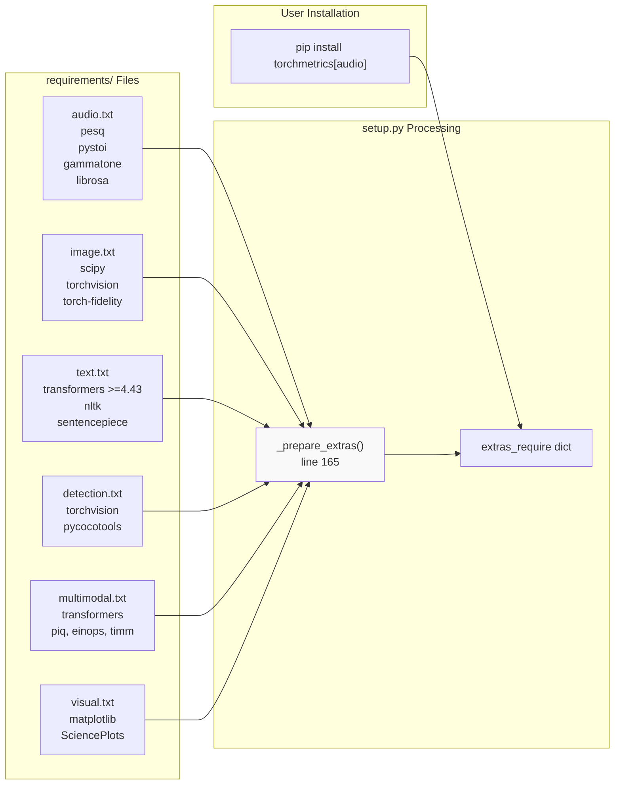
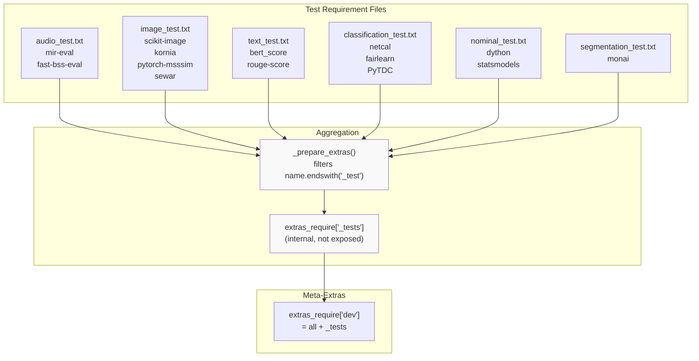
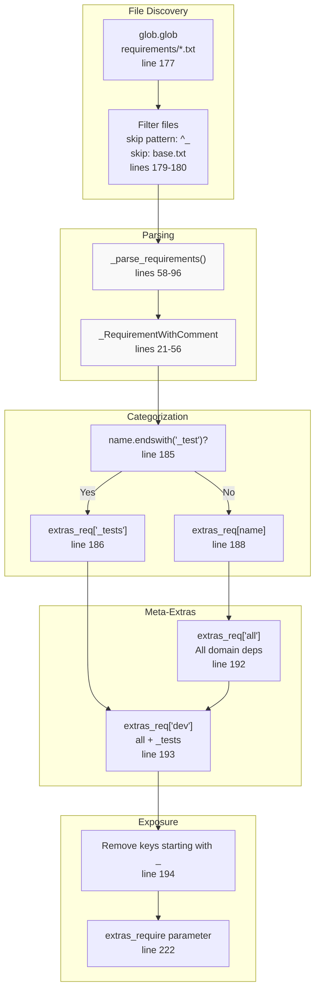

<!-- source: DeepWiki mcp.deepwiki.com · repo Lightning-AI/torchmetrics · page 14.1 Requirements File Organization · fetched 2026-10-21 -->

# Requirements File Organization

<details>
<summary>Relevant source files</summary>

The following files were used as context for generating this wiki page:

- [docs/source/regression/critical_success_index.rst](docs/source/regression/critical_success_index.rst)
- [examples/audio/text_to_speech.py](examples/audio/text_to_speech.py)
- [requirements.txt](requirements.txt)
- [requirements/_docs.txt](requirements/_docs.txt)
- [requirements/classification_test.txt](requirements/classification_test.txt)
- [requirements/image_test.txt](requirements/image_test.txt)
- [requirements/nominal_test.txt](requirements/nominal_test.txt)
- [requirements/segmentation_test.txt](requirements/segmentation_test.txt)
- [requirements/visual.txt](requirements/visual.txt)
- [setup.py](setup.py)
- [src/torchmetrics/functional/image/__init__.py](src/torchmetrics/functional/image/__init__.py)
- [src/torchmetrics/functional/regression/csi.py](src/torchmetrics/functional/regression/csi.py)
- [src/torchmetrics/image/__init__.py](src/torchmetrics/image/__init__.py)
- [src/torchmetrics/regression/csi.py](src/torchmetrics/regression/csi.py)
- [tests/unittests/image/test_csi.py](tests/unittests/image/test_csi.py)

</details>


## Purpose and Scope

This page documents the hierarchical organization of requirements files in the `requirements/` directory and how they map to installable extras in `setup.py`. For information about version constraint management and the `FREEZE_REQUIREMENTS` system, see [Version Management and Compatibility](#14.2).

The TorchMetrics requirements system is designed to:
- Minimize installation footprint by making domain-specific dependencies optional
- Provide clear separation between runtime, testing, and documentation dependencies
- Support CI/CD pipelines with stable, frozen versions while allowing flexible development workflows

**Sources**: [setup.py:1-250](), [requirements/_docs.txt:1-36]()

---

## Requirements Directory Structure

The `requirements/` directory follows a hierarchical naming convention where files are categorized by purpose and domain:

```mermaid
graph TB
    REQDIR["requirements/"]
    
    subgraph "Core"
        BASE["base.txt<br/>Core dependencies"]
        ROOT["../requirements.txt<br/>Points to base.txt"]
    end
    
    subgraph "Domain-Specific Runtime"
        AUDIO["audio.txt<br/>PESQ, pystoi, etc."]
        IMAGE["image.txt<br/>scipy, torchvision, etc."]
        TEXT["text.txt<br/>transformers, nltk, etc."]
        DETECTION["detection.txt<br/>pycocotools"]
        MULTIMODAL["multimodal.txt<br/>CLIP, transformers"]
        CLUSTERING["clustering.txt<br/>scipy"]
        NOMINAL["nominal.txt<br/>pandas, scipy"]
        VISUAL["visual.txt<br/>matplotlib"]
    end
    
    subgraph "Domain-Specific Testing"
        AUDIO_TEST["audio_test.txt<br/>mir-eval, fast-bss-eval"]
        IMAGE_TEST["image_test.txt<br/>scikit-image, kornia"]
        TEXT_TEST["text_test.txt<br/>bert_score, rouge-score"]
        CLASS_TEST["classification_test.txt<br/>netcal, fairlearn, PyTDC"]
        NOM_TEST["nominal_test.txt<br/>dython, statsmodels"]
        SEG_TEST["segmentation_test.txt<br/>monai"]
    end
    
    subgraph "Infrastructure"
        TESTS["_tests.txt<br/>pytest ecosystem"]
        DOCTEST["_doctest.txt<br/>pytest-doctestplus"]
        INTEGRATE["_integrate.txt<br/>Integration test deps"]
        DOCS["_docs.txt<br/>Sphinx, documentation"]
        CI["_ci.txt<br/>uv, coverage, codecov"]
        TYPING["typing.txt<br/>mypy, types-*"]
    end
    
    REQDIR --> BASE
    REQDIR --> ROOT
    REQDIR --> AUDIO
    REQDIR --> IMAGE
    REQDIR --> TEXT
    REQDIR --> DETECTION
    REQDIR --> MULTIMODAL
    REQDIR --> CLUSTERING
    REQDIR --> NOMINAL
    REQDIR --> VISUAL
    REQDIR --> AUDIO_TEST
    REQDIR --> IMAGE_TEST
    REQDIR --> TEXT_TEST
    REQDIR --> CLASS_TEST
    REQDIR --> NOM_TEST
    REQDIR --> SEG_TEST
    REQDIR --> TESTS
    REQDIR --> DOCTEST
    REQDIR --> INTEGRATE
    REQDIR --> DOCS
    REQDIR --> CI
    REQDIR --> TYPING
    
    style BASE fill:#f9f9f9
    style TESTS fill:#f9f9f9
    style DOCS fill:#f9f9f9
```



**Sources**: [setup.py:165-194](), [requirements/_docs.txt:1-36]()

---

## File Naming Conventions

The requirements files follow a systematic naming pattern:

| Pattern | Purpose | Example | Exposed as Extra? |
|---------|---------|---------|-------------------|
| `base.txt` | Core dependencies required by all installations | `base.txt` | No (always installed) |
| `{domain}.txt` | Runtime dependencies for a metric domain | `audio.txt`, `image.txt`, `text.txt` | Yes (`pip install torchmetrics[audio]`) |
| `{domain}_test.txt` | Test dependencies for a specific domain | `image_test.txt`, `classification_test.txt` | No (aggregated into `_tests`) |
| `_{purpose}.txt` | Infrastructure dependencies (underscore prefix) | `_tests.txt`, `_docs.txt`, `_ci.txt` | No (used internally) |
| `../requirements.txt` | Root-level convenience wrapper | Points to `base.txt` | N/A |

The underscore prefix (`_`) indicates files used for infrastructure/tooling rather than domain functionality. These files are not directly exposed as extras but are consumed by CI/CD pipelines or aggregated into meta-extras like `dev`.

**Sources**: [setup.py:165-194]()

---

## Base Requirements

The `requirements/base.txt` file contains the minimal dependencies required for any TorchMetrics installation:

```
numpy >=1.20.0, <2.4.0
torch >=2.0.0, <2.8.0
packaging >17.1
lightning-utilities >=0.8.0, <0.16.0
```

These dependencies provide:
- **numpy**: Numerical operations and array handling
- **torch**: PyTorch tensor operations and neural network primitives
- **packaging**: Version string parsing (used by utilities)
- **lightning-utilities**: Shared utilities from the Lightning ecosystem

All installations include these dependencies via `install_requires` in [setup.py:221]().

**Sources**: [setup.py:162](), [requirements.txt:1-2]()

---

## Domain-Specific Requirements

Domain-specific requirement files contain dependencies needed to use metrics in that domain. These map directly to installable extras:



### Example: Visual Requirements

The `requirements/visual.txt` file demonstrates the standard structure:

```
# NOTE: the upper bound for the package version is only set for CI stability...
#  in case you want to preserve/enforce restrictions on the latest compatible version, add "strict" as an in-line comment

matplotlib >=3.6.0, <3.11.0
SciencePlots >= 2.0.0, <2.2.0
```

Key features visible in [requirements/visual.txt:1-6]():
- Header comment explaining version bound purpose
- Version ranges with both lower and upper bounds
- `# strict` comment mechanism for preserving constraints (see [Version Management](#14.2))

**Sources**: [requirements/visual.txt:1-6](), [setup.py:165-194]()

---

## Test Requirements Pattern

Test requirement files follow the `{domain}_test.txt` naming pattern and contain dependencies needed only for testing that domain's metrics:



### Test File Characteristics

Test requirements differ from runtime requirements in several ways:

1. **Reference Implementations**: Many contain "ground truth" implementations for validation
   - `bert_score` in `text_test.txt` validates `BERTScore` implementation
   - `rouge-score` validates `ROUGEScore` implementation
   - `sewar` validates image quality metrics

2. **Platform-Specific Dependencies**: Some packages have platform constraints
   - PyTDC in [requirements/classification_test.txt:10-13]() has Windows and Python version restrictions
   - Different versions for different platforms to avoid compatibility issues

3. **Upper Bound Pinning**: Test dependencies often have strict upper bounds for CI stability
   - Example in [requirements/image_test.txt:4-8](): `scikit-image >=0.19.0, <0.26.0`

### Aggregation Logic

The `_prepare_extras()` function in [setup.py:184-186]() aggregates all `*_test.txt` files:

```python
for name, fname in zip(found_req_names, found_req_files):
    if name.endswith("_test"):
        extras_req["_tests"] += _load_req(file_name=fname)
```

The `_tests` extra is not directly installable (underscore prefix) but is included in the `dev` meta-extra at [setup.py:193]().

**Sources**: [requirements/image_test.txt:1-12](), [requirements/classification_test.txt:1-14](), [requirements/nominal_test.txt:1-8](), [requirements/segmentation_test.txt:1-6](), [setup.py:184-186]()

---

## Documentation Requirements

The `requirements/_docs.txt` file contains all dependencies needed to build documentation:

### Structure Analysis

```mermaid
graph TB
    DOCS_TXT["_docs.txt"]
    
    subgraph "Sphinx Ecosystem"
        SPHINX["sphinx ==5.3.0"]
        MYST["myst-parser ==1.0.0"]
        PANDOC["pandoc ==2.4"]
        DOCUTILS["docutils ==0.19"]
    end
    
    subgraph "Sphinx Extensions"
        FULLTOC["sphinxcontrib-fulltoc >=1.0"]
        MOCK["sphinxcontrib-mockautodoc"]
        THEME["lai-sphinx-theme"]
        TYPEHINTS["sphinx-autodoc-typehints ==1.23.0"]
        PARAMS["sphinx-paramlinks ==0.6.0"]
        TOGGLE["sphinx-togglebutton ==0.3.2"]
        COPY["sphinx-copybutton ==0.5.2"]
        AUTO["sphinx-autobuild ==2024.10.3"]
        GALLERY["sphinx-gallery ==0.19.0"]
    end
    
    subgraph "Domain Dependencies (via -r)"
        INTEGRATE["_integrate.txt"]
        AUDIO_D["audio.txt"]
        IMAGE_D["image.txt"]
        TEXT_D["text.txt"]
        MULTI_D["multimodal.txt"]
    end
    
    subgraph "Gallery Extra"
        SKIMAGE["scikit-image"]
        NOTE["Version depends on Python version"]
    end
    
    DOCS_TXT --> SPHINX
    DOCS_TXT --> MYST
    DOCS_TXT --> PANDOC
    DOCS_TXT --> DOCUTILS
    DOCS_TXT --> FULLTOC
    DOCS_TXT --> MOCK
    DOCS_TXT --> THEME
    DOCS_TXT --> TYPEHINTS
    DOCS_TXT --> PARAMS
    DOCS_TXT --> TOGGLE
    DOCS_TXT --> COPY
    DOCS_TXT --> AUTO
    DOCS_TXT --> GALLERY
    
    DOCS_TXT -."-r includes".-> INTEGRATE
    DOCS_TXT -."-r includes".-> AUDIO_D
    DOCS_TXT -."-r includes".-> IMAGE_D
    DOCS_TXT -."-r includes".-> TEXT_D
    DOCS_TXT -."-r includes".-> MULTI_D
    
    DOCS_TXT --> SKIMAGE
    SKIMAGE --> NOTE
    
    style DOCS_TXT fill:#f9f9f9
```



### Key Features

The documentation requirements file demonstrates several advanced patterns:

1. **Requirement File Inclusion**: Uses `-r` syntax to include other requirement files
   - Lines [requirements/_docs.txt:21-28]() include domain-specific dependencies
   - This ensures documentation can import and test all metric domains

2. **Python Version Conditionals**: Handles version-specific dependencies
   - Lines [requirements/_docs.txt:34-35](): Different `scikit-image` versions for Python <3.10 vs >=3.10
   - Uses `python_version` environment markers

3. **Custom Theme**: References private S3 bucket for Lightning theme
   - [requirements/_docs.txt:7](): `lai-sphinx-theme  # need to be downloaded from s3://sphinx-packages/`

4. **Gallery Dependencies**: Special section for sphinx-gallery examples
   - Comment at [requirements/_docs.txt:32]() notes workaround for sphinx-gallery issue #1290

**Sources**: [requirements/_docs.txt:1-36]()

---

## Integration with setup.py

The `setup.py` file processes requirements files and exposes them as installable extras:

### Processing Pipeline



### File Discovery Logic

The `_prepare_extras()` function at [setup.py:165-194]() orchestrates the entire process:

1. **Discovery**: Glob all `.txt` files in `requirements/` ([setup.py:177]())
2. **Filtering**: Skip files matching `^_` pattern and `base.txt` ([setup.py:179-180]())
3. **Name Extraction**: Strip `.txt` extension to get extra name ([setup.py:181]())
4. **Categorization**: Route to `_tests` or domain bucket based on name ([setup.py:184-188]())
5. **Deduplication**: Convert to set to remove duplicates ([setup.py:190]())
6. **Meta-extras Creation**: Build `all` and `dev` composites ([setup.py:192-193]())
7. **Privacy Filtering**: Remove underscore-prefixed keys ([setup.py:194]())

### Requirement Parsing

The `_parse_requirements()` function at [setup.py:58-96]() extends `pkg_resources.parse_requirements` to preserve comments:

| Feature | Purpose | Example |
|---------|---------|---------|
| Comment preservation | Track `# strict` markers | `arrow<=1.2.2  # strict` |
| Line continuation | Handle multi-line requirements | `package \<br>  >=1.0` |
| URL detection | Skip git/http links | `pesq @ git+https://...` |
| `-r` detection | Skip nested requirement files | `-r different/file.txt` |
| Pip argument tracking | Preserve `--` arguments | `--index-url ...` |

The parsing creates `_RequirementWithComment` objects that track both the requirement spec and associated comments, enabling version adjustment based on the `strict` marker (see [Version Management](#14.2)).

**Sources**: [setup.py:165-194](), [setup.py:58-96](), [setup.py:21-56]()

---

## Exposed Extras Reference

The following table maps requirement files to their corresponding pip installation extras:

| Extra Name | Source File(s) | Install Command | Purpose |
|------------|----------------|-----------------|---------|
| `audio` | `audio.txt` | `pip install torchmetrics[audio]` | Audio quality metrics (PESQ, STOI, etc.) |
| `image` | `image.txt` | `pip install torchmetrics[image]` | Image quality metrics (FID, SSIM, etc.) |
| `text` | `text.txt` | `pip install torchmetrics[text]` | Text metrics (BLEU, BERTScore, etc.) |
| `detection` | `detection.txt` | `pip install torchmetrics[detection]` | Object detection metrics (MAP, IoU, etc.) |
| `multimodal` | `multimodal.txt` | `pip install torchmetrics[multimodal]` | Cross-modal metrics (CLIPScore, etc.) |
| `clustering` | `clustering.txt` | `pip install torchmetrics[clustering]` | Clustering metrics |
| `nominal` | `nominal.txt` | `pip install torchmetrics[nominal]` | Nominal association metrics |
| `visual` | `visual.txt` | `pip install torchmetrics[visual]` | Visualization support |
| `all` | *All domain files* | `pip install torchmetrics[all]` | All metric domains |
| `dev` | *All files + tests* | `pip install torchmetrics[dev]` | Development environment |

Note that test-specific extras (`*_test.txt`) are not directly exposed but are aggregated into the internal `_tests` extra, which is included in `dev`.

**Sources**: [setup.py:192-194]()

---

## File References in Code

The requirements system is referenced throughout the codebase in several contexts:

### Import Guards

Many metric modules use conditional imports based on optional dependencies:

```python
# Example from src/torchmetrics/image/__init__.py
from torchmetrics.utilities.imports import (
    _TORCH_FIDELITY_AVAILABLE,
    _TORCHVISION_AVAILABLE,
)

if _TORCH_FIDELITY_AVAILABLE:
    from torchmetrics.image.fid import FrechetInceptionDistance
```

Lines [src/torchmetrics/image/__init__.py:30-64]() demonstrate this pattern, where metrics requiring `torch-fidelity` (from `image.txt`) are only imported if available.

### Test Markers

Test files use `pytest` skip/xfail markers when optional dependencies are missing:

```python
# Tests check for specific dependencies
pytest.mark.skipif(not _TRANSFORMERS_AVAILABLE, reason="test requires transformers")
```

This pattern ensures tests gracefully handle missing dependencies from domain-specific requirement files.

**Sources**: [src/torchmetrics/image/__init__.py:30-64](), [src/torchmetrics/functional/image/__init__.py:1-59]()

---

