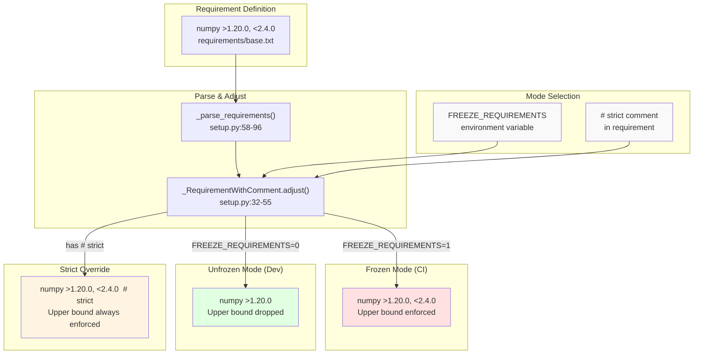
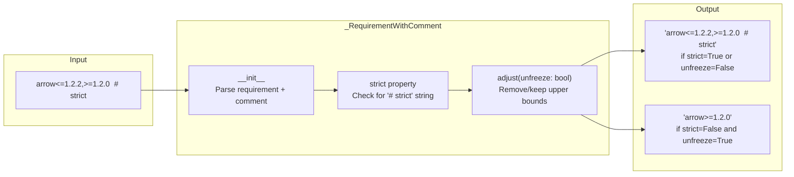
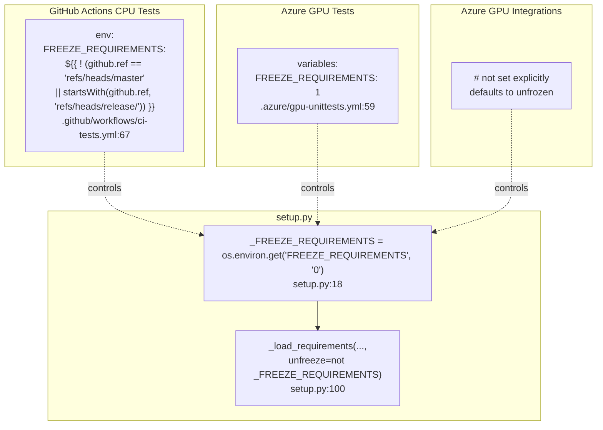
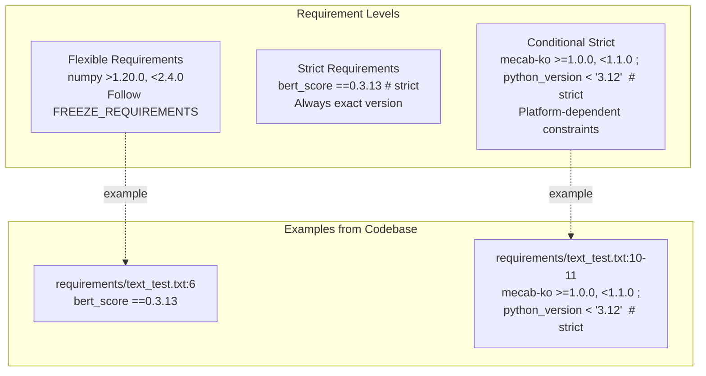
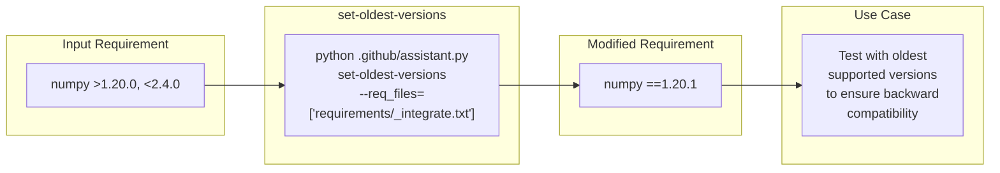
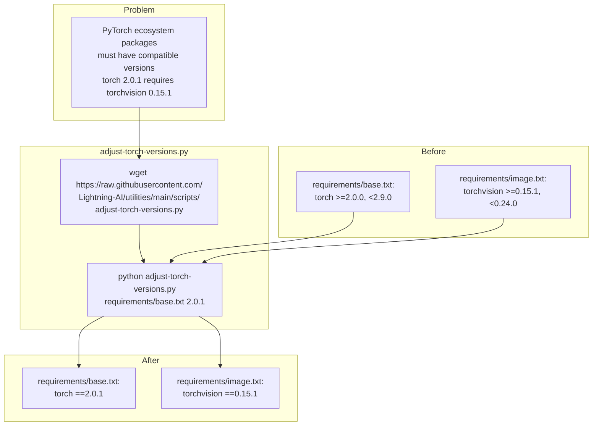
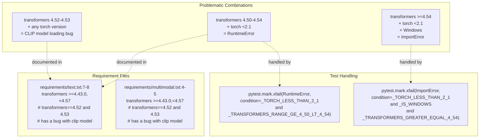
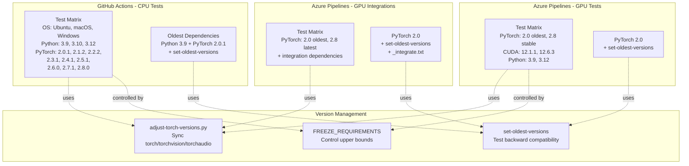
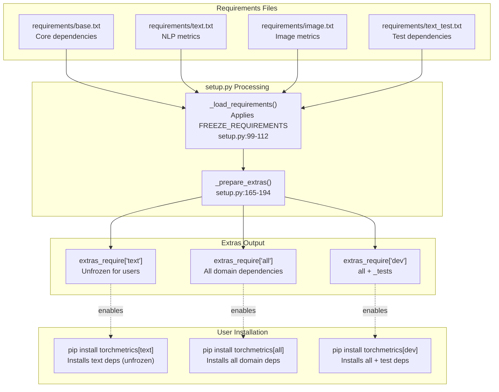

<!-- source: DeepWiki mcp.deepwiki.com · repo Lightning-AI/torchmetrics · page 14.2 Version Management and Compatibility · fetched 2026-10-21 -->

# Version Management and Compatibility

<details>
<summary>Relevant source files</summary>

The following files were used as context for generating this wiki page:

- [.azure/gpu-integrations.yml](.azure/gpu-integrations.yml)
- [.azure/gpu-unittests.yml](.azure/gpu-unittests.yml)
- [.github/workflows/ci-tests.yml](.github/workflows/ci-tests.yml)
- [.github/workflows/docker-build.yml](.github/workflows/docker-build.yml)
- [requirements.txt](requirements.txt)
- [requirements/audio.txt](requirements/audio.txt)
- [requirements/base.txt](requirements/base.txt)
- [requirements/detection.txt](requirements/detection.txt)
- [requirements/image.txt](requirements/image.txt)
- [requirements/multimodal.txt](requirements/multimodal.txt)
- [requirements/text.txt](requirements/text.txt)
- [requirements/text_test.txt](requirements/text_test.txt)
- [requirements/typing.txt](requirements/typing.txt)
- [setup.py](setup.py)
- [tests/unittests/_helpers/__init__.py](tests/unittests/_helpers/__init__.py)
- [tests/unittests/multimodal/test_clip_score.py](tests/unittests/multimodal/test_clip_score.py)
- [tests/unittests/text/test_bertscore.py](tests/unittests/text/test_bertscore.py)
- [tests/unittests/text/test_infolm.py](tests/unittests/text/test_infolm.py)
- [tests/unittests/utilities/test_plot.py](tests/unittests/utilities/test_plot.py)

</details>


This document describes the version management system in TorchMetrics, which balances CI reproducibility with development flexibility. It covers the dual-mode version constraint system controlled by `FREEZE_REQUIREMENTS`, the requirement parsing infrastructure, version adjustment utilities, and known compatibility issues with key dependencies like `transformers` and PyTorch.

For information about the overall requirements file organization, see [Requirements File Organization](#14.1). For information about CI/CD pipelines that use these version management features, see [CI/CD Pipeline](#15.1).

## The Dual-Mode Version Strategy

TorchMetrics implements a sophisticated version management system that allows requirements to be **frozen** (strict upper bounds enforced) or **unfrozen** (only lower bounds enforced). This dual-mode approach ensures reproducibility in CI while allowing flexibility during development.

### Version Constraint Modes



**Sources:** [setup.py:18](), [setup.py:32-55](), [setup.py:100]()

The system provides three outcomes:
- **Frozen mode**: Upper bounds are enforced (e.g., `numpy >1.20.0, <2.4.0`)
- **Unfrozen mode**: Only lower bounds remain (e.g., `numpy >1.20.0`)
- **Strict requirements**: Always keep full specification regardless of mode (e.g., `transformers >=4.43.0,<4.57 # strict`)

## Requirement Parsing System

The requirement parsing infrastructure extends `pkg_resources.Requirement` to support inline comments and the strict marker system.

### _RequirementWithComment Class



**Sources:** [setup.py:21-55]()

The `_RequirementWithComment` class provides three key capabilities:

1. **Comment preservation**: Maintains inline comments from requirement files
2. **Strict detection**: Identifies requirements marked with `# strict`
3. **Conditional adjustment**: Modifies version constraints based on mode

Key method signature:
```python
def adjust(self, unfreeze: bool) -> str:
    """Remove version restrictions unless they are strict."""
```

**Implementation logic** [setup.py:32-55]():
- If `self.strict == True`: Always return full specification with `# strict` comment
- If `unfreeze == False`: Return original specification
- If `unfreeze == True` and not strict: Remove upper bounds (`<`, `<=` operators)

## FREEZE_REQUIREMENTS Environment Variable

The `FREEZE_REQUIREMENTS` environment variable controls whether upper bounds are enforced across the entire dependency tree.

### Environment Variable Usage

| Context | Value | Effect |
|---------|-------|--------|
| **CI/CD (PRs)** | `1` or `true` | Upper bounds enforced for reproducibility |
| **CI/CD (master/release)** | `0` or unset | Upper bounds dropped to test forward compatibility |
| **Local development** | Not set (default `0`) | Upper bounds dropped for flexibility |
| **Integration tests (oldest)** | `1` | Combined with `set-oldest-versions` for backward compat testing |

**Configuration locations:**



**Sources:** [setup.py:18](), [.github/workflows/ci-tests.yml:67](), [.azure/gpu-unittests.yml:59]()

### Example Behavior

Given this requirement in `requirements/text.txt` [requirements/text.txt:8]():
```
transformers >=4.43.0,<4.57
```

**With `FREEZE_REQUIREMENTS=1`:**
```bash
$ pip install torchmetrics
# Installs transformers with constraint: >=4.43.0,<4.57
```

**With `FREEZE_REQUIREMENTS=0` (default):**
```bash
$ pip install torchmetrics
# Installs transformers with constraint: >=4.43.0 (no upper bound)
```

## Strict Version Markers

The `# strict` inline comment provides per-requirement override of `FREEZE_REQUIREMENTS`, ensuring critical version constraints are always enforced.

### Strict Marker System



**Sources:** [requirements/text_test.txt:6](), [requirements/text_test.txt:10-11]()

### When to Use Strict Markers

Use `# strict` for:
1. **Known compatibility issues**: Exact versions required due to breaking changes
2. **Reference implementation parity**: Testing against specific baseline versions
3. **Platform-specific constraints**: Requirements that vary by Python version or OS

**Example from text_test.txt** [requirements/text_test.txt:6]():
```
bert_score ==0.3.13
```
This ensures test results match the reference implementation exactly.

**Example with environment marker** [requirements/text_test.txt:10]():
```
mecab-ko >=1.0.0, <1.1.0 ; python_version < "3.12"  # strict # todo: unpin python_version
```
This maintains strict bounds on older Python versions where the package behavior is validated.

## Version Adjustment Utilities

TorchMetrics provides two utilities for modifying requirement files based on testing needs.

### set-oldest-versions Utility

The `set-oldest-versions` command converts `>=` constraints to `==` constraints, enabling backward compatibility testing.



**Sources:** [.github/workflows/ci-tests.yml:123](), [.azure/gpu-unittests.yml:125-127](), [.azure/gpu-integrations.yml:76-78]()

**Usage in CI workflows:**

**GitHub Actions** [.github/workflows/ci-tests.yml:121-123]():
```yaml
- name: Set min. dependencies
  if: matrix.requires == 'oldest'
  run: python .github/assistant.py set-oldest-versions
```

**Azure GPU Tests** [.azure/gpu-unittests.yml:124-127]():
```bash
- bash: |
    python .github/assistant.py set-oldest-versions
  condition: eq(variables['torch-ver'], '2.0')
  displayName: "Setting oldest versions"
```

**Azure GPU Integrations** [.azure/gpu-integrations.yml:75-78]():
```bash
- bash: |
    set -e
    python .github/assistant.py set-oldest-versions --req_files='["requirements/_integrate.txt"]'
    cat requirements/_integrate.txt
  condition: eq(variables['requires'], 'oldest')
```

The utility supports:
- `--req_files` parameter to target specific requirement files
- Default behavior: processes all `*.txt` files in `requirements/` directory
- Conversion logic: `>=X.Y.Z` becomes `==X.Y.Z` (using the lower bound)

### adjust-torch-versions.py Utility

The `adjust-torch-versions.py` script synchronizes PyTorch ecosystem packages (torch, torchvision, torchaudio) to compatible versions.



**Sources:** [.github/workflows/ci-tests.yml:118-120](), [.azure/gpu-unittests.yml:115-122]()

**Usage in GitHub Actions** [.github/workflows/ci-tests.yml:117-120]():
```yaml
- name: Set PyTorch version
  run: |
    python -m wget https://raw.githubusercontent.com/Lightning-AI/utilities/main/scripts/adjust-torch-versions.py
    python adjust-torch-versions.py requirements/base.txt ${{ matrix.pytorch-version }}
```

**Usage in Azure Pipelines** [.azure/gpu-unittests.yml:115-122]():
```bash
- bash: |
    pip install -q packaging
    wget https://raw.githubusercontent.com/Lightning-AI/utilities/main/scripts/adjust-torch-versions.py
    for fpath in `ls requirements/*.txt`; do
        # torch version shall be sourced based on the used docker
        python adjust-torch-versions.py $fpath
    done
  displayName: "Adjust versions"
```

The script:
1. Identifies torch/torchvision/torchaudio version requirements
2. Looks up compatible version combinations
3. Updates all requirement files to use exact matching versions
4. Prevents installation failures due to version mismatches

## Known Compatibility Issues

TorchMetrics maintains explicit compatibility tracking for problematic dependency combinations.

### Transformers + PyTorch Compatibility Matrix



**Sources:** [requirements/text.txt:7-8](), [requirements/multimodal.txt:4-5](), [tests/unittests/_helpers/__init__.py:38-40]()

### Compatibility Issue Categories

#### 1. Transformers 4.50-4.54 + PyTorch <2.1

**Symptom:** RuntimeError during model initialization or forward pass

**Affected metrics:**
- BERTScore [tests/unittests/text/test_bertscore.py:101-107]()
- InfoLM [tests/unittests/text/test_infolm.py:106-112]()
- CLIPScore [tests/unittests/multimodal/test_clip_score.py:96-101]()

**Test handling** [tests/unittests/text/test_bertscore.py:101-107]():
```python
@pytest.mark.xfail(
    RuntimeError,
    # todo: if the transformers compatibility issue present in next feature release,
    #  consider bumping also torch min versions in the metrics implementations
    condition=_TORCH_LESS_THAN_2_1 and _TRANSFORMERS_RANGE_GE_4_50_LT_4_54,
    reason="could be due to torch compatibility issues with transformers",
)
```

#### 2. Transformers 4.52-4.53 CLIP Loading Bug

**Symptom:** CLIP model fails to load correctly

**Mitigation:** Upper bound excludes 4.52-4.53 [requirements/text.txt:7-8]():
```
# transformers==4.52 and 4.53 has a bug with the clip model loading
transformers >=4.43.0,<4.57
```

#### 3. Transformers >=4.54 + PyTorch <2.1 + Windows

**Symptom:** ImportError on Windows platforms

**Test handling** [tests/unittests/text/test_bertscore.py:108-112]():
```python
@pytest.mark.xfail(
    ImportError,
    condition=_TORCH_LESS_THAN_2_1 and _IS_WINDOWS and _TRANSFORMERS_GREATER_EQUAL_4_54,
    reason="another strange behaviour of transformers on windows",
)
```

### Compatibility Check Helpers

**Helper constants** [tests/unittests/_helpers/__init__.py:35-40]():
```python
_IS_WINDOWS = sys.platform.startswith("win32")
_TORCH_LESS_THAN_2_1 = RequirementCache("torch<2.1.0")
_TRANSFORMERS_RANGE_GE_4_50_LT_4_54 = RequirementCache("transformers>=4.50.0,<4.54.0")
_TRANSFORMERS_GREATER_EQUAL_4_54 = RequirementCache("transformers>=4.54.0")
```

These constants are imported and used throughout test files to conditionally skip or mark tests as expected failures based on the installed environment.

## Testing with Different Version Combinations

The CI/CD infrastructure tests multiple version combinations to ensure broad compatibility.

### Test Matrix Strategy



**Sources:** [.github/workflows/ci-tests.yml:34-65](), [.azure/gpu-unittests.yml:25-33](), [.azure/gpu-integrations.yml:17-26]()

### Matrix Configuration Examples

**GitHub Actions CPU Matrix** [.github/workflows/ci-tests.yml:34-53]():
- 9 PyTorch versions (2.0.1 through 2.8.0) on Ubuntu + Python 3.10
- Additional combinations for Python 3.9, 3.12
- macOS and Windows coverage for oldest and latest versions

**Azure GPU Matrix** [.azure/gpu-unittests.yml:26-33]():
- PyTorch 2.0 (oldest supported) with CUDA 12.1.1
- PyTorch 2.8 (latest stable) with CUDA 12.6.3

**Version Compatibility Flow:**

1. **Pull request CI** [.github/workflows/ci-tests.yml:67]():
   - `FREEZE_REQUIREMENTS=1` for reproducibility
   - Test against frozen upper bounds

2. **Master/Release branches**:
   - `FREEZE_REQUIREMENTS=0` to test forward compatibility
   - Allows newest versions of dependencies

3. **Oldest version testing** [.azure/gpu-unittests.yml:126]():
   - `set-oldest-versions` converts `>=` to `==`
   - Ensures minimum version requirements are accurate

## Integration with setup.py

The version management system integrates with setuptools through the `_prepare_extras()` function.

### Extras and Version Constraints



**Sources:** [setup.py:165-194](), [setup.py:99-112](), [setup.py:222]()

**Key behavior** [setup.py:165-194]():
- Domain-specific extras (e.g., `text`, `image`) are created from requirement files
- Test requirements (`*_test.txt`) are aggregated into hidden `_tests` extra
- Meta-extras `all` and `dev` combine multiple requirement sets
- When users install via pip, `FREEZE_REQUIREMENTS` defaults to `0` (unfrozen)

**Example user installation:**
```bash
# User installs with upper bounds dropped (flexible)
$ pip install torchmetrics[text]
# Results in: transformers >=4.43.0 (no upper bound)

# CI installs with upper bounds enforced (reproducible)
$ FREEZE_REQUIREMENTS=1 pip install torchmetrics[text]
# Results in: transformers >=4.43.0,<4.57
```

This dual behavior allows:
- **Users**: Install latest compatible versions
- **CI/CD**: Test against specific version ranges
- **Developers**: Flexibility in local environments

**Sources:** [setup.py:18](), [setup.py:100](), [setup.py:165-194](), [setup.py:222](), [requirements/text.txt:8](), [requirements/multimodal.txt:5](), [.github/workflows/ci-tests.yml:67](), [.azure/gpu-unittests.yml:59](), [.azure/gpu-unittests.yml:124-127](), [.github/workflows/ci-tests.yml:118-123](), [tests/unittests/text/test_bertscore.py:101-112](), [tests/unittests/_helpers/__init__.py:35-40]()

---

