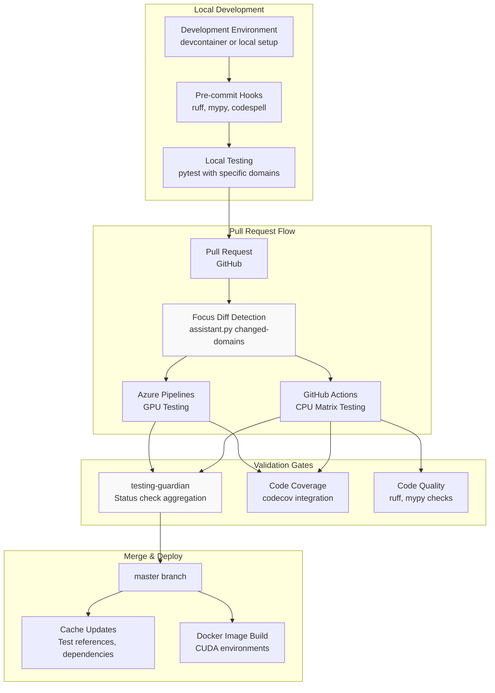
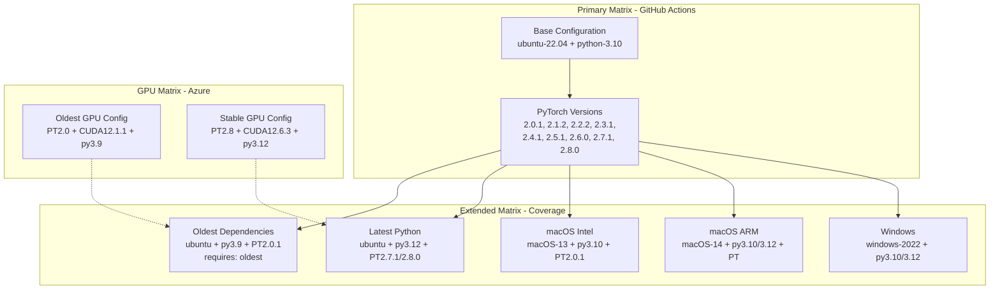
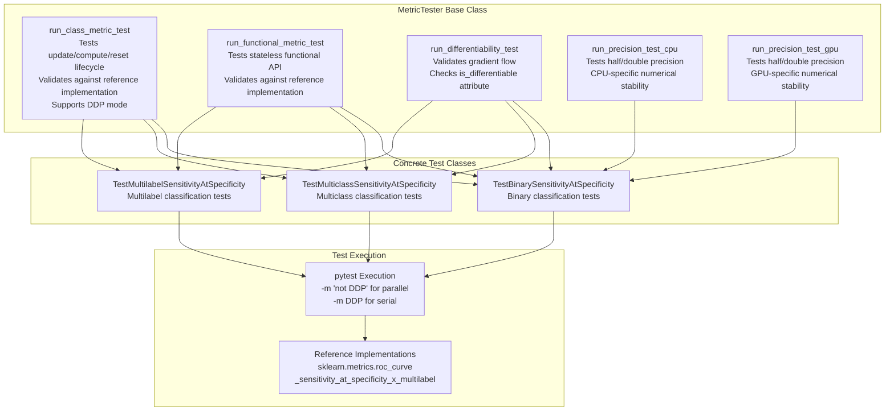
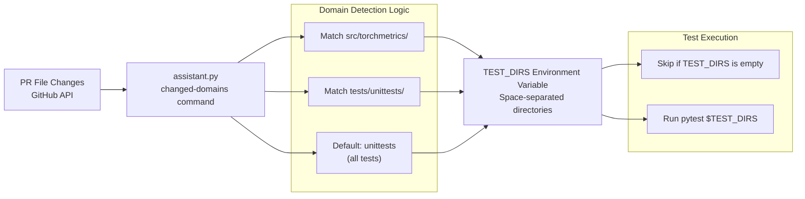
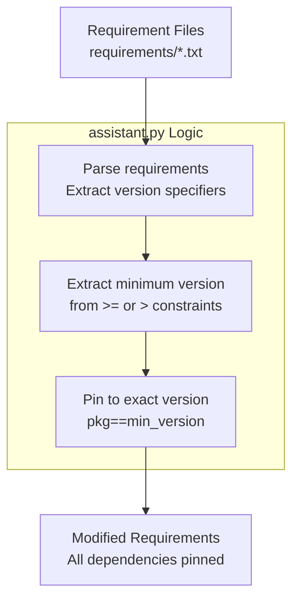
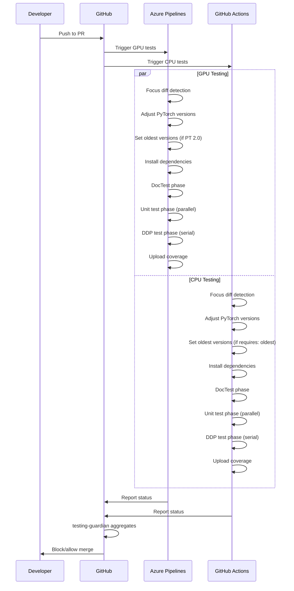

<!-- source: DeepWiki mcp.deepwiki.com · repo Lightning-AI/torchmetrics · page 15 Development and Testing · fetched 2026-10-21 -->

# Development and Testing

<details>
<summary>Relevant source files</summary>

The following files were used as context for generating this wiki page:

- [.azure/gpu-integrations.yml](.azure/gpu-integrations.yml)
- [.azure/gpu-unittests.yml](.azure/gpu-unittests.yml)
- [.github/actions/pull-caches/action.yml](.github/actions/pull-caches/action.yml)
- [.github/actions/push-caches/action.yml](.github/actions/push-caches/action.yml)
- [.github/assistant.py](.github/assistant.py)
- [.github/workflows/_focus-diff.yml](.github/workflows/_focus-diff.yml)
- [.github/workflows/ci-integrate.yml](.github/workflows/ci-integrate.yml)
- [.github/workflows/ci-tests.yml](.github/workflows/ci-tests.yml)
- [.github/workflows/cmd-help.yml](.github/workflows/cmd-help.yml)
- [.github/workflows/cmd-rebase.yml](.github/workflows/cmd-rebase.yml)
- [.github/workflows/docker-build.yml](.github/workflows/docker-build.yml)
- [.github/workflows/docs-build.yml](.github/workflows/docs-build.yml)
- [.github/workflows/labeler.yml](.github/workflows/labeler.yml)
- [.github/workflows/publish-pkg.yml](.github/workflows/publish-pkg.yml)
- [.github/workflows/slash-cmd-dispatch.yml](.github/workflows/slash-cmd-dispatch.yml)
- [requirements/_ci.txt](requirements/_ci.txt)
- [requirements/_doctest.txt](requirements/_doctest.txt)
- [requirements/_tests.txt](requirements/_tests.txt)
- [requirements/audio.txt](requirements/audio.txt)
- [requirements/base.txt](requirements/base.txt)
- [requirements/detection.txt](requirements/detection.txt)
- [requirements/image.txt](requirements/image.txt)
- [requirements/typing.txt](requirements/typing.txt)
- [tests/unittests/classification/test_auc.py](tests/unittests/classification/test_auc.py)
- [tests/unittests/classification/test_sensitivity_specificity.py](tests/unittests/classification/test_sensitivity_specificity.py)

</details>


This document provides an overview of the development workflow, testing philosophy, and contribution guidelines for the torchmetrics library. It covers the dual-platform CI/CD infrastructure, testing patterns, and development environment setup.

For detailed information about specific subsystems, see:
- [CI/CD Pipeline](#15.1) - Azure Pipelines, GitHub Actions, and automated testing workflows
- [Testing Framework](#15.2) - MetricTester base class, test patterns, and reference validation
- [Documentation System](#15.3) - Sphinx configuration and documentation build pipeline
- [Code Quality and Pre-commit Hooks](#15.4) - Linters, type checkers, and automated code quality tools

## Overview

The torchmetrics development process emphasizes correctness, compatibility, and maintainability through:

1. **Dual-Platform CI Strategy**: GPU-intensive workloads run on Azure Pipelines with dedicated hardware, while CPU tests run on GitHub Actions across multiple operating systems
2. **Comprehensive Testing**: Each metric is validated through four dimensions: class-based API, functional API, differentiability, and precision (half/double)
3. **Reference Validation**: All metrics are tested against established implementations (scikit-learn, torch-fidelity, etc.)
4. **Matrix Testing**: Tests run across Python 3.9-3.12, PyTorch 2.0-2.8, and both oldest-supported and latest-available dependencies
5. **Focus Testing**: Pull requests automatically run only tests affected by changed code to optimize CI time

Sources: [.azure/gpu-unittests.yml](), [.github/workflows/ci-tests.yml](), [tests/unittests/classification/test_sensitivity_specificity.py]()

## Development Workflow



**Development Workflow Diagram**

The development workflow begins with a local environment (either devcontainer or manual setup), followed by pre-commit hooks that run `ruff`, `mypy`, and `codespell` before commits. Local testing focuses on specific domains to speed up iteration.

When a pull request is created, the `assistant.py changed-domains` command determines which test directories need to run based on file changes. This "focus diff" optimization significantly reduces CI time for targeted changes. Both CPU and GPU tests run in parallel, with results aggregated by the `testing-guardian` job that blocks merging if tests fail.

After merging to master, caches are updated (test references, pip packages) and Docker images are rebuilt if requirements change.

Sources: [.github/workflows/ci-tests.yml:27-29](), [.azure/gpu-unittests.yml:89-99](), [.devcontainer/devcontainer.json]()

## Dual-Platform CI Architecture

```mermaid
graph LR
    subgraph "Azure Pipelines"
        GPU_POOL["lit-rtx-3090<br/>Dedicated GPU Pool"]
        
        subgraph "GPU Job Configuration"
            DOCKER_IMG["Docker Images<br/>ubuntu-cuda containers"]
            CACHE_GPU["Cache Directories<br/>/var/tmp/torch<br/>/var/tmp/hf<br/>/var/tmp/pip"]
            ADJUST_DEPS["adjust-torch-versions.py<br/>Align PyTorch ecosystem"]
        end
        
        subgraph "GPU Test Phases"
            DOCTEST_GPU["DocTest Phase<br/>pytest torchmetrics"]
            UNITTEST_GPU["Unit Test Phase<br/>-m 'not DDP' -n 6"]
            DDP_TEST["DDP Test Phase<br/>-m DDP serial"]
        end
    end
    
    subgraph "GitHub Actions"
        MATRIX["Test Matrix<br/>OS × Python × PyTorch × Reqs"]
        
        subgraph "CPU Job Configuration"
            UV_INSTALL["uv Package Manager<br/>Fast dependency install"]
            PYPI_CACHE["PyPI Cache<br/>_ci-cache_PyPI"]
            OS_SETUP["OS-Specific Setup<br/>ffmpeg, mecab, etc."]
        end
        
        subgraph "CPU Test Phases"
            DOCTEST_CPU["DocTest Phase<br/>src/torchmetrics"]
            UNITTEST_CPU["Unit Test Phase<br/>-m 'not DDP' -n auto"]
            DDP_CPU["DDP Test Phase<br/>-m DDP serial"]
        end
    end
    
    GPU_POOL --> DOCKER_IMG
    DOCKER_IMG --> CACHE_GPU
    CACHE_GPU --> ADJUST_DEPS
    ADJUST_DEPS --> DOCTEST_GPU
    DOCTEST_GPU --> UNITTEST_GPU
    UNITTEST_GPU --> DDP_TEST
    
    MATRIX --> UV_INSTALL
    UV_INSTALL --> PYPI_CACHE
    PYPI_CACHE --> OS_SETUP
    OS_SETUP --> DOCTEST_CPU
    DOCTEST_CPU --> UNITTEST_CPU
    UNITTEST_CPU --> DDP_CPU
```



**Dual-Platform CI Architecture Diagram**

The CI infrastructure uses two complementary platforms:

**Azure Pipelines** handles GPU testing on the `lit-rtx-3090` pool with pre-built Docker images. The configuration uses persistent caches at `/var/tmp/torch`, `/var/tmp/hf`, and `/var/tmp/pip` that survive across runs on the same machines. The `adjust-torch-versions.py` script ensures PyTorch, torchvision, and torchaudio versions are aligned. Tests run in three phases: doctests (with reruns), parallel unit tests (6 processes), and serial DDP tests.

**GitHub Actions** handles CPU testing across a matrix of configurations (3 OSes × 4 Python versions × 9 PyTorch versions × 2 dependency strategies). It uses `uv` for fast package installation and caches dependencies in `_ci-cache_PyPI`. Each OS requires specific setup (e.g., `mecab` on macOS, `ffmpeg` on all platforms). Tests follow the same three-phase pattern as Azure.

Sources: [.azure/gpu-unittests.yml:42-60](), [.github/workflows/ci-tests.yml:23-76]()

## Testing Philosophy

The torchmetrics testing philosophy is built on four core principles:

| Principle | Implementation | Purpose |
|-----------|---------------|---------|
| **Correctness** | Reference validation against scikit-learn, torch-fidelity | Ensure metric calculations match established implementations |
| **Compatibility** | Matrix testing across PyTorch 2.0-2.8, Python 3.9-3.12 | Support wide range of environments |
| **Completeness** | Four test dimensions per metric | Validate class API, functional API, differentiability, precision |
| **Efficiency** | Focus diff optimization, parallel execution | Minimize CI time while maintaining coverage |

### Test Matrix Configuration

The test matrix balances comprehensive coverage with practical constraints:



**Test Matrix Configuration Diagram**

The primary matrix runs all PyTorch versions on Ubuntu 22.04 with Python 3.10. The extended matrix adds specific combinations to test edge cases: oldest dependencies (`requires: oldest` flag), latest Python version, both Intel and ARM macOS, and Windows. GPU testing focuses on two key configurations: oldest supported (PyTorch 2.0 with CUDA 12.1.1) and stable latest (PyTorch 2.8 with CUDA 12.6.3).

Sources: [.github/workflows/ci-tests.yml:34-65](), [.azure/gpu-unittests.yml:26-36]()

## MetricTester Framework

All metric tests inherit from the `MetricTester` base class, which provides standardized test methods:



**MetricTester Framework Diagram**

The `MetricTester` base class provides five standardized test methods that every metric test class uses. Each concrete test class (like `TestBinarySensitivityAtSpecificity`) implements test methods that call these base methods with appropriate parameters.

The class-based test validates the stateful API (update/compute/reset), the functional test validates the stateless API, the differentiability test ensures gradients flow correctly, and the precision tests validate numerical stability in half and double precision on both CPU and GPU.

All tests compare results against reference implementations, typically from scikit-learn or custom implementations that replicate established algorithms.

Sources: [tests/unittests/classification/test_sensitivity_specificity.py:88-180]()

### Example: Test Implementation Pattern

The following table shows the standard test pattern used throughout the codebase:

| Test Method | Decorator | Purpose | Reference |
|-------------|-----------|---------|-----------|
| `test_binary_sensitivity_at_specificity` | `@pytest.mark.parametrize` with `ddp`, `min_specificity`, `ignore_index` | Class-based API validation with DDP support | [test_sensitivity_specificity.py:94-115]() |
| `test_binary_sensitivity_at_specificity_functional` | `@pytest.mark.parametrize` with `min_specificity`, `ignore_index` | Functional API validation | [test_sensitivity_specificity.py:119-139]() |
| `test_binary_sensitivity_at_specificity_differentiability` | None | Gradient flow validation | [test_sensitivity_specificity.py:141-150]() |
| `test_binary_sensitivity_at_specificity_dtype_cpu` | `@pytest.mark.parametrize` with `dtype` | CPU precision testing | [test_sensitivity_specificity.py:152-165]() |
| `test_binary_sensitivity_at_specificity_dtype_gpu` | `@pytest.mark.skipif` + `@pytest.mark.parametrize` with `dtype` | GPU precision testing | [test_sensitivity_specificity.py:167-179]() |

DDP tests use the `@pytest.mark.DDP` decorator and run serially to avoid resource conflicts. Non-DDP tests run in parallel with `pytest-xdist` using `-n auto` (GitHub Actions) or `-n 6` (Azure Pipelines).

Sources: [tests/unittests/classification/test_sensitivity_specificity.py:86-193]()

## Environment Variables and Configuration

The CI system uses several environment variables to control behavior:

| Variable | Purpose | Platforms | Example |
|----------|---------|-----------|---------|
| `FREEZE_REQUIREMENTS` | Pin exact dependency versions | Both | Set to `1` for PRs, unset for master |
| `TEST_DIRS` | Focus testing on specific domains | Both | `unittests/classification unittests/image` |
| `TORCH_HOME` | Cache PyTorch model checkpoints | Azure | `/var/tmp/torch` |
| `TRANSFORMERS_CACHE` | Cache HuggingFace models | Azure | `/var/tmp/hf/transformers` |
| `HF_HOME` | HuggingFace home directory | Azure | `/var/tmp/hf/home` |
| `ALLOW_SKIP_IF_OUT_OF_MEMORY` | Allow OOM skip in PRs | Both | Set to `1` for PRs |
| `ALLOW_SKIP_IF_BAD_CONNECTION` | Allow connection error skip in PRs | Both | Set to `1` for PRs |
| `USE_PYTEST_POOL` | Use pytest-pool for DDP tests | Both | Set to `1` for DDP phase |
| `UV_TORCH_BACKEND` | Set PyTorch backend for uv | GitHub | `cpu` |

The `FREEZE_REQUIREMENTS` variable controls version pinning strategy. When set, `assistant.py set-oldest-versions` pins all dependencies to their minimum supported versions, enabling testing against the oldest supported configuration.

Sources: [.azure/gpu-unittests.yml:44-59](), [.github/workflows/ci-tests.yml:66-72]()

## Focus Diff Optimization

The focus diff system automatically determines which test directories need to run based on file changes:



**Focus Diff Optimization Diagram**

For pull requests, the `.github/assistant.py changed-domains` command analyzes changed files and determines which test directories need to run. If changes are in `src/torchmetrics/classification/`, only `unittests/classification` runs. If changes are in core infrastructure, all tests run. This optimization can reduce CI time from 120 minutes to 20 minutes for focused changes.

The `TEST_DIRS` variable is set to an empty string if no relevant tests are found, causing test steps to be skipped with the condition `if: ${{ env.TEST_DIRS != '' }}`.

Sources: [.azure/gpu-unittests.yml:89-99](), [.github/workflows/ci-tests.yml:27-29]()

## Caching Strategy

The caching strategy differs between platforms:

**Azure Pipelines (GPU):**
- Uses machine-persistent caches at `/var/tmp/` that survive across runs
- Caches: PyTorch checkpoints (`TORCH_HOME`), HuggingFace models (`TRANSFORMERS_CACHE`, `HF_HOME`), pip packages (`PIP_CACHE_DIR`)
- Test references cached in `/var/tmp/cached-references.zip`
- Cache updated only on successful master builds to avoid polluting with failed test artifacts

**GitHub Actions (CPU):**
- Uses GitHub Actions cache with `astral-sh/setup-uv` for uv cache
- Custom cache action `.github/actions/pull-caches` for PyPI packages and test references
- Cache updated only on non-PR builds to prevent cache thrashing

The test reference cache contains pre-computed reference implementations that are expensive to calculate (e.g., image quality metrics on large datasets). These are downloaded from S3 (`https://pl-public-data.s3.amazonaws.com/metrics/data.zip`) and supplemented with locally cached results.

Sources: [.azure/gpu-unittests.yml:157-219](), [.github/workflows/ci-tests.yml:109-241]()

## Version Management

The repository uses two testing strategies for dependencies:

### Oldest-Supported Testing

The `assistant.py set-oldest-versions` command modifies requirement files to pin all dependencies to their minimum versions:



**Oldest-Supported Version Management Diagram**

When `requires: oldest` is set in the matrix, the assistant script parses each requirement file and pins every package to its minimum supported version. For example, `numpy >1.20.0, <2.4.0` becomes `numpy==1.20.1`.

This ensures the library remains compatible with older environments and catches breaking changes early.

### Latest-Available Testing

Without the `requires: oldest` flag, dependencies install with flexible version constraints, testing against the latest available versions. The `FREEZE_REQUIREMENTS` variable controls whether constraints are frozen during installation.

### PyTorch Ecosystem Alignment

The `adjust-torch-versions.py` script ensures PyTorch, torchvision, and torchaudio versions are aligned:

- Downloads from `https://raw.githubusercontent.com/Lightning-AI/utilities/main/scripts/adjust-torch-versions.py`
- Modifies requirement files to specify matching versions
- Handles CUDA version compatibility (e.g., `cu121`, `cu126`)
- Used in both Azure and GitHub workflows

Sources: [.azure/gpu-unittests.yml:115-127](), [.github/workflows/ci-tests.yml:117-123](), [dockers/ubuntu-cuda/Dockerfile:98-104]()

## Development Environment Setup

The repository provides two development environment options:

### Devcontainer

The `.devcontainer/` configuration provides a VS Code development container:

- Based on `pytorchlightning/torchmetrics:devcontainer-py3.9` image
- Pre-installs all development dependencies from `requirements/_devel.txt` and `requirements/_docs.txt`
- Configures VS Code with Python, pytest, linting, and RST extensions
- Sets up pre-commit hooks automatically via `postCreateCommand`
- Requires WSL2 on Windows for GPU support (optional)

The devcontainer Dockerfile downloads Sphinx packages from S3 (`s3://sphinx-packages/`) to enable offline documentation builds.

### Local Setup

For local development without devcontainer:

1. Install Python 3.9-3.12
2. Install dependencies: `pip install -e .[dev]`
3. Install pre-commit hooks: `pre-commit install`
4. Run tests: `pytest tests/unittests/<domain>/`

Sources: [.devcontainer/devcontainer.json:1-90](), [.devcontainer/Dockerfile:1-36]()

## Docker Images

The repository maintains Docker images for CI and development:

### CUDA Runtime Images

Built by `.github/workflows/docker-build.yml`, these images support GPU testing:

- **Base**: `nvidia/cuda:{CUDA_VERSION}-runtime-ubuntu{UBUNTU_VERSION}`
- **Python**: Installed via deadsnakes PPA (3.9-3.12)
- **Dependencies**: All torchmetrics requirements including domain-specific packages
- **Special handling**: Patches `pkgutil.py` for Python 3.12+ compatibility, installs `onnxruntime_gpu` instead of `onnxruntime` for audio metrics

Images are tagged as: `pytorchlightning/torchmetrics:ubuntu{UBUNTU}-cuda{CUDA}-py{PYTHON}-torch{TORCH}`

Example: `pytorchlightning/torchmetrics:ubuntu24.04-cuda12.6.3-py3.12-torch2.8`

### Devcontainer Images

Built by the same workflow, these images provide development environments:

- Tagged as: `pytorchlightning/torchmetrics:devcontainer-py{PYTHON}`
- Include AWS CLI for downloading Sphinx packages from S3
- Install development and documentation dependencies

Images are automatically built and pushed to DockerHub when requirements change or on manual trigger.

Sources: [.github/workflows/docker-build.yml:61-109](), [dockers/ubuntu-cuda/Dockerfile:15-123]()

## Test Execution Flow



**Test Execution Flow Sequence Diagram**

When a developer pushes to a pull request, both Azure Pipelines and GitHub Actions trigger in parallel. Each platform follows the same general flow: detect focused tests, adjust PyTorch versions, install dependencies, then run three test phases (doctest, unit tests, DDP tests).

The `testing-guardian` job waits for all test jobs to complete and aggregates their results. If any job fails, the guardian job fails, blocking the merge. This provides a single status check for pull requests.

Sources: [.azure/gpu-unittests.yml:68-233](), [.github/workflows/ci-tests.yml:245-257]()

## Common Testing Patterns

### Reference Validation Pattern

```python
def _reference_sklearn_sensitivity_at_specificity_binary(preds, target, min_specificity, ignore_index=None):
    """Custom reference implementation matching sklearn behavior."""
    preds = preds.flatten().numpy()
    target = target.flatten().numpy()
    if np.issubdtype(preds.dtype, np.floating) and not ((preds > 0) & (preds < 1)).all():
        preds = sigmoid(preds)
    target, preds = remove_ignore_index(target=target, preds=preds, ignore_index=ignore_index)
    return _sensitivity_at_specificity_x_multilabel(preds, target, min_specificity)
```

Reference functions convert PyTorch tensors to numpy, apply necessary transformations, remove ignored indices, and call established implementations or replicate reference algorithms.

### Parametrized Testing Pattern

```python
@pytest.mark.parametrize("min_specificity", [0.05, 0.10, 0.3, 0.5, 0.85])
@pytest.mark.parametrize("ignore_index", [None, -1, 0])
@pytest.mark.parametrize("ddp", [pytest.param(True, marks=pytest.mark.DDP), False])
def test_binary_sensitivity_at_specificity(self, inputs, ddp, min_specificity, ignore_index):
    """Test class implementation of metric."""
```

Tests use `@pytest.mark.parametrize` extensively to cover multiple configurations. The DDP parameter uses `pytest.param(True, marks=pytest.mark.DDP)` to mark distributed tests for serial execution.

### Precision Testing Pattern

```python
@pytest.mark.parametrize("dtype", [torch.half, torch.double])
def test_binary_sensitivity_at_specificity_dtype_cpu(self, inputs, dtype):
    """Test dtype support of the metric on CPU."""
    if not _TORCH_GREATER_EQUAL_2_1 and (preds < 0).any() and dtype == torch.half:
        pytest.xfail(reason="torch.sigmoid in metric does not support cpu + half precision for torch<2.1")
```

Precision tests validate numerical stability in half and double precision. The pattern includes conditional `pytest.xfail` for known PyTorch limitations.

Sources: [tests/unittests/classification/test_sensitivity_specificity.py:77-179]()

## Summary

The torchmetrics development and testing infrastructure is designed for:

- **Correctness**: Every metric validated against reference implementations
- **Compatibility**: Comprehensive matrix testing across Python versions, PyTorch versions, and operating systems  
- **Performance**: Focus diff optimization and parallel execution minimize CI time
- **Maintainability**: Standardized MetricTester framework ensures consistent test patterns

The dual-platform strategy (Azure GPU + GitHub CPU) provides optimal resource utilization, with expensive GPU tests running on dedicated hardware and broad compatibility testing running on GitHub's matrix infrastructure.

For detailed information about specific subsystems, refer to the child pages:
- [CI/CD Pipeline](#15.1)
- [Testing Framework](#15.2)
- [Documentation System](#15.3)
- [Code Quality and Pre-commit Hooks](#15.4)

---

