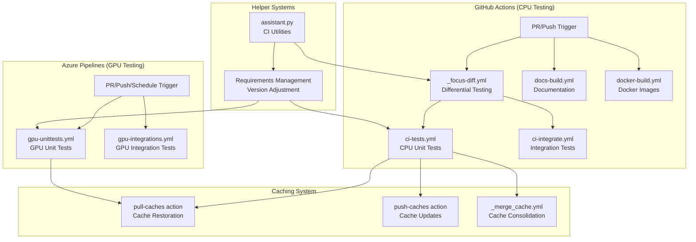
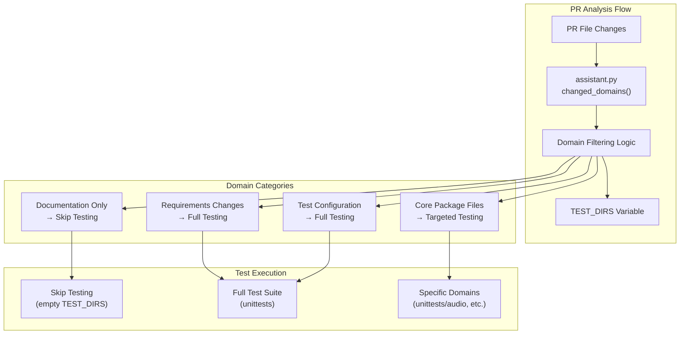
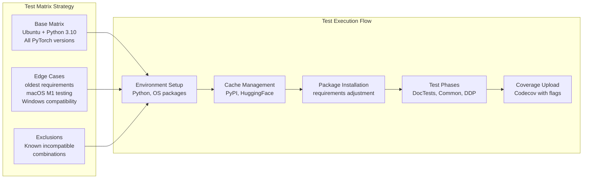
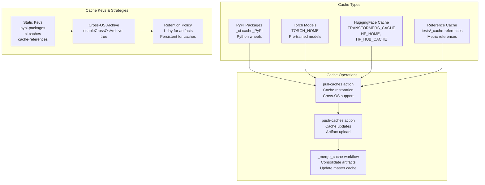
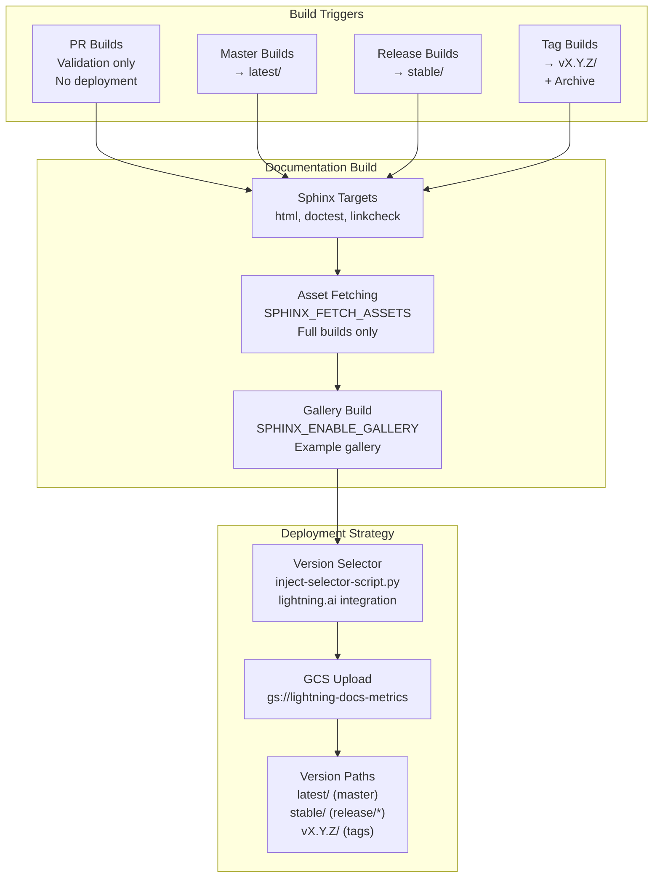
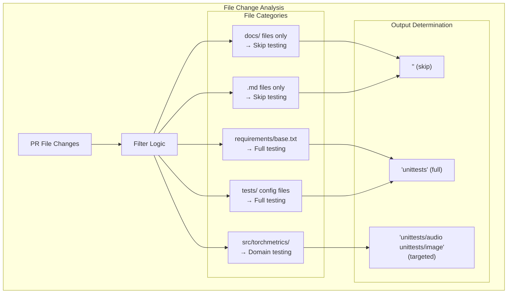

<!-- source: DeepWiki mcp.deepwiki.com · repo Lightning-AI/torchmetrics · page 15.1 CI/CD Pipeline · fetched 2026-10-21 -->

# CI/CD Pipeline

Relevant source files

The following files were used as context for generating this wiki page:

- [.azure/gpu-integrations.yml](.azure/gpu-integrations.yml)
- [.azure/gpu-unittests.yml](.azure/gpu-unittests.yml)
- [.github/actions/pull-caches/action.yml](.github/actions/pull-caches/action.yml)
- [.github/actions/push-caches/action.yml](.github/actions/push-caches/action.yml)
- [.github/assistant.py](.github/assistant.py)
- [.github/workflows/_focus-diff.yml](.github/workflows/_focus-diff.yml)
- [.github/workflows/ci-integrate.yml](.github/workflows/ci-integrate.yml)
- [.github/workflows/ci-tests.yml](.github/workflows/ci-tests.yml)
- [.github/workflows/cmd-help.yml](.github/workflows/cmd-help.yml)
- [.github/workflows/cmd-rebase.yml](.github/workflows/cmd-rebase.yml)
- [.github/workflows/docker-build.yml](.github/workflows/docker-build.yml)
- [.github/workflows/docs-build.yml](.github/workflows/docs-build.yml)
- [.github/workflows/labeler.yml](.github/workflows/labeler.yml)
- [.github/workflows/publish-pkg.yml](.github/workflows/publish-pkg.yml)
- [.github/workflows/slash-cmd-dispatch.yml](.github/workflows/slash-cmd-dispatch.yml)
- [requirements/_ci.txt](requirements/_ci.txt)
- [requirements/audio.txt](requirements/audio.txt)
- [requirements/audio_test.txt](requirements/audio_test.txt)
- [requirements/base.txt](requirements/base.txt)
- [requirements/detection.txt](requirements/detection.txt)
- [requirements/image.txt](requirements/image.txt)
- [requirements/typing.txt](requirements/typing.txt)
- [tests/unittests/classification/test_auc.py](tests/unittests/classification/test_auc.py)

The CI/CD pipeline for TorchMetrics provides comprehensive automated testing, documentation building, and deployment across multiple platforms, Python versions, and PyTorch versions. The pipeline uses both GitHub Actions for CPU testing and Azure Pipelines for GPU testing, with sophisticated caching and differential testing capabilities.

For information about the testing framework used within the CI/CD pipeline, see [Testing Framework](#13.2). For documentation generation specifics, see [Documentation System](#13.3).

## Pipeline Architecture Overview

The TorchMetrics CI/CD system operates as a multi-stage pipeline with separate tracks for different testing scenarios:

Sources: [.github/workflows/ci-tests.yml:1-250](), [.azure/gpu-unittests.yml:1-254](), [.github/workflows/_focus-diff.yml:1-33]()

## Differential Testing System

The pipeline implements intelligent differential testing through the `changed-domains` functionality in `assistant.py`, which analyzes PR changes to determine which test suites need to run:

Sources: [.github/assistant.py:112-206](), [.github/workflows/ci-tests.yml:68](), [.azure/gpu-unittests.yml:56]()

## GPU Testing Pipeline (Azure)

The Azure pipeline handles GPU-intensive testing with specialized hardware and caching:

| Component | Configuration | Purpose |
|-----------|--------------|---------|
| **Pool** | `lit-rtx-3090` | GPU-enabled Azure agents |
| **Docker Images** | `pytorchlightning/torchmetrics:ubuntu22.04-cuda12.*` | Pre-built environments |
| **PyTorch Versions** | 2.0 (oldest), 2.7 (stable) | Version compatibility testing |
| **Test Types** | Common tests, DDP tests | Single and multi-GPU scenarios |
| **Caching** | `/var/tmp/torch`, `/var/tmp/hf` | Model and dependency caching |

The GPU pipeline workflow:

```mermaid
graph TB
    subgraph "Azure GPU Pipeline"
        EnvSetup["Environment Setup<br/>CUDA_VISIBLE_DEVICES<br/>Cache Directories"]
        VersionAdjust["Version Adjustment<br/>adjust-torch-versions.py"]
        InstallDeps["Install Dependencies<br/>_devel.txt requirements"]
        SanityCheck["Sanity Check<br/>GPU availability<br/>PyTorch version"]
        
        subgraph "Testing Phases"
            DocTest["DocTesting<br/>torchmetrics package"]
            CacheRefs["Cache References<br/>S3 data download"]
            CommonTests["Common Tests<br/>-m 'not DDP'<br/>6 processes"]
            DdpTests["DDP Tests<br/>-m 'DDP'<br/>Distributed testing"]
        end
        
        Coverage["Coverage Upload<br/>codecov"]
        Examples["Run Examples<br/>_samples/ directory"]
        CacheUpdate["Update Cached Refs<br/>Archive to filesystem"]
    end
    
    EnvSetup --> VersionAdjust
    VersionAdjust --> InstallDeps
    InstallDeps --> SanityCheck
    SanityCheck --> DocTest
    DocTest --> CacheRefs
    CacheRefs --> CommonTests
    CommonTests --> DdpTests
    DdpTests --> Coverage
    Coverage --> Examples
    Examples --> CacheUpdate
```

Sources: [.azure/gpu-unittests.yml:68-254](), [.azure/gpu-integrations.yml:1-107]()

## CPU Testing Matrix (GitHub Actions)

The GitHub Actions pipeline provides comprehensive CPU testing across multiple dimensions:

| Dimension | Values | Strategy |
|-----------|--------|----------|
| **Operating Systems** | Ubuntu 22.04, macOS-13, macOS-14, Windows-2022 | Cross-platform compatibility |
| **Python Versions** | 3.9, 3.10, 3.11, 3.12 | Python ecosystem coverage |
| **PyTorch Versions** | 2.0.1 → 2.7.1 | PyTorch evolution tracking |
| **Requirements** | `oldest`, `latest` | Dependency range testing |

The testing strategy uses a matrix approach with selective inclusion/exclusion:

Sources: [.github/workflows/ci-tests.yml:32-75](), [.github/workflows/ci-tests.yml:108-228]()

## Caching Architecture

The pipeline implements a sophisticated multi-level caching system to optimize build times:

Sources: [.github/actions/pull-caches/action.yml:1-111](), [.github/actions/push-caches/action.yml:1-103](), [.github/workflows/_merge_cache.yml:1-62]()

## Documentation Pipeline

The documentation system builds and deploys versioned documentation:

Sources: [.github/workflows/docs-build.yml:1-135]()

## Docker Build System

The Docker pipeline maintains multi-variant images for testing environments:

| Image Type | Base Pattern | Variants |
|------------|-------------|----------|
| **Devcontainer** | `pytorchlightning/torchmetrics:devcontainer-py{version}` | Python 3.9, 3.10, 3.11 |
| **CUDA Runtime** | `pytorchlightning/torchmetrics:ubuntu{version}-cuda{version}-py{version}-torch{version}` | Multiple combinations |

The build matrix covers:
- **Ubuntu versions**: 22.04
- **Python versions**: 3.9-3.11  
- **PyTorch versions**: 2.0.1-2.7.1
- **CUDA versions**: 12.1.1-12.6.3

Sources: [.github/workflows/docker-build.yml:66-105]()

## Assistant Utilities

The `assistant.py` script provides critical CI automation functions:

| Function | Purpose | Usage |
|----------|---------|-------|
| `changed_domains()` | Analyzes PR changes to determine test scope | `.github/workflows/_focus-diff.yml` |
| `set_oldest_versions()` | Converts `>=` to `==` in requirements | Version compatibility testing |
| `replace_str_requirements()` | Updates requirement files | PyTorch version adjustments |
| `move_new_packages()` | Manages package caching | Cache artifact management |

The domain detection logic prioritizes different file types:

Sources: [.github/assistant.py:112-206]()

---

