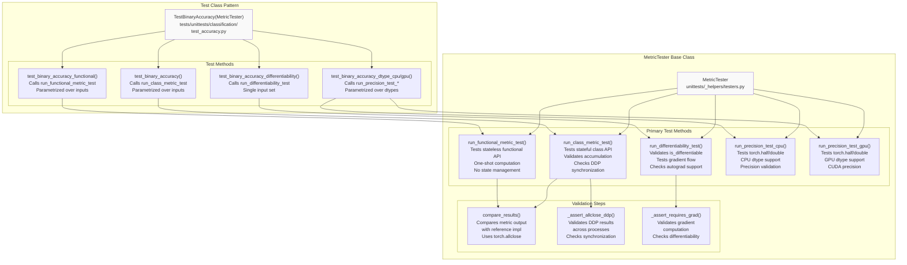
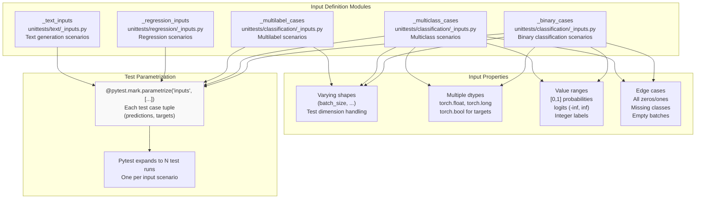
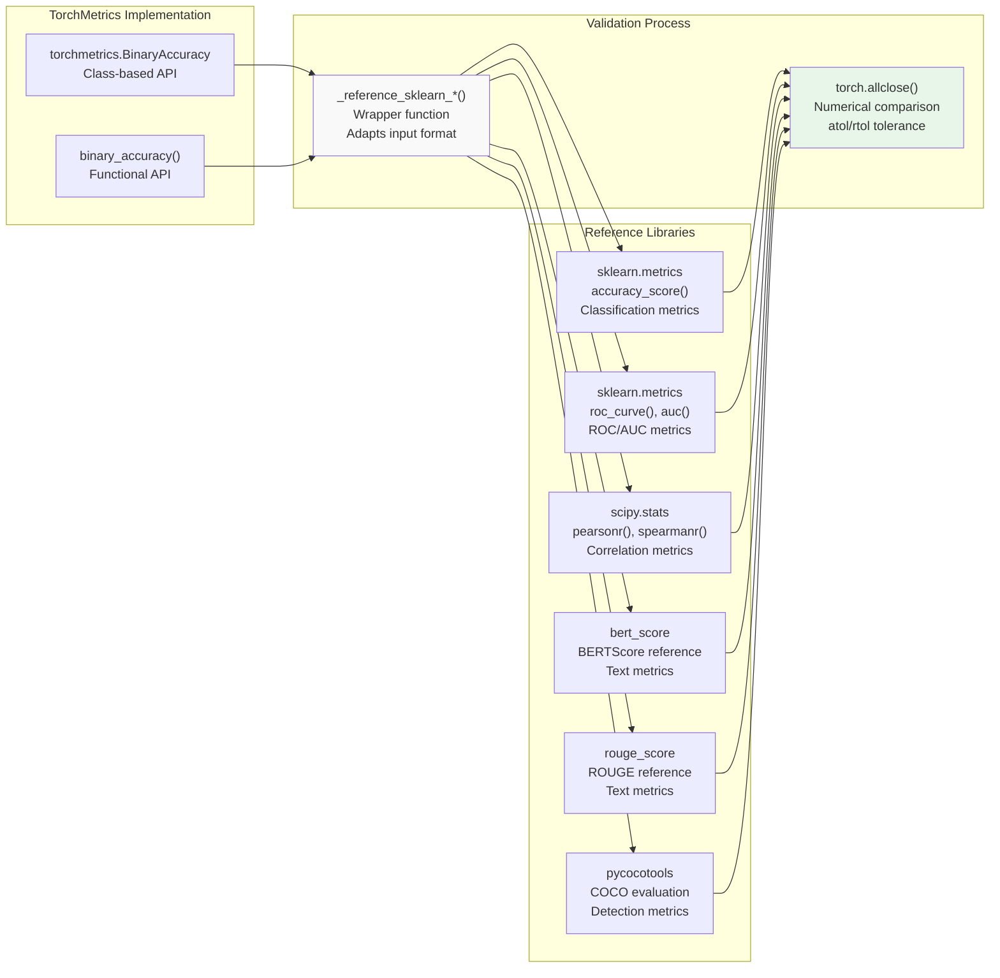
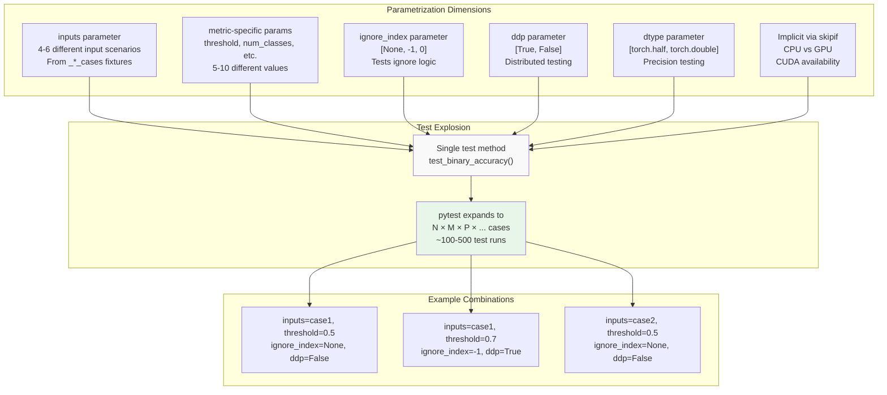
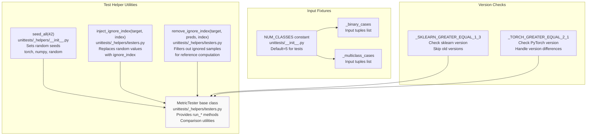
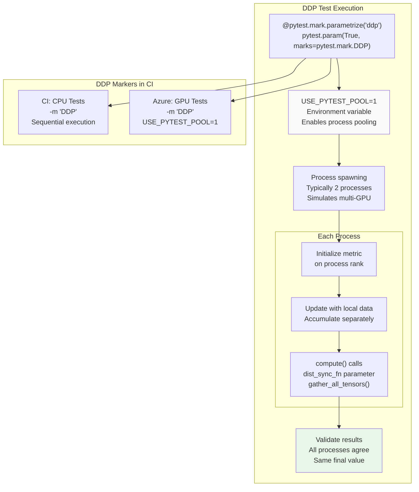
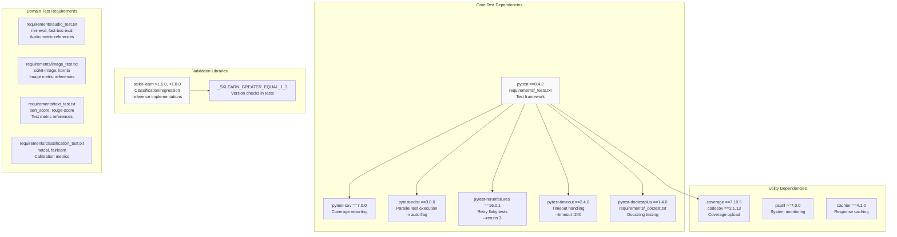
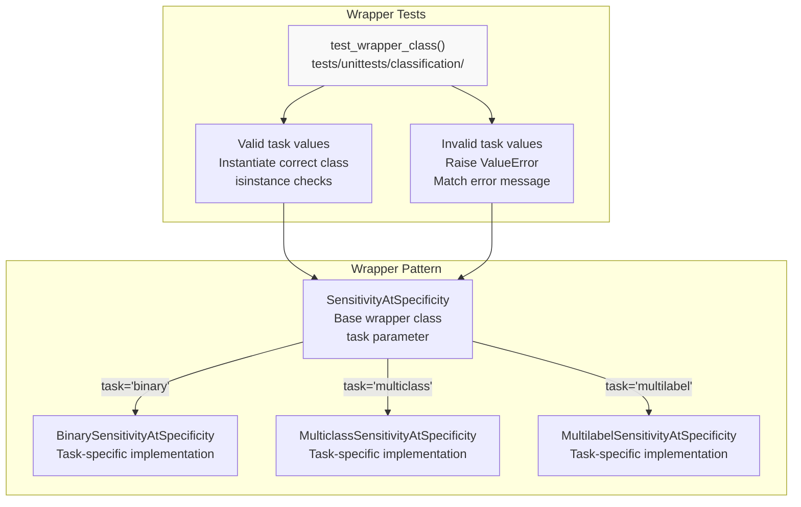

<!-- source: DeepWiki mcp.deepwiki.com · repo Lightning-AI/torchmetrics · page 15.2 Testing Framework · fetched 2026-10-21 -->

# Testing Framework

<details>
<summary>Relevant source files</summary>

The following files were used as context for generating this wiki page:

- [.azure/gpu-integrations.yml](.azure/gpu-integrations.yml)
- [.azure/gpu-unittests.yml](.azure/gpu-unittests.yml)
- [.github/workflows/ci-tests.yml](.github/workflows/ci-tests.yml)
- [.github/workflows/docker-build.yml](.github/workflows/docker-build.yml)
- [requirements/_doctest.txt](requirements/_doctest.txt)
- [requirements/_tests.txt](requirements/_tests.txt)
- [requirements/audio.txt](requirements/audio.txt)
- [requirements/base.txt](requirements/base.txt)
- [requirements/detection.txt](requirements/detection.txt)
- [requirements/image.txt](requirements/image.txt)
- [requirements/typing.txt](requirements/typing.txt)
- [tests/unittests/classification/test_sensitivity_specificity.py](tests/unittests/classification/test_sensitivity_specificity.py)

</details>


## Purpose and Scope

This document describes the testing framework used in TorchMetrics to ensure correctness, consistency, and reliability across all metric implementations. The framework provides a standardized approach for testing both class-based and functional metric APIs, validating distributed training behavior, checking dtype support, and ensuring differentiability properties.

For information about the CI/CD infrastructure that executes these tests, see [15.1](#15.1). For details on test data caching and optimization strategies, see [15.6](#15.6).

---

## MetricTester Base Class

The testing framework is built around the `MetricTester` base class, which provides standardized test methods for all metrics. Test classes inherit from `MetricTester` and use its methods to validate different aspects of metric behavior.

### Test Methods Architecture



**Sources:** [tests/unittests/classification/test_sensitivity_specificity.py:1-497]()

---

## Test Types and Execution Flow

### Core Test Categories

The framework validates five primary aspects of metric behavior:

| Test Type | Method | Purpose | Validates Against |
|-----------|--------|---------|-------------------|
| **Class API** | `run_class_metric_test()` | Stateful accumulation across batches | Reference implementation (sklearn, scipy, etc.) |
| **Functional API** | `run_functional_metric_test()` | Stateless single-shot computation | Reference implementation |
| **Differentiability** | `run_differentiability_test()` | Gradient flow and autograd | Metric's `is_differentiable` attribute |
| **CPU Precision** | `run_precision_test_cpu()` | Half/double precision on CPU | torch.float32 baseline |
| **GPU Precision** | `run_precision_test_gpu()` | Half/double precision on GPU | torch.float32 baseline |

### Test Execution Pattern

```mermaid
graph TB
    subgraph "Test Discovery"
        PY[pytest collection<br/>Discovers test_*.py files<br/>In tests/unittests/]
        PAR["@pytest.mark.parametrize<br/>Expands test cases<br/>Multiple parameter sets"]
    end
    
    subgraph "Test Execution for Each Parameter Set"
        SETUP[Setup Phase<br/>seed_all(42)<br/>Load test inputs<br/>Inject ignore_index]
        
        subgraph "Class API Test"
            INIT[Initialize metric instance<br/>metric_class(**metric_args)]
            UPDATE[Call update() for each batch<br/>Accumulate predictions/targets]
            COMPUTE[Call compute()<br/>Get final result]
            COMPARE1[Compare with reference<br/>torch.allclose(result, ref)]
            RESET[Call reset()<br/>Clear metric state]
        end
        
        subgraph "Functional API Test"
            CALL[Call functional version<br/>metric_functional(preds, target)]
            COMPARE2[Compare with reference<br/>torch.allclose(result, ref)]
        end
        
        subgraph "DDP Test"
            SPAWN[Spawn processes<br/>USE_PYTEST_POOL=1]
            DIST[Distributed execution<br/>Each process updates metric]
            GATHER[Synchronize results<br/>dist_sync_fn in compute()]
            VALIDATE[Validate consistency<br/>across all processes]
        end
    end
    
    PY --> PAR
    PAR --> SETUP
    
    SETUP --> INIT
    INIT --> UPDATE
    UPDATE --> COMPUTE
    COMPUTE --> COMPARE1
    COMPARE1 --> RESET
    
    SETUP --> CALL
    CALL --> COMPARE2
    
    SETUP --> SPAWN
    SPAWN --> DIST
    DIST --> GATHER
    GATHER --> VALIDATE
    
    style SETUP fill:#f9f9f9
    style COMPARE1 fill:#e8f5e9
    style COMPARE2 fill:#e8f5e9
    style VALIDATE fill:#e8f5e9
```

**Sources:** [tests/unittests/classification/test_sensitivity_specificity.py:88-180](), [.github/workflows/ci-tests.yml:183-213]()

---

## Test Inputs and Fixtures

### Input Generation Structure

Test inputs are organized in domain-specific modules that generate synthetic data covering edge cases and typical scenarios:



### Common Input Patterns

Test inputs follow standardized patterns:

```python
# Binary: predictions in [0,1] or logits, targets in {0,1}
_binary_cases = [
    (torch.rand(100), torch.randint(0, 2, (100,))),  # probabilities
    (torch.randn(100), torch.randint(0, 2, (100,))),  # logits
]

# Multiclass: predictions (N, C) probabilities/logits, targets (N,) class indices
_multiclass_cases = [
    (torch.rand(100, NUM_CLASSES), torch.randint(0, NUM_CLASSES, (100,))),
]

# Multilabel: predictions (N, L) per-label probs, targets (N, L) binary
_multilabel_cases = [
    (torch.rand(100, NUM_CLASSES), torch.randint(0, 2, (100, NUM_CLASSES))),
]
```

**Sources:** [tests/unittests/classification/test_sensitivity_specificity.py:41-42](), [tests/unittests/classification/test_sensitivity_specificity.py:87]()

---

## Reference Implementations

### Validation Against External Libraries

Each metric test validates TorchMetrics implementations against trusted reference implementations from scientific libraries:



### Reference Implementation Pattern

Reference implementations follow a consistent pattern:

1. **Format Conversion**: Convert PyTorch tensors to numpy arrays
2. **Preprocessing**: Apply same preprocessing as the metric (sigmoid, softmax, etc.)
3. **Handle Special Cases**: Deal with ignore_index, missing classes, edge cases
4. **Call Reference**: Invoke the reference library function
5. **Format Output**: Convert result back to comparable format

Example from classification tests:

[tests/unittests/classification/test_sensitivity_specificity.py:77-83]()
```python
def _reference_sklearn_sensitivity_at_specificity_binary(preds, target, min_specificity, ignore_index=None):
    preds = preds.flatten().numpy()
    target = target.flatten().numpy()
    if np.issubdtype(preds.dtype, np.floating) and not ((preds > 0) & (preds < 1)).all():
        preds = sigmoid(preds)
    target, preds = remove_ignore_index(target=target, preds=preds, ignore_index=ignore_index)
    return _sensitivity_at_specificity_x_multilabel(preds, target, min_specificity)
```

**Sources:** [tests/unittests/classification/test_sensitivity_specificity.py:46-74](), [tests/unittests/classification/test_sensitivity_specificity.py:77-83](), [tests/unittests/classification/test_sensitivity_specificity.py:195-209]()

---

## Test Parametrization Strategy

### Comprehensive Coverage via Parametrization

Tests use `pytest.mark.parametrize` extensively to achieve comprehensive coverage with minimal code duplication:



### Typical Parametrization Pattern

[tests/unittests/classification/test_sensitivity_specificity.py:86-116]()
```python
@pytest.mark.skipif(not _SKLEARN_GREATER_EQUAL_1_3, reason="...")
@pytest.mark.parametrize("inputs", [_binary_cases[1], _binary_cases[2], ...])
class TestBinarySensitivityAtSpecificity(MetricTester):
    
    @pytest.mark.parametrize("min_specificity", [0.05, 0.10, 0.3, 0.5, 0.85])
    @pytest.mark.parametrize("ignore_index", [None, -1, 0])
    @pytest.mark.parametrize("ddp", [pytest.param(True, marks=pytest.mark.DDP), False])
    def test_binary_sensitivity_at_specificity(self, inputs, ddp, min_specificity, ignore_index):
        # Test runs N_inputs × N_specificity × N_ignore × N_ddp times
```

**Sources:** [tests/unittests/classification/test_sensitivity_specificity.py:86-116](), [tests/unittests/classification/test_sensitivity_specificity.py:212-244]()

---

## pytest Configuration and Markers

### Custom pytest Markers

The framework uses custom markers to control test execution:

| Marker | Purpose | Usage |
|--------|---------|-------|
| `@pytest.mark.DDP` | Distributed data parallel tests | Tests that require multi-GPU or multi-process execution |
| `@pytest.mark.skipif` | Conditional skip | Skip tests based on dependencies, CUDA availability, etc. |
| `pytest.param(True, marks=pytest.mark.DDP)` | Parametrize with marker | Apply DDP marker to specific parameter values |

### Skip Conditions

```python
# Skip if sklearn version too old
@pytest.mark.skipif(not _SKLEARN_GREATER_EQUAL_1_3, reason="metric does not support scikit-learn versions below 1.3")

# Skip if CUDA not available
@pytest.mark.skipif(not torch.cuda.is_available(), reason="test requires cuda")

# Conditional xfail for known issues
if not _TORCH_GREATER_EQUAL_2_1 and (preds < 0).any() and dtype == torch.half:
    pytest.xfail(reason="torch.sigmoid in metric does not support cpu + half precision for torch<2.1")
```

### Environment Variables for Graceful Failures

Tests check environment variables to allow graceful skipping in PR runs:

```python
# Allow skipping OOM errors in PRs
ALLOW_SKIP_IF_OUT_OF_MEMORY = os.getenv('ALLOW_SKIP_IF_OUT_OF_MEMORY', '0') == '1'

# Allow skipping connection errors in PRs
ALLOW_SKIP_IF_BAD_CONNECTION = os.getenv('ALLOW_SKIP_IF_BAD_CONNECTION', '0') == '1'
```

**Sources:** [tests/unittests/classification/test_sensitivity_specificity.py:86-87](), [tests/unittests/classification/test_sensitivity_specificity.py:156-157](), [tests/unittests/classification/test_sensitivity_specificity.py:167-169](), [.github/workflows/ci-tests.yml:157-161]()

---

## Test Helpers and Utilities

### Key Helper Functions



### Seed Management

Tests use deterministic seeding for reproducibility:

[tests/unittests/classification/test_sensitivity_specificity.py:43]()
```python
seed_all(42)  # Called at module level to ensure deterministic test data
```

### Ignore Index Handling

Tests validate the `ignore_index` parameter by injecting and removing ignored values:

```python
# In test
if ignore_index is not None:
    target = inject_ignore_index(target, ignore_index)

# In reference implementation
target, preds = remove_ignore_index(target=target, preds=preds, ignore_index=ignore_index)
```

**Sources:** [tests/unittests/classification/test_sensitivity_specificity.py:38-43](), [tests/unittests/classification/test_sensitivity_specificity.py:82](), [tests/unittests/classification/test_sensitivity_specificity.py:98-99]()

---

## DDP Testing

### Distributed Testing Architecture



### DDP Test Pattern

DDP tests verify that metrics synchronize correctly across distributed processes:

[tests/unittests/classification/test_sensitivity_specificity.py:93-115]()
```python
@pytest.mark.parametrize("ddp", [pytest.param(True, marks=pytest.mark.DDP), False])
def test_binary_sensitivity_at_specificity(self, inputs, ddp, min_specificity, ignore_index):
    self.run_class_metric_test(
        ddp=ddp,  # Enables distributed testing
        preds=preds,
        target=target,
        metric_class=BinarySensitivityAtSpecificity,
        reference_metric=partial(...),
        metric_args={...},
    )
```

DDP tests run in CI with:
- [.github/workflows/ci-tests.yml:199-213](): CPU tests with `-m DDP` flag
- [.azure/gpu-unittests.yml:198-208](): GPU tests with `USE_PYTEST_POOL=1` environment variable

**Sources:** [tests/unittests/classification/test_sensitivity_specificity.py:93-115](), [.github/workflows/ci-tests.yml:199-213](), [.azure/gpu-unittests.yml:198-208]()

---

## Test Dependencies and Requirements

### Testing Dependency Structure



**Sources:** [requirements/_tests.txt:1-22](), [requirements/_doctest.txt:1-7](), [tests/unittests/classification/test_sensitivity_specificity.py:39]()

---

## Test Execution in CI/CD

### CPU Test Execution

CPU tests run on GitHub Actions with extensive parametrization:

[.github/workflows/ci-tests.yml:183-213]()
```yaml
# Unittests common (non-DDP)
- name: Unittests common
  run: |
    python -m pytest \
      $TEST_DIRS \
      --cov=torchmetrics \
      --durations=50 \
      --reruns 3 \
      --reruns-delay 1 \
      -m "not DDP" \
      -n auto \          # Parallel execution
      --dist=load \      # Load balancing
      ${{ env.UNITTEST_TIMEOUT }}

# Unittests DDP
- name: Unittests DDP
  env:
    USE_PYTEST_POOL: "1"
  run: |
    python -m pytest -v \
      $TEST_DIRS \
      --cov=torchmetrics \
      --durations=50 \
      -m DDP \          # Only DDP tests
      --reruns 3 \
      --reruns-delay 1
```

### GPU Test Execution

GPU tests run on Azure Pipelines with specialized configuration:

[.azure/gpu-unittests.yml:146-208]()
```yaml
# DocTesting
- bash: |
    python -m pytest torchmetrics --cov=torchmetrics \
      --timeout=240 --durations=50 \
      --reruns 2 --reruns-delay 1

# UnitTesting common
- bash: |
    python -m pytest $(TEST_DIRS) \
      -m "not DDP" --numprocesses=6 --dist=loadfile \
      --cov=torchmetrics --timeout=240 --durations=100 \
      --reruns 3 --reruns-delay 1

# UnitTesting DDP
- bash: |
    python -m pytest $(TEST_DIRS) -v \
      --cov=torchmetrics -m "DDP" \
      --timeout=240 --durations=100
  env:
    USE_PYTEST_POOL: "1"
```

### Test Selection via Focus Diff

The `_focus-diff.yml` workflow intelligently determines which tests to run based on changed files:

[.azure/gpu-unittests.yml:89-99]()
```bash
# Determine which test directories to run based on PR changes
pip install -q fire pyGithub
focus=$(python .github/assistant.py changed-domains $PR_NUMBER)
echo "##vso[task.setvariable variable=TEST_DIRS]$focus"
```

This reduces CI time by only running tests for affected domains.

**Sources:** [.github/workflows/ci-tests.yml:183-213](), [.azure/gpu-unittests.yml:146-208](), [.azure/gpu-unittests.yml:89-99]()

---

## Wrapper Class Testing

### Testing Task-Based Wrappers

Metrics with task-based organization (binary/multiclass/multilabel) include wrapper class tests:



[tests/unittests/classification/test_sensitivity_specificity.py:478-496]()
```python
@pytest.mark.parametrize(
    ("metric", "kwargs"),
    [
        (BinarySensitivityAtSpecificity, {"task": "binary", "min_specificity": 0.5}),
        (MulticlassSensitivityAtSpecificity, {"task": "multiclass", "num_classes": 3, ...}),
        (MultilabelSensitivityAtSpecificity, {"task": "multilabel", "num_labels": 3, ...}),
        (None, {"task": "not_valid_task", "min_specificity": 0.5}),
    ],
)
def test_wrapper_class(metric, kwargs, base_metric=SensitivityAtSpecificity):
    assert issubclass(base_metric, Metric)
    if metric is None:
        with pytest.raises(ValueError, match=r"Invalid *"):
            base_metric(**kwargs)
    else:
        instance = base_metric(**kwargs)
        assert isinstance(instance, metric)
        assert isinstance(instance, Metric)
```

**Sources:** [tests/unittests/classification/test_sensitivity_specificity.py:463-496]()

---

## Threshold Argument Testing

### Validating Threshold Flexibility

Metrics supporting thresholds test multiple input formats:

[tests/unittests/classification/test_sensitivity_specificity.py:463-476]()
```python
@pytest.mark.parametrize("thresholds", [None, 100, [0.3, 0.5, 0.7, 0.9], torch.linspace(0, 1, 10)])
def test_valid_input_thresholds(recwarn, metric, thresholds):
    """Test valid formats of the threshold argument."""
    metric(min_specificity=0.5, thresholds=thresholds)
    assert len(recwarn) == 0, "Warning was raised when it should not have been."
```

Threshold argument test pattern:

[tests/unittests/classification/test_sensitivity_specificity.py:181-192]()
```python
def test_binary_sensitivity_at_specificity_threshold_arg(self, inputs, min_specificity):
    """Test that different types of `thresholds` argument lead to same result."""
    preds, target = inputs
    
    for pred, true in zip(preds, target):
        pred = torch.tensor(np.round(pred.numpy(), 1)) + 1e-6
        r1, _ = binary_sensitivity_at_specificity(pred, true, min_specificity=..., thresholds=None)
        r2, _ = binary_sensitivity_at_specificity(pred, true, min_specificity=..., thresholds=torch.linspace(0, 1, 100))
        assert torch.allclose(r1, r2)
```

This validates that discretized thresholds produce consistent results with continuous threshold search.

**Sources:** [tests/unittests/classification/test_sensitivity_specificity.py:181-192](), [tests/unittests/classification/test_sensitivity_specificity.py:463-476]()

---

## Integration Tests

### Integration Testing Strategy

Integration tests validate compatibility with external frameworks and libraries:

[.azure/gpu-integrations.yml:103-106]()
```yaml
- bash: pytest . -v --durations=0 --timeout=360
  workingDirectory: "tests/integrations/"
  timeoutInMinutes: "15"
  displayName: "Test integrations"
```

Integration tests are separated from unit tests and run with:
- Different dependency sets (requirements/_integrate.txt)
- Oldest and latest dependency versions
- Longer timeouts (360s vs 240s)
- Focused on framework compatibility (Lightning integration, etc.)

**Sources:** [.azure/gpu-integrations.yml:1-107](), [.azure/gpu-integrations.yml:74-79](), [.azure/gpu-integrations.yml:103-106]()

---

## Summary

The TorchMetrics testing framework provides comprehensive validation through:

1. **MetricTester Base Class**: Standardized test methods for class API, functional API, differentiability, and precision
2. **Parametrization Strategy**: Extensive use of `pytest.mark.parametrize` for comprehensive coverage
3. **Reference Implementations**: Validation against trusted libraries (sklearn, scipy, bert_score, etc.)
4. **Test Helpers**: Utilities for seeding, ignore_index handling, and input manipulation
5. **DDP Testing**: Distributed testing with process pooling and synchronization validation
6. **CI/CD Integration**: Automated execution on CPU (GitHub Actions) and GPU (Azure Pipelines) with intelligent test selection
7. **Domain-Specific Fixtures**: Organized input generation for each metric domain

This framework ensures that all metrics are correct, consistent across APIs, support distributed training, handle edge cases, and work across different hardware and precision settings.

---

