<!-- source: DeepWiki mcp.deepwiki.com · repo Lightning-AI/torchmetrics · page 15.4 Code Quality and Pre-commit Hooks · fetched 2026-10-21 -->

# Code Quality and Pre-commit Hooks

<details>
<summary>Relevant source files</summary>

The following files were used as context for generating this wiki page:

- [.github/actions/pull-caches/action.yml](.github/actions/pull-caches/action.yml)
- [.github/actions/push-caches/action.yml](.github/actions/push-caches/action.yml)
- [.github/assistant.py](.github/assistant.py)
- [.github/workflows/_focus-diff.yml](.github/workflows/_focus-diff.yml)
- [.github/workflows/ci-integrate.yml](.github/workflows/ci-integrate.yml)
- [.github/workflows/cmd-help.yml](.github/workflows/cmd-help.yml)
- [.github/workflows/cmd-rebase.yml](.github/workflows/cmd-rebase.yml)
- [.github/workflows/docs-build.yml](.github/workflows/docs-build.yml)
- [.github/workflows/labeler.yml](.github/workflows/labeler.yml)
- [.github/workflows/publish-pkg.yml](.github/workflows/publish-pkg.yml)
- [.github/workflows/slash-cmd-dispatch.yml](.github/workflows/slash-cmd-dispatch.yml)
- [.pre-commit-config.yaml](.pre-commit-config.yaml)
- [pyproject.toml](pyproject.toml)
- [requirements/_ci.txt](requirements/_ci.txt)
- [src/torchmetrics/collections.py](src/torchmetrics/collections.py)
- [src/torchmetrics/metric.py](src/torchmetrics/metric.py)
- [tests/unittests/bases/test_collections.py](tests/unittests/bases/test_collections.py)
- [tests/unittests/bases/test_metric.py](tests/unittests/bases/test_metric.py)
- [tests/unittests/classification/test_auc.py](tests/unittests/classification/test_auc.py)

</details>


## Purpose and Scope

This document describes the code quality infrastructure and pre-commit hooks used in the TorchMetrics repository. It covers the configuration and purpose of each quality tool, how they integrate into the development workflow, and their relationship to the CI/CD pipeline. For information about the overall CI/CD infrastructure and testing strategy, see [15.1](#15.1) and [15.2](#15.2). For documentation build specifics, see [15.3](#15.3).

The code quality system ensures consistent code style, catches common errors, enforces type annotations, validates documentation formatting, and maintains spell-check standards across the entire codebase.

---

## Pre-commit Hook System Architecture

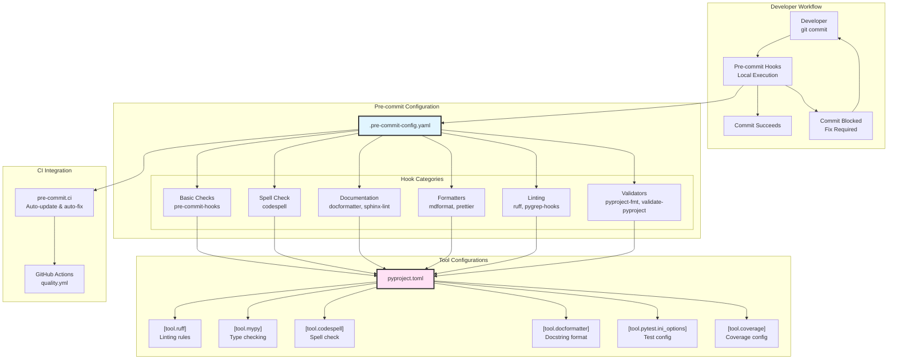

**Pre-commit Hook Execution Flow**: When a developer runs `git commit`, pre-commit hooks execute automatically before the commit is created. Each hook validates specific code quality aspects. If any hook fails, the commit is blocked and the developer must fix the issues before re-attempting the commit.

Sources: [.pre-commit-config.yaml:1-127](), [pyproject.toml:1-189]()

---

## Pre-commit Configuration Structure

The pre-commit system is configured in [.pre-commit-config.yaml:1-127]() with the following global settings:

| Setting | Value | Purpose |
|---------|-------|---------|
| `default_language_version` | `python: python3` | Ensures Python 3 is used for all hooks |
| `ci.autofix_prs` | `true` | Automatically fixes issues in pull requests |
| `ci.autoupdate_commit_msg` | Custom message | Standardized commit message for hook updates |
| `ci.autoupdate_schedule` | `quarterly` | Updates hooks every quarter |

The configuration defines 10 hook repositories, each providing specific quality checks:

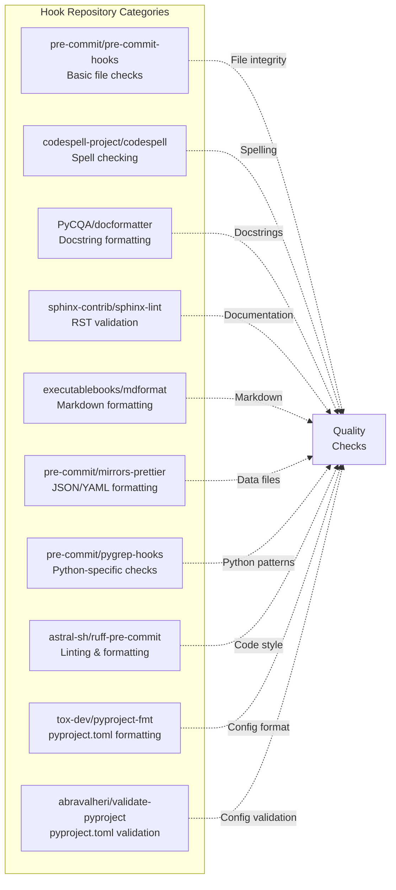

Sources: [.pre-commit-config.yaml:15-127]()

---

## Basic File Integrity Checks

The `pre-commit-hooks` repository ([.pre-commit-config.yaml:25-38]()) provides fundamental file validation:

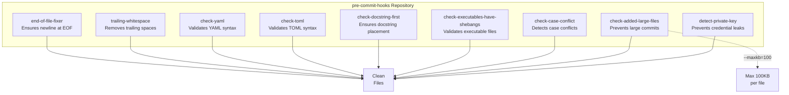

**Key Configuration**:
- `check-added-large-files`: Limited to 100KB with `--enforce-all` flag
- `check-json`: Disabled due to incompatibility with `.devcontainer/devcontainer.json`

Sources: [.pre-commit-config.yaml:25-38]()

---

## Code Linting and Formatting with Ruff

Ruff ([.pre-commit-config.yaml:107-117]()) is the primary linting and formatting tool, replacing multiple legacy tools (flake8, isort, black, etc.). The configuration in [pyproject.toml:7-85]() defines comprehensive code quality rules:

### Ruff Configuration Overview

| Setting | Value | Purpose |
|---------|-------|---------|
| `target-version` | `py39` | Ensures Python 3.9+ compatibility |
| `line-length` | `120` | Maximum line length |
| `format.preview` | `true` | Enables preview formatting features |

### Rule Categories Enabled

```mermaid
graph TB
    subgraph "Core Rules [lint.select]"
        D["D - pydocstyle<br/>Docstring conventions"]
        E["E - pycodestyle errors<br/>PEP 8 errors"]
        F["F - pyflakes<br/>Logical errors"]
        I["I - isort<br/>Import sorting"]
        N["N - pep8-naming<br/>Naming conventions"]
        S["S - flake8-bandit<br/>Security issues"]
        UP["UP - pyupgrade<br/>Modern Python syntax"]
        W["W - pycodestyle warnings<br/>PEP 8 warnings"]
    end
    
    subgraph "Extended Rules [lint.extend-select]"
        A["A - flake8-builtins<br/>Builtin shadowing"]
        ANN["ANN - flake8-annotations<br/>Type annotations"]
        B["B - flake8-bugbear<br/>Bug patterns"]
        C4["C4 - flake8-comprehensions<br/>Comprehension patterns"]
        EXE["EXE - flake8-executable<br/>Shebang validation"]
        ISC["ISC - flake8-implicit-str-concat<br/>String concatenation"]
        PERF["PERF - perflint<br/>Performance issues"]
        PIE["PIE - flake8-pie<br/>Unnecessary code"]
        PLE["PLE - pylint errors<br/>Pylint error subset"]
        PT["PT - flake8-pytest-style<br/>Pytest patterns"]
        PYI["PYI - flake8-pyi<br/>Stub file checks"]
        Q["Q - flake8-quotes<br/>Quote consistency"]
        RET["RET - flake8-return<br/>Return patterns"]
        RUF["RUF - Ruff-specific<br/>Custom rules"]
        SIM["SIM - flake8-simplify<br/>Code simplification"]
        T10["T10 - flake8-debugger<br/>Debug statement detection"]
        TID["TID - flake8-tidy-imports<br/>Import organization"]
        YTT["YTT - flake8-2020<br/>Version checks"]
    end
    
    D & E & F & I & N & S & UP & W --> ENABLED["Enabled<br/>Rules"]
    A & ANN & B & C4 & EXE & ISC & PERF & PIE & PLE & PT & PYI & Q & RET & RUF & SIM & T10 & TID & YTT --> ENABLED
```

Sources: [pyproject.toml:7-43]()

### Ignored Rules and Exceptions

Several rules are intentionally disabled ([pyproject.toml:44-51]()):

| Rule | Reason |
|------|--------|
| `D100` | Missing docstring in public module (todo) |
| `D104` | Missing docstring in public package (todo) |
| `D107` | Missing docstring in `__init__` (not required) |
| `E731` | Lambda assignments allowed |
| `EXE002` | Shebang not required for all executables |
| `ISC001` | Potential conflict with formatter |

### Per-File Ignore Patterns

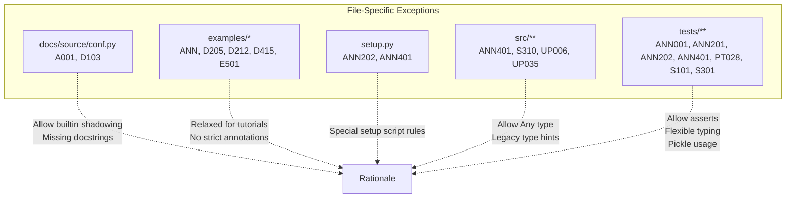

Sources: [pyproject.toml:52-81]()

### Ruff Execution in Pre-commit

The ruff hook runs three times ([.pre-commit-config.yaml:109-117]()):

1. **Fix pass**: `ruff --fix` - Auto-fixes issues where possible
2. **Format pass**: `ruff-format` - Applies consistent formatting
3. **Validation pass**: `ruff` - Validates all rules are satisfied

---

## Type Checking with Mypy

Mypy configuration ([pyproject.toml:153-169]()) enforces strict type checking for the core library:

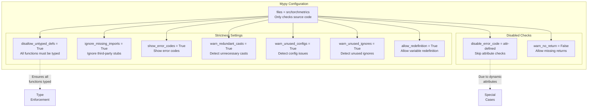

**Key Design Decision**: Type checking is **not** included in pre-commit hooks but runs in CI/CD. This allows developers to iterate quickly locally while still enforcing type correctness in pull requests.

Sources: [pyproject.toml:153-169]()

---

## Spell Checking with Codespell

Codespell ([.pre-commit-config.yaml:40-46]()) automatically fixes spelling errors in code and documentation:

### Configuration

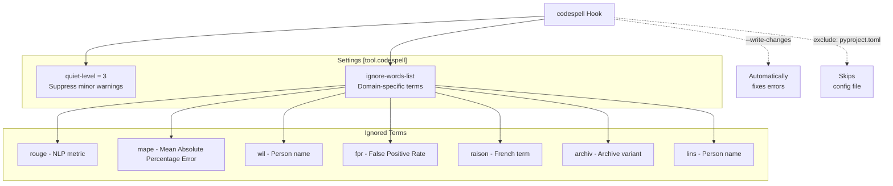

**Arguments**: The `--write-changes` flag ([.pre-commit-config.yaml:45]()) enables automatic fixing of spelling errors during the pre-commit stage.

Sources: [.pre-commit-config.yaml:40-46](), [pyproject.toml:87-102]()

---

## Documentation Quality Tools

### Docformatter

Docformatter ([.pre-commit-config.yaml:48-53]()) enforces Google-style docstring formatting:

| Setting | Value | Purpose |
|---------|-------|---------|
| `recursive` | `true` | Process all subdirectories |
| `wrap-summaries` | `119` | Allow slightly longer summaries |
| `wrap-descriptions` | `120` | Match line-length setting |
| `blank` | `true` | Preserve blank lines in docstrings |

The `--in-place` argument automatically reformats docstrings during commit.

Sources: [.pre-commit-config.yaml:48-53](), [pyproject.toml:104-109]()

### Sphinx-lint

Validates reStructuredText (RST) documentation syntax ([.pre-commit-config.yaml:55-58]()):

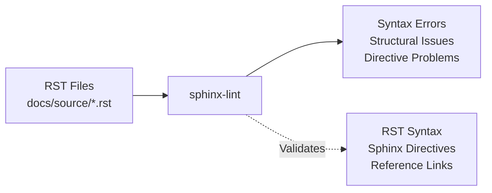

Sources: [.pre-commit-config.yaml:55-58]()

### Markdown Formatting

Mdformat ([.pre-commit-config.yaml:60-73]()) standardizes Markdown files:

**Extensions Enabled**:
- `mdformat-gfm`: GitHub Flavored Markdown support
- `mdformat-black`: Code block formatting
- `mdformat_frontmatter`: YAML frontmatter support

**Arguments**: `--number` enables numbered lists

**Exclusions**:
- `CHANGELOG.md`: Preserved as-is to maintain history
- `docs/paper_JOSS/paper.md`: Journal-specific formatting

Sources: [.pre-commit-config.yaml:60-73]()

---

## Python-Specific Pattern Checks

The `pygrep-hooks` repository ([.pre-commit-config.yaml:83-105]()) provides regex-based validation:

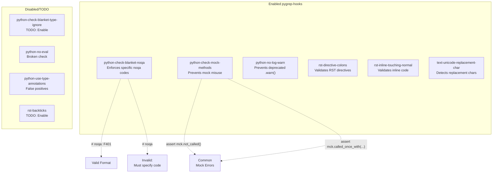

**Key Enforcements**:
- **Specific noqa codes**: Generic `# noqa` comments are forbidden; must use `# noqa: F401` format
- **Mock method validation**: Catches common mock assertion mistakes
- **RST syntax**: Ensures proper directive and inline code formatting

Sources: [.pre-commit-config.yaml:83-105]()

---

## Configuration File Formatting

### Prettier

Prettier ([.pre-commit-config.yaml:75-81]()) formats JSON, YAML, and TOML files:

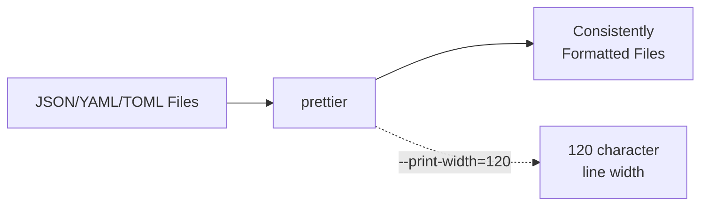

Sources: [.pre-commit-config.yaml:75-81]()

### Pyproject.toml Validation

Two hooks ensure `pyproject.toml` correctness:

1. **pyproject-fmt** ([.pre-commit-config.yaml:118-122]()): Formats the file according to PEP 621 standards
2. **validate-pyproject** ([.pre-commit-config.yaml:123-126]()): Validates against the pyproject.toml schema

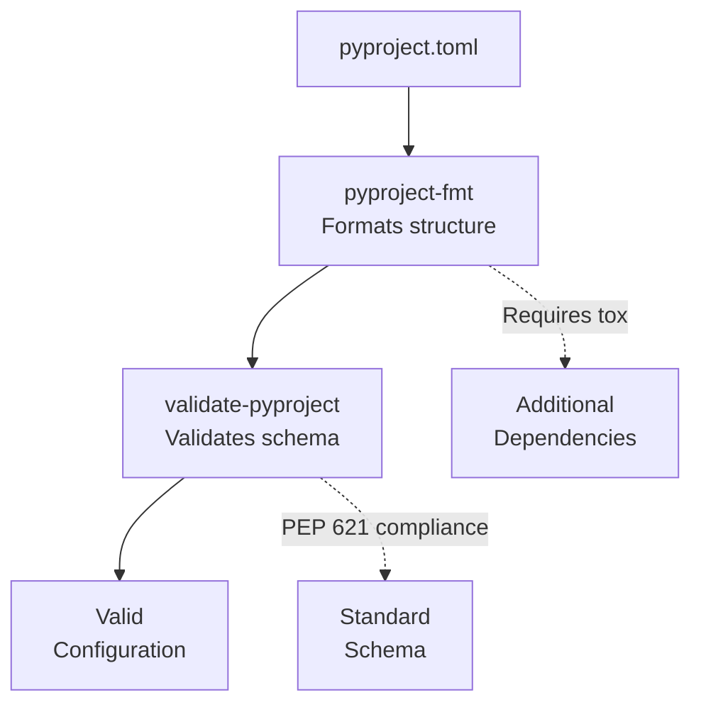

Sources: [.pre-commit-config.yaml:118-126]()

---

## Testing and Coverage Configuration

### Pytest Configuration

The pytest configuration ([pyproject.toml:118-141]()) defines test execution behavior:

```mermaid
graph TB
    subgraph "Pytest Settings [tool.pytest.ini_options]"
        NOREC["norecursedirs<br/>.git, .github, dist, build, docs"]
        
        subgraph "Addopts (Additional Options)"
            STRICT["--strict-markers<br/>Only registered markers"]
            DOCTEST["--doctest-modules<br/>Test code in docstrings"]
            DOCTEST_PLUS["--doctest-plus<br/>Enhanced doctest support"]
            COLOR["--color=yes<br/>Colored output"]
            NOWARN["--disable-pytest-warnings<br/>Suppress warnings"]
        end
        
        subgraph "Markers"
            DDP["DDP: mark a test as<br/>Distributed Data Parallel"]
        end
        
        subgraph "Filter Warnings"
            IGNORE_FUTURE["ignore::FutureWarning"]
            DEFAULT_TM["default:::torchmetrics<br/>Show TorchMetrics warnings"]
        end
        
        XFAIL["xfail_strict = true<br/>Fail on unexpected passes"]
        DURATION["junit_duration_report = call<br/>Report call duration"]
    end
    
    NOREC --> EXECUTION["Test<br/>Execution"]
    STRICT & DOCTEST & DOCTEST_PLUS & COLOR & NOWARN --> EXECUTION
    DDP --> EXECUTION
    IGNORE_FUTURE & DEFAULT_TM --> EXECUTION
    XFAIL --> EXECUTION
    DURATION --> EXECUTION
```

**Key Features**:
- **Doctest support**: Both `--doctest-modules` and `--doctest-plus` enable testing of code examples in docstrings
- **Strict markers**: `--strict-markers` ensures only registered markers (like `DDP`) are used
- **Warning filtering**: Suppresses future warnings but shows TorchMetrics-specific warnings

Sources: [pyproject.toml:118-141]()

### Coverage Configuration

Coverage settings ([pyproject.toml:143-151]()) control test coverage reporting:

| Setting | Value | Purpose |
|---------|-------|---------|
| `exclude_lines` | `pragma: no cover`, `pass` | Lines to exclude from coverage |
| `parallel` | `true` | Support parallel test execution |
| `concurrency` | `thread` | Use thread-based concurrency |
| `relative_files` | `true` | Use relative paths in reports |

Sources: [pyproject.toml:143-151]()

---

## Integration with CI/CD

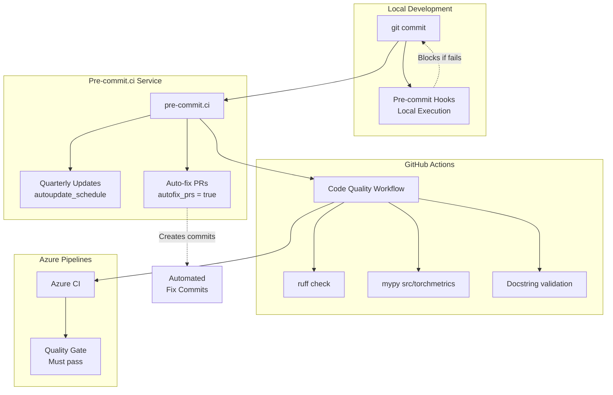

**Pre-commit.ci Integration**:
- **Automatic updates**: Pre-commit hook versions are updated quarterly ([.pre-commit-config.yaml:21]())
- **Auto-fix PRs**: When enabled ([.pre-commit-config.yaml:19]()), pre-commit.ci automatically commits fixes to pull requests
- **Standardized messages**: Update commits use a consistent format ([.pre-commit-config.yaml:20]())

**CI/CD Quality Gates**:
- Ruff checks run in both local pre-commit and CI
- Mypy runs **only** in CI, not in local pre-commit hooks (intentional design decision)
- All quality checks must pass before merging

Sources: [.pre-commit-config.yaml:18-22]()

---

## Tool Version Management

The pre-commit configuration uses specific tool versions to ensure reproducibility:

| Tool | Version | Repository |
|------|---------|------------|
| pre-commit-hooks | v5.0.0 | [.pre-commit-config.yaml:26]() |
| codespell | v2.4.1 | [.pre-commit-config.yaml:41]() |
| docformatter | v1.7.7 | [.pre-commit-config.yaml:49]() |
| sphinx-lint | v1.0.0 | [.pre-commit-config.yaml:56]() |
| mdformat | 0.7.22 | [.pre-commit-config.yaml:61]() |
| prettier | v3.1.0 | [.pre-commit-config.yaml:76]() |
| pygrep-hooks | v1.10.0 | [.pre-commit-config.yaml:84]() |
| ruff | v0.12.2 | [.pre-commit-config.yaml:108]() |
| pyproject-fmt | v2.6.0 | [.pre-commit-config.yaml:119]() |
| validate-pyproject | v0.24.1 | [.pre-commit-config.yaml:124]() |

**Update Strategy**: Versions are updated quarterly by pre-commit.ci, with changes reviewed in dedicated pull requests.

Sources: [.pre-commit-config.yaml:26-126]()

---

## Local Development Workflow

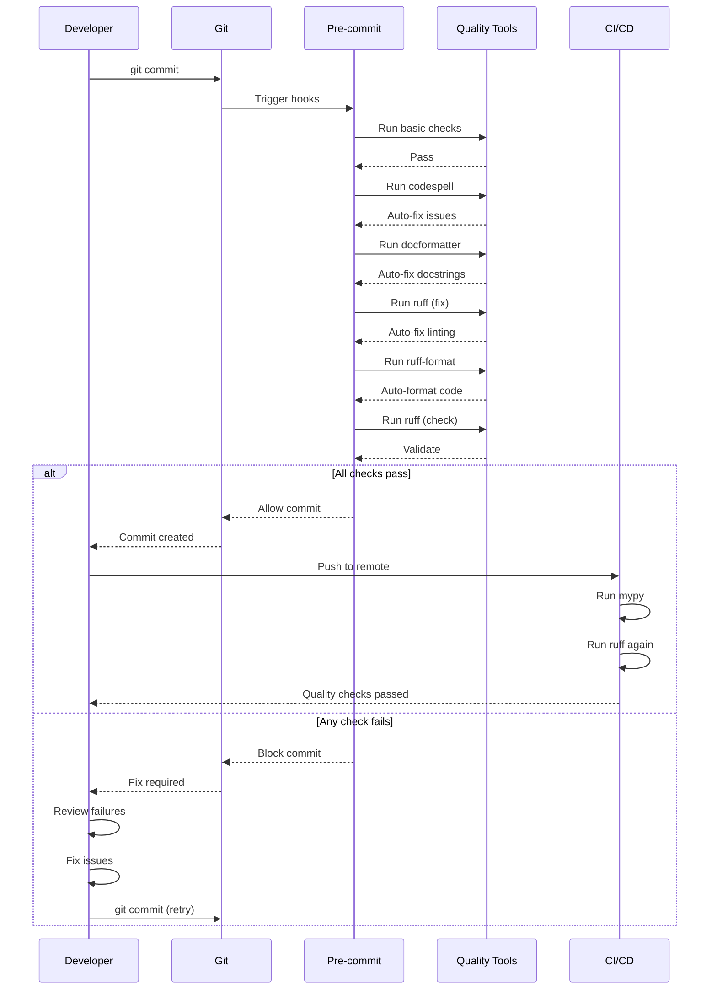

**Installation**:
```bash
pip install pre-commit
pre-commit install
```

**Manual Execution**:
```bash
# Run on all files
pre-commit run --all-files

# Run specific hook
pre-commit run ruff --all-files

# Skip hooks for emergency commits
git commit --no-verify
```

**Updating Hooks**:
```bash
pre-commit autoupdate
```

Sources: [.pre-commit-config.yaml:1-127]()

---

## Quality Metrics and Standards

### Ruff Rule Coverage

The ruff configuration enables **26 rule categories** covering:

- **Style enforcement**: Line length, quote consistency, import ordering
- **Bug prevention**: Unused variables, unreachable code, mutable defaults
- **Security**: SQL injection, unsafe pickle usage, eval usage
- **Performance**: Inefficient comprehensions, unnecessary operations
- **Type safety**: Missing annotations, incorrect type usage
- **Best practices**: Docstring conventions, naming patterns

### McCabe Complexity

Cyclomatic complexity is limited to 10 ([pyproject.toml:83]()):

```python
# Maximum complexity example (threshold = 10)
def complex_function():
    if condition1:        # +1
        if condition2:    # +1
            if condition3:  # +1
                # ... additional branches
```

Sources: [pyproject.toml:7-85]()

---

## Error Code Reference

### Common Ruff Error Patterns

| Code | Description | Example |
|------|-------------|---------|
| `F401` | Unused import | `import torch  # noqa: F401` if intentionally unused |
| `E501` | Line too long | Automatically fixed by ruff-format |
| `D100` | Missing module docstring | Add module-level docstring |
| `ANN001` | Missing type annotation | Add parameter types |
| `S101` | Use of assert | Allowed in tests, forbidden in source |
| `PT028` | Test parameter has default | Allowed for flexibility |

### Mypy Error Patterns

Common mypy errors encountered:

- `attr-defined`: Disabled globally due to dynamic metric attributes
- `name-defined`: Missing imports or undefined variables
- `type-arg`: Missing type arguments for generics
- `arg-type`: Incorrect argument types

---

## Special Cases and Exclusions

### Test File Relaxations

Tests have relaxed quality requirements ([pyproject.toml:73-81]()):

```python
# tests/** allows:
# - Missing annotations (ANN001, ANN201, ANN202)
# - Any type usage (ANN401)
# - Assert statements (S101)
# - Pickle usage (S301)
# - Default test parameters (PT028)
```

### Example File Relaxations

Examples prioritize readability ([pyproject.toml:56-62]()):

```python
# examples/* allows:
# - Missing annotations (ANN)
# - Long lines (E501)
# - Relaxed docstring requirements (D205, D212, D415)
```

### Documentation Exceptions

Configuration files have special rules ([pyproject.toml:52-55]()):

```python
# docs/source/conf.py allows:
# - Builtin shadowing (A001) - Sphinx uses 'copyright'
# - Missing docstrings (D103) - Config file
```

Sources: [pyproject.toml:52-81]()

---

## Summary

The code quality infrastructure in TorchMetrics uses a layered approach:

1. **Pre-commit hooks** provide immediate feedback during development
2. **Ruff** consolidates linting and formatting into a single fast tool
3. **Mypy** enforces type safety in CI/CD
4. **Specialized tools** handle documentation, spelling, and file formatting
5. **Per-file rules** balance strictness with practicality

This system ensures consistent, high-quality code while minimizing friction in the development workflow. The separation of Mypy from pre-commit hooks allows rapid local iteration while maintaining type safety through CI/CD enforcement.

Sources: [.pre-commit-config.yaml:1-127](), [pyproject.toml:1-189]()

---

