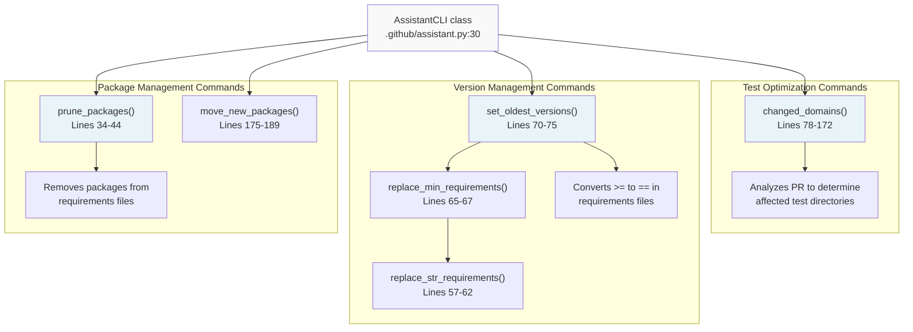
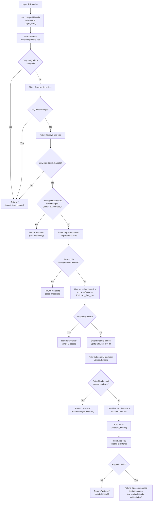
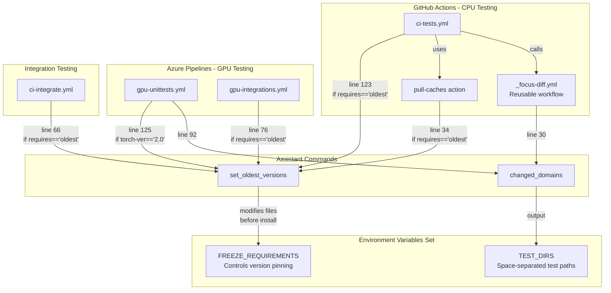
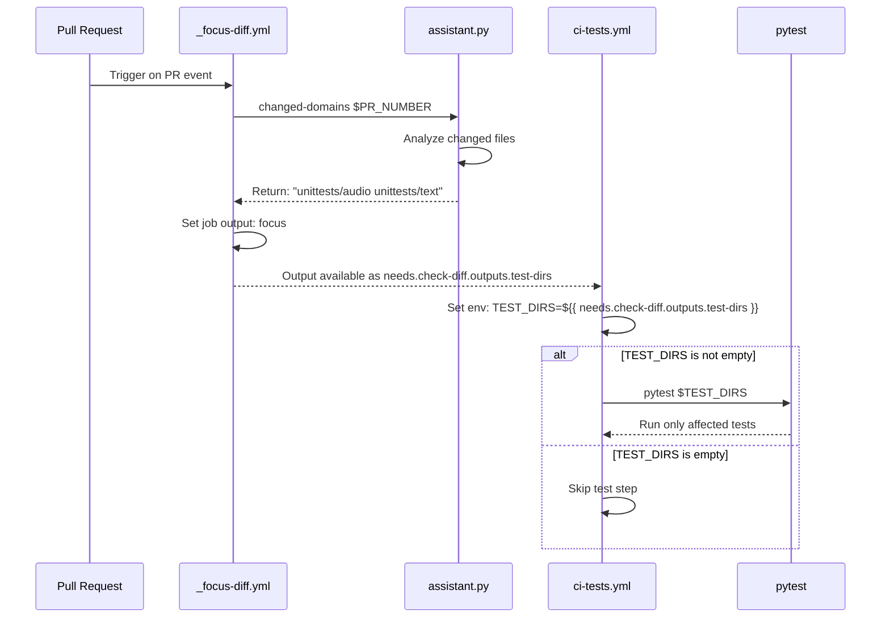
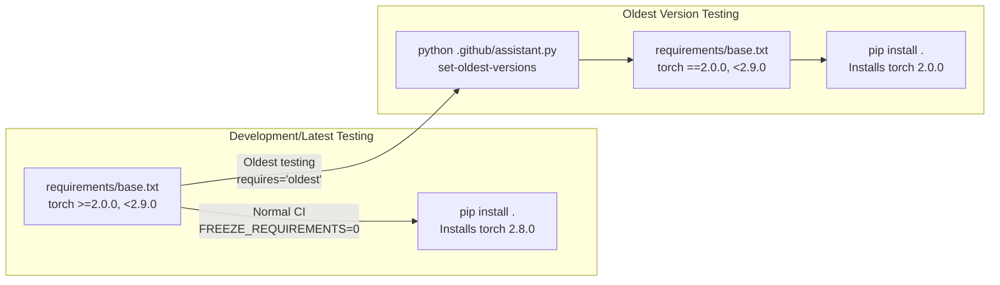

<!-- source: DeepWiki mcp.deepwiki.com · repo Lightning-AI/torchmetrics · page 15.5 Assistant CLI and Development Utilities · fetched 2026-10-21 -->

# Assistant CLI and Development Utilities

<details>
<summary>Relevant source files</summary>

The following files were used as context for generating this wiki page:

- [.azure/gpu-integrations.yml](.azure/gpu-integrations.yml)
- [.azure/gpu-unittests.yml](.azure/gpu-unittests.yml)
- [.github/actions/pull-caches/action.yml](.github/actions/pull-caches/action.yml)
- [.github/actions/push-caches/action.yml](.github/actions/push-caches/action.yml)
- [.github/assistant.py](.github/assistant.py)
- [.github/workflows/_focus-diff.yml](.github/workflows/_focus-diff.yml)
- [.github/workflows/ci-integrate.yml](.github/workflows/ci-integrate.yml)
- [.github/workflows/ci-tests.yml](.github/workflows/ci-tests.yml)
- [.github/workflows/cmd-help.yml](.github/workflows/cmd-help.yml)
- [.github/workflows/cmd-rebase.yml](.github/workflows/cmd-rebase.yml)
- [.github/workflows/docker-build.yml](.github/workflows/docker-build.yml)
- [.github/workflows/docs-build.yml](.github/workflows/docs-build.yml)
- [.github/workflows/labeler.yml](.github/workflows/labeler.yml)
- [.github/workflows/publish-pkg.yml](.github/workflows/publish-pkg.yml)
- [.github/workflows/slash-cmd-dispatch.yml](.github/workflows/slash-cmd-dispatch.yml)
- [requirements/_ci.txt](requirements/_ci.txt)
- [requirements/audio.txt](requirements/audio.txt)
- [requirements/base.txt](requirements/base.txt)
- [requirements/detection.txt](requirements/detection.txt)
- [requirements/image.txt](requirements/image.txt)
- [requirements/typing.txt](requirements/typing.txt)
- [tests/unittests/classification/test_auc.py](tests/unittests/classification/test_auc.py)

</details>


## Purpose and Scope

This page documents the `.github/assistant.py` script, a command-line interface tool that provides critical automation for TorchMetrics' development workflow. The assistant performs three primary functions: **smart test selection** (determining which test directories to run based on PR changes), **backward compatibility testing** (converting version constraints to test with oldest supported dependencies), and **requirements file manipulation** (modifying dependency specifications programmatically).

For information about the broader CI/CD infrastructure that uses these utilities, see [15.1](#15.1). For details on the caching strategies that complement these utilities, see [15.6](#15.6). For the overall testing framework, see [15.2](#15.2).

## Overview

The assistant CLI is implemented as a single Python script at [.github/assistant.py:1-195]() that uses the `fire` library to expose a class-based CLI. It is invoked throughout the CI/CD pipeline to optimize testing efficiency and ensure compatibility across dependency versions.

**Key capabilities:**
- **Test optimization**: Reduces CI time by 50-90% through intelligent test directory selection
- **Version management**: Automates backward compatibility testing by setting oldest supported versions
- **Requirements manipulation**: Programmatically modifies dependency specifications across multiple files
- **PR analysis**: Analyzes GitHub PR file changes to determine affected code domains

**Command Structure**



Sources: [.github/assistant.py:30-189]()

## Command Reference

### set-oldest-versions

**Purpose**: Converts all `>=` version constraints to `==` constraints in requirements files to test backward compatibility with the oldest supported dependency versions.

**Signature**: `set_oldest_versions(req_files: list[str] = REQUIREMENTS_FILES) -> None`

**Default files processed** ([.github/assistant.py:27]()):
- All files matching `requirements/*.txt`
- `requirements.txt`

**Example usage**:
```bash
# Test all requirements with oldest versions
python .github/assistant.py set-oldest-versions

# Test specific requirement file only
python .github/assistant.py set-oldest-versions --req_files='["requirements/_integrate.txt"]'
```

**Transformation example**:
```
Before: torch >=2.0.0, <2.9.0
After:  torch ==2.0.0, <2.9.0
```

**CI integration points**:
| Workflow | Line | Condition | Purpose |
|----------|------|-----------|---------|
| `.azure/gpu-unittests.yml` | [125]() | `torch-ver == '2.0'` | Test GPU code with oldest PyTorch |
| `.github/workflows/ci-tests.yml` | [123]() | `requires == 'oldest'` | Test CPU code with oldest deps |
| `.azure/gpu-integrations.yml` | [76]() | `requires == 'oldest'` | Test GPU integrations with oldest deps |
| `.github/workflows/ci-integrate.yml` | [66]() | `requires == 'oldest'` | Test CPU integrations with oldest deps |
| `.github/actions/pull-caches/action.yml` | [34]() | `requires == 'oldest'` | Prepare environment for oldest version testing |

Sources: [.github/assistant.py:70-75](), [.azure/gpu-unittests.yml:125-127](), [.github/workflows/ci-tests.yml:121-123]()

### changed-domains

**Purpose**: Analyzes a GitHub pull request to determine which metric domains were modified, enabling **smart test selection** that dramatically reduces CI execution time by running only affected tests.

**Signature**: `changed_domains(pr: Optional[int], auth_token: Optional[str] = None, as_list: bool = False, general_sub_pkgs: tuple[str] = _PKG_WIDE_SUBPACKAGES) -> Union[str, list[str]]`

**Parameters**:
- `pr`: GitHub pull request number
- `auth_token`: GitHub authentication token (optional, defaults to anonymous access)
- `as_list`: Return Python list instead of space-separated string
- `general_sub_pkgs`: Subpackages that affect all tests (default: `("utilities", "helpers")`)

**Return values**:
- **Full testing**: `"unittests"` (string mode) or `["torchmetrics"]` (list mode) - when changes affect core infrastructure
- **Focused testing**: `"unittests/audio unittests/image"` (string mode) or `["audio", "image"]` (list mode) - when specific domains are affected
- **No testing**: `""` (string mode) or `[]` (list mode) - when only docs/markdown files changed

**Usage in CI**:
```yaml
# Azure Pipelines syntax
- bash: |
    focus=$(python .github/assistant.py changed-domains $PR_NUMBER)
    echo "##vso[task.setvariable variable=TEST_DIRS]$focus"
  env:
    PR_NUMBER: $(System.PullRequest.PullRequestNumber)
```

Sources: [.github/assistant.py:78-172](), [.azure/gpu-unittests.yml:89-99](), [.github/workflows/_focus-diff.yml:22-30]()

### prune-packages

**Purpose**: Removes specified packages from a requirements file, useful for handling incompatible dependencies in specific environments.

**Signature**: `prune_packages(req_file: str, *pkgs: str) -> None`

**Example**:
```bash
# Remove transformers from a requirements file
python .github/assistant.py prune-packages requirements/text.txt transformers
```

**Implementation**: Filters out lines starting with the specified package names and rewrites the file ([.github/assistant.py:34-44]()).

Sources: [.github/assistant.py:34-44]()

### replace-str-requirements

**Purpose**: Performs find-and-replace operations across multiple requirements files, useful for bulk version updates or constraint modifications.

**Signature**: `replace_str_requirements(old_str: str, new_str: str, req_files: list[str] = REQUIREMENTS_FILES) -> None`

**Example**:
```bash
# Update all references to a package version
python .github/assistant.py replace-str-requirements "torch >=2.0.0" "torch >=2.1.0"
```

Sources: [.github/assistant.py:57-62]()

## Smart Test Selection Algorithm

The `changed_domains` command implements a sophisticated algorithm to minimize CI time while maintaining test coverage. This is critical for a repository with 9 metric domains and ~40,000 lines of test code.

**Algorithm Flow**



Sources: [.github/assistant.py:78-172]()

**Decision Logic Table**

| Changed Files | Decision | Rationale |
|---------------|----------|-----------|
| Only `tests/integrations/*` | Skip unit tests | Integration tests run separately ([.github/assistant.py:99-102]()) |
| Only `docs/*` | Skip unit tests | Documentation changes don't affect code ([.github/assistant.py:105-108]()) |
| Only `*.md` | Skip unit tests | Markdown doesn't affect functionality ([.github/assistant.py:111-115]()) |
| `tests/*` non-test files (configs, helpers) | Test everything | Infrastructure changes affect all tests ([.github/assistant.py:118-121]()) |
| `requirements/base.txt` | Test everything | Base requirements affect all domains ([.github/assistant.py:129-130]()) |
| Changes to `utilities/` or `helpers/` | Test everything | General-purpose code used everywhere ([.github/assistant.py:150-151]()) |
| Domain-specific files | Test affected domains | Safe to isolate tests ([.github/assistant.py:157-172]()) |

**Path Parsing Logic**

The algorithm extracts domain names from file paths using the following mappings ([.github/assistant.py:142-149]()):

```python
# Input paths are cropped to extract domain:
"src/torchmetrics/audio/pesq.py" → "audio"
"tests/unittests/audio/test_pesq.py" → "audio"
"tests/unittests/functional/audio/test_pesq.py" → "audio"

# Output paths are constructed:
"audio" → "unittests/audio"
"text" → "unittests/text"
```

**Edge Cases and Safety**

The algorithm includes multiple safety fallbacks that return `"unittests"` (test everything) when:
1. Test infrastructure files are modified ([.github/assistant.py:118-121]())
2. Base requirements are touched ([.github/assistant.py:129-130]())
3. General-purpose subpackages are modified ([.github/assistant.py:150-151]())
4. Changes exceed parsed module boundaries ([.github/assistant.py:152-154]())
5. No valid test directories can be determined ([.github/assistant.py:169-170]())

Sources: [.github/assistant.py:78-172]()

## CI/CD Integration

The assistant utilities are invoked at strategic points in the CI/CD pipeline to optimize testing and ensure compatibility.

**Integration Architecture**



Sources: [.github/workflows/ci-tests.yml:29](), [.github/workflows/_focus-diff.yml:1-33](), [.azure/gpu-unittests.yml:89-99](), [.azure/gpu-unittests.yml:125-127]()

**Invocation Patterns by Workflow**

| Workflow | Command | When | Purpose | Output Variable |
|----------|---------|------|---------|-----------------|
| `_focus-diff.yml` | `changed-domains $PR_NUMBER` | Every PR | Smart test selection | `focus` (job output) |
| `ci-tests.yml` | `set-oldest-versions` | `requires == 'oldest'` matrix entry | Backward compat | Modifies files in-place |
| `gpu-unittests.yml` | `changed-domains $PR_NUMBER` | PRs only | Smart test selection | `TEST_DIRS` env var |
| `gpu-unittests.yml` | `set-oldest-versions` | `torch-ver == '2.0'` matrix entry | Backward compat with PyTorch 2.0 | Modifies files in-place |
| `gpu-integrations.yml` | `set-oldest-versions` | `requires == 'oldest'` matrix entry | Integration backward compat | Modifies `_integrate.txt` |
| `ci-integrate.yml` | `set-oldest-versions` | `requires == 'oldest'` matrix entry | Integration backward compat | Modifies `_integrate.txt` |
| `pull-caches` action | `set-oldest-versions` | `requires == 'oldest'` input | Cache preparation | Modifies files in-place |

**Test Directory Variable Flow**



Sources: [.github/workflows/_focus-diff.yml:1-33](), [.github/workflows/ci-tests.yml:28-69]()

## Backward Compatibility Testing Strategy

The `set-oldest-versions` command enables **minimum version validation** by converting `>=` constraints to `==` constraints. This ensures TorchMetrics works with the oldest advertised dependency versions, not just the latest.

**Version Constraint Transformation**



Sources: [.github/assistant.py:65-75]()

**Test Matrix Strategy**

The CI system uses matrix builds to test both oldest and latest dependency versions:

| Workflow | Matrix Variable | Values | Effect |
|----------|----------------|---------|--------|
| `ci-tests.yml` | `requires` | `oldest`, (default) | Line 51: Tests Python 3.9 + PyTorch 2.0.1 with oldest deps |
| `ci-integrate.yml` | `requires` | `oldest`, `latest` | Line 31: Tests all integration combinations |
| `gpu-integrations.yml` | `requires` | `oldest`, (default) | Line 23: Tests "torch 2.0" config with oldest deps |

**Special Case: Integration Testing**

Integration tests use a **targeted requirements file** ([.github/assistant.py:70-75]()):

```bash
# Only modify integration requirements, not all requirements
python .github/assistant.py set-oldest-versions \
  --req_files='["requirements/_integrate.txt"]'
```

This approach ([.azure/gpu-integrations.yml:76](), [.github/workflows/ci-integrate.yml:66]()):
- Tests integration compatibility with oldest versions of PyTorch Lightning, Hydra, etc.
- Avoids unnecessarily pinning unrelated dependencies
- Reduces dependency conflicts during installation

**Verification Steps**

After running `set-oldest-versions`, CI pipelines verify the correct versions were installed:

```yaml
# From ci-tests.yml:166
- name: Sanity check
  run: |
    python -c "from torch import __version__ as ver; 
               ver = ver.split('+')[0]; 
               assert ver == '${{ matrix.pytorch-version }}', ver"
```

Sources: [.github/workflows/ci-tests.yml:50-53](), [.github/workflows/ci-integrate.yml:29-31](), [.azure/gpu-integrations.yml:19-26](), [.github/assistant.py:70-75]()

## Implementation Details

### File Operations

All file modification commands use a consistent pattern ([.github/assistant.py:47-54]()):

1. Read file content as string or line list
2. Perform in-memory transformation
3. Write back to same file path
4. Log changes for debugging

This in-place modification approach works because CI environments are ephemeral and don't need to preserve original files.

### Error Handling

The assistant uses defensive programming with safety fallbacks:

**Missing PR number** ([.github/assistant.py:92-93]()):
```python
if not pr:
    return _return_all  # Test everything if PR number unknown
```

**Missing directories** ([.github/assistant.py:163-167]()):
```python
# Filter only existing path in repo
test_modules = [fp for fp in test_modules if (_PATH_DIR_TESTS / fp).exists()]
if not test_modules:
    return _return_all  # Safety: test everything if paths don't exist
```

### Constants and Configuration

Key constants defined at module level ([.github/assistant.py:22-27]()):

| Constant | Value | Purpose |
|----------|-------|---------|
| `_REQUEST_TIMEOUT` | `10` | GitHub API request timeout (seconds) |
| `_PATH_REPO_ROOT` | `Path(__file__).resolve().parent.parent` | Repository root directory |
| `_PATH_DIR_TESTS` | `_PATH_REPO_ROOT / "tests"` | Tests directory path |
| `_PKG_WIDE_SUBPACKAGES` | `("utilities", "helpers")` | Subpackages affecting all tests |
| `REQUIREMENTS_FILES` | `glob.glob("requirements/*.txt")` + `requirements.txt` | Default requirement files |

Sources: [.github/assistant.py:14-27]()

### Dependencies

The assistant requires minimal dependencies installed via `requirements/_ci.txt` ([requirements/_ci.txt:1-5]()):

```
py-tree       # For displaying directory trees
packaging     # For version parsing
fire          # For CLI interface
wget          # For downloading files
```

These are installed early in all CI workflows ([.github/workflows/ci-tests.yml:90](), [.azure/gpu-unittests.yml:90]()).

### GitHub API Integration

The `changed_domains` command uses the `PyGithub` library to access the GitHub API ([.github/assistant.py:85-96]()):

```python
import github

gh = github.Github(login_or_token=auth_token)
pr = gh.get_repo("Lightning-AI/torchmetrics").get_pull(pr)
files = [f.filename for f in pr.get_files()]
```

**Authentication**: The `auth_token` parameter is optional. When not provided, anonymous API access is used (rate-limited to 60 requests/hour). In CI, tokens are typically not passed, which is sufficient for single PR analysis.

Sources: [.github/assistant.py:85-96](), [requirements/_ci.txt:1-5]()

## Performance Impact

The smart test selection provides dramatic CI time savings:

**Without smart selection** (full test suite):
- CPU testing: ~20-30 minutes per matrix entry
- GPU testing: ~40-60 minutes per matrix entry
- Total: ~15 hours across all matrix combinations

**With smart selection** (typical PR affecting 1-2 domains):
- CPU testing: ~5-10 minutes per matrix entry
- GPU testing: ~10-20 minutes per matrix entry
- Total: ~3-5 hours across all matrix combinations

**Savings**: 50-70% reduction in CI time for typical PRs affecting specific metric domains.

**Example scenarios**:

| PR Change | Detected Domains | Test Time | vs. Full Suite |
|-----------|------------------|-----------|----------------|
| Only docs updated | `""` (skip tests) | ~2 min (lint only) | -98% |
| Fix bug in `audio/pesq.py` | `unittests/audio` | ~40 min | -70% |
| Update `requirements/text.txt` | `unittests/text` | ~45 min | -65% |
| Modify `utilities/imports.py` | `unittests` (all) | ~2.5 hours | 0% (safety) |
| Change `requirements/base.txt` | `unittests` (all) | ~2.5 hours | 0% (safety) |

Sources: [.github/assistant.py:78-172](), [.github/workflows/ci-tests.yml:1-258](), [.azure/gpu-unittests.yml:1-254]()

---

