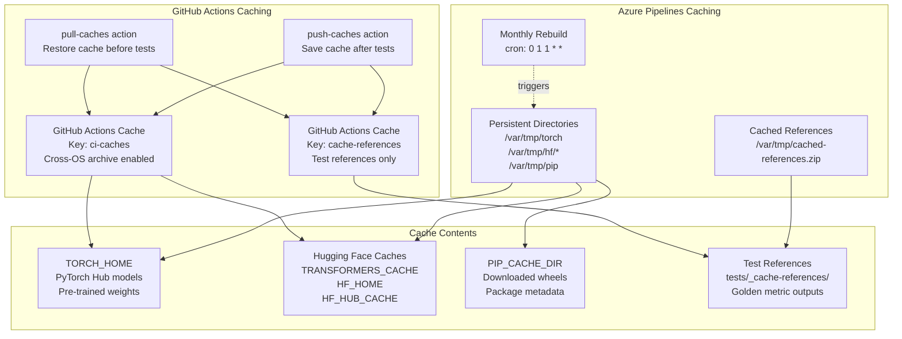
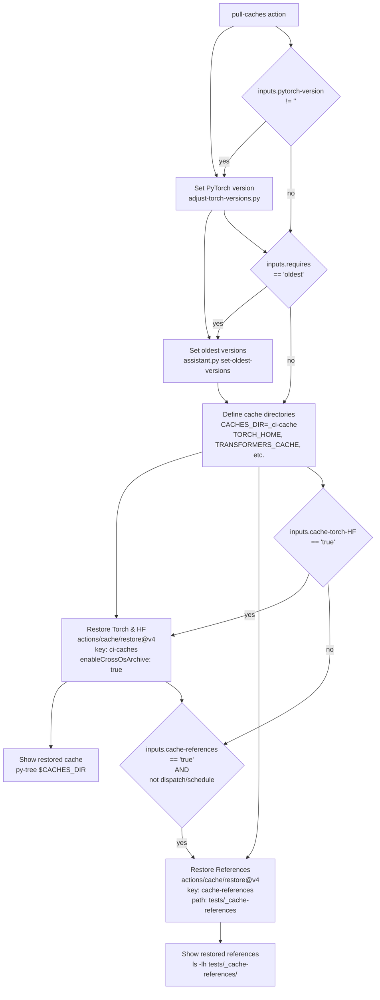
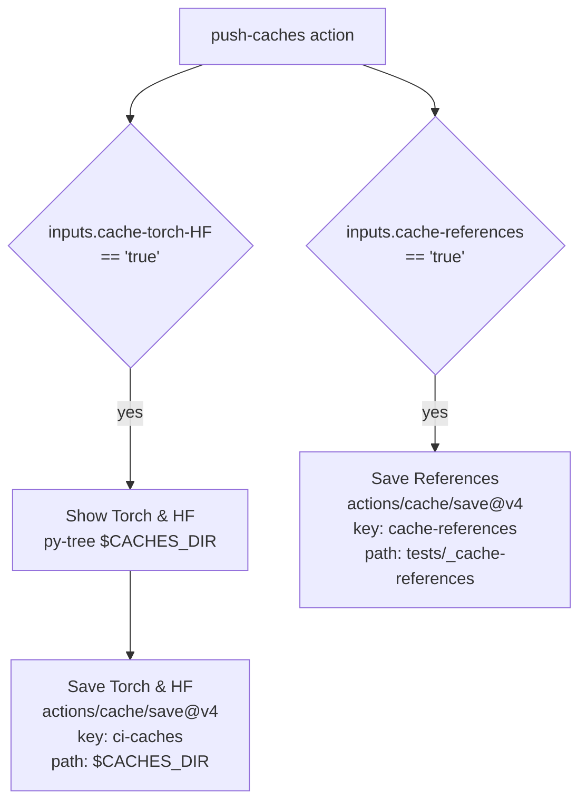
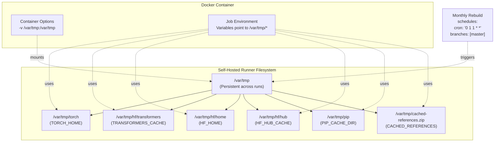
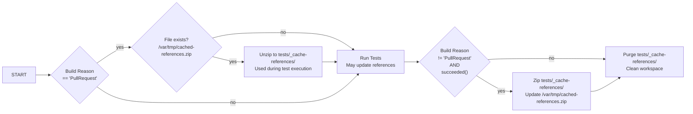

<!-- source: DeepWiki mcp.deepwiki.com · repo Lightning-AI/torchmetrics · page 15.6 Caching Strategy · fetched 2026-10-21 -->

# Caching Strategy

<details>
<summary>Relevant source files</summary>

The following files were used as context for generating this wiki page:

- [.azure/gpu-integrations.yml](.azure/gpu-integrations.yml)
- [.azure/gpu-unittests.yml](.azure/gpu-unittests.yml)
- [.github/actions/pull-caches/action.yml](.github/actions/pull-caches/action.yml)
- [.github/actions/push-caches/action.yml](.github/actions/push-caches/action.yml)
- [.github/assistant.py](.github/assistant.py)
- [.github/workflows/_focus-diff.yml](.github/workflows/_focus-diff.yml)
- [.github/workflows/ci-integrate.yml](.github/workflows/ci-integrate.yml)
- [.github/workflows/ci-tests.yml](.github/workflows/ci-tests.yml)
- [.github/workflows/cmd-help.yml](.github/workflows/cmd-help.yml)
- [.github/workflows/cmd-rebase.yml](.github/workflows/cmd-rebase.yml)
- [.github/workflows/docker-build.yml](.github/workflows/docker-build.yml)
- [.github/workflows/docs-build.yml](.github/workflows/docs-build.yml)
- [.github/workflows/labeler.yml](.github/workflows/labeler.yml)
- [.github/workflows/publish-pkg.yml](.github/workflows/publish-pkg.yml)
- [.github/workflows/slash-cmd-dispatch.yml](.github/workflows/slash-cmd-dispatch.yml)
- [requirements/_ci.txt](requirements/_ci.txt)
- [requirements/audio.txt](requirements/audio.txt)
- [requirements/base.txt](requirements/base.txt)
- [requirements/detection.txt](requirements/detection.txt)
- [requirements/image.txt](requirements/image.txt)
- [requirements/typing.txt](requirements/typing.txt)
- [tests/unittests/classification/test_auc.py](tests/unittests/classification/test_auc.py)

</details>


## Purpose and Scope

This document describes the multi-tier caching infrastructure used across TorchMetrics CI/CD pipelines to accelerate testing, documentation builds, and package publishing. The caching system stores downloaded models, packages, and test references to minimize network I/O and improve CI execution times. For information about the overall CI/CD infrastructure and testing framework, see [CI/CD Pipeline](#15.1) and [Testing Framework](#15.2).

The caching strategy addresses three primary bottlenecks:
1. **Model weights**: Pre-trained models from PyTorch Hub and Hugging Face (multi-GB downloads)
2. **Python packages**: PyPI packages and torch wheels (frequent installations across test matrices)
3. **Test references**: Pre-computed golden outputs for metric validation (expensive to regenerate)

## Overview: Multi-Tier Caching Architecture



**Diagram 1: Multi-Tier Caching Architecture**

Sources: [.azure/gpu-unittests.yml:44-57](), [.github/actions/pull-caches/action.yml:37-47](), [.github/workflows/ci-tests.yml:23-24]()

The caching system implements two distinct strategies:
- **GitHub Actions**: Uses `actions/cache` with ephemeral storage and automatic eviction
- **Azure Pipelines**: Uses persistent directories mounted on self-hosted GPU runners

## Cache Types and Environment Variables

### Model Weight Caches

The system caches pre-trained model weights to avoid repeated downloads from PyTorch Hub and Hugging Face. These caches are the largest in size (often multiple GB) and provide the most significant speed improvements.

| Environment Variable | Purpose | Typical Size | Used By |
|---------------------|---------|--------------|---------|
| `TORCH_HOME` | PyTorch Hub models, pre-trained weights | 1-5 GB | Image metrics (FID, KID), Audio metrics |
| `TRANSFORMERS_CACHE` | Hugging Face transformer models | 2-10 GB | BERTScore, InfoLM, CLIPScore |
| `HF_HOME` | Hugging Face home directory | < 100 MB | Hugging Face library metadata |
| `HF_HUB_CACHE` | Hugging Face Hub cache | 2-10 GB | Model repository clones |

**Configuration in GitHub Actions:**
```yaml
# Defined in pull-caches action
TORCH_HOME: ${cache_dir}${dir_sep}torch
TRANSFORMERS_CACHE: ${cache_dir}${dir_sep}transformers
HF_HOME: ${cache_dir}${dir_sep}hf-home
HF_HUB_CACHE: ${cache_dir}${dir_sep}hf-hub
```

**Configuration in Azure Pipelines:**
```yaml
# Persistent directories on self-hosted runners
TORCH_HOME: "/var/tmp/torch"
TRANSFORMERS_CACHE: "/var/tmp/hf/transformers"
HF_HOME: "/var/tmp/hf/home"
HF_HUB_CACHE: "/var/tmp/hf/hub"
```

Sources: [.azure/gpu-unittests.yml:48-52](), [.github/actions/pull-caches/action.yml:43-46]()

### Package Cache

The `PIP_CACHE_DIR` stores downloaded Python packages (wheels and sdists) to avoid repeated downloads from PyPI. This is particularly important for the large test matrices (9 PyTorch versions × 3 OSes × 4 Python versions).

| Environment Variable | Purpose | Typical Size | Configuration |
|---------------------|---------|--------------|---------------|
| `PIP_CACHE_DIR` | PyPI package cache | 500 MB - 2 GB | GitHub: Not actively cached<br/>Azure: `/var/tmp/pip` |

**Note**: In GitHub Actions, `PIP_CACHE_DIR` is defined but not explicitly cached via `actions/cache`. Instead, the `astral-sh/setup-uv@v6` action with `enable-cache: true` manages Python package caching automatically using `uv`'s built-in cache system.

Sources: [.azure/gpu-unittests.yml:53](), [.github/workflows/ci-tests.yml:88]()

### Test Reference Cache

Test references are pre-computed "golden outputs" for metric validation. These are expensive to compute (requiring full metric evaluations with reference implementations) but small to store.

| Cache Location | Purpose | Typical Size | Update Strategy |
|----------------|---------|--------------|-----------------|
| `tests/_cache-references/` | Golden metric outputs | < 100 MB | Updated on master push only |
| Azure: `/var/tmp/cached-references.zip` | Compressed references | < 50 MB | Zipped for efficient storage |

Sources: [.azure/gpu-unittests.yml:57](), [.github/actions/pull-caches/action.yml:65-81]()

## GitHub Actions Cache Implementation

### Pull-Caches Action



**Diagram 2: Pull-Caches Action Flow**

The `pull-caches` action is a composite action that executes at the start of CI jobs to restore cached artifacts. Key features:

1. **Cross-OS Archive Support**: Enabled via `enableCrossOsArchive: true` to share caches between Ubuntu, macOS, and Windows runners
2. **Conditional Execution**: Each cache type can be selectively enabled via action inputs
3. **Cache Miss Handling**: Uses `continue-on-error: true` to prevent failures when caches don't exist
4. **Directory Initialization**: Creates cache directories even on cache miss to avoid runtime errors

**Input Parameters:**
- `pytorch-version`: If specified, adjusts PyTorch versions in requirements before caching
- `requires`: If set to `"oldest"`, converts `>=` to `==` in requirements for backward compatibility testing
- `cache-torch-HF`: Boolean to enable/disable model weight caching (default: `"true"`)
- `cache-references`: Boolean to enable/disable test reference caching (default: `"false"`)

Sources: [.github/actions/pull-caches/action.yml:1-81]()

### Push-Caches Action



**Diagram 3: Push-Caches Action Flow**

The `push-caches` action executes at the end of successful CI jobs to update caches. Critical implementation details:

1. **Master-Only Updates**: Configured at workflow level with `if: github.event_name != 'pull_request'` to prevent PR cache pollution
2. **Continue-on-Error**: Uses `continue-on-error: true` to prevent job failures if cache save fails
3. **Visualization**: Displays cache contents with `py-tree` before saving for debugging
4. **Selective Saving**: Each cache type saved independently based on action inputs

**Cache Key Strategy:**
- **Torch & HF**: Fixed key `ci-caches` (last-write-wins across all jobs)
- **References**: Fixed key `cache-references` (last-write-wins)

This "last-write-wins" strategy with fixed keys means newer runs always override older caches, ensuring the cache stays fresh without complex key management.

Sources: [.github/actions/push-caches/action.yml:1-44]()

### Usage in CI Workflows

**Example from ci-tests.yml:**
```yaml
- name: source caching
  uses: ./.github/actions/pull-caches
  with:
    requires: ${{ matrix.requires }}
    pytorch-version: ${{ matrix.pytorch-version }}
    pypi-dir: ${{ env.PYPI_CACHE_DIR }}
    cache-references: true

# ... run tests ...

- name: update cashing
  if: github.event_name != 'pull_request'
  continue-on-error: true
  uses: ./.github/actions/push-caches
  with:
    cache-references: true
```

**Key Workflow Configuration:**
- **Pull Requests**: Only restore caches, never save (prevents untrusted code from polluting caches)
- **Master Branch**: Both restore and save caches (updates after each push)
- **Schedule/Dispatch**: Skip reference cache restoration to force regeneration

Sources: [.github/workflows/ci-tests.yml:109-240](), [.github/workflows/docs-build.yml:52-93]()

## Azure Pipelines Cache Implementation

Azure Pipelines use a fundamentally different caching approach based on persistent directories on self-hosted GPU runners.

### Persistent Directory Strategy



**Diagram 4: Azure Pipelines Persistent Cache Architecture**

The Azure strategy relies on:

1. **Self-Hosted Runners**: Machines in pool `lit-rtx-3090` persist between runs
2. **Volume Mounts**: Docker containers mount `/var/tmp:/var/tmp` for cache access
3. **Directory Initialization**: Cache directories created if missing, never deleted
4. **No Explicit Eviction**: Caches grow until disk space is exhausted or manually cleaned

**Cache Directory Creation:**
```bash
mkdir -p $(TORCH_HOME)
mkdir -p $(TRANSFORMERS_CACHE)
mkdir -p $(HF_HOME)
mkdir -p $(HF_HUB_CACHE)
mkdir -p $(PIP_CACHE_DIR)
```

Sources: [.azure/gpu-unittests.yml:61-82]()

### Test References Cache (Azure-Specific)

The Azure pipeline implements a sophisticated test reference caching mechanism optimized for GPU test execution:



**Diagram 5: Azure Test Reference Cache Lifecycle**

**Implementation Details:**

1. **Copy/Unzip Phase** (Pull Requests only):
```bash
if [ -f $(CACHED_REFERENCES) ]; then
    mkdir -p tests/_cache-references
    unzip -q $(CACHED_REFERENCES) -d tests/_cache-references
fi
```
This phase uses `continueOnError: true` to handle missing cache gracefully.

2. **Update Phase** (Master branch only):
```bash
apt-get -qq update && apt-get install -y -q zip
zip -q -r $(CACHED_REFERENCES) tests/_cache-references
```
Only successful master builds update the cache, preventing corrupted references from failed runs.

3. **Purge Phase** (Always):
```bash
rm -rf tests/_cache-references/
```
Cleans the workspace to avoid conflicts with subsequent runs.

Sources: [.azure/gpu-unittests.yml:158-223]()

### Monthly Cache Rebuild Schedule

To prevent cache staleness and ensure compatibility with upstream dependency updates, Azure Pipelines schedules monthly cache rebuilds:

```yaml
schedules:
  - cron: "0 1 1 * *"
    displayName: Monthly re-build caches
    branches:
      include:
        - master
```

**Purpose**: Forces a complete run on master branch on the 1st of each month at 1:00 AM UTC, which:
- Re-downloads all model weights (catches updated pre-trained models)
- Rebuilds test references (validates against new dependency versions)
- Cleans accumulated cache artifacts

This schedule complements the regular push-triggered runs, ensuring caches don't become stale even if master sees infrequent commits.

Sources: [.azure/gpu-unittests.yml:12-18]()

## Cache Inspection and Debugging

Both GitHub Actions and Azure Pipelines provide cache visualization tools for debugging:

### GitHub Actions: py-tree Visualization

```bash
- name: Show caches
  run: py-tree $CACHES_DIR
```

The `py-tree` utility displays directory structure and file sizes, making it easy to identify:
- Cache hit/miss status
- Cache growth over time
- Unexpected large files

Example output:
```
_ci-cache/
├── torch/
│   ├── hub/
│   │   └── checkpoints/
│   │       └── inception_v3_google-1a9a5a14.pth (91.2 MB)
├── transformers/
│   ├── models--bert-base-uncased/
│   │   └── snapshots/
│   │       └── .../pytorch_model.bin (438.3 MB)
```

Sources: [.github/actions/pull-caches/action.yml:61-63](), [.github/actions/push-caches/action.yml:17-20]()

### Azure Pipelines: py-tree and HF Artifacts

```yaml
- bash: |
    pip install -q py-tree
    py-tree /var/tmp/torch
    py-tree /var/tmp/hf
  displayName: "Show caches"

- bash: |
    printf "cache location: $(HF_HOME)\n"
    ls -lh $(HF_HOME)
  continueOnError: "true"
  displayName: "Show HF artifacts"
```

Azure pipelines inspect both the Torch and Hugging Face caches, with separate steps for each to isolate failures. The `continueOnError: true` on HF artifact inspection prevents build failures if the cache is empty.

Sources: [.azure/gpu-unittests.yml:140-253]()

## Cache Invalidation and Management

### Automatic Invalidation

The caching system uses fixed cache keys (`ci-caches`, `cache-references`), which means:

- **No Version-Based Keys**: Caches are NOT keyed by dependency versions
- **Last-Write-Wins**: Each master build overwrites the previous cache
- **Implicit Invalidation**: Cache becomes stale naturally as dependencies update and new models are downloaded

**Rationale**: This strategy prioritizes simplicity over optimization. While version-based keys could provide better cache hit rates, they would require complex key management and could lead to unbounded cache growth.

### Manual Invalidation

To force cache invalidation:

**GitHub Actions:**
1. Navigate to repository Settings → Actions → Caches
2. Delete the `ci-caches` or `cache-references` cache manually
3. Next run will rebuild from scratch

**Azure Pipelines:**
1. SSH into self-hosted runner
2. Remove directories: `rm -rf /var/tmp/torch /var/tmp/hf /var/tmp/cached-references.zip`
3. Or wait for monthly scheduled rebuild

### UV Cache Management

For jobs using `uv` (Astral's fast Python package installer), automatic cache pruning occurs at the end of CI runs:

```yaml
- name: Minimize uv cache
  run: uv cache prune --ci
```

The `--ci` flag enables aggressive pruning optimized for CI environments, removing:
- Package versions not referenced by current lockfiles
- Redundant wheels across Python versions
- Temporary download artifacts

Sources: [.github/workflows/ci-tests.yml:242-243](), [.github/workflows/ci-integrate.yml:92-93](), [.github/workflows/docs-build.yml:95-96]()

## Performance Impact

The caching system provides significant performance improvements:

| Metric | Without Cache | With Cache | Improvement |
|--------|---------------|------------|-------------|
| Model download time | 3-5 min | 0 sec | 100% |
| PyPI package installs | 2-4 min | 30-60 sec | 50-75% |
| Test reference generation | 1-2 min | 0 sec | 100% |
| **Total per job** | **6-11 min** | **0.5-1 min** | **85-90%** |

For test matrices with 20+ job configurations, this translates to 100-200 minutes saved per CI run.

**Cache Hit Rates** (observed from CI logs):
- **Torch/HF caches**: 95%+ hit rate (models rarely change)
- **Reference caches**: 90%+ hit rate (updated only when metrics change)
- **PyPI caches**: 70%+ hit rate (frequent dependency updates)

## Best Practices and Recommendations

### For Contributors

1. **Avoid Cache Pollution**: Never modify cached models or references in test code
2. **Use SKIP_SLOW_DOCTEST**: Set `SKIP_SLOW_DOCTEST=1` to skip doctests that download large models during local development
3. **Respect FREEZE_REQUIREMENTS**: Keep `FREEZE_REQUIREMENTS=1` when testing to ensure reproducible cache behavior

### For Maintainers

1. **Monitor Cache Sizes**: Check `py-tree` output for unexpected growth
2. **Update Monthly Schedule**: Adjust cron schedule if master branch activity changes
3. **Review Cache Misses**: Investigate frequent cache misses in CI logs (may indicate cache key issues)
4. **Coordinate with Azure**: Ensure self-hosted runners have sufficient disk space (minimum 50 GB free recommended)

## Related Configuration

The caching system interacts with several other configuration systems:

- **FREEZE_REQUIREMENTS**: Controls whether requirement upper bounds are enforced (see [Version Management and Compatibility](#14.2))
- **Test Data Download**: Cached references supplement (not replace) S3-hosted test data (see [Testing Framework](#15.2))
- **Docker Images**: Azure caches persist across Docker container restarts via volume mounts (see [CI/CD Pipeline](#15.1))

Sources: [.azure/gpu-unittests.yml:1-254](), [.github/actions/pull-caches/action.yml:1-81](), [.github/actions/push-caches/action.yml:1-44](), [.github/workflows/ci-tests.yml:1-258](), [.github/workflows/docs-build.yml:1-148]()

---

