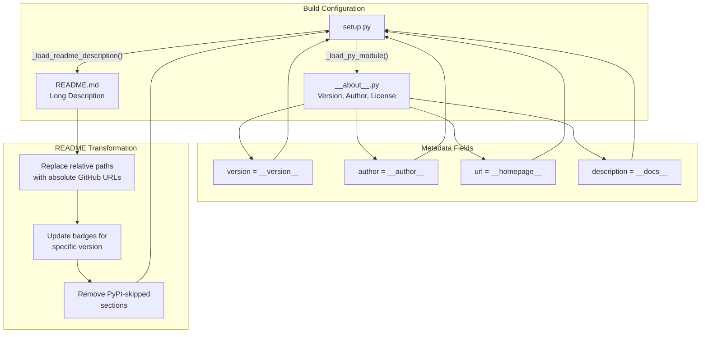
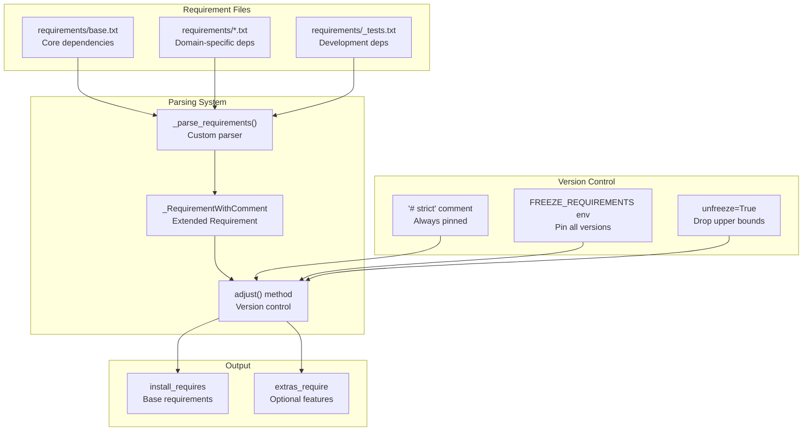
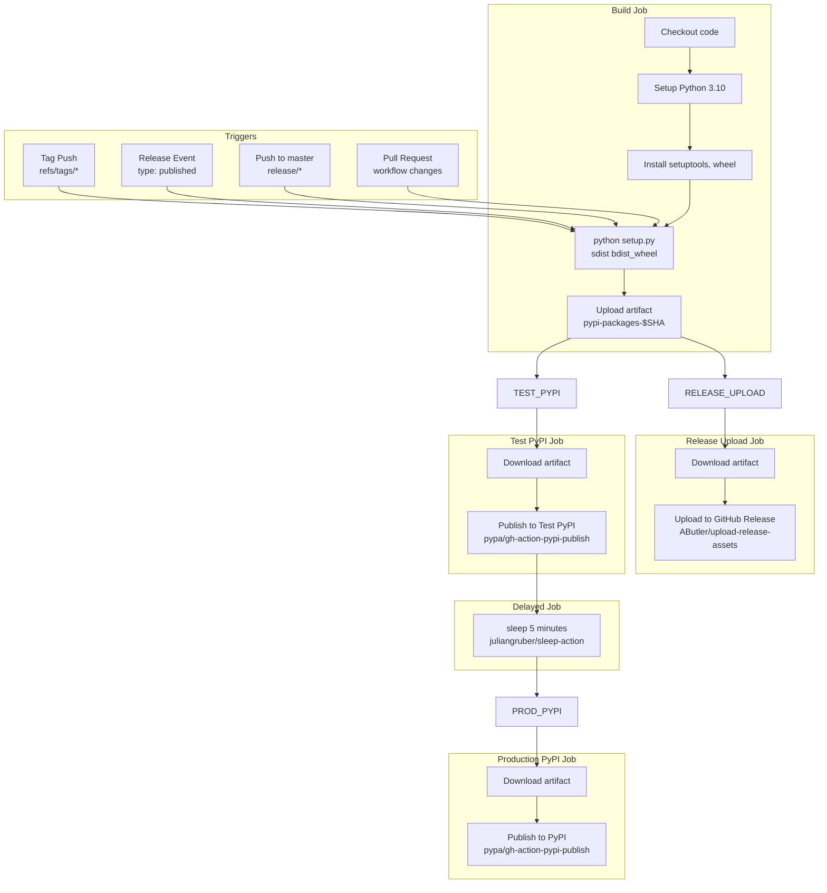
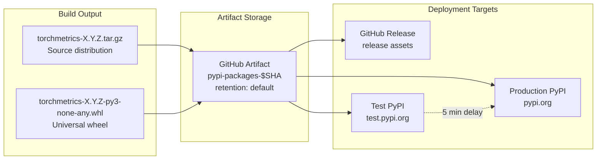
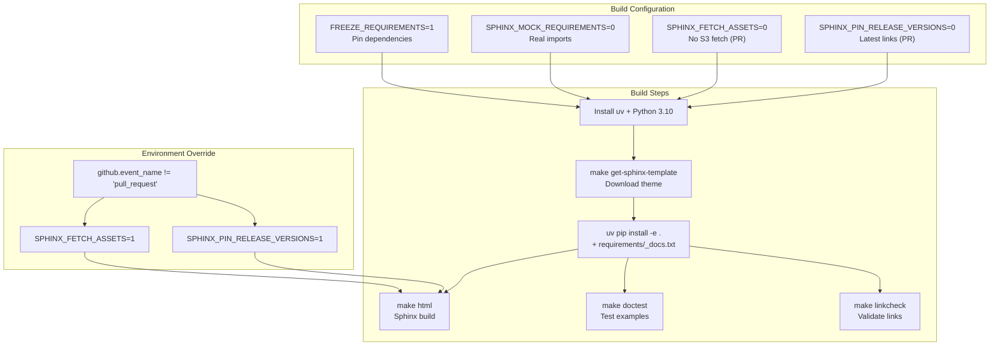
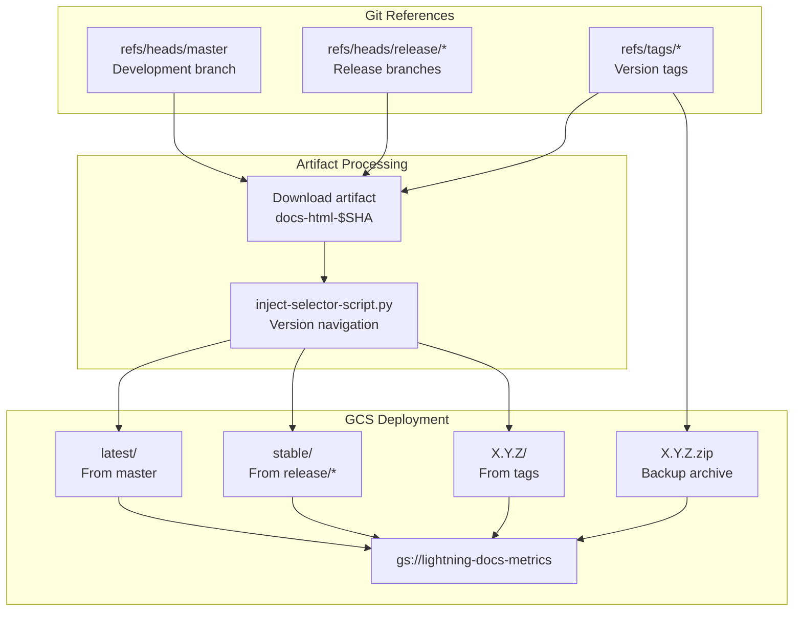
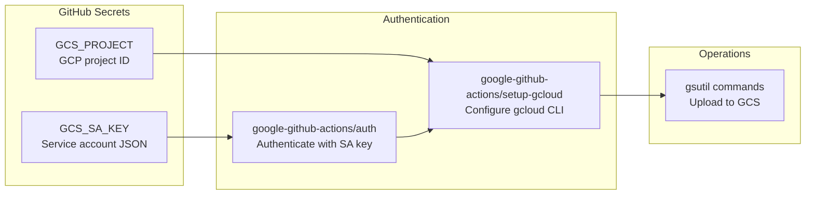
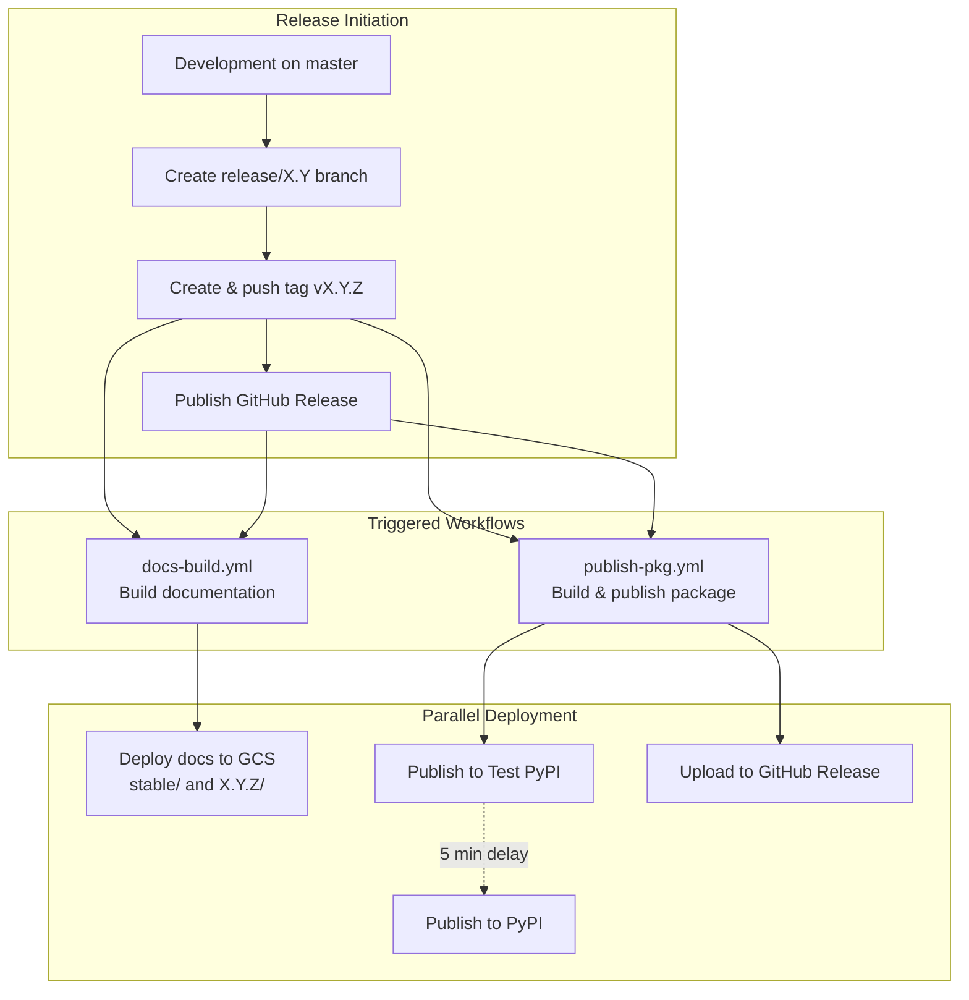
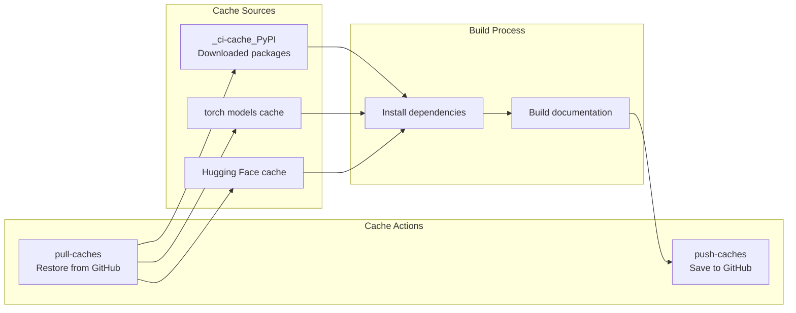

<!-- source: DeepWiki mcp.deepwiki.com · repo Lightning-AI/torchmetrics · page 16 Package Publishing · fetched 2026-10-21 -->

# Package Publishing

<details>
<summary>Relevant source files</summary>

The following files were used as context for generating this wiki page:

- [.github/actions/pull-caches/action.yml](.github/actions/pull-caches/action.yml)
- [.github/actions/push-caches/action.yml](.github/actions/push-caches/action.yml)
- [.github/assistant.py](.github/assistant.py)
- [.github/workflows/_focus-diff.yml](.github/workflows/_focus-diff.yml)
- [.github/workflows/ci-integrate.yml](.github/workflows/ci-integrate.yml)
- [.github/workflows/cmd-help.yml](.github/workflows/cmd-help.yml)
- [.github/workflows/cmd-rebase.yml](.github/workflows/cmd-rebase.yml)
- [.github/workflows/docs-build.yml](.github/workflows/docs-build.yml)
- [.github/workflows/labeler.yml](.github/workflows/labeler.yml)
- [.github/workflows/publish-pkg.yml](.github/workflows/publish-pkg.yml)
- [.github/workflows/slash-cmd-dispatch.yml](.github/workflows/slash-cmd-dispatch.yml)
- [requirements.txt](requirements.txt)
- [requirements/_ci.txt](requirements/_ci.txt)
- [setup.py](setup.py)
- [tests/unittests/classification/test_auc.py](tests/unittests/classification/test_auc.py)

</details>


## Purpose and Scope

This document describes the package publishing infrastructure for torchmetrics, covering how releases are built, tested, and deployed to PyPI and how documentation is published to Google Cloud Storage. It includes the automated GitHub Actions workflows that handle package building, staged PyPI deployment, and multi-version documentation hosting.

For information about the general CI/CD pipeline and testing infrastructure, see [CI/CD Pipeline](#15.1). For details about version pinning and dependency management during builds, see [Dependency Management](#14).

---

## Package Build Configuration

The package build process is controlled by `setup.py`, which uses setuptools to generate source distributions (sdist) and binary wheels (bdist_wheel).

### Package Metadata and Version Loading

The build system loads package metadata from `src/torchmetrics/__about__.py` at build time:



**Diagram: Package metadata assembly from source files**

The `_load_py_module()` function dynamically imports `__about__.py` to extract version and author information [setup.py:149-153](). This approach avoids importing the entire package during setup, which could fail if dependencies aren't installed yet.

The README transformation process [setup.py:115-146]() performs several modifications:
- Replaces relative paths like `docs/source/_static/` with absolute GitHub URLs pointing to the release tag
- Updates ReadTheDocs badge URLs to point to the version-specific documentation
- Updates CI/CD badges to reflect the release tag instead of master branch
- Removes sections marked with special HTML comments for PyPI exclusion

Sources: [setup.py:149-161](), [setup.py:115-146]()

### Requirements Processing and Extras

The build system implements a sophisticated requirements parsing system that supports version pinning control:



**Diagram: Requirements parsing with version control system**

The `_RequirementWithComment` class [setup.py:21-56]() extends `pkg_resources.Requirement` to add:
- **Comment parsing**: Extracts inline comments from requirement lines
- **Strict marker**: Requirements with `# strict` comment are always fully pinned
- **Version adjustment**: The `adjust()` method can remove upper version bounds while preserving lower bounds unless marked strict

The `_prepare_extras()` function [setup.py:165-194]() scans the `requirements/` directory to build the extras_require dictionary:
- Files matching `*_test.txt` are aggregated into a hidden `_tests` extra
- Other `.txt` files become named extras (e.g., `audio.txt` → `audio` extra)
- An `all` extra is created that includes all domain extras
- A `dev` extra includes everything plus test dependencies

Sources: [setup.py:21-56](), [setup.py:58-112](), [setup.py:165-194]()

---

## PyPI Publishing Pipeline

The PyPI publishing workflow implements a staged deployment strategy with automated testing before production release.

### Workflow Triggers and Jobs



**Diagram: PyPI publishing workflow with staged deployment**

The workflow [.github/workflows/publish-pkg.yml:1-102]() defines five jobs:

1. **build-package**: Runs on all triggers (tags, releases, PRs) to validate buildability
   - Uses Python 3.10 for consistency
   - Builds both source distribution and wheel
   - Uploads as GitHub artifact with SHA-based name

2. **release-upload**: Runs only for tags/releases
   - Downloads the build artifact
   - Uploads package files to the GitHub Release page

3. **publish-pypi-test**: Runs only for tags/releases
   - Publishes to Test PyPI (test.pypi.org)
   - Uses separate `test_pypi_password` secret
   - Failures here are not critical (comment in workflow)

4. **publish-delayed**: Simple 5-minute delay
   - Allows time to verify Test PyPI deployment
   - Provides a safety window to cancel if issues detected

5. **publish-pypi-main**: Final production deployment
   - Depends on successful test deployment + delay
   - Publishes to production PyPI (pypi.org)
   - Uses main `pypi_password` secret

Sources: [.github/workflows/publish-pkg.yml:14-102]()

### Authentication and Secrets

The workflow uses GitHub Secrets for PyPI authentication:

| Secret | Usage | Repository |
|--------|-------|------------|
| `test_pypi_password` | API token for Test PyPI | https://test.pypi.org/legacy/ |
| `pypi_password` | API token for Production PyPI | https://pypi.org |
| `GITHUB_TOKEN` | Built-in token for GitHub Release uploads | Automatic |

Both PyPI deployments use the `pypa/gh-action-pypi-publish` action with `user: __token__` [.github/workflows/publish-pkg.yml:72-75](), [.github/workflows/publish-pkg.yml:98-101]().

Sources: [.github/workflows/publish-pkg.yml:57-76](), [.github/workflows/publish-pkg.yml:85-102]()

### Build Artifact Flow



**Diagram: Package artifact distribution flow**

The build job creates two package formats:
- **Source distribution (sdist)**: Complete source code tarball for pip to build from
- **Wheel (bdist_wheel)**: Pre-built distribution for fast installation

These are uploaded as a GitHub Actions artifact [.github/workflows/publish-pkg.yml:34-37]() which is then downloaded by subsequent jobs [.github/workflows/publish-pkg.yml:45-48](), [.github/workflows/publish-pkg.yml:63-66](), [.github/workflows/publish-pkg.yml:91-94]().

Sources: [.github/workflows/publish-pkg.yml:16-38](), [.github/workflows/publish-pkg.yml:29-37]()

---

## Documentation Publishing

Documentation is built and published separately from the package, with different hosting for different branches and tags.

### Documentation Build Process



**Diagram: Documentation build configuration and steps**

The docs build workflow [.github/workflows/docs-build.yml:1-97]() runs three parallel build targets:
- **html**: Generates the full HTML documentation
- **doctest**: Tests code examples embedded in documentation
- **linkcheck**: Validates all external links

For pull requests, asset fetching and version pinning are disabled to speed up builds [.github/workflows/docs-build.yml:66-73](). For deployments (pushes/tags), these are enabled to ensure complete builds with stable external references.

Sources: [.github/workflows/docs-build.yml:19-28](), [.github/workflows/docs-build.yml:66-78]()

### Multi-Version Documentation Deployment



**Diagram: Documentation deployment routing by git reference**

The deployment job [.github/workflows/docs-build.yml:98-148]() publishes documentation to Google Cloud Storage with different paths based on the trigger:

| Git Reference | GCS Path | Purpose |
|--------------|----------|---------|
| `refs/heads/master` | `${GCP_TARGET}/latest` | Latest development docs |
| `refs/heads/release/*` | `${GCP_TARGET}/stable` | Current stable release |
| `refs/tags/*` | `${GCP_TARGET}/$TAG` | Version-specific docs |
| `refs/tags/*` | `${GCP_TARGET}/$TAG.zip` | Archived backup |

The `inject-selector-script.py` [.github/workflows/docs-build.yml:127-132]() injects JavaScript into the built HTML to provide a version selector dropdown, allowing users to navigate between documentation versions.

The deployment uses `gsutil -m rsync -d -R` which:
- `-m`: Parallel upload for faster deployment
- `-d`: Delete remote files not in local (ensure clean state)
- `-R`: Recursive sync of entire directory

Sources: [.github/workflows/docs-build.yml:98-148](), [.github/workflows/docs-build.yml:135-147]()

### GCS Authentication



**Diagram: Google Cloud Storage authentication flow**

The workflow uses two GitHub secrets for GCS access [.github/workflows/docs-build.yml:110-117]():
- `GCS_SA_KEY`: Service account credentials as JSON
- `GCS_PROJECT`: Google Cloud project identifier

Sources: [.github/workflows/docs-build.yml:110-117]()

---

## Release Process and Versioning

### Version Management

The package version is defined in a single source: `src/torchmetrics/__about__.py`. This file contains:

```python
__version__ = "X.Y.Z"
__author__ = "Lightning AI"
__author_email__ = "name@domain.com"
__license__ = "Apache-2.0"
__homepage__ = "https://github.com/Lightning-AI/torchmetrics"
__docs__ = "Machine learning metrics for distributed, scalable PyTorch applications."
```

The `setup.py` dynamically loads this module [setup.py:156-161]() to extract version information, ensuring version is defined in exactly one place.

### Release Trigger Flow



**Diagram: Complete release workflow from tag to deployment**

The typical release process:

1. **Development Phase**: Work proceeds on the `master` branch
2. **Branch Creation**: A `release/X.Y` branch is created from master
3. **Tag Creation**: A version tag (e.g., `v1.2.3`) is created and pushed
4. **GitHub Release**: A release is published on GitHub, triggering workflows

Both documentation and package publishing workflows are triggered simultaneously:
- Documentation is built and deployed to both `stable/` and versioned paths
- Package is built and goes through staged deployment (Test PyPI → delay → Production PyPI)
- Build artifacts are attached to the GitHub Release

Sources: [.github/workflows/docs-build.yml:3-9](), [.github/workflows/publish-pkg.yml:3-12]()

### Build Environment Control

The publishing workflows use specific environment variables to control dependency installation:

| Variable | Value | Purpose |
|----------|-------|---------|
| `FREEZE_REQUIREMENTS` | `"1"` | Pin exact versions during build |
| `TORCH_URL` | CPU wheel URL | Use CPU-only PyTorch to reduce artifact size |
| `SPHINX_MOCK_REQUIREMENTS` | `0` | Import real dependencies for doc build |
| `SPHINX_FETCH_ASSETS` | `0` or `1` | Download external assets for complete docs |
| `SPHINX_PIN_RELEASE_VERSIONS` | `0` or `1` | Pin external doc links for stable references |

The `FREEZE_REQUIREMENTS=1` [.github/workflows/docs-build.yml:20]() ensures that packages built for release use exact versions, making builds reproducible. This is controlled by the environment variable checked in `setup.py` [setup.py:18]().

Sources: [.github/workflows/docs-build.yml:19-28](), [setup.py:18]()

---

## Integration with CI/CD Infrastructure

### Caching Strategy

The documentation build workflow uses the shared caching actions [.github/workflows/docs-build.yml:52-56](), [.github/workflows/docs-build.yml:88-93]():



**Diagram: Caching flow for documentation builds**

The caching system is defined in custom composite actions [.github/actions/pull-caches/action.yml]() and [.github/actions/push-caches/action.yml](). For documentation builds, only the PyPI cache is used, not the reference test cache.

Sources: [.github/workflows/docs-build.yml:52-56](), [.github/workflows/docs-build.yml:88-93]()

### Dependency Installation with uv

The workflows use the `uv` package manager for faster dependency installation [.github/workflows/docs-build.yml:41-48]():

```bash
uv pip install -r requirements/_ci.txt
uv pip install -e . -r requirements/_docs.txt
```

The `USE_UV=1` environment variable can be set to enable uv-specific optimizations [.github/workflows/docs-build.yml:60]().

Sources: [.github/workflows/docs-build.yml:41-65]()

### Version Pinning for Integration Tests

The AssistantCLI utility [.github/assistant.py:70-75]() provides a `set-oldest-versions` command used in integration testing workflows to pin dependencies to minimum supported versions:

```python
@staticmethod
def set_oldest_versions(req_files: list[str] = REQUIREMENTS_FILES) -> None:
    """Set the oldest version for requirements."""
    if isinstance(req_files, str):
        req_files = [req_files]
    for fpath in req_files:
        AssistantCLI.replace_min_requirements(fpath)
```

This ensures that published packages work with the minimum versions declared in requirements files.

Sources: [.github/assistant.py:64-75](), [.github/workflows/ci-integrate.yml:64-66]()

---

## Publishing Checklist

When preparing a release, the following automated checks ensure quality:

| Check | Workflow | Purpose |
|-------|----------|---------|
| Package builds successfully | `publish-pkg.yml` | Validates setup.py and dependencies |
| Documentation builds without errors | `docs-build.yml` | Ensures docs are complete and valid |
| Doctests pass | `docs-build.yml` (doctest) | Code examples in docs work correctly |
| Links are valid | `docs-build.yml` (linkcheck) | External references are reachable |
| Test PyPI upload succeeds | `publish-pkg.yml` | Credentials and package format valid |

All checks must pass before the production PyPI deployment occurs. The 5-minute delay [.github/workflows/publish-pkg.yml:77-83]() provides a final window to verify the Test PyPI deployment and cancel if necessary.

Sources: [.github/workflows/publish-pkg.yml:77-83](), [.github/workflows/docs-build.yml:36]()

---

