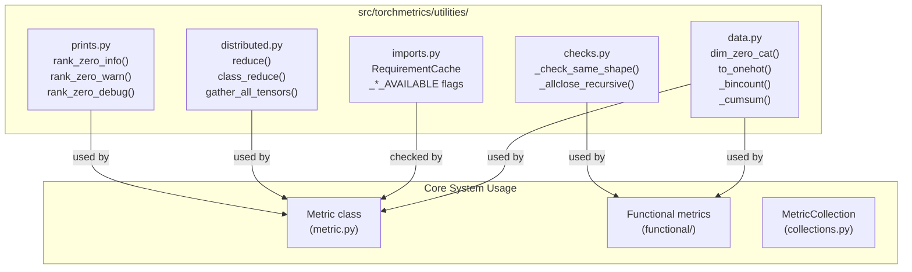
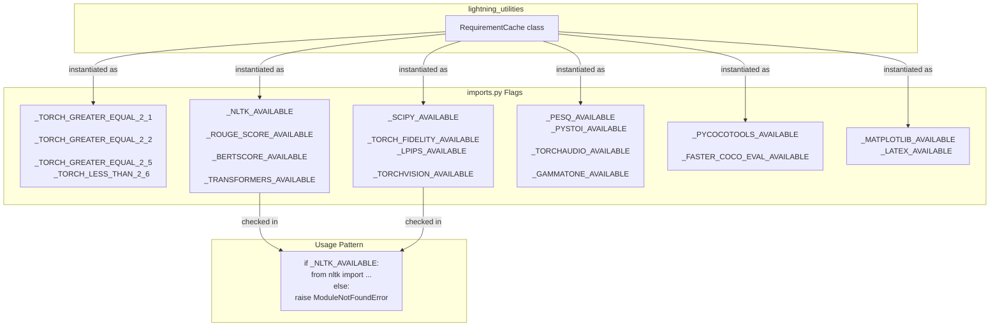
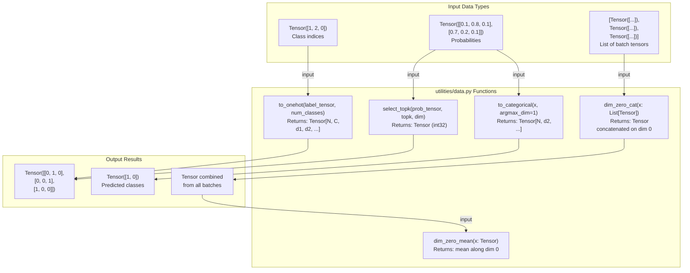
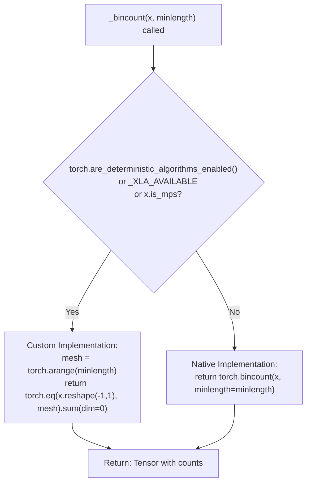
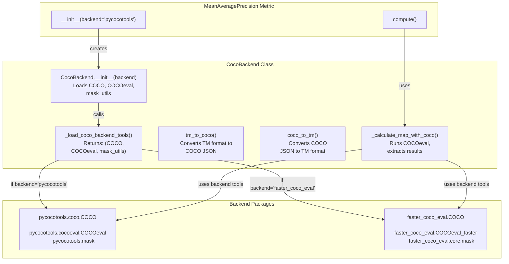

<!-- source: DeepWiki mcp.deepwiki.com · repo Lightning-AI/torchmetrics · page 17 Utilities and Helpers · fetched 2026-10-21 -->

# Utilities

<details>
<summary>Relevant source files</summary>

The following files were used as context for generating this wiki page:

- [docs/source/detection/mean_average_precision.rst](docs/source/detection/mean_average_precision.rst)
- [docs/source/links.rst](docs/source/links.rst)
- [requirements/detection_test.txt](requirements/detection_test.txt)
- [src/torchmetrics/__init__.py](src/torchmetrics/__init__.py)
- [src/torchmetrics/classification/__init__.py](src/torchmetrics/classification/__init__.py)
- [src/torchmetrics/detection/_mean_ap.py](src/torchmetrics/detection/_mean_ap.py)
- [src/torchmetrics/detection/helpers.py](src/torchmetrics/detection/helpers.py)
- [src/torchmetrics/detection/mean_ap.py](src/torchmetrics/detection/mean_ap.py)
- [src/torchmetrics/functional/__init__.py](src/torchmetrics/functional/__init__.py)
- [src/torchmetrics/functional/classification/__init__.py](src/torchmetrics/functional/classification/__init__.py)
- [src/torchmetrics/functional/detection/map.py](src/torchmetrics/functional/detection/map.py)
- [src/torchmetrics/functional/image/ssim.py](src/torchmetrics/functional/image/ssim.py)
- [src/torchmetrics/functional/pairwise/__init__.py](src/torchmetrics/functional/pairwise/__init__.py)
- [src/torchmetrics/functional/regression/__init__.py](src/torchmetrics/functional/regression/__init__.py)
- [src/torchmetrics/image/ssim.py](src/torchmetrics/image/ssim.py)
- [src/torchmetrics/regression/__init__.py](src/torchmetrics/regression/__init__.py)
- [src/torchmetrics/utilities/data.py](src/torchmetrics/utilities/data.py)
- [src/torchmetrics/utilities/imports.py](src/torchmetrics/utilities/imports.py)
- [tests/README.md](tests/README.md)
- [tests/unittests/detection/test_map.py](tests/unittests/detection/test_map.py)
- [tests/unittests/image/test_ms_ssim.py](tests/unittests/image/test_ms_ssim.py)
- [tests/unittests/image/test_ssim.py](tests/unittests/image/test_ssim.py)
- [tests/unittests/utilities/test_utilities.py](tests/unittests/utilities/test_utilities.py)

</details>


## Introduction

The TorchMetrics utilities system provides essential functionality that supports the core metrics implementation. These utilities handle tasks ranging from data manipulation and tensor operations to distributed training support and import management. This page documents the primary utility modules and functions that power the internal workings of TorchMetrics.

Sources: [src/torchmetrics/utilities/data.py:1-272](), [src/torchmetrics/utilities/imports.py:1-67]()

## Overview of Utility Modules

TorchMetrics provides several specialized utility modules that support the metrics system. The primary modules are located in `src/torchmetrics/utilities/`:



Sources: [src/torchmetrics/utilities/data.py:1-272](), [src/torchmetrics/utilities/imports.py:1-69](), [tests/unittests/utilities/test_utilities.py:26-37]()

## Import Utilities

The import utilities module provides a clean way to manage optional dependencies in TorchMetrics. It uses the `RequirementCache` from `lightning_utilities` to check if specific packages are available at runtime.

### RequirementCache System

The `RequirementCache` class from `lightning_utilities.core.imports` provides lazy evaluation of package availability. TorchMetrics defines numerous availability flags in [src/torchmetrics/utilities/imports.py:19-69]():



**Key Availability Flags:**

| Flag | Package Requirement | Used By |
|------|---------------------|---------|
| `_NLTK_AVAILABLE` | nltk | BLEU, ROUGE, text tokenization |
| `_TRANSFORMERS_AVAILABLE` | transformers | BERTScore, CLIPScore, InfoLM |
| `_PYCOCOTOOLS_AVAILABLE` | pycocotools | MeanAveragePrecision |
| `_FASTER_COCO_EVAL_AVAILABLE` | faster-coco-eval | MeanAveragePrecision (alternative backend) |
| `_TORCH_FIDELITY_AVAILABLE` | torch-fidelity | FID, KID, InceptionScore |
| `_SCIPY_AVAILABLE` | scipy | Various image/statistical metrics |
| `_MATPLOTLIB_AVAILABLE` | matplotlib | plot() methods |

Sources: [src/torchmetrics/utilities/imports.py:16-69](), [src/torchmetrics/detection/mean_ap.py:30-35]()

## Data Manipulation Utilities

The data manipulation utilities provide essential functions for tensor operations, particularly those needed across different metric implementations.

### Key Functions

The [src/torchmetrics/utilities/data.py]() module provides the following primary functions:

| Function | Location | Purpose | Return Type |
|----------|----------|---------|-------------|
| `dim_zero_cat` | [data.py:29-36]() | Concatenate tensors/lists along dimension 0 | Tensor |
| `dim_zero_sum` | [data.py:39-41]() | Sum along dimension 0 | Tensor |
| `dim_zero_mean` | [data.py:44-46]() | Mean along dimension 0 | Tensor |
| `dim_zero_max` | [data.py:49-51]() | Max along dimension 0 | Tensor |
| `dim_zero_min` | [data.py:54-56]() | Min along dimension 0 | Tensor |
| `to_onehot` | [data.py:81-113]() | Convert labels to one-hot encoding | Tensor |
| `to_categorical` | [data.py:151-167]() | Convert probabilities to class indices | Tensor |
| `select_topk` | [data.py:124-148]() | Binary tensor with top-k highest entries | Tensor (int32) |
| `_bincount` | [data.py:178-206]() | Count occurrences (deterministic-safe) | Tensor |
| `_cumsum` | [data.py:209-220]() | Cumulative sum (deterministic-safe) | Tensor |
| `_flatten` | [data.py:59-61]() | Flatten list of lists | list |
| `_flatten_dict` | [data.py:64-78]() | Flatten nested dicts, detect duplicates | tuple[dict, bool] |
| `_flexible_bincount` | [data.py:223-239]() | Bincount for non-continuous values | Tensor |
| `allclose` | [data.py:242-246]() | Compare tensors with dtype robustness | bool |
| `interp` | [data.py:249-271]() | 1D interpolation (like numpy.interp) | Tensor |

### Data Transformation Pipeline



Sources: [src/torchmetrics/utilities/data.py:29-271](), [tests/unittests/utilities/test_utilities.py:75-113]()

## Custom Implementations

TorchMetrics includes custom implementations of certain PyTorch functions to ensure compatibility with different environments, handle edge cases, or work around limitations in deterministic settings.

### Deterministic and Edge Case Implementations

PyTorch has limitations with certain operations in deterministic mode or specific hardware/dtype combinations. TorchMetrics provides custom implementations:

| Function | Issue Addressed | Implementation Strategy | Code Reference |
|----------|-----------------|-------------------------|----------------|
| `_bincount` | `torch.bincount` not deterministic on GPU; not supported on MPS/XLA | Uses `torch.arange` + `torch.eq` when `torch.are_deterministic_algorithms_enabled()` | [data.py:178-206]() |
| `_cumsum` | `torch.cumsum` not deterministic on GPU for FP tensors (pre-2.6) | Copies to CPU, computes, copies back (with warning) | [data.py:209-220]() |
| `_top_k_with_half_precision_support` | `torch.topk` not implemented for half precision on CPU | Falls back to `torch.argsort(...).flip(dim).narrow(...)` | [data.py:116-121]() |
| `_flexible_bincount` | Standard bincount requires continuous values | Shifts values to start from 0, filters output | [data.py:223-239]() |

### Environment-Aware Execution Pattern



**Example: `_cumsum` implementation for deterministic GPU support**

The function in [data.py:209-220]() checks if running on CUDA with deterministic algorithms and PyTorch < 2.6, then:
1. Copies tensor to CPU with `x.cpu()`
2. Calls `cumsum(dim=dim, dtype=dtype)`
3. Copies result back with `.to(x.device)`
4. Issues warning via `rank_zero_warn` about performance impact

Sources: [src/torchmetrics/utilities/data.py:178-220](), [tests/unittests/utilities/test_utilities.py:131-206]()

## Constants and Helper Variables

TorchMetrics defines several constants that are used throughout the library:

| Constant | Value | Purpose |
|----------|-------|---------|
| `METRIC_EPS` | 1e-6 | Small epsilon value to prevent division by zero |
| `_PYTHON_VERSION` | Current Python version | Version checking |

These constants help ensure consistent behavior across the library.

Sources: [src/torchmetrics/utilities/data.py:26]()

## Backend Utilities and Abstraction Layers

TorchMetrics uses backend abstraction layers to support multiple implementations of the same functionality. The most prominent example is the `CocoBackend` class for detection metrics.

### CocoBackend: Detection Evaluation Abstraction

The [src/torchmetrics/detection/helpers.py:152-543]() `CocoBackend` class abstracts pycocotools and faster-coco-eval implementations:



**Key Methods:**

| Method | Purpose | Input | Output |
|--------|---------|-------|--------|
| `tm_to_coco()` | Convert TorchMetrics format to COCO JSON files | Lists of tensors (boxes, labels, scores, masks) | Writes `*_preds.json` and `*_target.json` |
| `coco_to_tm()` | Convert COCO JSON to TorchMetrics format | JSON file paths | `list[dict[str, Tensor]]` |
| `_calculate_map_with_coco()` | Run COCO evaluation | Detection/GT data, thresholds, settings | `dict` with map, mar, map_50, etc. |

Sources: [src/torchmetrics/detection/helpers.py:126-543](), [src/torchmetrics/detection/mean_ap.py:415]()

## Additional Utility Functions

### Validation and Comparison Utilities

Located in [src/torchmetrics/utilities/checks.py]():

- `_check_same_shape(preds, target)`: Validates tensors have matching shapes
- `_allclose_recursive(...)`: Recursively compares tensors/lists/dicts with `torch.allclose`

### Distributed Training Utilities

Located in [src/torchmetrics/utilities/distributed.py]():

- `reduce(tensor, reduction)`: Apply reduction ('elementwise_mean', 'sum', 'none')
- `class_reduce(num, denom, weights, average)`: Class-wise averaging (micro/macro/weighted)
- `gather_all_tensors(result)`: All-gather operation across distributed processes

### Printing Utilities

Located in [src/torchmetrics/utilities/prints.py]():

- `rank_zero_info(message)`: Log info only on rank 0
- `rank_zero_warn(message, category)`: Warn only on rank 0
- `rank_zero_debug(message)`: Debug log only on rank 0

Sources: [src/torchmetrics/utilities/distributed.py](), [src/torchmetrics/utilities/prints.py](), [tests/unittests/utilities/test_utilities.py:42-73]()

## Usage Examples

### Converting Between Label Formats

```python
import torch
from torchmetrics.utilities.data import to_onehot, to_categorical

# Convert class indices to one-hot format (data.py:81-113)
class_indices = torch.tensor([1, 2, 0])
one_hot = to_onehot(class_indices, num_classes=3)
# Result: tensor([[0, 1, 0], [0, 0, 1], [1, 0, 0]])

# Convert probabilities to class indices (data.py:151-167)
probs = torch.tensor([[0.1, 0.8, 0.1], [0.7, 0.2, 0.1], [0.2, 0.2, 0.6]])
predictions = to_categorical(probs)
# Result: tensor([1, 0, 2])
```

### Aggregating Distributed Results

```python
import torch
from torchmetrics.utilities.data import dim_zero_cat, _bincount

# Combine batch results from multiple update() calls
batch_results = [torch.tensor([0.85, 0.90]), torch.tensor([0.88, 0.92])]
all_results = dim_zero_cat(batch_results)
# Result: tensor([0.85, 0.90, 0.88, 0.92])

# Count class occurrences (deterministic-safe)
labels = torch.tensor([0, 0, 1, 2, 1, 0, 2, 2])
class_counts = _bincount(labels, minlength=3)
# Result: tensor([3, 2, 3])
```

### Checking Package Availability

```python
from torchmetrics.utilities.imports import (
    _NLTK_AVAILABLE,
    _TRANSFORMERS_AVAILABLE,
    _TORCH_GREATER_EQUAL_2_1
)

# Conditional metric implementation
if _NLTK_AVAILABLE:
    from torchmetrics.text import BLEUScore
    metric = BLEUScore()
else:
    raise ModuleNotFoundError("BLEUScore requires nltk")

# Version-specific features
if _TORCH_GREATER_EQUAL_2_1:
    # Use new PyTorch 2.1+ features
    pass
```

Sources: [src/torchmetrics/utilities/data.py:29-239](), [src/torchmetrics/utilities/imports.py:19-69](), [tests/unittests/utilities/test_utilities.py:75-120]()

## Conclusion

The TorchMetrics utilities module provides a comprehensive set of tools that support the core metrics implementation. These utilities handle everything from data manipulation and tensor operations to distributed training support and package management, ensuring that TorchMetrics works consistently across different environments and use cases.

The utilities system is designed to be modular and reusable, with many components being useful beyond their original context. Understanding these utilities can help you extend TorchMetrics with your own custom metrics and make better use of the library's capabilities.