<!-- source: DeepWiki mcp.deepwiki.com · repo Lightning-AI/torchmetrics · page 2 Core Architecture · fetched 2026-10-21 -->

# Core Architecture

<details>
<summary>Relevant source files</summary>

The following files were used as context for generating this wiki page:

- [.pre-commit-config.yaml](.pre-commit-config.yaml)
- [CHANGELOG.md](CHANGELOG.md)
- [LICENSE](LICENSE)
- [README.md](README.md)
- [docs/source/_templates/theme_variables.jinja](docs/source/_templates/theme_variables.jinja)
- [docs/source/all-metrics.rst](docs/source/all-metrics.rst)
- [docs/source/conf.py](docs/source/conf.py)
- [docs/source/index.rst](docs/source/index.rst)
- [docs/source/pages/implement.rst](docs/source/pages/implement.rst)
- [docs/source/pages/lightning.rst](docs/source/pages/lightning.rst)
- [docs/source/pages/overview.rst](docs/source/pages/overview.rst)
- [docs/source/pages/quickstart.rst](docs/source/pages/quickstart.rst)
- [pyproject.toml](pyproject.toml)
- [requirements/integrate.txt](requirements/integrate.txt)
- [src/torchmetrics/__about__.py](src/torchmetrics/__about__.py)
- [src/torchmetrics/collections.py](src/torchmetrics/collections.py)
- [src/torchmetrics/metric.py](src/torchmetrics/metric.py)
- [tests/integrations/lightning/boring_model.py](tests/integrations/lightning/boring_model.py)
- [tests/integrations/test_lightning.py](tests/integrations/test_lightning.py)
- [tests/unittests/bases/test_collections.py](tests/unittests/bases/test_collections.py)
- [tests/unittests/bases/test_metric.py](tests/unittests/bases/test_metric.py)

</details>


This document provides a deep dive into the foundational architecture of TorchMetrics, covering the `Metric` base class, state management mechanisms, and distributed synchronization patterns. For implementing custom metrics using this architecture, see [Implementing a Metric](#15). For integration with PyTorch Lightning, see [TorchMetrics in PyTorch Lightning](#1.2).

## Overview

The TorchMetrics architecture is built around a base `Metric` class that inherits from `torch.nn.Module` and provides a standardized interface for metric computation. The design enables automatic state accumulation across batches, distributed synchronization across devices, and persistent storage of metric states.

**Core Design Principles:**

| Principle | Implementation |
|-----------|----------------|
| **Stateful Computation** | Metrics maintain internal state variables that accumulate across batches |
| **Distributed-First** | Automatic synchronization and reduction across processes in DDP mode |
| **Module Integration** | Inherits from `torch.nn.Module` for seamless PyTorch integration |
| **Dual API** | Both module-based (stateful) and functional (stateless) interfaces |
| **Memory Efficiency** | Optional CPU offloading and configurable caching strategies |

Sources: [src/torchmetrics/metric.py:52-86](), [docs/source/pages/overview.rst:10-22]()

## Metric Base Class Architecture

### Class Hierarchy and Core Components

```mermaid
graph TB
    Module["torch.nn.Module"]
    ABC["abc.ABC"]
    Metric["torchmetrics.Metric"]
    
    Module --> Metric
    ABC --> Metric
    
    subgraph "Metric State Dictionaries"
        Defaults["_defaults: dict<br/>Default values for states"]
        Persistent["_persistent: dict<br/>Persistence flags"]
        Reductions["_reductions: dict<br/>Reduction functions"]
    end
    
    subgraph "Lifecycle Methods (Abstract)"
        Update["update(*args, **kwargs)<br/>Update metric state"]
        Compute["compute() -> Any<br/>Compute final result"]
    end
    
    subgraph "Provided Methods"
        Forward["forward(*args, **kwargs)<br/>Dual-purpose: update + compute"]
        Reset["reset()<br/>Reset states to defaults"]
        AddState["add_state(name, default, dist_reduce_fx)<br/>Register metric state"]
    end
    
    subgraph "Synchronization Methods"
        Sync["sync(dist_sync_fn, process_group)<br/>Manual sync"]
        Unsync["unsync()<br/>Restore local state"]
        SyncDist["_sync_dist(dist_sync_fn)<br/>Internal sync implementation"]
    end
    
    subgraph "Configuration Attributes"
        SyncOnCompute["sync_on_compute: bool<br/>Auto-sync on compute"]
        DistSyncOnStep["dist_sync_on_step: bool<br/>Sync on forward"]
        ComputeOnCPU["compute_on_cpu: bool<br/>Offload list states to CPU"]
        ComputeWithCache["compute_with_cache: bool<br/>Cache compute results"]
        FullStateUpdate["full_state_update: bool<br/>Forward behavior mode"]
    end
    
    Metric --> Defaults
    Metric --> Persistent
    Metric --> Reductions
    Metric --> Update
    Metric --> Compute
    Metric --> Forward
    Metric --> Reset
    Metric --> AddState
    Metric --> Sync
    Metric --> Unsync
    Metric --> SyncDist
    Metric --> SyncOnCompute
    Metric --> DistSyncOnStep
    Metric --> ComputeOnCPU
    Metric --> ComputeWithCache
    Metric --> FullStateUpdate
```

Sources: [src/torchmetrics/metric.py:52-176](), [docs/source/pages/overview.rst:14-22]()

### Metric Properties and Attributes

The `Metric` class exposes several key properties and class attributes:

| Property/Attribute | Type | Purpose |
|-------------------|------|---------|
| `is_differentiable` | `Optional[bool]` | Indicates if metric supports backpropagation |
| `higher_is_better` | `Optional[bool]` | Optimization direction for hyperparameter tuning |
| `full_state_update` | `Optional[bool]` | Controls `forward()` method behavior |
| `plot_lower_bound` | `Optional[float]` | Lower bound for plotting |
| `plot_upper_bound` | `Optional[float]` | Upper bound for plotting |
| `metric_state` | `dict` | Read-only property returning current state |
| `update_count` | `int` | Number of times `update()` has been called |
| `update_called` | `bool` | Whether `update()` has been called since last reset |
| `device` | `torch.device` | Current device of metric states |
| `dtype` | `torch.dtype` | Current dtype of metric states |

Sources: [src/torchmetrics/metric.py:87-199]()

## State Management System

### The add_state Method

Metric states are registered using `add_state()`, which establishes how states are stored, synchronized, and reduced:

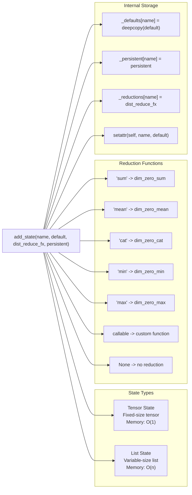

**Tensor States vs List States:**

Tensor states maintain a fixed memory footprint and are suitable when the state can be incrementally updated (e.g., counters, sums). List states grow with each `update()` call and are necessary when individual batch data must be retained (e.g., for rank calculations).

```python
# Example from metric implementation
self.add_state("correct", default=torch.tensor(0), dist_reduce_fx="sum")  # Tensor state
self.add_state("preds", default=[], dist_reduce_fx="cat")  # List state
```

Sources: [src/torchmetrics/metric.py:201-285](), [docs/source/pages/overview.rst:136-183]()

### State Reduction Operations

When metrics are synchronized in distributed mode, the `dist_reduce_fx` parameter determines how states are reduced:

| Reduction | Operation | Use Case |
|-----------|-----------|----------|
| `"sum"` | `dim_zero_sum()` | Counting operations (correct predictions, total samples) |
| `"mean"` | `dim_zero_mean()` | Averaging values |
| `"cat"` | `dim_zero_cat()` | Concatenating tensors or lists |
| `"min"` | `dim_zero_min()` | Finding minimum value |
| `"max"` | `dim_zero_max()` | Finding maximum value |
| `None` | Stacking only | When custom reduction logic is needed |
| `callable` | User function | Custom reduction logic |

The reduction is applied during synchronization in `_sync_dist()`:

Sources: [src/torchmetrics/metric.py:264-276](), [src/torchmetrics/metric.py:501-541]()

### State Dictionary Management

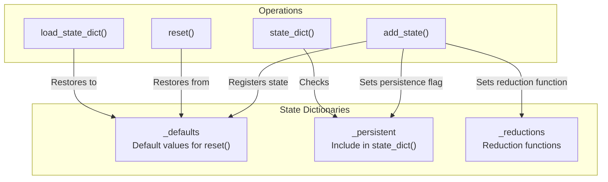

Sources: [src/torchmetrics/metric.py:169-172](), [src/torchmetrics/metric.py:758-774]()

## Lifecycle Methods: Update, Compute, Reset

### Method Execution Flow

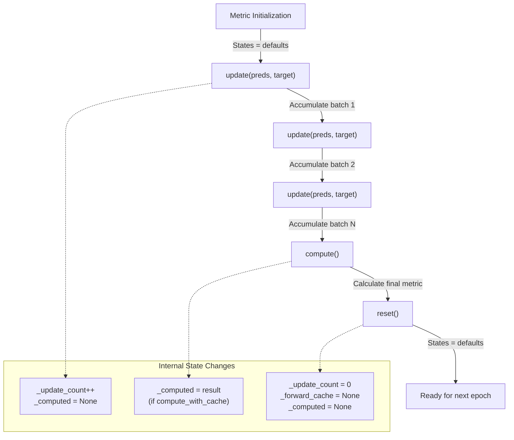

Sources: [src/torchmetrics/metric.py:710-774](), [docs/source/pages/overview.rst:32-56]()

### The update Method

The `update()` method is wrapped by `_wrap_update()` to provide additional functionality:

**Wrapping Behavior:**

1. Clear computed cache (`_computed = None`)
2. Increment update counter (`_update_count += 1`)
3. Execute user-defined `update()` with gradient control
4. Move list states to CPU if `compute_on_cpu=True`
5. Handle device mismatch errors with helpful messages

Sources: [src/torchmetrics/metric.py:542-572]()

### The compute Method

The `compute()` method is wrapped by `_wrap_compute()` to handle synchronization and caching:

**Wrapping Behavior:**

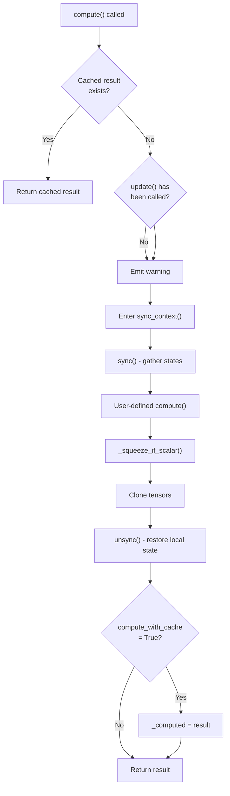

**Key Features:**

- Results are cached to avoid redundant computation
- Automatic synchronization in distributed mode
- Tensors are cloned to prevent in-place modifications
- Scalar outputs are squeezed

Sources: [src/torchmetrics/metric.py:676-708]()

### The reset Method

The `reset()` method restores all metric states to their default values:

**Reset Operations:**

1. `_update_count = 0`
2. `_forward_cache = None`
3. `_computed = None`
4. For each state in `_defaults`:
   - Tensor states: Clone and move to current device
   - List states: Clear the list (frees memory)
5. `_cache = None`
6. `_is_synced = False`

Sources: [src/torchmetrics/metric.py:758-774]()

## Forward Method Behavior

The `forward()` method serves a dual purpose: it updates the metric state **and** returns the metric value for the current batch. This behavior is controlled by the `full_state_update` attribute.

### Full State Update Mode

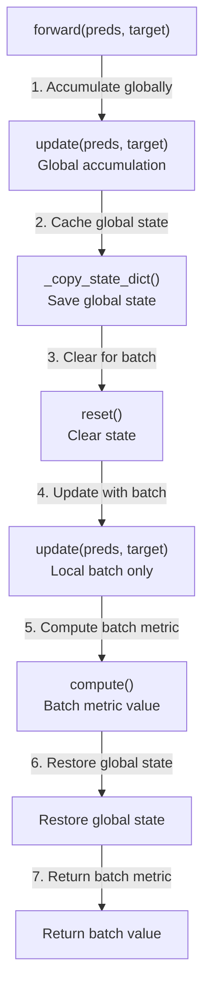

**When to use:** Metrics where `update()` requires access to the full accumulated state (e.g., metrics that normalize by total count).

**Performance:** Slower due to double `update()` call and state save/restore operations.

Sources: [src/torchmetrics/metric.py:319-362]()

### Reduced State Update Mode

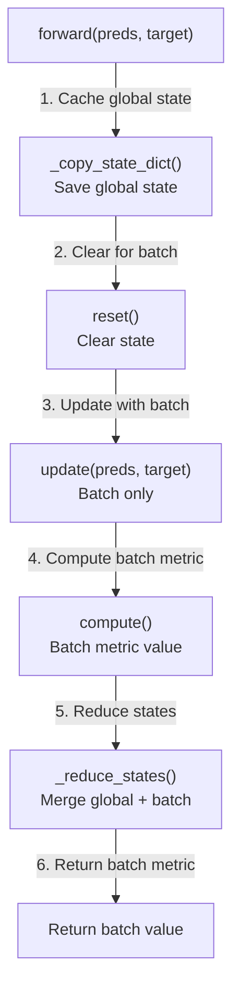

**When to use:** Metrics where batch states are independent and can be reduced via simple operations (sum, mean, cat, etc.).

**Performance:** Faster due to single `update()` call and simpler state merging.

Sources: [src/torchmetrics/metric.py:364-402]()

### Configuration Impact

| Setting | Value | Behavior |
|---------|-------|----------|
| `full_state_update` | `True` or `None` | Use full state update mode |
| `full_state_update` | `False` | Use reduced state update mode |
| `dist_sync_on_step` | `True` | Synchronize on every `forward()` call |
| `dist_sync_on_step` | `False` | Only synchronize on `compute()` |

Sources: [src/torchmetrics/metric.py:312-317](), [docs/source/pages/implement.rst:209-233]()

## Distributed Synchronization

### Synchronization Architecture

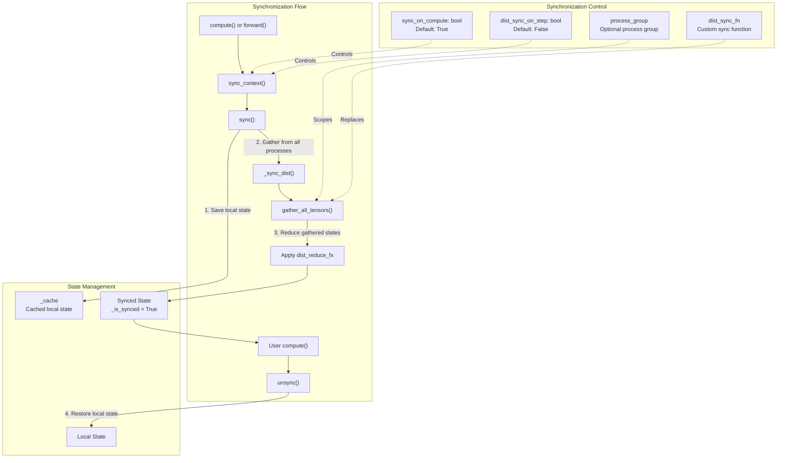

Sources: [src/torchmetrics/metric.py:573-674](), [src/torchmetrics/metric.py:501-541]()

### The _sync_dist Method

This internal method handles the actual synchronization logic:

**Synchronization Steps:**

1. **Pre-concatenate list states** with `dist_reduce_fx="cat"` to reduce `all_gather` operations
2. **Handle empty states** for ranks with no data (PyTorch 2.1+)
3. **Apply `gather_all_tensors()`** to collect states from all processes
4. **Stack or flatten** collected states based on type
5. **Apply reduction function** (`dist_reduce_fx`) to produce final reduced state
6. **Set reduced state** on the metric instance

Sources: [src/torchmetrics/metric.py:501-541]()

### Manual Synchronization Control

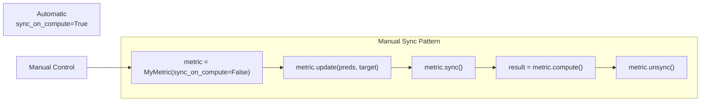

**Use Cases for Manual Synchronization:**

- Fine-grained control over when synchronization happens
- Avoiding redundant synchronization in complex workflows
- Debugging distributed behavior

Sources: [src/torchmetrics/metric.py:573-674](), [docs/source/pages/overview.rst:536-556]()

### Reduction State Merging

The `_reduce_states()` method merges incoming metric states with local states using the configured reduction function:

| Reduction | Local State | Incoming State | Result |
|-----------|-------------|----------------|--------|
| `dim_zero_sum` | `local` | `incoming` | `incoming + local` |
| `dim_zero_mean` | `local` | `incoming` | `((count-1) * incoming + local) / count` |
| `dim_zero_cat` | `local` | `incoming` | `torch.cat([incoming, local])` |
| `dim_zero_min` | `local` | `incoming` | `torch.min(incoming, local)` |
| `dim_zero_max` | `local` | `incoming` | `torch.max(incoming, local)` |
| `None` (tensor) | `local` | `incoming` | `torch.stack([incoming, local])` |
| `None` (list) | `local` | `incoming` | `_flatten([incoming, local])` |
| Custom callable | `local` | `incoming` | `reduce_fn(torch.stack([incoming, local]))` |

Sources: [src/torchmetrics/metric.py:465-500]()

## Device and Dtype Management

### Device Transfer

Metrics inherit device management from `torch.nn.Module`:

```python
metric = MyMetric()
metric.to('cuda')  # Moves all metric states to GPU
metric.to('cpu')   # Moves all metric states to CPU
```

**Automatic Device Placement in Lightning:**

When a metric is properly defined as a child module of a `LightningModule`, it is automatically moved to the same device as the model:

```python
class MyModule(LightningModule):
    def __init__(self):
        super().__init__()
        self.metric = BinaryAccuracy()  # Will auto-move with model
```

Sources: [docs/source/pages/overview.rst:77-107](), [docs/source/pages/lightning.rst:21-28]()

### Dtype Management

Metrics support explicit dtype setting via the `set_dtype()` method:

```python
metric = MyMetric()
metric.set_dtype(torch.float64)  # Set to double precision
metric.set_dtype(torch.float16)  # Set to half precision
```

**Half Precision Limitations:**

Some metrics have limited support for `torch.half` on CPU. The library provides better support for half precision on GPU (especially with PyTorch 1.6+).

Sources: [docs/source/pages/overview.rst:242-260]()

### Memory Management

The `compute_on_cpu` flag enables automatic offloading of list states to CPU after each `update()`:

```python
metric = MyMetric(compute_on_cpu=True)
# List states moved to CPU after update()
# Reduces GPU memory usage
# Compute happens on CPU
```

**Memory Recommendations:**

1. Call `reset()` when done with a metric to ensure garbage collection
2. Reuse metric instances instead of creating new ones
3. Use functional API for batch-only metrics (no accumulation)
4. Enable `compute_on_cpu` for list-state metrics on GPU

Sources: [src/torchmetrics/metric.py:566-572](), [docs/source/pages/overview.rst:136-183]()

## Persistence and Serialization

### State Dict Behavior

By default, metric states are **not** saved in `state_dict()`:

```python
metric = MyMetric()
metric.add_state("correct", default=torch.tensor(0), persistent=False)  # Default
metric.state_dict()  # Empty OrderedDict()
```

To include metric states in `state_dict()`:

```python
# Option 1: Set persistent flag when adding state
metric.add_state("correct", default=torch.tensor(0), persistent=True)

# Option 2: Call persistent() method after initialization
metric = MyMetric()
metric.persistent(True)  # All states now included in state_dict()
```

Sources: [src/torchmetrics/metric.py:282-284](), [docs/source/pages/overview.rst:186-227]()

### Saving and Loading

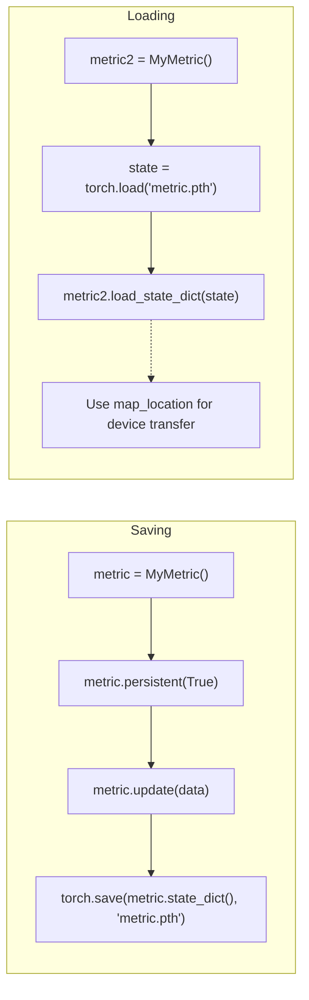

**Device Transfer Example:**

```python
# Save on GPU
metric = MyMetric().to('cuda')
metric.persistent(True)
torch.save(metric.state_dict(), 'metric.pth')

# Load on CPU
metric2 = MyMetric()
metric2.load_state_dict(torch.load('metric.pth', map_location='cpu'))
```

Sources: [docs/source/pages/overview.rst:186-227]()

### Pickling Support

Metrics support both `pickle` and `cloudpickle`:

```python
import pickle
metric = MyMetric()
metric.update(data)

# Serialize
pickled = pickle.dumps(metric)

# Deserialize
loaded_metric = pickle.loads(pickled)
assert loaded_metric.compute() == metric.compute()
```

**Implementation Details:**

The `__getstate__()` method excludes `update` and `compute` functions, which are restored in `__setstate__()` by re-wrapping the methods.

Sources: [src/torchmetrics/metric.py:779-815]()

## MetricCollection Architecture

### Purpose and Design

`MetricCollection` wraps multiple metrics into a single callable object with the same interface as individual metrics. It provides:

- **Unified interface** for multiple metrics
- **Compute group optimization** for state sharing
- **Prefix/postfix management** for logging
- **Nested collection support**

```mermaid
graph TB
    Collection["MetricCollection"]
    ModuleDict["Inherits from<br/>torch.nn.ModuleDict"]
    
    subgraph "Input Formats"
        List["List[Metric]<br/>Uses class names as keys"]
        Dict["Dict[str, Metric]<br/>Custom keys"]
        Args["*args<br/>Individual metrics"]
        Nested["MetricCollection<br/>Nested collections"]
    end
    
    subgraph "Core Features"
        Update["update(*args, **kwargs)<br/>Calls update on all metrics"]
        Compute["compute() -> Dict<br/>Calls compute on all metrics"]
        Forward["forward(*args, **kwargs)<br/>Update + compute per metric"]
        Reset["reset()<br/>Resets all metrics"]
        Clone["clone(prefix, postfix)<br/>Deep copy with new affixes"]
    end
    
    subgraph "Compute Groups"
        Groups["_groups: Dict[int, List[str]]<br/>Groups of metrics sharing state"]
        Optimize["State sharing optimization<br/>Update first member, broadcast to others"]
        Merge["_merge_compute_groups()<br/>Dynamically detect shared states"]
    end
    
    Collection --> ModuleDict
    Collection --> List
    Collection --> Dict
    Collection --> Args
    Collection --> Nested
    Collection --> Update
    Collection --> Compute
    Collection --> Forward
    Collection --> Reset
    Collection --> Clone
    Collection --> Groups
    Collection --> Optimize
    Collection --> Merge
```

Sources: [src/torchmetrics/collections.py:59-194]()

### Compute Groups Optimization

Compute groups enable significant performance improvements by identifying metrics that share the same metric state:

**Optimization Strategy:**

1. On first `update()`, all metrics are updated individually
2. `_merge_compute_groups()` analyzes metric states using `_equal_metric_states()`
3. Metrics with identical states are grouped together
4. On subsequent `update()` calls, only the first member of each group is updated
5. State references are created from the first member to other group members

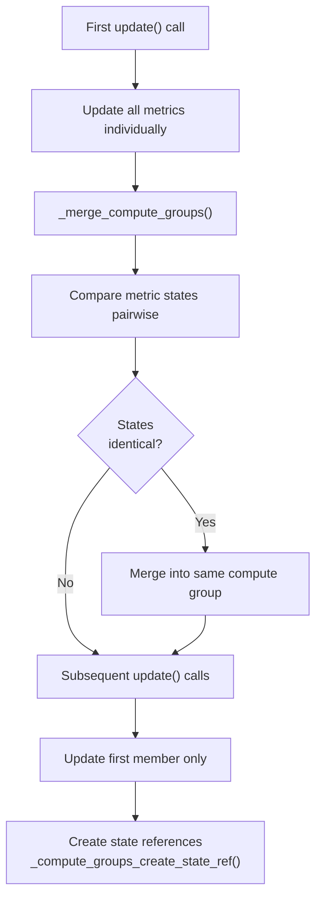

**Example Compute Groups:**

```python
collection = MetricCollection([
    MulticlassAccuracy(num_classes=3),  # Group 0
    MulticlassPrecision(num_classes=3), # Group 0 (shares state with Accuracy)
    MulticlassRecall(num_classes=3),    # Group 0 (shares state with Accuracy)
    MulticlassConfusionMatrix(num_classes=3), # Group 1 (different state)
])

# After first update:
# collection._groups = {
#     0: ['MulticlassAccuracy', 'MulticlassPrecision', 'MulticlassRecall'],
#     1: ['MulticlassConfusionMatrix']
# }
```

Sources: [src/torchmetrics/collections.py:269-337](), [tests/unittests/bases/test_collections.py:439-495]()

### State Sharing Implementation

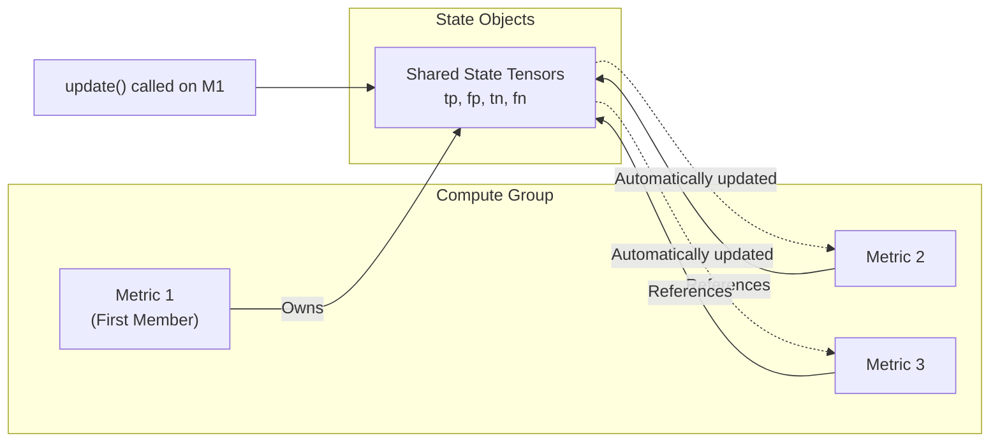

**Key Implementation Details:**

- State references are created by assigning the same tensor object
- The `_state_is_copy` flag tracks whether states are references or copies
- Calling `.items()` or `.values()` breaks references and creates copies
- References are re-established on next `update()` call

Sources: [src/torchmetrics/collections.py:338-357](), [docs/source/pages/overview.rst:384-401]()

### Prefix and Postfix Management

```python
collection = MetricCollection(
    {'acc': Accuracy(), 'prec': Precision()},
    prefix='train_',
    postfix='_macro'
)

result = collection(preds, target)
# Returns: {
#     'train_acc_macro': ...,
#     'train_prec_macro': ...
# }
```

The `_set_name()` method applies prefix/postfix transformations to output keys during `compute()` and `forward()`.

Sources: [src/torchmetrics/collections.py:210-220](), [tests/unittests/bases/test_collections.py:164-221]()

## Internal Implementation Details

### Method Wrapping

Both `update()` and `compute()` are wrapped to provide additional functionality:

**Update Wrapping (`_wrap_update`):**

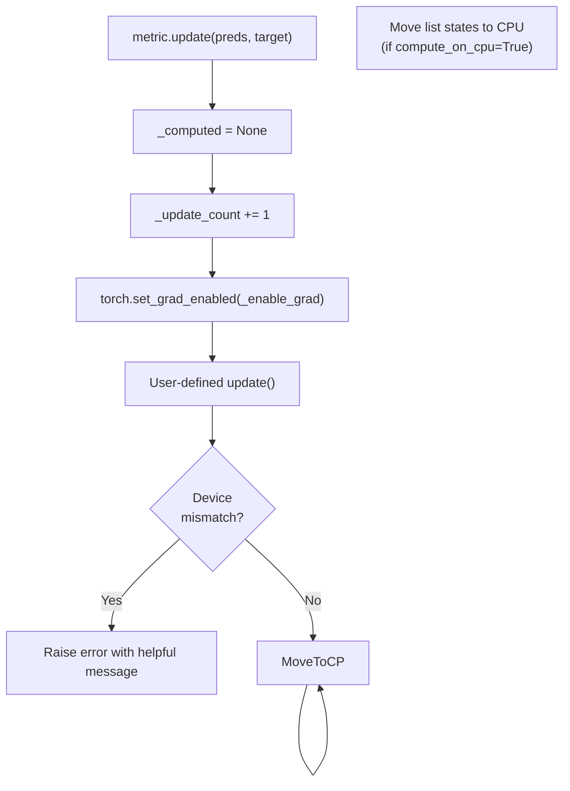

**Compute Wrapping (`_wrap_compute`):**

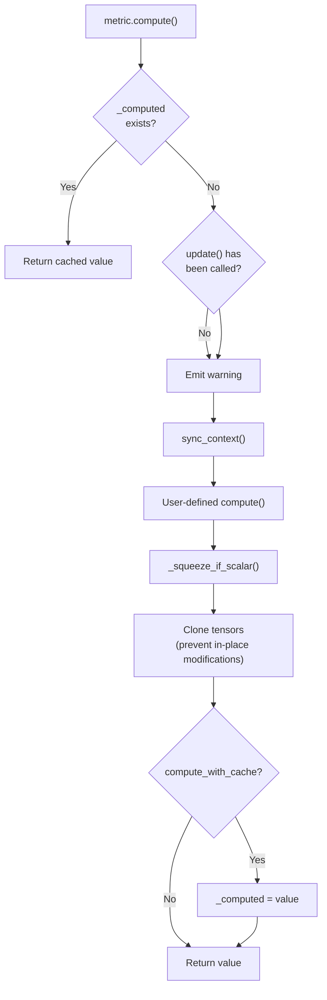

Sources: [src/torchmetrics/metric.py:542-572](), [src/torchmetrics/metric.py:676-708]()

### State Synchronization Context

The `sync_context()` context manager ensures that local states are properly saved and restored:

```python
with metric.sync_context(
    dist_sync_fn=gather_all_tensors,
    should_sync=True,
    should_unsync=True
):
    # Inside: states are synchronized across processes
    value = user_compute()
# Outside: local states are restored
```

**Context Manager Flow:**

1. Call `sync()` to save local state and synchronize
2. Yield control to execute code with synced state
3. Call `unsync()` to restore local state

Sources: [src/torchmetrics/metric.py:639-674]()

### Forward Cache

The `_forward_cache` stores the result from the last `forward()` call:

```python
metric = MyMetric()
result = metric(preds, target)  # Calls forward()
assert metric._forward_cache == result
```

This cache is separate from `_computed` and is used internally by the `forward()` method.

Sources: [src/torchmetrics/metric.py:161-162](), [src/torchmetrics/metric.py:317]()

### Reference Counting and Update Tracking

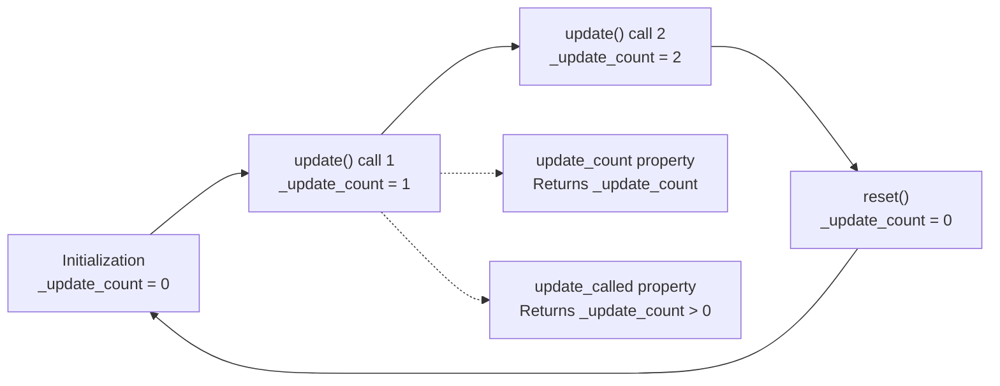

The update count is used for:

- Computing mean reductions in distributed mode
- Checking if `update()` was called before `compute()`
- Debugging and introspection

Sources: [src/torchmetrics/metric.py:186-194](), [src/torchmetrics/metric.py:546]()

### Gradient Control

The `_enable_grad` flag controls whether gradients are computed during `update()`:

```python
# During forward() batch computation
self._enable_grad = True
self.update(preds, target)  # Allows gradients
batch_value = self.compute()  # Can backprop through this

# During normal update
self._enable_grad = False  # Default
self.update(preds, target)  # No gradients
```

**Note:** Cached states (from `_computed`) are always detached and cannot be backpropagated through.

Sources: [src/torchmetrics/metric.py:165](), [src/torchmetrics/metric.py:343](), [src/torchmetrics/metric.py:547]()

---

This architecture provides a robust foundation for implementing metrics that are compatible with PyTorch's training workflows, support distributed training out of the box, and integrate seamlessly with PyTorch Lightning. The design prioritizes correctness, efficiency, and ease of use while maintaining flexibility for advanced use cases.

---

