<!-- source: DeepWiki mcp.deepwiki.com · repo Lightning-AI/torchmetrics · page 2.1 Metric Base Class · fetched 2026-10-21 -->

# Metric Base Class

<details>
<summary>Relevant source files</summary>

The following files were used as context for generating this wiki page:

- [.pre-commit-config.yaml](.pre-commit-config.yaml)
- [LICENSE](LICENSE)
- [README.md](README.md)
- [docs/source/_templates/theme_variables.jinja](docs/source/_templates/theme_variables.jinja)
- [docs/source/all-metrics.rst](docs/source/all-metrics.rst)
- [docs/source/conf.py](docs/source/conf.py)
- [docs/source/index.rst](docs/source/index.rst)
- [docs/source/pages/implement.rst](docs/source/pages/implement.rst)
- [docs/source/pages/lightning.rst](docs/source/pages/lightning.rst)
- [docs/source/pages/overview.rst](docs/source/pages/overview.rst)
- [docs/source/pages/quickstart.rst](docs/source/pages/quickstart.rst)
- [pyproject.toml](pyproject.toml)
- [requirements/integrate.txt](requirements/integrate.txt)
- [src/torchmetrics/__about__.py](src/torchmetrics/__about__.py)
- [src/torchmetrics/collections.py](src/torchmetrics/collections.py)
- [src/torchmetrics/metric.py](src/torchmetrics/metric.py)
- [tests/integrations/lightning/boring_model.py](tests/integrations/lightning/boring_model.py)
- [tests/integrations/test_lightning.py](tests/integrations/test_lightning.py)
- [tests/unittests/bases/test_collections.py](tests/unittests/bases/test_collections.py)
- [tests/unittests/bases/test_metric.py](tests/unittests/bases/test_metric.py)

</details>


## Purpose and Scope

This page documents the `Metric` base class ([src/torchmetrics/metric.py:52-1048]()), which is the foundation of all metrics in TorchMetrics. It provides the core interface that all metric implementations must follow: `__init__()`, `add_state()`, `update()`, `compute()`, and `reset()`. This page focuses on the base class implementation details and its public API. For information about implementing custom metrics, see page 1.1. For distributed training specifics, see [Distributed Training Support](#2.2). For memory management and performance optimization, see [Memory Management and Performance](#2.3).

## Metric Base Class Overview

The `Metric` class ([src/torchmetrics/metric.py:52]()) is an abstract base class that inherits from `torch.nn.Module` and provides three primary capabilities:

1. **Automatic device placement** - Metric states are transferred to the correct device
2. **Distributed synchronization** - Metric states are synchronized across processes automatically
3. **State management** - Provides a standardized interface for accumulating and computing metrics

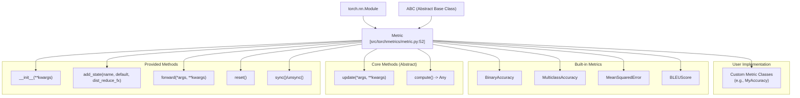

**Sources:** [src/torchmetrics/metric.py:52-104](), [docs/source/pages/overview.rst:14-22]()

## Initialization and Constructor Arguments

The `Metric` base class `__init__()` method ([src/torchmetrics/metric.py:105-167]()) accepts several keyword arguments that control metric behavior:

| Argument | Type | Default | Description |
|----------|------|---------|-------------|
| `compute_on_cpu` | `bool` | `False` | Move list states to CPU after `update()` to save GPU memory |
| `dist_sync_on_step` | `bool` | `False` | Synchronize metric state after every `forward()` call |
| `process_group` | `Optional[Any]` | `None` | Process group for distributed synchronization |
| `dist_sync_fn` | `Optional[Callable]` | `None` | Custom function for distributed synchronization |
| `distributed_available_fn` | `Optional[Callable]` | `jit_distributed_available` | Function to check if distributed backend is available |
| `sync_on_compute` | `bool` | `True` | Synchronize metric state when `compute()` is called |
| `compute_with_cache` | `bool` | `True` | Cache the result of `compute()` until next `update()` |

The constructor performs validation on these arguments ([src/torchmetrics/metric.py:119-155]()) and raises `ValueError` if invalid values are provided.

**Internal Initialization:**

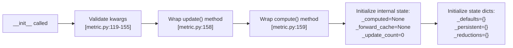

**Sources:** [src/torchmetrics/metric.py:105-172](), [tests/unittests/bases/test_metric.py:39-60]()

## add_state: Registering Metric States

The `add_state()` method ([src/torchmetrics/metric.py:201-285]()) is the primary mechanism for registering metric states. It must be called in the `__init__()` method of any metric implementation.

**Method Signature:**
```python
def add_state(
    self,
    name: str,
    default: Union[list, Tensor],
    dist_reduce_fx: Optional[Union[str, Callable]] = None,
    persistent: bool = False,
) -> None
```

**Parameters:**

- **`name`**: String identifier for the state variable. The state becomes accessible as `self.<name>`
- **`default`**: Initial value - either a `torch.Tensor` or an empty `list`
- **`dist_reduce_fx`**: Reduction function for distributed synchronization. Built-in options:
  - `"sum"` → `dim_zero_sum` ([src/torchmetrics/metric.py:265]())
  - `"mean"` → `dim_zero_mean` ([src/torchmetrics/metric.py:267]())
  - `"max"` → `dim_zero_max` ([src/torchmetrics/metric.py:269]())
  - `"min"` → `dim_zero_min` ([src/torchmetrics/metric.py:271]())
  - `"cat"` → `dim_zero_cat` ([src/torchmetrics/metric.py:273]())
  - Custom callable function
  - `None` → No reduction, returns stacked/concatenated states from all processes
- **`persistent`**: Whether to include the state in `state_dict()` (default: `False`)

**State Types:**

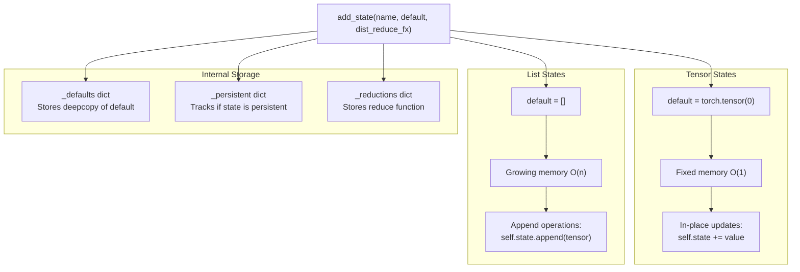

**Example Usage:**

From [README.md:236-274]():
```python
class MyAccuracy(Metric):
    def __init__(self):
        super().__init__()
        # Tensor state with sum reduction
        self.add_state("correct", default=torch.tensor(0), dist_reduce_fx="sum")
        self.add_state("total", default=torch.tensor(0), dist_reduce_fx="sum")

    def update(self, preds: torch.Tensor, target: torch.Tensor) -> None:
        self.correct += torch.sum(preds == target)
        self.total += target.numel()

    def compute(self) -> torch.Tensor:
        return self.correct.float() / self.total
```

**Sources:** [src/torchmetrics/metric.py:201-285](), [docs/source/pages/implement.rst:68-98](), [README.md:236-274]()

## update: Accumulating Data

The `update()` method is an abstract method ([src/torchmetrics/metric.py:710-712]()) that must be implemented by all metric subclasses. The base class wraps this method ([src/torchmetrics/metric.py:542-564]()) to provide automatic state management.

**User Implementation:**
- Takes predictions and targets (or other metric-specific inputs)
- Updates metric states in-place
- Should NOT return any values

**Internal Wrapping Behavior:**

```mermaid
sequenceDiagram
    participant User
    participant _wrap_update["_wrap_update<br/>[metric.py:542]"]
    participant update["User's update()"]
    participant State["Metric States"]
    
    User->>_wrap_update: metric.update(preds, target)
    _wrap_update->>_wrap_update: Clear computed cache<br/>self._computed = None
    _wrap_update->>_wrap_update: Increment counter<br/>self._update_count += 1
    _wrap_update->>_wrap_update: Set grad context<br/>torch.set_grad_enabled(self._enable_grad)
    _wrap_update->>update: Call user's update()
    update->>State: Update states (e.g., self.correct += ...)
    _wrap_update->>_wrap_update: Handle device errors
    _wrap_update->>_wrap_update: Move list states to CPU<br/>if compute_on_cpu=True
    _wrap_update-->>User: Return (None)
```

**Key Behaviors:**

1. **Cache Invalidation** ([src/torchmetrics/metric.py:545]()): Sets `self._computed = None` to invalidate any cached result
2. **Update Counter** ([src/torchmetrics/metric.py:546]()): Increments `self._update_count` for tracking
3. **Gradient Context** ([src/torchmetrics/metric.py:547]()): Wraps in `torch.set_grad_enabled()` context
4. **Error Handling** ([src/torchmetrics/metric.py:550-559]()): Provides helpful error messages for device mismatches
5. **CPU Offloading** ([src/torchmetrics/metric.py:561-562]()): Moves list states to CPU if `compute_on_cpu=True`

**Sources:** [src/torchmetrics/metric.py:542-572](), [src/torchmetrics/metric.py:710-712]()

## compute: Calculating Final Results

The `compute()` method is an abstract method ([src/torchmetrics/metric.py:714-720]()) that calculates the final metric value from accumulated states. The base class wraps this method ([src/torchmetrics/metric.py:676-708]()) to handle synchronization and caching.

**User Implementation:**
- Accesses metric states (e.g., `self.correct`, `self.total`)
- Performs final calculations
- Returns the computed metric value (typically a `torch.Tensor` or dict)

**Internal Wrapping Behavior:**

```mermaid
sequenceDiagram
    participant User
    participant _wrap_compute["_wrap_compute<br/>[metric.py:676]"]
    participant sync_context["sync_context<br/>[metric.py:639]"]
    participant _sync_dist["_sync_dist<br/>[metric.py:501]"]
    participant compute["User's compute()"]
    
    User->>_wrap_compute: metric.compute()
    _wrap_compute->>_wrap_compute: Check if update was called
    
    alt Cached result exists
        _wrap_compute-->>User: Return self._computed
    else No cache
        _wrap_compute->>sync_context: Enter sync_context
        
        alt Should sync (distributed)
            sync_context->>sync_context: Cache current state
            sync_context->>_sync_dist: Synchronize states
            _sync_dist->>_sync_dist: gather_all_tensors()
            _sync_dist->>_sync_dist: Apply dist_reduce_fx
        end
        
        sync_context->>compute: Call user's compute()
        compute->>compute: Calculate metric from states
        compute-->>sync_context: Return value
        
        alt Should unsync
            sync_context->>sync_context: Restore cached state
        end
        
        sync_context-->>_wrap_compute: Return computed value
        _wrap_compute->>_wrap_compute: Clone tensors to avoid in-place ops
        
        alt compute_with_cache=True
            _wrap_compute->>_wrap_compute: Cache result<br/>self._computed = value
        end
        
        _wrap_compute-->>User: Return value
    end
```

**Key Behaviors:**

1. **Update Check** ([src/torchmetrics/metric.py:679-685]()): Warns if `compute()` is called before `update()`
2. **Result Caching** ([src/torchmetrics/metric.py:688-689]()): Returns cached result if available
3. **Automatic Synchronization** ([src/torchmetrics/metric.py:694-698]()): Uses `sync_context` to handle distributed synchronization
4. **Tensor Cloning** ([src/torchmetrics/metric.py:699-701]()): Clones tensors to prevent in-place modifications
5. **Cache Storage** ([src/torchmetrics/metric.py:703-704]()): Stores result in `self._computed` if `compute_with_cache=True`

**Sources:** [src/torchmetrics/metric.py:676-708](), [src/torchmetrics/metric.py:714-720]()

## reset: Clearing Metric State

The `reset()` method ([src/torchmetrics/metric.py:722-735]()) restores all metric states to their default values. This method is automatically called by PyTorch Lightning at the end of each epoch.

**Behavior:**

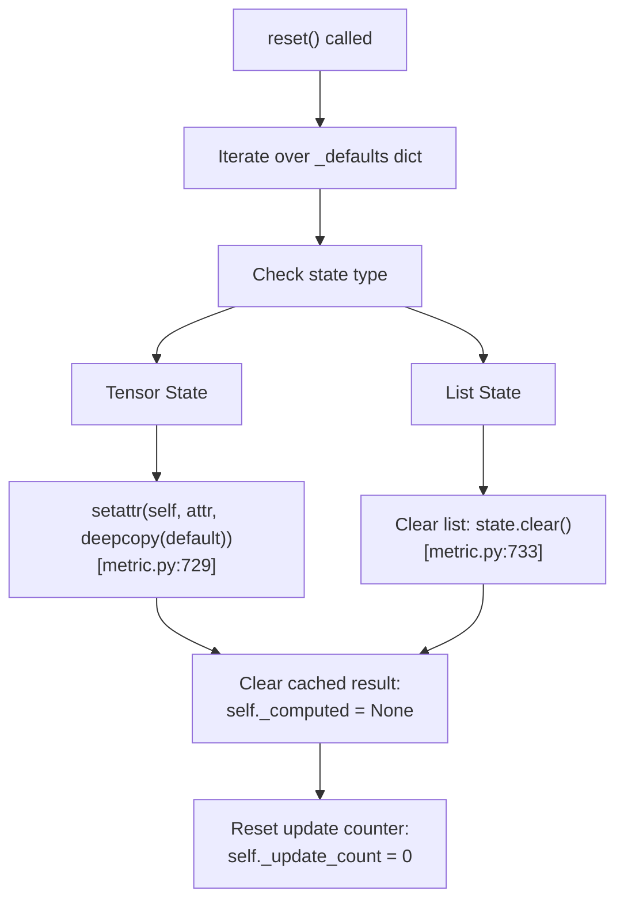

**Important Notes:**

1. **Tensor States**: Reset by setting to a `deepcopy()` of the default value ([src/torchmetrics/metric.py:729]())
2. **List States**: Cleared using `.clear()` method ([src/torchmetrics/metric.py:733]())
3. **Cache Invalidation**: Sets `self._computed = None` ([src/torchmetrics/metric.py:734]())
4. **Counter Reset**: Sets `self._update_count = 0` ([src/torchmetrics/metric.py:735]())
5. **Reference Caution**: List state values are deleted, so any external references to items in the list become invalid ([docs/source/pages/implement.rst:127-130]())

**Sources:** [src/torchmetrics/metric.py:722-735](), [tests/unittests/bases/test_metric.py:112-140]()

## forward: Dual-Purpose Aggregation

The `forward()` method ([src/torchmetrics/metric.py:286-317]()) serves a dual purpose: it both computes the metric on the current batch AND accumulates the batch statistics for later epoch-level computation.

**Method Flow:**

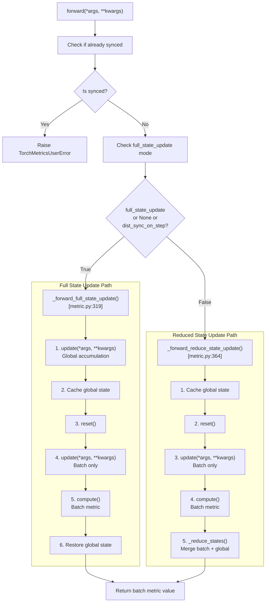

**Two Implementation Strategies:**

1. **Full State Update** ([src/torchmetrics/metric.py:319-362]()) - Used when `full_state_update=True` or `None`:
   - Calls `update()` twice: once for global accumulation, once for batch computation
   - Required when metrics need access to the full accumulated state during `update()`
   - Slower but more safe for complex metrics

2. **Reduced State Update** ([src/torchmetrics/metric.py:364-402]()) - Used when `full_state_update=False`:
   - Calls `update()` only once
   - Merges batch state with global state using reduction functions
   - Faster but only works when batch states are independent
   - Uses `_reduce_states()` method ([src/torchmetrics/metric.py:465-500]())

**Sources:** [src/torchmetrics/metric.py:286-402](), [docs/source/pages/implement.rst:186-234]()

## Key Properties and Attributes

The `Metric` base class exposes several important properties and class attributes:

### Class Attributes

| Attribute | Type | Default | Description |
|-----------|------|---------|-------------|
| `is_differentiable` | `Optional[bool]` | `None` | Whether the metric supports backpropagation |
| `higher_is_better` | `Optional[bool]` | `None` | Whether higher metric values are better |
| `full_state_update` | `Optional[bool]` | `None` | Whether `update()` needs full accumulated state |
| `plot_lower_bound` | `Optional[float]` | `None` | Lower bound for plotting |
| `plot_upper_bound` | `Optional[float]` | `None` | Upper bound for plotting |
| `plot_legend_name` | `Optional[str]` | `None` | Legend name for plotting |

These are defined in [src/torchmetrics/metric.py:97-103]() and are used for metadata and optimization decisions.

### Instance Properties

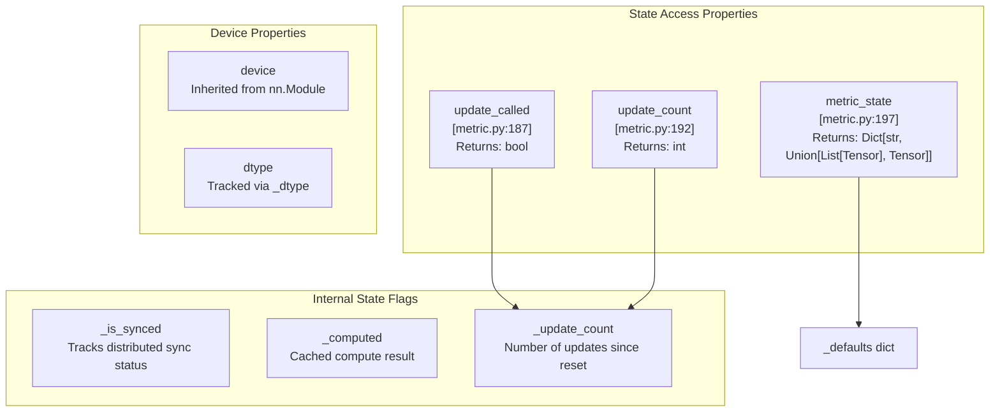

**Key Properties:**

1. **`metric_state`** ([src/torchmetrics/metric.py:197-199]()): Returns a dictionary of all metric states
   ```python
   @property
   def metric_state(self) -> dict[str, Union[List[Tensor], Tensor]]:
       return {attr: getattr(self, attr) for attr in self._defaults}
   ```

2. **`update_called`** ([src/torchmetrics/metric.py:187-189]()): Boolean indicating if `update()` has been called since initialization or last `reset()`
   ```python
   @property
   def update_called(self) -> bool:
       return self._update_count > 0
   ```

3. **`update_count`** ([src/torchmetrics/metric.py:192-194]()): Number of times `update()` has been called
   ```python
   @property
   def update_count(self) -> int:
       return self._update_count
   ```

**Sources:** [src/torchmetrics/metric.py:97-103](), [src/torchmetrics/metric.py:177-199]()

## State Management Internals

The `Metric` base class maintains several internal dictionaries to manage state:

### Internal State Dictionaries

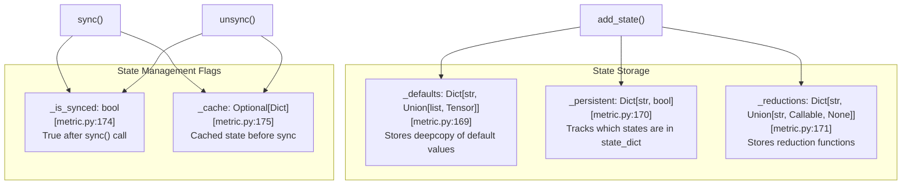

**Dictionary Interactions:**

1. **`_defaults`** ([src/torchmetrics/metric.py:169]()): 
   - Populated by `add_state()` with `deepcopy(default)`
   - Used by `reset()` to restore initial values
   - Keys are state names, values are default tensors/lists

2. **`_persistent`** ([src/torchmetrics/metric.py:170]()): 
   - Tracks which states should be in `state_dict()`
   - Set via the `persistent` argument in `add_state()`
   - Default is `False` for backward compatibility

3. **`_reductions`** ([src/torchmetrics/metric.py:171]()): 
   - Maps state names to reduction functions
   - Used during distributed synchronization in `_sync_dist()`
   - Can be built-in strings or custom callables

4. **`_cache`** ([src/torchmetrics/metric.py:175]()): 
   - Stores pre-sync state during `sync_context`
   - Allows restoration after compute in distributed mode
   - Used in `sync()`/`unsync()` methods

**Sources:** [src/torchmetrics/metric.py:169-176](), [src/torchmetrics/metric.py:201-285]()

## merge_state: Combining Metric Instances

The `merge_state()` method ([src/torchmetrics/metric.py:404-463]()) allows combining the state of one metric instance into another. This is useful for parallel processing scenarios.

**Method Signature:**
```python
def merge_state(self, incoming_state: Union[dict[str, Any], "Metric"]) -> None
```

**Limitations:**
- Only supported when `full_state_update=False`
- Only supported when `dist_sync_on_step=False`
- Incoming state must match the metric's state structure

**Internal Operation:**

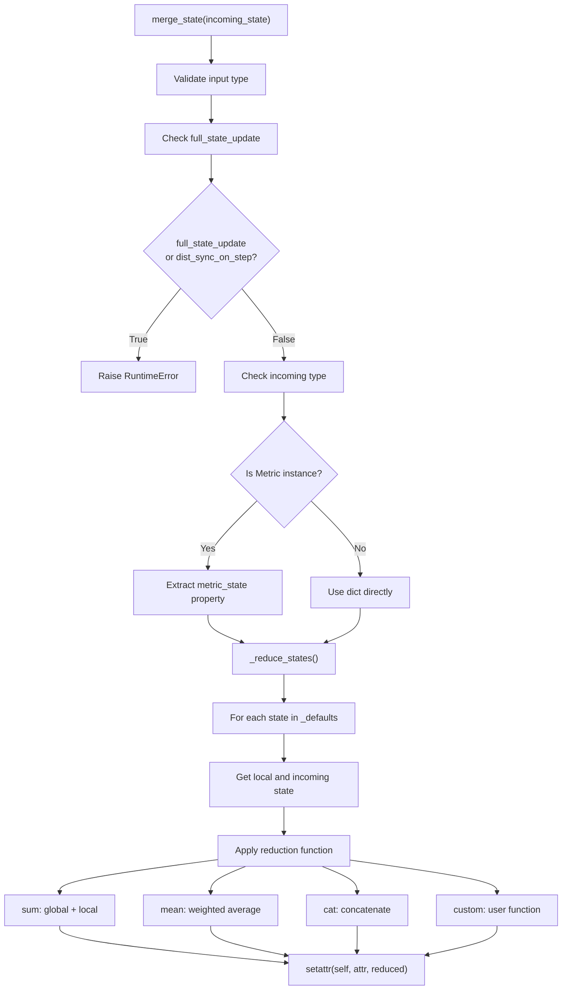

**Usage Example:**

From [src/torchmetrics/metric.py:423-442]():
```python
# Example with a metric instance
from torchmetrics.aggregation import SumMetric
metric1 = SumMetric()
metric2 = SumMetric()
metric1.update(1)
metric2.update(2)
metric1.merge_state(metric2)
metric1.compute()  # Returns tensor(3.)

# Example with a dict
metric = SumMetric()
metric.update(1)
metric.merge_state({"sum_value": torch.tensor(2)})
metric.compute()  # Returns tensor(3.)
```

**Sources:** [src/torchmetrics/metric.py:404-500]()

## Method Wrapping and Lifecycle

The `Metric` base class automatically wraps user-defined `update()` and `compute()` methods to provide additional functionality. This wrapping happens during `__init__()`.

### Wrapping Initialization

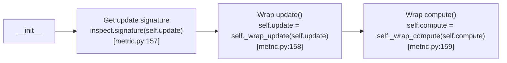

### Complete Metric Lifecycle

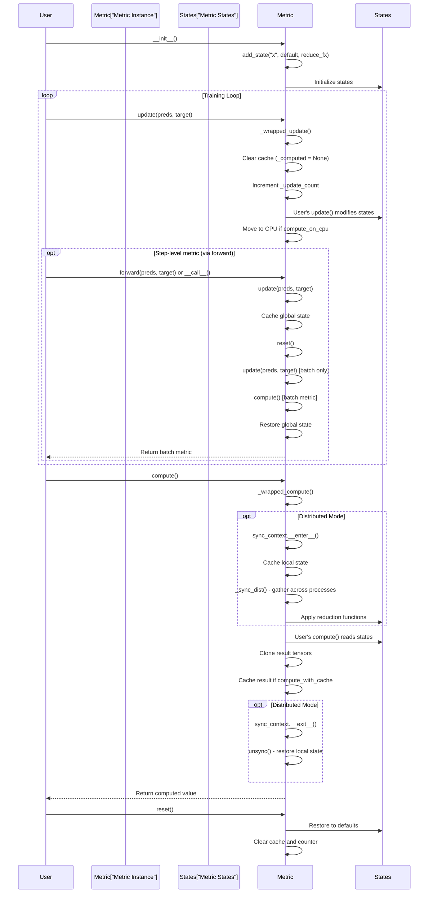

**Sources:** [src/torchmetrics/metric.py:157-159](), [src/torchmetrics/metric.py:542-708](), [docs/source/pages/implement.rst:186-234]()

## Persistent State and state_dict

By default, metric states are NOT included in the module's `state_dict()`. This maintains backward compatibility with models that don't use TorchMetrics. The `persistent()` method ([src/torchmetrics/metric.py:747-762]()) controls this behavior.

**Persistence Control:**

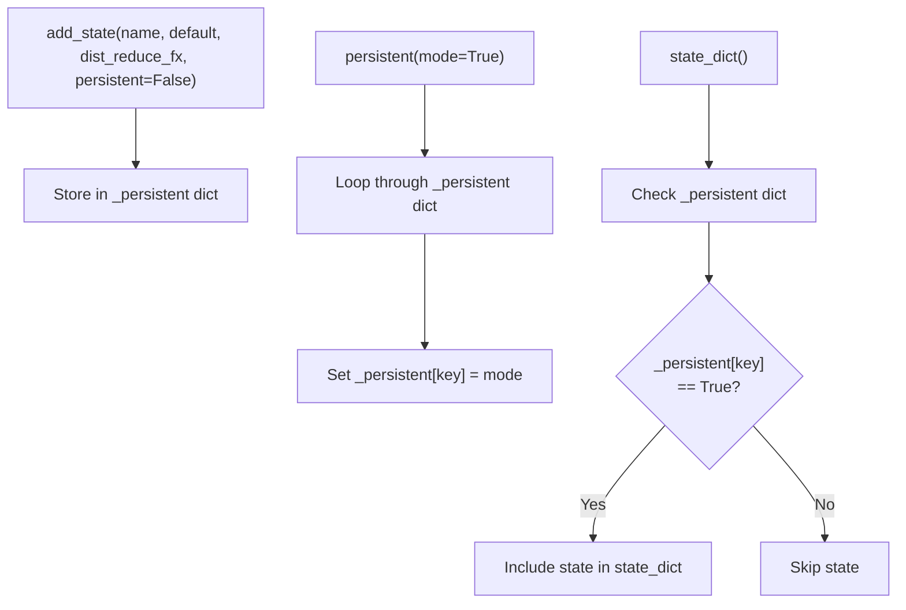

**Usage Example:**

From [docs/source/pages/overview.rst:206-224]():
```python
import torch
from torchmetrics.classification import MulticlassAccuracy

metric = MulticlassAccuracy(num_classes=5).to("cuda")
metric.persistent(True)  # Mark states as persistent
metric.update(torch.randint(5, (100,)).cuda(), torch.randint(5, (100,)).cuda())
torch.save(metric.state_dict(), "metric.pth")

metric2 = MulticlassAccuracy(num_classes=5).to("cpu")
metric2.load_state_dict(torch.load("metric.pth", map_location="cpu"))
```

**Sources:** [src/torchmetrics/metric.py:747-762](), [docs/source/pages/overview.rst:186-227]()

## Device and Type Management

Metrics inherit device and dtype management from `torch.nn.Module` but add specific handling for metric states.

### Device Transfer

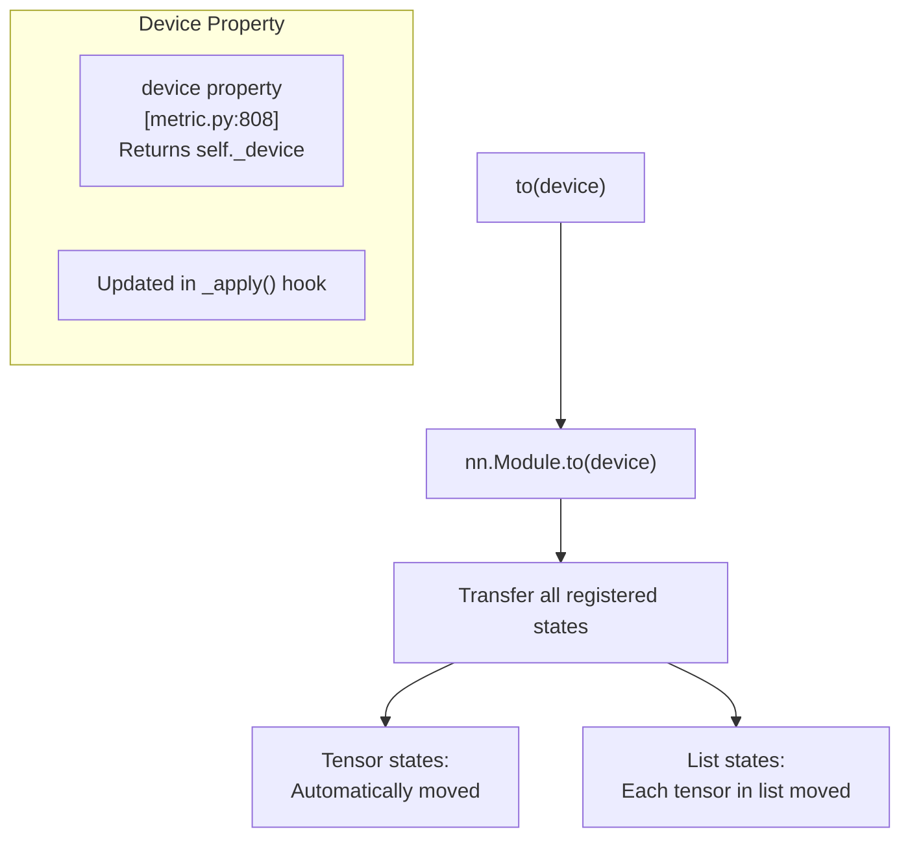

**Key Points:**

1. **Automatic Transfer**: States are automatically moved when calling `.to(device)` because they're registered as buffers
2. **Device Property** ([src/torchmetrics/metric.py:808-818]()): Returns current device
3. **Integration with Lightning**: When metrics are properly defined as child modules of a LightningModule, they're automatically moved to the correct device ([docs/source/pages/overview.rst:98-106]())

### Type Conversion

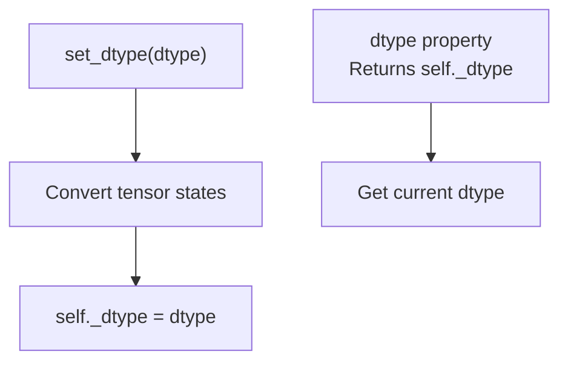

**Sources:** [src/torchmetrics/metric.py:764-818](), [docs/source/pages/overview.rst:78-131]()

## Error Handling and Validation

The `Metric` base class includes several validation and error handling mechanisms:

### Constructor Validation

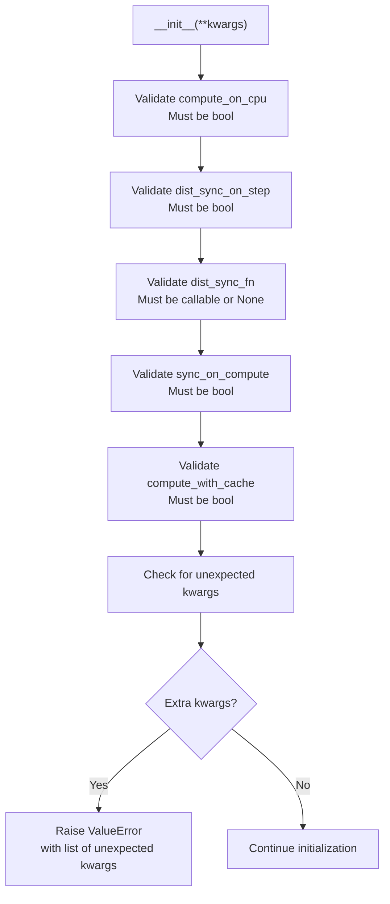

### Runtime Checks

From [src/torchmetrics/metric.py:550-559]():
```python
# Device mismatch detection
try:
    update(*args, **kwargs)
except RuntimeError as err:
    if "Expected all tensors to be on" in str(err):
        raise RuntimeError(
            "Encountered different devices in metric calculation. "
            f"Instead of `metric={self.__class__.__name__}(...)` "
            f"try to do `metric={self.__class__.__name__}(...).to(device)` "
            "where device corresponds to the device of the input."
        ) from err
    raise err
```

**Sources:** [src/torchmetrics/metric.py:119-155](), [src/torchmetrics/metric.py:550-559](), [tests/unittests/bases/test_metric.py:39-61]()

---

