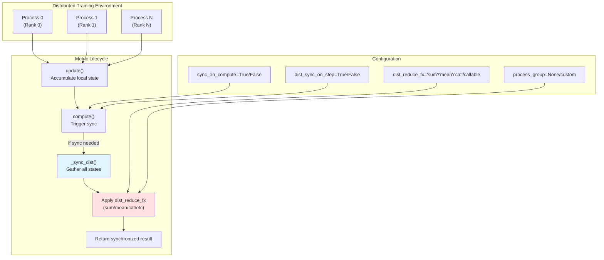
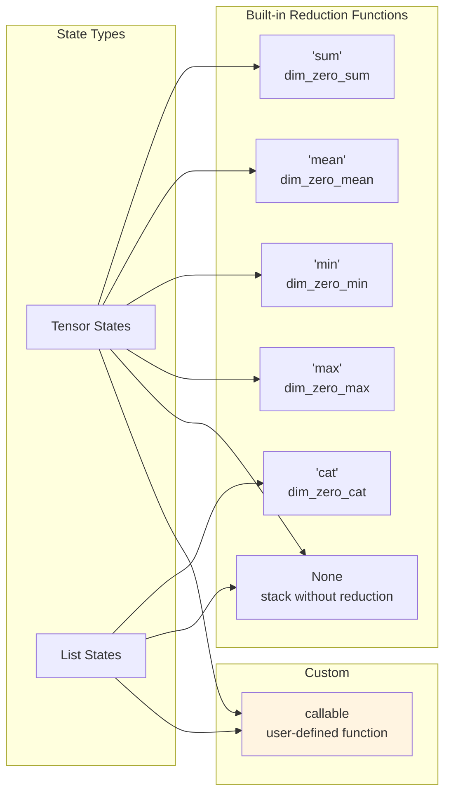
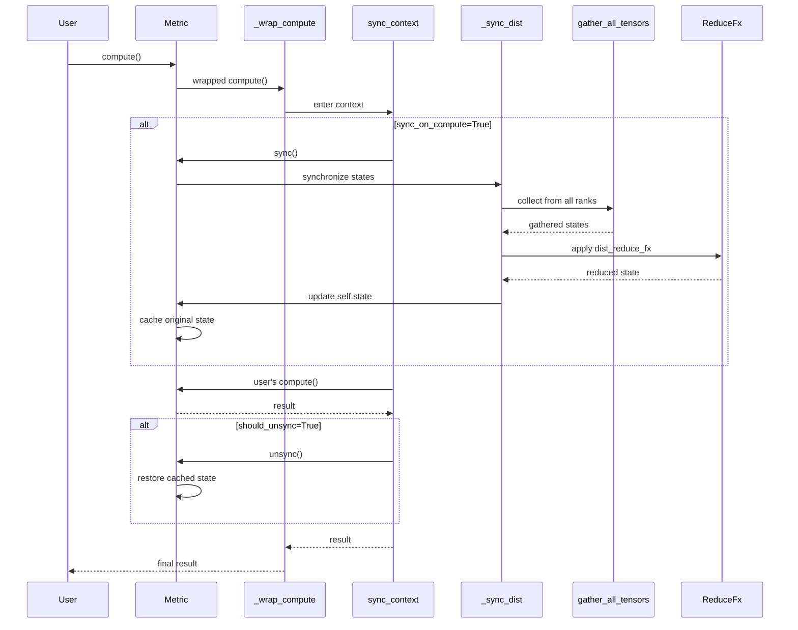
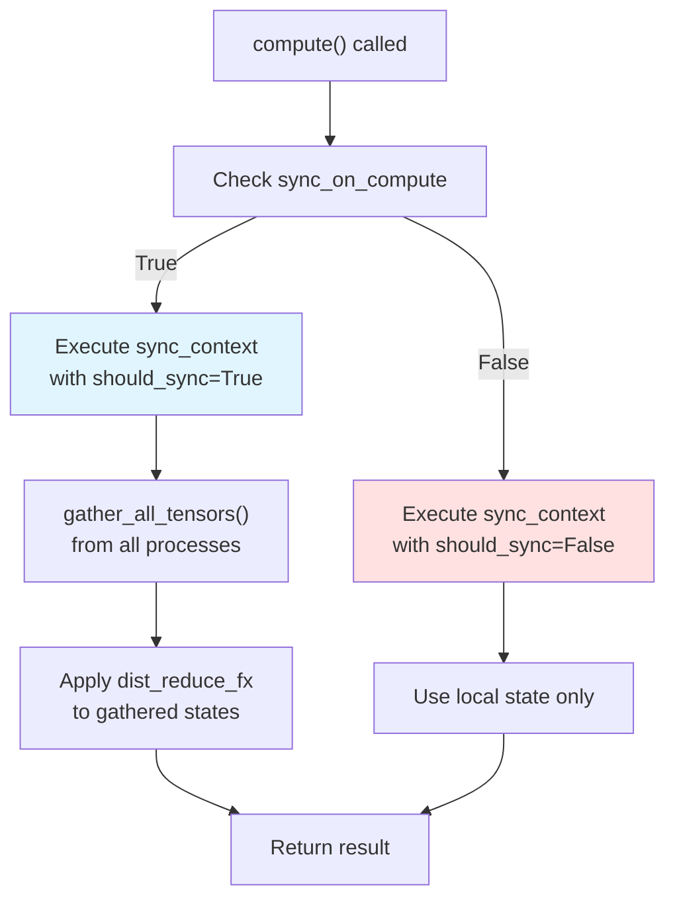
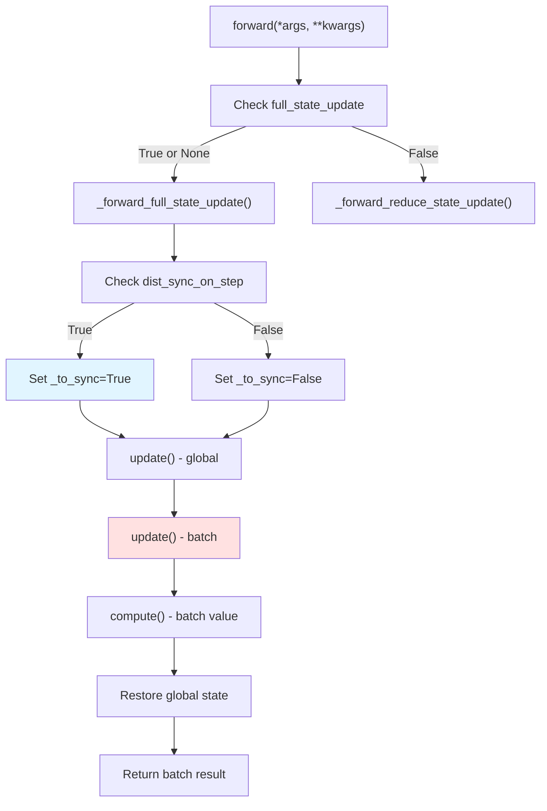
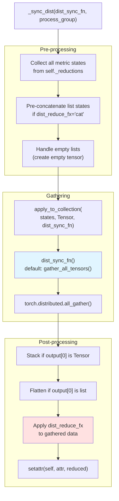
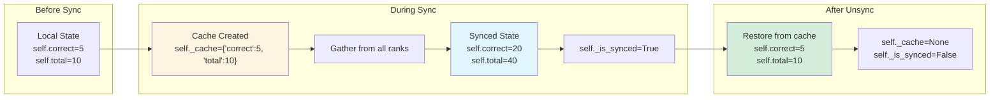
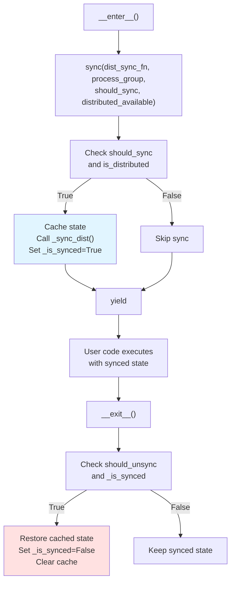
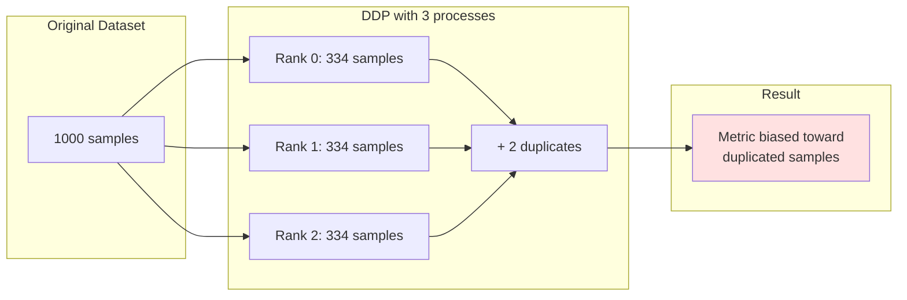

<!-- source: DeepWiki mcp.deepwiki.com · repo Lightning-AI/torchmetrics · page 2.2 Distributed Training Support · fetched 2026-10-21 -->

# Distributed Training Support

<details>
<summary>Relevant source files</summary>

The following files were used as context for generating this wiki page:

- [.pre-commit-config.yaml](.pre-commit-config.yaml)
- [CHANGELOG.md](CHANGELOG.md)
- [LICENSE](LICENSE)
- [README.md](README.md)
- [docs/source/_templates/theme_variables.jinja](docs/source/_templates/theme_variables.jinja)
- [docs/source/all-metrics.rst](docs/source/all-metrics.rst)
- [docs/source/conf.py](docs/source/conf.py)
- [docs/source/index.rst](docs/source/index.rst)
- [docs/source/pages/implement.rst](docs/source/pages/implement.rst)
- [docs/source/pages/lightning.rst](docs/source/pages/lightning.rst)
- [docs/source/pages/overview.rst](docs/source/pages/overview.rst)
- [docs/source/pages/quickstart.rst](docs/source/pages/quickstart.rst)
- [pyproject.toml](pyproject.toml)
- [requirements/integrate.txt](requirements/integrate.txt)
- [src/torchmetrics/__about__.py](src/torchmetrics/__about__.py)
- [src/torchmetrics/collections.py](src/torchmetrics/collections.py)
- [src/torchmetrics/metric.py](src/torchmetrics/metric.py)
- [tests/integrations/lightning/boring_model.py](tests/integrations/lightning/boring_model.py)
- [tests/integrations/test_lightning.py](tests/integrations/test_lightning.py)
- [tests/unittests/bases/test_collections.py](tests/unittests/bases/test_collections.py)
- [tests/unittests/bases/test_metric.py](tests/unittests/bases/test_metric.py)

</details>


This document explains TorchMetrics' distributed training capabilities, including automatic synchronization across devices, manual control mechanisms, and configuration options for various distributed computing scenarios.

For information about the base Metric class architecture, see [Metric Base Class](#2.1). For memory management strategies in distributed settings, see [Memory Management and Performance](#2.3).

## Purpose and Scope

TorchMetrics provides built-in support for distributed training scenarios, automatically synchronizing metric states across multiple devices when running in Distributed Data Parallel (DDP) mode. This page covers:

- Automatic synchronization mechanisms and reduction functions
- Configuration parameters for controlling distributed behavior
- Manual synchronization control via `sync()`, `unsync()`, and `sync_context()`
- Internal implementation details of the synchronization process
- Best practices and common pitfalls in distributed settings

## Overview of Distributed Synchronization



**Sources:** [src/torchmetrics/metric.py:52-85](), [src/torchmetrics/metric.py:501-540](), [src/torchmetrics/metric.py:676-708]()

## Core Synchronization Mechanism

### Distributed Availability Check

TorchMetrics determines if distributed training is active using the `jit_distributed_available()` function:

| Function | Purpose | Implementation |
|----------|---------|----------------|
| `jit_distributed_available()` | Check if distributed backend is initialized | Returns `torch.distributed.is_available() and torch.distributed.is_initialized()` |
| `distributed_available_fn` (kwarg) | Custom availability check | User-provided callable, defaults to `jit_distributed_available` |

The availability check occurs before every synchronization operation to determine if metric states should be gathered across processes.

**Sources:** [src/torchmetrics/metric.py:47-49](), [src/torchmetrics/metric.py:139]()

### State Registration and Reduction Functions

When defining metric states via `add_state()`, the `dist_reduce_fx` parameter specifies how states are reduced across processes:



**Reduction Function Mapping:**

| String Value | Function | Use Case |
|--------------|----------|----------|
| `"sum"` | `dim_zero_sum` | Accumulating counts, totals (e.g., `correct`, `total`) |
| `"mean"` | `dim_zero_mean` | Averaging values across processes |
| `"cat"` | `dim_zero_cat` | Concatenating lists or tensors (e.g., predictions, targets) |
| `"min"` | `dim_zero_min` | Finding minimum across processes |
| `"max"` | `dim_zero_max` | Finding maximum across processes |
| `None` | No reduction | Stack states from all processes |
| `callable` | Custom function | User-defined reduction logic |

**Sources:** [src/torchmetrics/metric.py:201-285](), [src/torchmetrics/utilities/data.py:31-39]()

### Synchronization Lifecycle



**Sources:** [src/torchmetrics/metric.py:676-708](), [src/torchmetrics/metric.py:639-674](), [src/torchmetrics/metric.py:501-540]()

## Configuration Parameters

### Metric Initialization Parameters

The `Metric` base class accepts several kwargs that control distributed behavior:

| Parameter | Type | Default | Description |
|-----------|------|---------|-------------|
| `sync_on_compute` | `bool` | `True` | Synchronize states when `compute()` is called |
| `dist_sync_on_step` | `bool` | `False` | Synchronize states on every `forward()` call |
| `process_group` | `Optional[ProcessGroup]` | `None` | Process group for synchronization (None = world) |
| `dist_sync_fn` | `Optional[Callable]` | `None` | Custom sync function (defaults to `gather_all_tensors`) |
| `distributed_available_fn` | `Optional[Callable]` | `jit_distributed_available` | Function to check if distributed is available |

**Sources:** [src/torchmetrics/metric.py:105-155]()

### sync_on_compute Behavior



When `sync_on_compute=True` (default):
- Metric states are synchronized across all processes when `compute()` is called
- Each process receives the globally reduced metric state
- After computation, states are restored to local values (if `should_unsync=True`)

When `sync_on_compute=False`:
- `compute()` operates only on local states
- Useful when synchronization is handled manually or not needed
- Required when using `@rank_zero_only` decorators to avoid deadlocks

**Sources:** [src/torchmetrics/metric.py:141-145](), [docs/source/pages/lightning.rst:265-286]()

### dist_sync_on_step Behavior

The `dist_sync_on_step` parameter controls synchronization during `forward()`:



**Important:** Setting `dist_sync_on_step=True` is **not recommended** because:
- It requires expensive synchronization after every batch
- Can significantly slow down training
- Most metrics work correctly with synchronization only at epoch end

**Sources:** [src/torchmetrics/metric.py:312-362](), [docs/source/pages/overview.rst:546-548]()

## Internal Synchronization Implementation

### The _sync_dist Method

The core synchronization logic is implemented in `_sync_dist()`:



**Key Implementation Details:**

1. **Pre-concatenation Optimization** [src/torchmetrics/metric.py:506-507]():
   - List states with `dist_reduce_fx="cat"` are concatenated locally before gathering
   - Reduces number of `all_gather` operations

2. **Empty List Handling** [src/torchmetrics/metric.py:509-516]():
   - For PyTorch ≥2.1, empty lists are converted to empty tensors for concatenation
   - Prevents issues in distributed settings where some ranks have no data

3. **Type-Based Gathering** [src/torchmetrics/metric.py:518-523]():
   - Uses `apply_to_collection` to recursively gather all tensors
   - Respects the specified `process_group` for selective synchronization

4. **Reduction Application** [src/torchmetrics/metric.py:525-540]():
   - Gathered states are passed through the appropriate `dist_reduce_fx`
   - Custom reduction functions receive stacked tensor: `shape=[num_processes, ...]`

**Sources:** [src/torchmetrics/metric.py:501-540](), [src/torchmetrics/utilities/distributed.py:40]()

### State Caching for Unsync



The metric maintains synchronization state through internal flags:
- `_is_synced`: Boolean indicating if metric is currently in synced state
- `_cache`: Dictionary storing original local states before sync
- `_should_unsync`: Boolean controlling whether to restore after compute

**Sources:** [src/torchmetrics/metric.py:173-176](), [src/torchmetrics/metric.py:610-615](), [src/torchmetrics/metric.py:633-637]()

## Manual Synchronization Control

### sync() and unsync() Methods

Manual synchronization provides fine-grained control over when states are synchronized:

| Method | Purpose | Parameters |
|--------|---------|------------|
| `sync()` | Manually synchronize states across processes | `dist_sync_fn`, `process_group`, `should_sync`, `distributed_available` |
| `unsync()` | Restore local state after synchronization | `should_unsync` |
| `sync_context()` | Context manager for automatic sync/unsync | Same as `sync()` + `should_unsync` |

**Typical Use Cases:**

1. **Custom synchronization timing**: Control exactly when synchronization occurs
2. **Partial synchronization**: Use custom `process_group` to sync subset of ranks
3. **Rank-specific operations**: Combine with `@rank_zero_only` for single-rank computations

**Sources:** [src/torchmetrics/metric.py:573-638]()

### sync_context Context Manager



The context manager is used internally by `_wrap_compute()` to ensure states are synchronized during `compute()` and optionally restored afterward.

**Sources:** [src/torchmetrics/metric.py:639-674](), [src/torchmetrics/metric.py:676-708]()

## Usage Examples

### Basic DDP Example

The following example shows a complete DDP setup with TorchMetrics:

**Key Components:**
- `dist.init_process_group()`: Initialize distributed backend [README.md:186]()
- Metric attached to model: Ensures metric moves to correct device [README.md:191-196]()
- `DDP` wrapper: Wraps model for distributed training [README.md:199]()
- Automatic synchronization: Metric automatically syncs when `compute()` is called [README.md:216-219]()
- Manual reset: Must reset metric between epochs [README.md:222]()

**Sources:** [README.md:166-233]()

### Custom Reduction Function

Users can provide custom reduction functions for specialized aggregation:

```python
def custom_reduce_fn(gathered_states):
    """
    Custom reduction function.
    
    Args:
        gathered_states: Tensor of shape [num_processes, ...] containing
                        metric states from all processes
    
    Returns:
        Reduced tensor
    """
    # Example: Weighted average based on process rank
    weights = torch.arange(gathered_states.shape[0], dtype=torch.float)
    weights = weights / weights.sum()
    return (gathered_states * weights.view(-1, 1)).sum(0)

metric.add_state("value", default=torch.tensor(0.0), dist_reduce_fx=custom_reduce_fn)
```

**Important:** Custom functions receive stacked states as `torch.stack([state_rank0, state_rank1, ...])` with shape `[num_processes, ...]`.

**Sources:** [src/torchmetrics/metric.py:244-246](), [src/torchmetrics/metric.py:495-496]()

### Manual Sync Control Example

```python
# Initialize metric with sync_on_compute=False for manual control
metric = MyMetric(sync_on_compute=False)

# Option 1: Use sync_context for automatic unsync
with metric.sync_context(should_sync=True, should_unsync=True):
    result = metric.compute()  # Uses synchronized state
# After context, state is restored to local values

# Option 2: Manual sync/unsync
metric.sync(should_sync=True)
result = metric.compute()
metric.unsync(should_unsync=True)

# Option 3: Sync without unsync (keep global state)
metric.sync(should_sync=True)
result = metric.compute()
# State remains synchronized for future operations
```

**Sources:** [src/torchmetrics/metric.py:573-674]()

## Common Pitfalls and Best Practices

### Pitfall 1: Dataset Size and DDP



**Issue:** When dataset size is not divisible by number of processes, DDP adds duplicate samples to ensure equal batch sizes across ranks.

**Impact:** Computed metrics are slightly biased toward the duplicated samples.

**Solutions:**
1. Run test evaluation on single GPU
2. Use PyTorch's `join()` context manager with DDP
3. Account for duplicates when computing final metrics

**Sources:** [docs/source/pages/overview.rst:232-240]()

### Pitfall 2: rank_zero_only Decorator

**Issue:** Using `@rank_zero_only` decorator with metrics that have `sync_on_compute=True` can cause deadlocks.

**Why:** `sync_on_compute=True` triggers `all_gather()` which requires all processes to participate. If only rank 0 calls `compute()`, other ranks wait indefinitely.

**Solution:**
```python
# BAD - will deadlock
class MyModule(LightningModule):
    def __init__(self):
        self.metric = MyMetric()  # sync_on_compute=True by default
    
    @rank_zero_only
    def validation_step(self, batch, batch_idx):
        val = self.metric.compute()  # Only rank 0 calls this!

# GOOD - set sync_on_compute=False
class MyModule(LightningModule):
    def __init__(self):
        self.metric = MyMetric(sync_on_compute=False)
    
    @rank_zero_only
    def validation_step(self, batch, batch_idx):
        val = self.metric.compute()  # No synchronization, safe for rank 0 only
```

**Sources:** [docs/source/pages/lightning.rst:265-286]()

### Pitfall 3: dist_sync_on_step=True Performance

**Issue:** Setting `dist_sync_on_step=True` causes synchronization after every `forward()` call, which is extremely expensive.

**Performance Impact:**
- Each batch requires network communication across all processes
- Can slow down training by 2-10x depending on network speed
- Only necessary in rare cases where per-batch global metrics are required

**Best Practice:** Always use `dist_sync_on_step=False` (default) unless you have a specific need for per-batch global metrics.

**Sources:** [docs/source/pages/overview.rst:546-548]()

### Best Practice 1: Separate Metric Instances

**Recommendation:** Use separate metric instances for train/val/test to avoid state mixing.

```python
class MyModule(LightningModule):
    def __init__(self):
        # Separate instances for each stage
        self.train_acc = Accuracy(...)
        self.val_acc = Accuracy(...)
        self.test_acc = Accuracy(...)
    
    def training_step(self, batch, batch_idx):
        self.train_acc.update(preds, target)
    
    def validation_step(self, batch, batch_idx):
        self.val_acc.update(preds, target)
```

**Sources:** [docs/source/pages/overview.rst:57-62](), [docs/source/pages/lightning.rst:235-257]()

### Best Practice 2: Understanding Metric States

| State Type | Memory Growth | Synchronization Cost | Use Case |
|------------|---------------|---------------------|----------|
| Tensor (constant size) | None | Low | Counters, sums, scalar accumulators |
| List (appending) | Linear with data | Medium-High | Predictions, targets for ranking metrics |

**Recommendation:** Prefer tensor states when possible for better performance in distributed settings. Use `compute_on_cpu=True` for list states to save GPU memory.

**Sources:** [docs/source/pages/overview.rst:137-183](), [docs/source/pages/overview.rst:527-531]()

### Best Practice 3: Testing Distributed Metrics

When implementing custom metrics, test both distributed and non-distributed scenarios:

```python
@pytest.mark.DDP
def test_my_metric_ddp(rank, world_size):
    """Test metric in DDP setting."""
    # Initialize process group
    os.environ["MASTER_ADDR"] = "localhost"
    os.environ["MASTER_PORT"] = "12355"
    dist.init_process_group("gloo", rank=rank, world_size=world_size)
    
    # Test metric
    metric = MyMetric()
    # ... test logic ...
    
    # Cleanup
    dist.destroy_process_group()
```

**Sources:** [tests/unittests/bases/test_metric.py:1-36](), [pyproject.toml:134]()

## Summary

TorchMetrics provides robust distributed training support through:

1. **Automatic synchronization**: Metrics synchronize by default when `compute()` is called
2. **Flexible reduction functions**: Built-in options (sum, mean, cat, min, max) plus custom functions
3. **Manual control**: `sync()`, `unsync()`, and `sync_context()` for fine-grained control
4. **Configuration options**: `sync_on_compute`, `dist_sync_on_step`, `process_group`, `dist_sync_fn`
5. **Efficient implementation**: Pre-concatenation optimization, state caching, type-safe gathering

**Key Takeaways:**
- Most users don't need to modify default settings - they work correctly out of the box
- Avoid `dist_sync_on_step=True` for performance reasons
- Use `sync_on_compute=False` with `@rank_zero_only` decorators
- Be aware of dataset padding issues in DDP when evaluating test sets
- Prefer tensor states over list states for better distributed performance

**Sources:** [src/torchmetrics/metric.py:52-708](), [docs/source/pages/overview.rst:229-556](), [README.md:108-162]()

---

