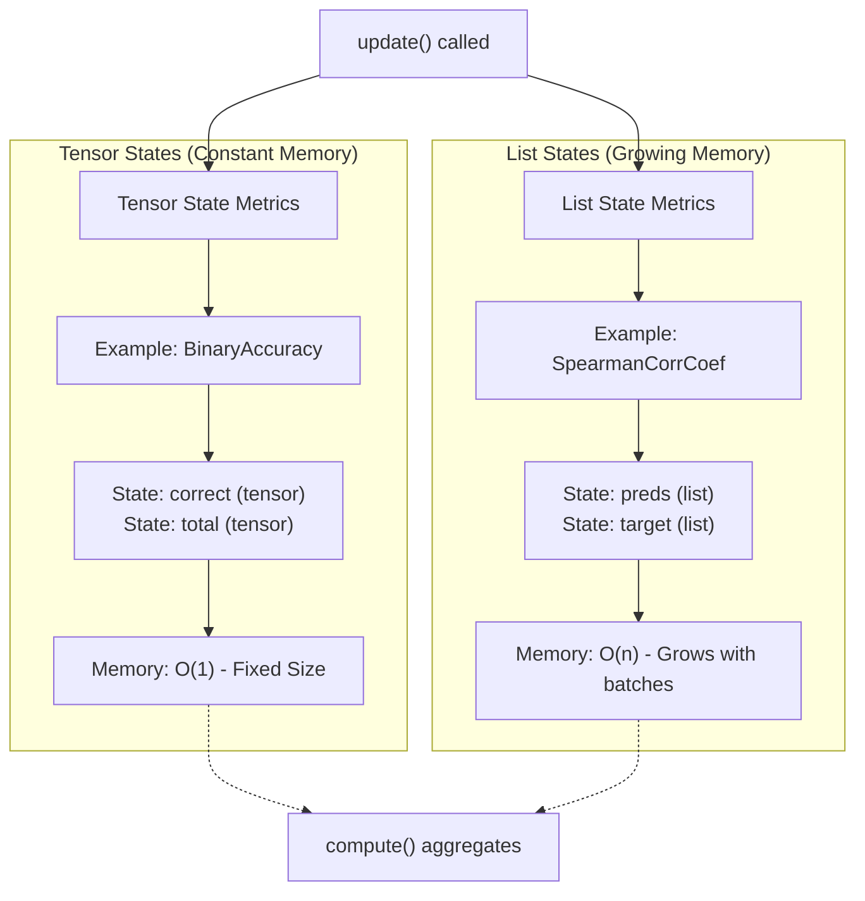
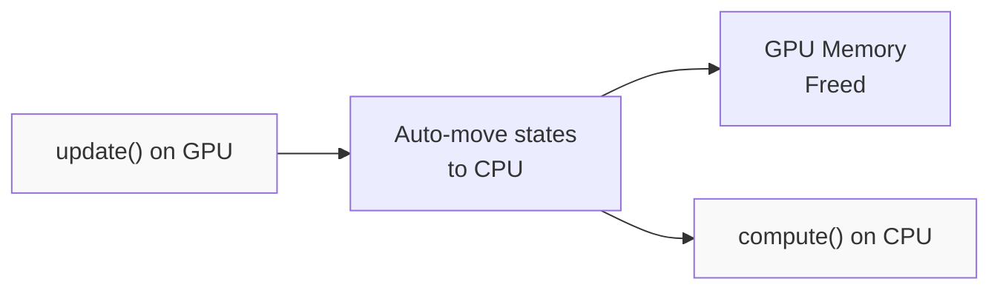
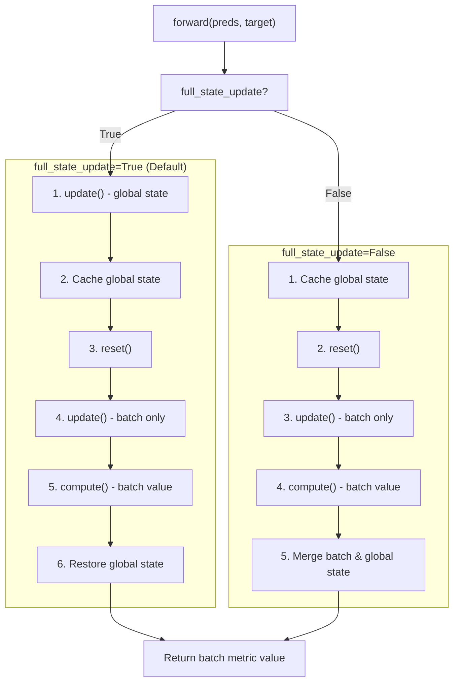
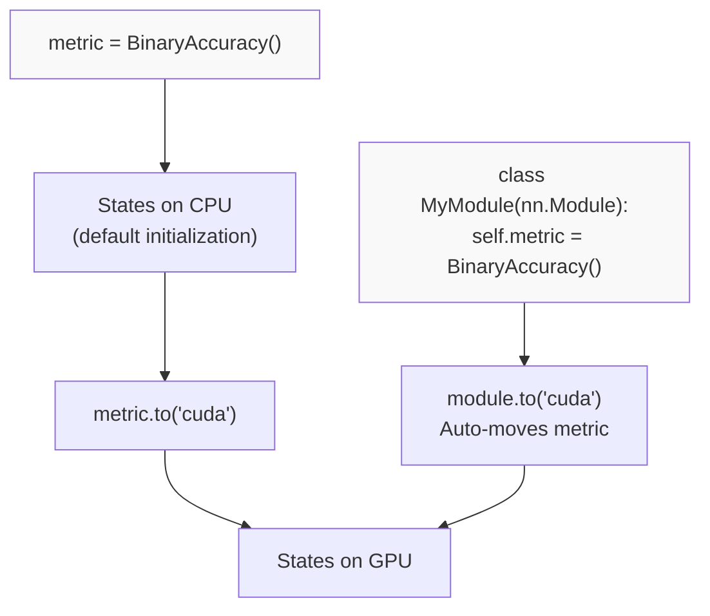
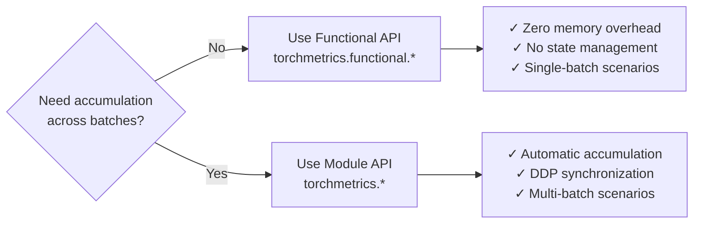

<!-- source: DeepWiki mcp.deepwiki.com · repo Lightning-AI/torchmetrics · page 2.3 Memory Management and Performance · fetched 2026-10-21 -->

# Memory Management and Performance

<details>
<summary>Relevant source files</summary>

The following files were used as context for generating this wiki page:

- [.pre-commit-config.yaml](.pre-commit-config.yaml)
- [LICENSE](LICENSE)
- [README.md](README.md)
- [docs/source/_templates/theme_variables.jinja](docs/source/_templates/theme_variables.jinja)
- [docs/source/all-metrics.rst](docs/source/all-metrics.rst)
- [docs/source/conf.py](docs/source/conf.py)
- [docs/source/index.rst](docs/source/index.rst)
- [docs/source/pages/implement.rst](docs/source/pages/implement.rst)
- [docs/source/pages/lightning.rst](docs/source/pages/lightning.rst)
- [docs/source/pages/overview.rst](docs/source/pages/overview.rst)
- [docs/source/pages/quickstart.rst](docs/source/pages/quickstart.rst)
- [pyproject.toml](pyproject.toml)
- [requirements/integrate.txt](requirements/integrate.txt)
- [src/torchmetrics/__about__.py](src/torchmetrics/__about__.py)
- [src/torchmetrics/collections.py](src/torchmetrics/collections.py)
- [src/torchmetrics/metric.py](src/torchmetrics/metric.py)
- [tests/integrations/lightning/boring_model.py](tests/integrations/lightning/boring_model.py)
- [tests/integrations/test_lightning.py](tests/integrations/test_lightning.py)
- [tests/unittests/bases/test_collections.py](tests/unittests/bases/test_collections.py)
- [tests/unittests/bases/test_metric.py](tests/unittests/bases/test_metric.py)

</details>


This document covers memory management strategies and performance optimization techniques in TorchMetrics. It focuses on how metric states are stored, cached, and transferred between devices, and provides best practices for minimizing memory footprint while maintaining computational efficiency.

For information about the basic metric lifecycle (update/compute/reset), see [Metric Base Class](#2.1). For distributed synchronization mechanisms, see [Distributed Training Support](#2.2).

---

## Overview of Memory Considerations

TorchMetrics metrics maintain internal states that accumulate data across batches. Understanding how these states are stored and managed is critical for both memory efficiency and performance, especially when working with large datasets or resource-constrained environments.

The library provides several mechanisms to control memory usage:

- **State type selection**: Tensor states (constant memory) vs list states (growing memory)
- **Device placement**: Automatic device management and the `compute_on_cpu` flag
- **Caching control**: The `compute_with_cache` parameter for result caching
- **Forward caching**: Internal optimization for the `forward()` method behavior

Sources: [docs/source/pages/overview.rst:134-183]()

---

## Metric State Types

### Tensor States vs List States

TorchMetrics categorizes metrics into two fundamental types based on how their internal states behave:



**Tensor State Metrics** have fixed-size tensor states that are updated in-place. The memory footprint remains constant regardless of how many batches are processed. These metrics can accumulate statistics efficiently without storing individual batch data.

**List State Metrics** append tensor data to lists with each `update()` call. Their memory footprint grows linearly with the number of batches. These are necessary when the final computation requires access to the full data distribution (e.g., ranking operations, percentile calculations).

Sources: [docs/source/pages/overview.rst:136-147]()

### Inspecting Metric States

The `.metric_state` property provides visibility into the current state structure and values:

```python
from torchmetrics.regression import SpearmanCorrCoef

metric = SpearmanCorrCoef()
metric.update(torch.rand(10), torch.rand(10))
print(metric.metric_state)
# Output: {'preds': [tensor(...)], 'target': [tensor(...)]}
```

This property returns a dictionary where:
- Keys are state variable names (defined via `add_state()`)
- Values are either tensors or lists of tensors
- List states indicate growing memory usage

Sources: [docs/source/pages/overview.rst:148-167](), [docs/source/pages/implement.rst:76-130]()

---

## Memory Management Strategies

### The `compute_on_cpu` Flag

For metrics with **list states only**, the `compute_on_cpu` parameter enables automatic state transfer to CPU after each `update()` call, preventing GPU memory exhaustion:



**Usage:**
```python
metric = SpearmanCorrCoef(compute_on_cpu=True)
```

**When to use:**
- Running out of GPU VRAM during training
- Metrics with list states that accumulate large amounts of data
- When compute performance on CPU is acceptable

**Trade-offs:**
- Reduces GPU memory usage
- `compute()` executes on CPU (slower)
- Only affects list state metrics (no effect on tensor state metrics)

Sources: [docs/source/pages/overview.rst:528-531]()

### The `compute_with_cache` Flag

Controls whether `compute()` results are cached between calls:

| Parameter Value | Behavior | Memory Impact | Use Case |
|----------------|----------|---------------|----------|
| `True` (default) | Cache result after first `compute()` | +1 tensor per metric | Repeated `compute()` calls without state changes |
| `False` | Recompute on every `compute()` call | No caching overhead | Single `compute()` call per epoch or memory-constrained scenarios |

**Usage:**
```python
metric = MulticlassAccuracy(num_classes=10, compute_with_cache=False)
```

The cache is automatically invalidated when `update()` is called, ensuring correctness.

Sources: [docs/source/pages/overview.rst:533-536](), [CHANGELOG.md:574]()

### Reset and Cleanup Best Practices

The following practices minimize memory leaks and accumulation issues:

1. **Always call `reset()` when done with a metric instance:**
   ```python
   for epoch in range(num_epochs):
       for batch in train_loader:
           metric.update(preds, target)
       result = metric.compute()
       metric.reset()  # Critical: frees list states
   ```

2. **Reuse metric instances across epochs** rather than creating new ones:
   ```python
   # Good: single instance, reused
   metric = MulticlassAccuracy(num_classes=5)
   for epoch in range(10):
       # ... training loop
       metric.reset()
   
   # Avoid: creating new instances (can leak memory)
   for epoch in range(10):
       metric = MulticlassAccuracy(num_classes=5)  # Memory leak risk
   ```

3. **Use separate instances for train/val/test** to avoid state mixing:
   ```python
   train_acc = MulticlassAccuracy(num_classes=5)
   val_acc = MulticlassAccuracy(num_classes=5)
   test_acc = MulticlassAccuracy(num_classes=5)
   ```

Sources: [docs/source/pages/overview.rst:169-182]()

---

## Forward Method Caching and Performance

### The Forward Lifecycle

The `forward()` method (called via `metric(preds, target)`) serves dual purposes:
1. Accumulate batch data via `update()`
2. Return the metric value for the current batch

The implementation uses sophisticated caching to optimize this:



**Key insight:** When `full_state_update=False`, the metric only calls `update()` once instead of twice, significantly improving performance for metrics where batch states are independent.

Sources: [docs/source/pages/implement.rst:206-233]()

### Full State Update Flag

The `full_state_update` class attribute controls forward behavior:

```python
class MyMetric(Metric):
    # Set to False if metric state for each batch is independent
    full_state_update: bool = False
    
    def update(self, preds, target):
        # If this doesn't depend on previous batches' state, 
        # set full_state_update=False for better performance
        ...
```

**Performance comparison:**
- `full_state_update=True`: 2 calls to `update()` per forward
- `full_state_update=False`: 1 call to `update()` per forward (up to 2x faster)

**When to use `False`:**
- Batch metrics are statistically independent (e.g., Accuracy, Precision)
- No cross-batch dependencies in computation

**When to use `True` (default):**
- Metrics requiring full data distribution (e.g., AUROC, calibration metrics)
- Uncertain about independence (safer default)

Sources: [docs/source/pages/implement.rst:210-233]()

---

## Device and Dtype Management

### Automatic Device Placement

Metrics are `torch.nn.Module` subclasses, so their states follow PyTorch's device management:



**Key points:**

1. **Initial state:** All metric states initialize on CPU regardless of instantiation context
2. **Manual transfer:** Use `.to(device)` to move metric states
3. **Automatic transfer:** When properly registered as a submodule, metrics move with parent modules
4. **Input matching:** Input tensors and metric states must be on the same device

**Proper registration examples:**
```python
class MyModel(nn.Module):
    def __init__(self):
        super().__init__()
        # ✓ Correct: direct attribute assignment
        self.metric1 = BinaryAccuracy()
        
        # ✓ Correct: ModuleList
        self.metric2 = nn.ModuleList([BinaryAccuracy()])
        
        # ✓ Correct: ModuleDict
        self.metric3 = nn.ModuleDict({'acc': BinaryAccuracy()})
        
        # ✓ Correct: MetricCollection
        self.metric4 = MetricCollection([BinaryAccuracy()])
        
        # ✗ Incorrect: Python list (not tracked)
        self.metric5 = [BinaryAccuracy()]  # Won't auto-transfer!
```

Sources: [docs/source/pages/overview.rst:77-131]()

### Device Checking

The `.device` property returns the current device of metric states:

```python
metric = MulticlassAccuracy(num_classes=5)
print(metric.device)  # cpu

metric.to('cuda')
print(metric.device)  # cuda:0
```

Sources: [docs/source/pages/overview.rst:131]()

### Dtype Management

Similar to devices, metrics support dtype control:

```python
metric = MulticlassAccuracy(num_classes=5)
metric.set_dtype(torch.float64)  # Set precision

print(metric.dtype)  # torch.float64
```

**Half precision (torch.float16) limitations:**
- Some metrics don't support CPU half precision
- GPU half precision generally well-supported (PyTorch 1.6+)
- Check the `.is_differentiable` property and metric documentation

Sources: [docs/source/pages/overview.rst:244-259]()

---

## Performance Optimization Patterns

### Choosing Between Functional and Module APIs



**Functional API for single-batch evaluation:**
```python
from torchmetrics.functional import accuracy

# No state, no memory overhead
for batch in test_loader:
    acc = accuracy(preds, target, task="multiclass", num_classes=5)
    print(f"Batch accuracy: {acc}")
```

**Module API for accumulation:**
```python
from torchmetrics import Accuracy

metric = Accuracy(task="multiclass", num_classes=5)
for batch in test_loader:
    metric.update(preds, target)  # Accumulate

final_acc = metric.compute()  # Aggregate over all batches
```

Sources: [docs/source/pages/overview.rst:176-181](), [docs/source/pages/overview.rst:461-470]()

### MetricCollection and Compute Groups

When using multiple metrics, `MetricCollection` automatically identifies shared states to reduce redundant computation:

```python
from torchmetrics import MetricCollection
from torchmetrics.classification import MulticlassAccuracy, MulticlassPrecision, MulticlassRecall

# These metrics share state computation (confusion matrix)
metrics = MetricCollection([
    MulticlassAccuracy(num_classes=5),
    MulticlassPrecision(num_classes=5),
    MulticlassRecall(num_classes=5),
])

# Only one confusion matrix is computed, shared across all three metrics
# This can reduce computation by 2-3x
metrics.update(preds, target)
result = metrics.compute()
```

**Performance benefit:** 2-3x speedup when metrics share underlying state computation (e.g., confusion matrix for classification metrics).

Sources: [docs/source/pages/overview.rst:390-401]()

---

## Memory Footprint Analysis

### Comparative Memory Usage

| Metric Type | State Structure | Memory Growth | Example Metrics |
|------------|----------------|---------------|-----------------|
| Tensor states only | Fixed tensors | O(1) | `BinaryAccuracy`, `MulticlassPrecision`, `MeanSquaredError` |
| Small list states | Lists with summary values | O(num_batches) | `ConfusionMatrix` (stores per-batch counts) |
| Full list states | Lists storing all values | O(num_samples) | `SpearmanCorrCoef`, `ROC`, `PrecisionRecallCurve` |

### Monitoring Memory

```python
import torch
from torchmetrics.regression import SpearmanCorrCoef

metric = SpearmanCorrCoef()

# Check initial state
print(f"Initial state: {metric.metric_state}")
# {}

# After first update
metric.update(torch.rand(100), torch.rand(100))
print(f"After update 1: {metric.metric_state}")
# {'preds': [tensor([...])], 'target': [tensor([...])]}

# After second update (list grows)
metric.update(torch.rand(100), torch.rand(100))
print(f"After update 2: {len(metric.metric_state['preds'])} batches")
# 2 batches

# Memory is freed
metric.reset()
print(f"After reset: {metric.metric_state}")
# {'preds': [], 'target': []}
```

Sources: [docs/source/pages/overview.rst:148-167]()

---

## Integration with PyTorch Lightning

PyTorch Lightning provides additional memory management benefits:

```python
from lightning.pytorch import LightningModule
from torchmetrics import MetricCollection
from torchmetrics.classification import MulticlassAccuracy, MulticlassPrecision

class MyModule(LightningModule):
    def __init__(self):
        super().__init__()
        self.train_metrics = MetricCollection({
            'acc': MulticlassAccuracy(num_classes=10),
            'prec': MulticlassPrecision(num_classes=10),
        })
        
    def training_step(self, batch, batch_idx):
        x, y = batch
        preds = self(x)
        
        # Lightning automatically:
        # 1. Ensures metrics are on the correct device
        # 2. Resets metrics at epoch end
        # 3. Handles DDP synchronization
        self.log_dict(self.train_metrics(preds, y))
        
        return loss
```

**Lightning-specific benefits:**
- Automatic device placement matching model device
- Automatic metric reset at epoch boundaries
- No manual `.reset()` calls needed

Sources: [docs/source/pages/lightning.rst:23-28](), [tests/integrations/test_lightning.py:82-181]()

---

## Advanced Settings Summary

The following table summarizes all memory and performance-related keyword arguments accepted by metrics:

| Argument | Type | Default | Purpose | When to Override |
|----------|------|---------|---------|------------------|
| `compute_on_cpu` | bool | `False` | Move list states to CPU after update | GPU memory constraints with list-state metrics |
| `compute_with_cache` | bool | `True` | Cache compute() results | Single compute per epoch, or memory-critical scenarios |
| `sync_on_compute` | bool | `True` | Auto-sync in DDP on compute() | Manual control over sync timing |
| `dist_sync_on_step` | bool | `False` | Sync after every forward() | Real-time distributed monitoring (expensive) |
| `full_state_update` | bool | `True` | Class attribute controlling forward behavior | Set to `False` for independent batch states |

**Example usage:**
```python
metric = MulticlassAccuracy(
    num_classes=10,
    compute_on_cpu=True,        # Free GPU memory
    compute_with_cache=False,   # No result caching
    sync_on_compute=True,       # Auto-sync in DDP
    dist_sync_on_step=False,    # Don't sync every step
)
```

Sources: [docs/source/pages/overview.rst:517-555]()

---

## Summary of Best Practices

1. **Use tensor-state metrics when possible** for constant memory footprint
2. **Call `reset()` after `compute()`** to free memory, especially for list-state metrics
3. **Enable `compute_on_cpu=True`** when GPU memory is limited and list states are used
4. **Set `compute_with_cache=False`** for single-compute scenarios to save memory
5. **Reuse metric instances** across epochs rather than creating new ones
6. **Use separate instances** for train/validation/test to avoid state contamination
7. **Prefer functional API** for single-batch evaluation with no accumulation
8. **Use MetricCollection** to leverage compute group optimizations
9. **Set `full_state_update=False`** for metrics with independent batch states
10. **Properly register metrics** as submodules for automatic device management

Sources: [docs/source/pages/overview.rst:134-183](), [docs/source/pages/overview.rst:517-555]()

---

