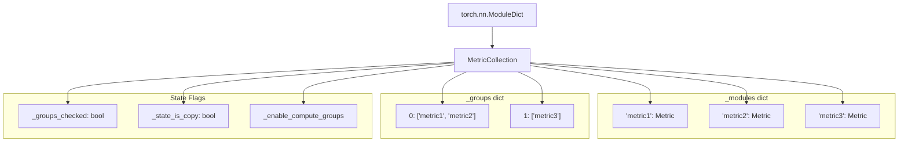
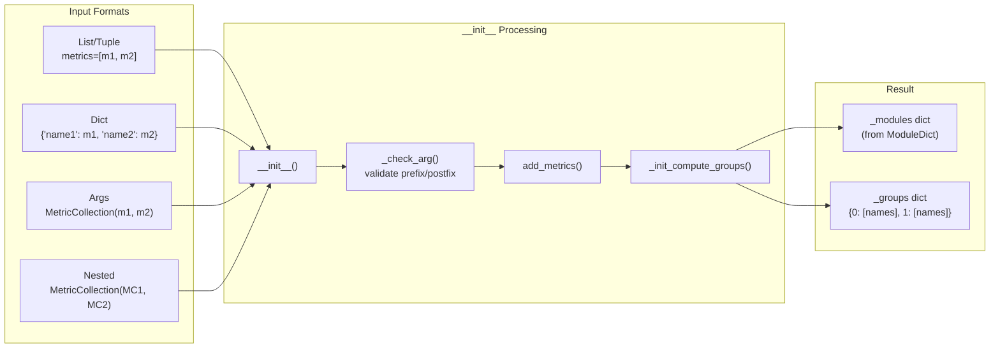
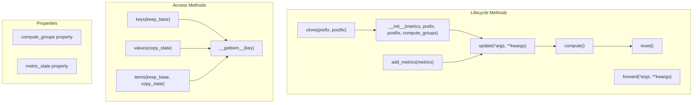
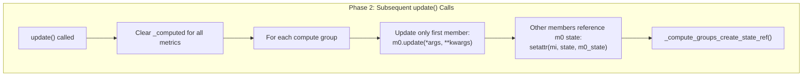
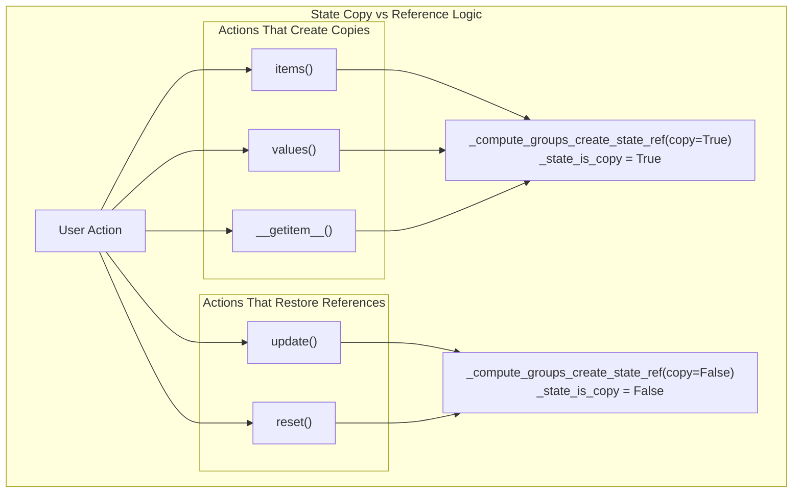
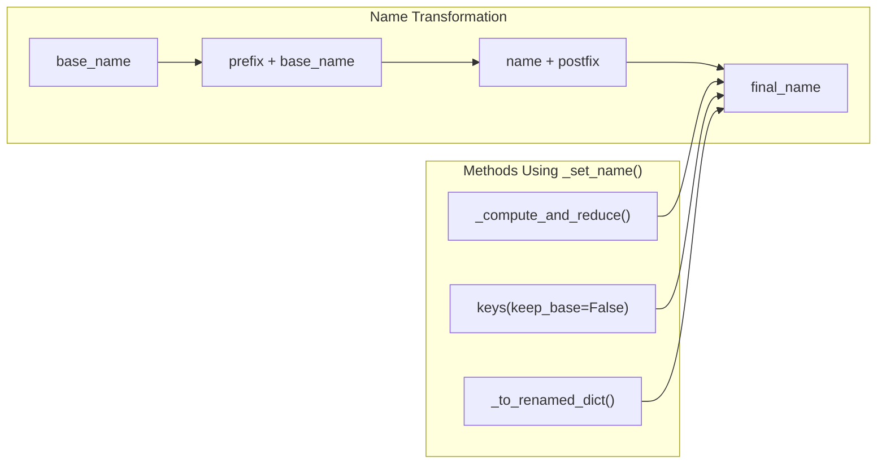
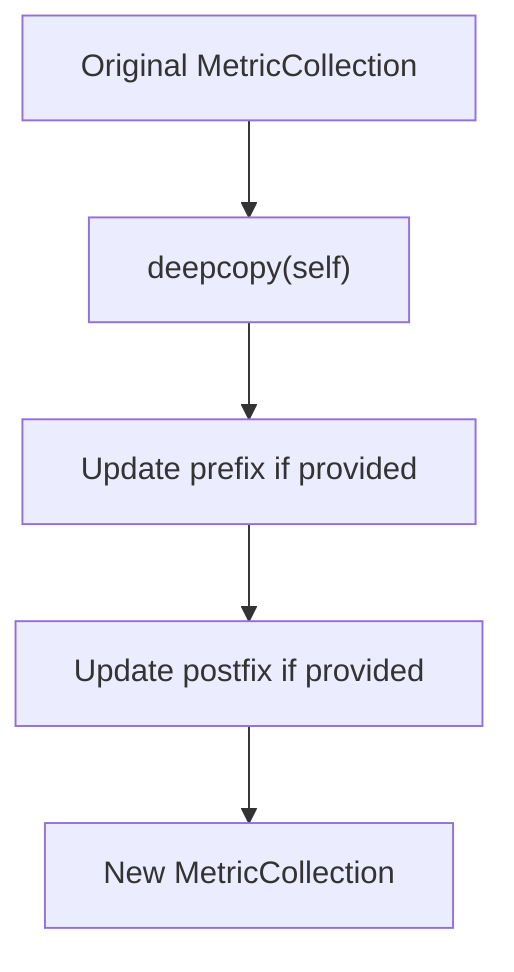
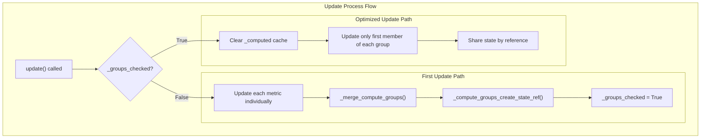

<!-- source: DeepWiki mcp.deepwiki.com · repo Lightning-AI/torchmetrics · page 2.4 MetricCollection · fetched 2026-10-21 -->

# MetricCollection

<details>
<summary>Relevant source files</summary>

The following files were used as context for generating this wiki page:

- [.pre-commit-config.yaml](.pre-commit-config.yaml)
- [CHANGELOG.md](CHANGELOG.md)
- [LICENSE](LICENSE)
- [README.md](README.md)
- [docs/source/_templates/theme_variables.jinja](docs/source/_templates/theme_variables.jinja)
- [docs/source/all-metrics.rst](docs/source/all-metrics.rst)
- [docs/source/conf.py](docs/source/conf.py)
- [docs/source/index.rst](docs/source/index.rst)
- [docs/source/pages/implement.rst](docs/source/pages/implement.rst)
- [docs/source/pages/lightning.rst](docs/source/pages/lightning.rst)
- [docs/source/pages/overview.rst](docs/source/pages/overview.rst)
- [docs/source/pages/quickstart.rst](docs/source/pages/quickstart.rst)
- [pyproject.toml](pyproject.toml)
- [requirements/integrate.txt](requirements/integrate.txt)
- [src/torchmetrics/__about__.py](src/torchmetrics/__about__.py)
- [src/torchmetrics/collections.py](src/torchmetrics/collections.py)
- [src/torchmetrics/metric.py](src/torchmetrics/metric.py)
- [tests/integrations/lightning/boring_model.py](tests/integrations/lightning/boring_model.py)
- [tests/integrations/test_lightning.py](tests/integrations/test_lightning.py)
- [tests/unittests/bases/test_collections.py](tests/unittests/bases/test_collections.py)
- [tests/unittests/bases/test_metric.py](tests/unittests/bases/test_metric.py)

</details>


`MetricCollection` is a container class that manages multiple metrics with automatic optimization through compute groups. When multiple metrics share identical state variables (e.g., `MulticlassPrecision` and `MulticlassRecall` both use confusion matrix state), the collection can update only one metric's state and share it by reference with others, significantly reducing computational overhead.

The class inherits from `torch.nn.ModuleDict` and is defined in [src/torchmetrics/collections.py:59-731]().

## Overview

**MetricCollection Class Hierarchy**



Sources: [src/torchmetrics/collections.py:59-220](), [src/torchmetrics/collections.py:196-220]()
</thinking>

## Initialization Patterns

`MetricCollection` supports multiple initialization patterns via the `__init__` method [src/torchmetrics/collections.py:199-221]():

**Initialization Pattern Diagram**



**Input Format Examples:**

| Pattern | Code | Result Keys | Notes |
|---------|------|-------------|-------|
| List | `MetricCollection([Acc(), Prec()])` | `['MulticlassAccuracy', 'MulticlassPrecision']` | Uses class `__name__` |
| Dict | `MetricCollection({'acc': Acc(), 'prec': Prec()})` | `['acc', 'prec']` | Custom keys, sorted alphabetically |
| Args | `MetricCollection(Acc(), Prec())` | `['MulticlassAccuracy', 'MulticlassPrecision']` | Same as list |
| Nested | `MetricCollection([MC1, MC2])` | Flattened keys with prefix/postfix | Single-level nesting only |

Sources: [src/torchmetrics/collections.py:199-221](), [src/torchmetrics/collections.py:437-520](), [tests/unittests/bases/test_collections.py:54-90]()

## Core API Methods

**MetricCollection Public API**



**Method Signatures:**

| Method | Signature | Returns | Purpose |
|--------|-----------|---------|---------|
| `__init__` | `(metrics, prefix=None, postfix=None, compute_groups=True)` | None | Initialize collection |
| `update` | `(*args, **kwargs)` | None | Update all metrics with filtered kwargs |
| `forward` | `(*args, **kwargs)` | `dict[str, Any]` | Update and compute in one call |
| `compute` | `()` | `dict[str, Any]` | Compute all metrics |
| `reset` | `()` | None | Reset all metrics |
| `clone` | `(prefix=None, postfix=None)` | `MetricCollection` | Deep copy with new prefix/postfix |
| `add_metrics` | `(metrics)` | None | Add metrics to existing collection |
| `keys` | `(keep_base=False)` | `Iterable[str]` | Get metric names (with/without prefix/postfix) |
| `values` | `(copy_state=True)` | `Iterable[Metric]` | Get metric instances |
| `items` | `(keep_base=False, copy_state=True)` | `Iterable[tuple]` | Get (name, metric) pairs |

Sources: [src/torchmetrics/collections.py:199-731](), [src/torchmetrics/collections.py:228-235](), [src/torchmetrics/collections.py:237-268](), [src/torchmetrics/collections.py:358-407]()

## Compute Groups Optimization

Compute groups enable efficient multi-metric computation by sharing state between metrics. The system works in two phases: detection and execution.

**Compute Groups Detection Phase**

```mermaid
graph TB
    subgraph "Phase 1: First update() Call"
        Update1["update() called"]
        InitGroups["_init_compute_groups()<br/>Each metric in own group"]
        UpdateAll["Update each metric individually"]
        Merge["_merge_compute_groups()"]
        
        subgraph "_equal_metric_states() Logic"
            CompareKeys["metric1._defaults.keys()<br/>== metric2._defaults.keys()"]
            CompareTypes["type(state1) == type(state2)"]
            CompareValues["allclose(state1, state2)"]
        end
        
        SetFlag["_groups_checked = True"]
        CreateRef["_compute_groups_create_state_ref()"]
    end
    
    Update1 --> InitGroups
    InitGroups --> UpdateAll
    UpdateAll --> Merge
    Merge --> CompareKeys
    CompareKeys --> CompareTypes
    CompareTypes --> CompareValues
    CompareValues --> SetFlag
    SetFlag --> CreateRef
```



**State Equality Check Implementation:**

The `_equal_metric_states()` static method [src/torchmetrics/collections.py:305-336]() compares two metrics:

1. Check both have non-empty `_defaults` dict
2. Compare `_defaults.keys()` for identical state names
3. For each state, compare:
   - Type equality using `type(state1) != type(state2)`
   - Tensor states: shape and `allclose()` comparison
   - List states: element-wise shape and `allclose()` for all pairs

**Compute Groups Execution Phase**



**Compute Groups Data Structure:**

The `_groups` dictionary maps group indices to lists of metric names:

```python
# Example _groups structure after detection
{
    0: ["MulticlassRecall", "MulticlassPrecision", "MulticlassF1Score"],
    1: ["MulticlassConfusionMatrix"],
    2: ["MulticlassAccuracy"]
}
```

Sources: [src/torchmetrics/collections.py:269-304](), [src/torchmetrics/collections.py:305-336](), [src/torchmetrics/collections.py:237-268](), [src/torchmetrics/collections.py:244-267]()

## State Reference Management

The collection manages whether metric states are shared by reference or copied, controlled by the `_state_is_copy` flag [src/torchmetrics/collections.py:218]().

**State Sharing Control Flow**



**Implementation Details:**

The `_compute_groups_create_state_ref()` method [src/torchmetrics/collections.py:338-356]() handles state sharing:

- When `copy=False`: Sets state attributes by reference: `setattr(mi, state, m0_state)`
- When `copy=True`: Creates deep copies: `setattr(mi, state, deepcopy(m0_state))`
- Also manages `_update_count` synchronization between group members
- Only executes if `not self._state_is_copy` to avoid redundant operations

**Why Copies Are Needed:**

When users access individual metrics via `items()`, `values()`, or `__getitem__()`, they may reset those metrics individually. If states were shared by reference, resetting one metric would affect all metrics in the group. Creating copies prevents this issue while maintaining correctness.

Sources: [src/torchmetrics/collections.py:338-356](), [src/torchmetrics/collections.py:581-604](), [src/torchmetrics/collections.py:606-620](), [tests/unittests/bases/test_collections.py:824-858]()

## Prefix and Postfix Management

Prefix and postfix strings are applied to metric names in the output dictionary via the `_set_name()` method [src/torchmetrics/collections.py:553-556]().

**Prefix/Postfix Application**



**Key Behaviors:**

| Scenario | Example | Result |
|----------|---------|--------|
| No prefix/postfix | `MetricCollection([Acc()])` | `{'MulticlassAccuracy': ...}` |
| With prefix | `MetricCollection([Acc()], prefix='train_')` | `{'train_MulticlassAccuracy': ...}` |
| With postfix | `MetricCollection([Acc()], postfix='_epoch')` | `{'MulticlassAccuracy_epoch': ...}` |
| Both | `MetricCollection([Acc()], prefix='val_', postfix='_best')` | `{'val_MulticlassAccuracy_best': ...}` |
| Nested | Child `postfix='_macro'`, Parent `prefix='metrics/'` | `{'metrics/MulticlassAccuracy_macro': ...}` |

**Nested Collection Handling:**

When adding nested collections via `add_metrics()` [src/torchmetrics/collections.py:482-504](), the child collection's prefix/postfix is stored on each metric via `_from_collection` flag and applied during `_compute_and_reduce()` [src/torchmetrics/collections.py:400-403]().

Sources: [src/torchmetrics/collections.py:553-556](), [src/torchmetrics/collections.py:214-215](), [src/torchmetrics/collections.py:362-407](), [tests/unittests/bases/test_collections.py:164-221]()

## Cloning Patterns

The `clone()` method [src/torchmetrics/collections.py:417-430]() creates a deep copy of the collection with optional new prefix/postfix.

**Clone Operation**



**Use Cases:**

1. **Train/Val Split**: Clone collection with different prefixes
   ```python
   train_metrics = MetricCollection([Acc(), Prec()], prefix='train_')
   val_metrics = train_metrics.clone(prefix='val_')
   ```

2. **Multiple Evaluation Stages**: Clone with different postfixes
   ```python
   base = MetricCollection([Acc(), Prec()])
   epoch_metrics = base.clone(postfix='_epoch')
   step_metrics = base.clone(postfix='_step')
   ```

3. **Independent State**: Each clone maintains separate metric states
   ```python
   m1 = MetricCollection([Acc()])
   m2 = m1.clone()
   m1.update(...)  # Does not affect m2
   ```

Sources: [src/torchmetrics/collections.py:417-430](), [tests/unittests/bases/test_collections.py:194-221]()

## Implementation Details

### Update Process with Compute Groups

The optimized update process differs significantly when compute groups are enabled:



Sources: [src/torchmetrics/collections.py:237-268](), [src/torchmetrics/collections.py:244-267]()

### State Reference Management

The system manages state sharing between metrics in compute groups through careful reference handling:

- **Copy vs Reference**: Uses `_state_is_copy` flag to track state sharing mode
- **Items/Values Access**: Automatically creates copies when accessing individual metrics
- **Reset Coordination**: Ensures state references are maintained after reset operations

Sources: [src/torchmetrics/collections.py:338-356](), [src/torchmetrics/collections.py:581-604]()

### Manual Compute Group Specification

Users can manually specify compute groups during initialization:

```python
compute_groups=[["MulticlassRecall", "MulticlassPrecision"], ["MeanSquaredError"]]
```

The system validates that all specified metrics exist in the collection and automatically assigns unspecified metrics to their own groups.

Sources: [src/torchmetrics/collections.py:521-547](), [tests/unittests/bases/test_collections.py:580-597]()

## Integration Points

### ModuleDict Inheritance

MetricCollection inherits from `torch.nn.ModuleDict`, providing:

- **Standard Module Interface**: Automatic device/dtype handling
- **State Dict Support**: Proper serialization/deserialization
- **Iteration Support**: Standard dict-like access patterns

Sources: [src/torchmetrics/collections.py:59](), [src/torchmetrics/collections.py:196]()

### Metric Base Class Integration

MetricCollection works seamlessly with the base `Metric` class:

- **Update/Compute Pattern**: Maintains the standard metric interface
- **Kwargs Filtering**: Automatically filters kwargs based on metric signatures via `_filter_kwargs()`
- **Forward Method**: Supports both update and forward calling patterns

Sources: [src/torchmetrics/collections.py:228-235](), [src/torchmetrics/collections.py:362-407]()

---

