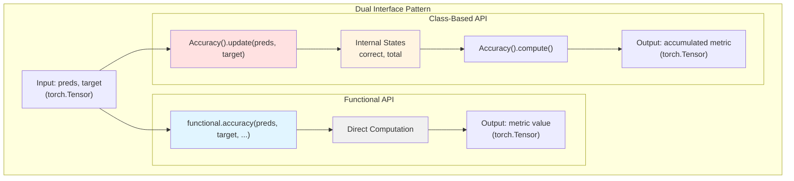
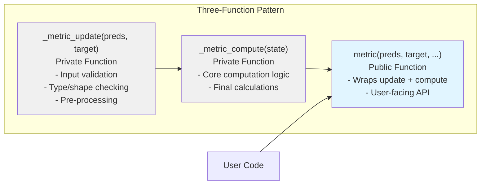
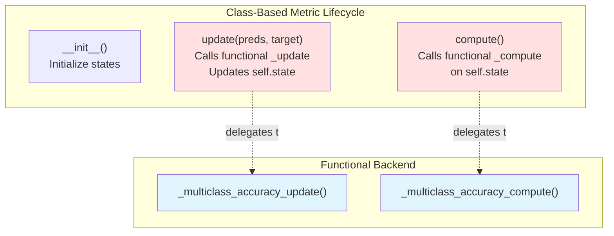
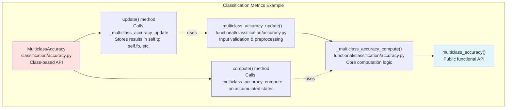

<!-- source: DeepWiki mcp.deepwiki.com · repo Lightning-AI/torchmetrics · page 2.5 Functional API · fetched 2026-10-21 -->

# Functional API

<details>
<summary>Relevant source files</summary>

The following files were used as context for generating this wiki page:

- [CHANGELOG.md](CHANGELOG.md)
- [LICENSE](LICENSE)
- [README.md](README.md)
- [docs/source/_templates/theme_variables.jinja](docs/source/_templates/theme_variables.jinja)
- [docs/source/all-metrics.rst](docs/source/all-metrics.rst)
- [docs/source/conf.py](docs/source/conf.py)
- [docs/source/index.rst](docs/source/index.rst)
- [docs/source/links.rst](docs/source/links.rst)
- [docs/source/pages/implement.rst](docs/source/pages/implement.rst)
- [docs/source/pages/lightning.rst](docs/source/pages/lightning.rst)
- [docs/source/pages/overview.rst](docs/source/pages/overview.rst)
- [docs/source/pages/quickstart.rst](docs/source/pages/quickstart.rst)
- [requirements/integrate.txt](requirements/integrate.txt)
- [src/torchmetrics/__about__.py](src/torchmetrics/__about__.py)
- [src/torchmetrics/__init__.py](src/torchmetrics/__init__.py)
- [src/torchmetrics/classification/__init__.py](src/torchmetrics/classification/__init__.py)
- [src/torchmetrics/functional/__init__.py](src/torchmetrics/functional/__init__.py)
- [src/torchmetrics/functional/classification/__init__.py](src/torchmetrics/functional/classification/__init__.py)
- [src/torchmetrics/functional/pairwise/__init__.py](src/torchmetrics/functional/pairwise/__init__.py)
- [src/torchmetrics/functional/regression/__init__.py](src/torchmetrics/functional/regression/__init__.py)
- [src/torchmetrics/regression/__init__.py](src/torchmetrics/regression/__init__.py)
- [tests/integrations/lightning/boring_model.py](tests/integrations/lightning/boring_model.py)
- [tests/integrations/test_lightning.py](tests/integrations/test_lightning.py)

</details>


## Purpose and Scope

The Functional API in TorchMetrics provides stateless, function-based interfaces for computing metrics. Unlike the class-based API (see [2.1](#2.1) for the Metric base class), functional metrics perform direct, one-shot calculations without internal state management, distributed synchronization, or batch accumulation. This document covers the organization, implementation patterns, usage, and relationship of functional metrics to their class-based counterparts.

For information about the class-based Metric API with state accumulation and DDP support, see [2.1](#2.1). For implementing your own metrics, see the implementation guide in the project documentation.

**Sources:** [docs/source/pages/overview.rst:460-471](), [README.md:275-293]()

## Overview: Stateless vs Stateful Metrics

TorchMetrics implements a dual-interface pattern where nearly every metric has both a functional and class-based version:



**Key Differences:**

| Aspect | Functional API | Class-Based API |
|--------|---------------|-----------------|
| **State Management** | Stateless | Stateful (via `add_state()`) |
| **Batch Accumulation** | No automatic accumulation | Automatic via `update()` |
| **DDP Synchronization** | No automatic sync | Automatic via `compute()` |
| **Memory Footprint** | Minimal (computation only) | Persistent state tensors/lists |
| **Use Case** | Single batch evaluation | Multi-batch training/validation |
| **Integration** | Manual logging | Native Lightning support |

**Sources:** [docs/source/pages/overview.rst:460-471](), [README.md:275-293](), [docs/source/pages/quickstart.rst:48-68]()

## Organization and Structure

Functional metrics are organized by domain into separate modules, mirroring the organization of class-based metrics:

```mermaid
graph TB
    ROOT["torchmetrics.functional"]
    
    AUDIO["audio/*<br/>permutation_invariant_training<br/>scale_invariant_signal_distortion_ratio<br/>signal_noise_ratio"]
    
    CLASSIFICATION["classification/*<br/>accuracy, auroc, precision<br/>recall, f1_score, confusion_matrix<br/>roc, precision_recall_curve"]
    
    DETECTION["detection/*<br/>panoptic_quality"]
    
    IMAGE["image/*<br/>peak_signal_noise_ratio<br/>structural_similarity_index_measure<br/>spectral_angle_mapper"]
    
    MULTIMODAL["multimodal/*<br/>lip_vertex_error"]
    
    NOMINAL["nominal/*<br/>cramers_v, fleiss_kappa<br/>theils_u, tschuprows_t"]
    
    PAIRWISE["pairwise/*<br/>pairwise_cosine_similarity<br/>pairwise_euclidean_distance<br/>pairwise_minkowski_distance"]
    
    REGRESSION["regression/*<br/>mean_absolute_error<br/>mean_squared_error<br/>pearson_corrcoef, r2_score"]
    
    RETRIEVAL["retrieval/*<br/>retrieval_average_precision<br/>retrieval_normalized_dcg<br/>retrieval_precision"]
    
    TEXT["text/*<br/>bleu_score, rouge_score<br/>bert_score, word_error_rate<br/>char_error_rate"]
    
    ROOT --> AUDIO
    ROOT --> CLASSIFICATION
    ROOT --> DETECTION
    ROOT --> IMAGE
    ROOT --> MULTIMODAL
    ROOT --> NOMINAL
    ROOT --> PAIRWISE
    ROOT --> REGRESSION
    ROOT --> RETRIEVAL
    ROOT --> TEXT
```



**Top-Level Import Structure:**

All functional metrics can be imported from `torchmetrics.functional` or from their domain-specific submodules:

```python
# Top-level import
from torchmetrics.functional import accuracy

# Domain-specific import
from torchmetrics.functional.classification import multiclass_accuracy

# Direct module import
from torchmetrics.functional.classification.accuracy import multiclass_accuracy
```

**Sources:** [src/torchmetrics/functional/__init__.py:1-254](), [src/torchmetrics/functional/classification/__init__.py:1-150](), [src/torchmetrics/functional/regression/__init__.py:1-62]()

## Implementation Pattern

Functional metrics in TorchMetrics follow a standardized three-function implementation pattern:



**Example: Classification Accuracy Implementation Pattern**

The implementation follows this structure in [src/torchmetrics/functional/classification/accuracy.py]():

1. **`_multiclass_accuracy_update(...)`** - Handles input validation, shape checking, and preprocessing
2. **`_multiclass_accuracy_compute(...)`** - Performs the actual accuracy calculation
3. **`multiclass_accuracy(...)`** - Public API that combines update and compute

**Usage Example:**

```python
import torch
from torchmetrics.functional.classification import multiclass_accuracy

# Generate predictions and targets
preds = torch.randn(10, 5).softmax(dim=-1)
target = torch.randint(5, (10,))

# Direct computation - no state management
acc = multiclass_accuracy(preds, target, num_classes=5)
print(f"Accuracy: {acc}")
```

**Class-Based Metrics Use Functional Backend:**

Class-based metrics internally delegate to their functional counterparts:



This design ensures that the core computation logic is shared between both APIs, reducing code duplication and maintenance burden.

**Sources:** [docs/source/pages/implement.rst:250-261](), [src/torchmetrics/functional/classification/__init__.py]()

## Domain Coverage and Examples

### Classification Domain

The classification domain provides the most extensive functional API coverage:

**Binary Classification:**
- `binary_accuracy`, `binary_auroc`, `binary_precision`, `binary_recall`
- `binary_f1_score`, `binary_confusion_matrix`, `binary_roc`

**Multiclass Classification:**
- `multiclass_accuracy`, `multiclass_auroc`, `multiclass_precision`, `multiclass_recall`
- `multiclass_f1_score`, `multiclass_confusion_matrix`, `multiclass_roc`

**Multilabel Classification:**
- `multilabel_accuracy`, `multilabel_auroc`, `multilabel_precision`, `multilabel_recall`
- `multilabel_f1_score`, `multilabel_confusion_matrix`, `multilabel_roc`

**Example Usage:**

```python
from torchmetrics.functional.classification import (
    binary_accuracy,
    multiclass_f1_score,
    multilabel_auroc
)

# Binary classification
binary_preds = torch.rand(100)
binary_target = torch.randint(0, 2, (100,))
acc = binary_accuracy(binary_preds, binary_target, threshold=0.5)

# Multiclass classification
mc_preds = torch.randn(100, 5).softmax(dim=-1)
mc_target = torch.randint(0, 5, (100,))
f1 = multiclass_f1_score(mc_preds, mc_target, num_classes=5, average='macro')

# Multilabel classification
ml_preds = torch.rand(100, 5)
ml_target = torch.randint(0, 2, (100, 5))
auroc = multilabel_auroc(ml_preds, ml_target, num_labels=5)
```

**Sources:** [src/torchmetrics/functional/classification/__init__.py:1-150]()

### Regression Domain

Regression metrics provide straightforward error and correlation computations:

**Error Metrics:**
- `mean_absolute_error`, `mean_squared_error`, `mean_squared_log_error`
- `mean_absolute_percentage_error`, `symmetric_mean_absolute_percentage_error`

**Correlation Metrics:**
- `pearson_corrcoef`, `spearman_corrcoef`, `kendall_rank_corrcoef`
- `concordance_corrcoef`

**Other Metrics:**
- `r2_score`, `explained_variance`, `cosine_similarity`
- `kl_divergence`, `jensen_shannon_divergence`

**Example Usage:**

```python
from torchmetrics.functional.regression import (
    mean_squared_error,
    pearson_corrcoef,
    r2_score
)

preds = torch.randn(100)
target = torch.randn(100)

mse = mean_squared_error(preds, target)
corr = pearson_corrcoef(preds, target)
r2 = r2_score(preds, target)
```

**Sources:** [src/torchmetrics/functional/regression/__init__.py:1-62]()

### Other Domains

**Pairwise Metrics:**

Compute pairwise distances/similarities between samples:

```python
from torchmetrics.functional.pairwise import (
    pairwise_cosine_similarity,
    pairwise_euclidean_distance,
    pairwise_minkowski_distance
)

x = torch.randn(10, 128)  # 10 samples, 128 features
y = torch.randn(20, 128)  # 20 samples, 128 features

# Compute pairwise distances
distances = pairwise_euclidean_distance(x, y)  # Shape: [10, 20]
```

**Nominal Metrics:**

For categorical data analysis:

```python
from torchmetrics.functional.nominal import (
    cramers_v,
    theils_u,
    fleiss_kappa
)

# Cramér's V for association between categorical variables
confusion_matrix = torch.randint(0, 10, (5, 5))
association = cramers_v(confusion_matrix)
```

**Sources:** [src/torchmetrics/functional/pairwise/__init__.py:1-27](), [src/torchmetrics/functional/__init__.py:78-88]()

## When to Use Functional vs Class-Based

The choice between functional and class-based APIs depends on your use case:

### Use Functional API When:

1. **Single Batch Evaluation:** You need to compute a metric on a complete dataset in one pass
   ```python
   # Evaluate entire test set at once
   test_preds = model(test_data)
   accuracy = functional.accuracy(test_preds, test_targets, task="multiclass", num_classes=10)
   ```

2. **Memory Constraints:** You want to minimize memory overhead (no state persistence)

3. **Simple Scripts:** You're writing simple evaluation scripts without training loops

4. **Custom Aggregation:** You need full control over how metrics are aggregated

5. **Small Datasets:** The entire dataset fits in memory for a single computation

### Use Class-Based API When:

1. **Batch Accumulation:** You need to accumulate metrics over multiple batches
   ```python
   metric = Accuracy(task="multiclass", num_classes=10)
   for batch in dataloader:
       preds, targets = model(batch), batch.targets
       metric.update(preds, targets)
   final_accuracy = metric.compute()
   ```

2. **Distributed Training:** You're using DDP and need automatic synchronization

3. **PyTorch Lightning:** You want native integration with Lightning's logging system

4. **Metric Tracking:** You need to track metrics over epochs (see [12.2](#12.2) for MetricTracker)

5. **Metric Collections:** You're computing multiple metrics simultaneously (see [2.4](#2.4))

**Comparison Table:**

| Scenario | Functional API | Class-Based API |
|----------|---------------|-----------------|
| Single batch evaluation | ✓ Optimal | ✗ Overhead |
| Multi-batch training | ✗ Manual work | ✓ Automatic |
| DDP training | ✗ No sync | ✓ Auto sync |
| Memory efficiency | ✓ Minimal | ✗ State overhead |
| Lightning integration | ✗ Manual logging | ✓ Native support |
| Metric arithmetic | ✗ Not supported | ✓ Supported |

**Sources:** [docs/source/pages/overview.rst:460-471](), [README.md:275-293]()

## Relationship to Class-Based Metrics

The functional and class-based APIs are tightly coupled, with class-based metrics serving as stateful wrappers around functional implementations:



**Shared Code Benefits:**

1. **Single Source of Truth:** Core computation logic exists in one place (functional implementation)
2. **Easier Maintenance:** Bug fixes in functional code automatically benefit class-based metrics
3. **Consistency:** Both APIs produce identical results for the same inputs
4. **Testing Efficiency:** Functional tests validate both APIs simultaneously

**Code Structure Example:**

For classification metrics, the relationship is evident in the file structure:

```
src/torchmetrics/
├── functional/
│   └── classification/
│       └── accuracy.py              # _update, _compute, public function
└── classification/
    └── accuracy.py                  # Class wrapper using functional backend
```

Class-based metrics in [src/torchmetrics/classification/]() delegate to functional implementations in [src/torchmetrics/functional/classification/]().

**Sources:** [src/torchmetrics/classification/__init__.py:1-239](), [src/torchmetrics/functional/classification/__init__.py:1-150]()

## Limitations and Considerations

### Limitations of Functional API

1. **No Automatic DDP Synchronization:**
   - Functional metrics don't synchronize across processes
   - In distributed settings, you must manually gather results
   
2. **No Batch Accumulation:**
   - Each call computes on provided data only
   - For multi-batch evaluation, you must manually accumulate

3. **No State Persistence:**
   - Cannot be saved/loaded like class-based metrics
   - Cannot use `.persistent()` method for checkpoint saving

4. **No Metric Arithmetic:**
   - Cannot combine metrics with operators (`+`, `-`, etc.)
   - Cannot use metric composition features

5. **Limited Lightning Integration:**
   - Cannot use `self.log(metric_object)` pattern
   - Must manually compute and log scalar values

### Performance Considerations

**Memory:**
- Functional API has lower memory footprint (no state storage)
- Better for evaluation-only scenarios
- Class-based API amortizes overhead over many batches

**Computation:**
- For single-batch evaluation: Functional API is faster (no state management overhead)
- For multi-batch evaluation: Class-based API can be more efficient (compute groups optimization in [2.4](#2.4))

**Example - Avoiding Functional API Pitfalls:**

```python
# ❌ Incorrect: Doesn't accumulate properly in DDP
for batch in dataloader:
    acc = functional.accuracy(batch.preds, batch.targets, task="multiclass", num_classes=5)
    # Each process has different acc, no synchronization

# ✓ Correct: Use class-based for DDP
metric = Accuracy(task="multiclass", num_classes=5)
for batch in dataloader:
    metric.update(batch.preds, batch.targets)
acc = metric.compute()  # Automatically synchronized across processes
```

**Sources:** [docs/source/pages/overview.rst:460-471](), [docs/source/pages/overview.rst:229-240]()

## Complete Usage Example

Here's a comprehensive example showing appropriate use of both APIs:

```python
import torch
from torchmetrics.functional import accuracy as functional_accuracy
from torchmetrics import Accuracy

# Scenario 1: One-time evaluation on complete test set
# Use functional API
test_preds = torch.randn(1000, 10).softmax(dim=-1)
test_targets = torch.randint(0, 10, (1000,))

test_acc = functional_accuracy(
    test_preds, 
    test_targets, 
    task="multiclass", 
    num_classes=10
)
print(f"Test Accuracy: {test_acc:.4f}")

# Scenario 2: Training loop with batch accumulation
# Use class-based API
train_metric = Accuracy(task="multiclass", num_classes=10)
val_metric = Accuracy(task="multiclass", num_classes=10)

for epoch in range(num_epochs):
    # Training
    for batch in train_loader:
        preds = model(batch.x)
        loss = criterion(preds, batch.y)
        
        # Update metric states
        train_metric.update(preds, batch.y)
        
        optimizer.zero_grad()
        loss.backward()
        optimizer.step()
    
    # Compute epoch-level training metric
    train_acc = train_metric.compute()
    print(f"Epoch {epoch} - Train Accuracy: {train_acc:.4f}")
    train_metric.reset()  # Reset for next epoch
    
    # Validation
    with torch.no_grad():
        for batch in val_loader:
            preds = model(batch.x)
            val_metric.update(preds, batch.y)
    
    val_acc = val_metric.compute()
    print(f"Epoch {epoch} - Val Accuracy: {val_acc:.4f}")
    val_metric.reset()
```

**Sources:** [README.md:136-162](), [docs/source/pages/quickstart.rst:80-106](), [docs/source/pages/overview.rst:24-56]()

## Summary

The Functional API provides stateless, direct metric computations suitable for single-batch evaluations and scenarios where manual control is needed. It forms the computational backbone for class-based metrics, ensuring consistency across the library. Choose functional metrics for simplicity and low memory overhead in non-distributed, single-pass evaluations. For training loops, distributed settings, or when using PyTorch Lightning, the class-based API (see [2.1](#2.1)) is recommended for its automatic state management, batch accumulation, and DDP synchronization features.

**Sources:** [docs/source/pages/overview.rst:460-471](), [README.md:275-293](), [src/torchmetrics/functional/__init__.py:1-254]()

---

