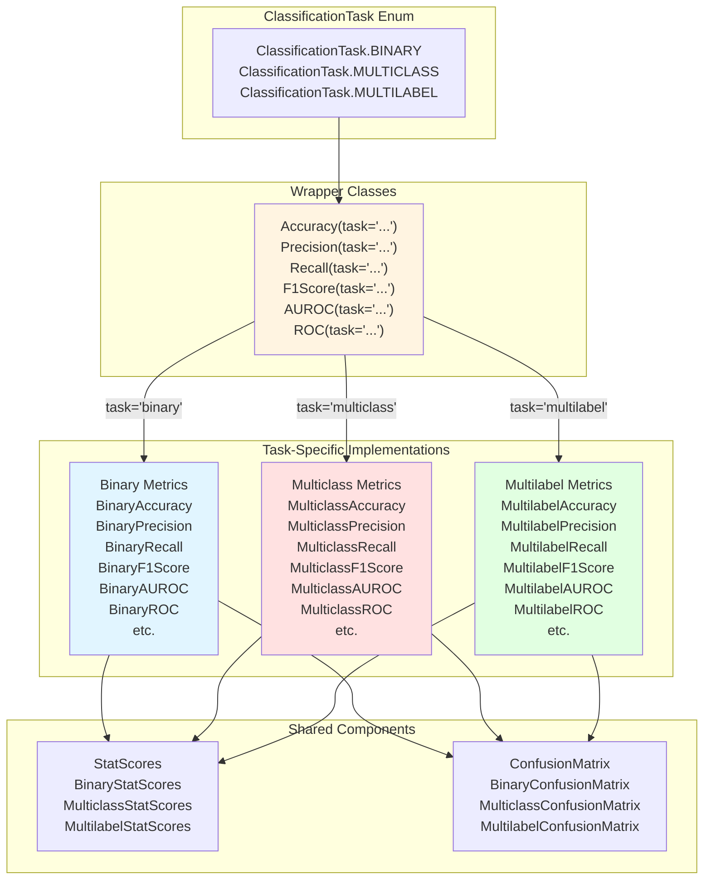
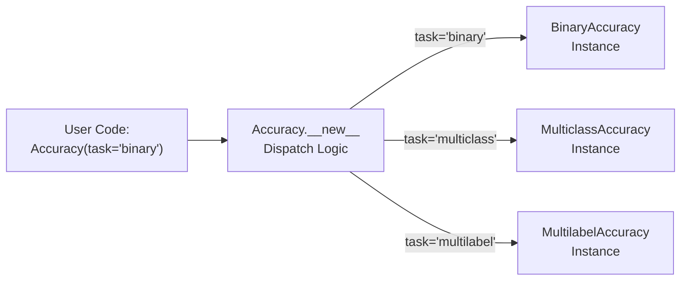
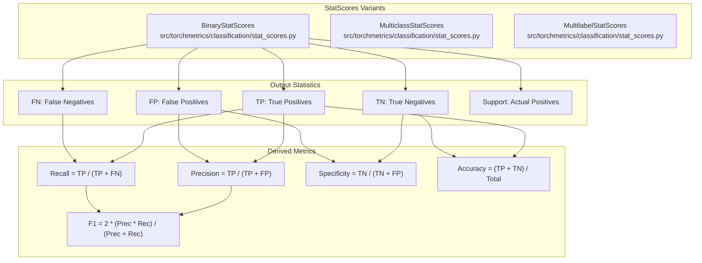
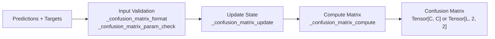
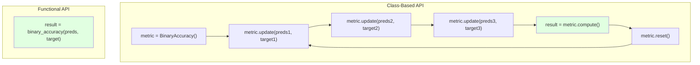

<!-- source: DeepWiki mcp.deepwiki.com · repo Lightning-AI/torchmetrics · page 3 Classification Metrics · fetched 2026-10-21 -->

# Classification Metrics

<details>
<summary>Relevant source files</summary>

The following files were used as context for generating this wiki page:

- [CHANGELOG.md](CHANGELOG.md)
- [docs/source/links.rst](docs/source/links.rst)
- [requirements/_doctest.txt](requirements/_doctest.txt)
- [requirements/_tests.txt](requirements/_tests.txt)
- [src/torchmetrics/__init__.py](src/torchmetrics/__init__.py)
- [src/torchmetrics/classification/__init__.py](src/torchmetrics/classification/__init__.py)
- [src/torchmetrics/functional/__init__.py](src/torchmetrics/functional/__init__.py)
- [src/torchmetrics/functional/classification/__init__.py](src/torchmetrics/functional/classification/__init__.py)
- [src/torchmetrics/functional/pairwise/__init__.py](src/torchmetrics/functional/pairwise/__init__.py)
- [src/torchmetrics/functional/regression/__init__.py](src/torchmetrics/functional/regression/__init__.py)
- [src/torchmetrics/regression/__init__.py](src/torchmetrics/regression/__init__.py)
- [tests/unittests/classification/test_sensitivity_specificity.py](tests/unittests/classification/test_sensitivity_specificity.py)

</details>


This page documents the classification metrics domain in TorchMetrics, which provides metrics for evaluating classification tasks. Classification metrics measure the quality of predictions in tasks where the goal is to assign discrete labels to inputs.

For information about regression metrics, see [Regression Metrics](#4). For detection/segmentation metrics, see [Detection and Segmentation Metrics](#8). For the core architecture underlying all metrics, see [Core Architecture](#2) and [Metric Base Class](#2.1).

## Purpose and Scope

The classification metrics domain provides over 40 metrics for three classification task types:

- **Binary Classification**: Two-class problems (positive/negative)
- **Multiclass Classification**: Multi-class problems with mutually exclusive classes
- **Multilabel Classification**: Multi-label problems where each sample can have multiple labels

Each metric is available in task-specific variants (e.g., `BinaryAccuracy`, `MulticlassAccuracy`, `MultilabelAccuracy`) and through a unified wrapper class that dispatches based on the `task` parameter (e.g., `Accuracy(task='binary')`).

## Task-Based Organization

### Architecture Overview

Classification metrics follow a strict task-based organization introduced in the v0.9.0-v1.0.0 refactor. This replaced the previous unified API that used conditional logic branches.

**Diagram: Classification Metric Organization**



Sources: [src/torchmetrics/classification/__init__.py:1-239](), [CHANGELOG.md:568-641]()

### ClassificationTask Enum

The `ClassificationTask` enum provides type-safe task identification. It is defined with three values: `BINARY`, `MULTICLASS`, and `MULTILABEL`. This enum is used internally by wrapper classes to dispatch to the correct task-specific implementation.

**Diagram: Task Dispatch Pattern**



Sources: [CHANGELOG.md:612](), [src/torchmetrics/__init__.py:56-82]()

## Classification Metrics by Category

### Basic Metrics (Accuracy, Precision, Recall, F-Score)

These fundamental metrics measure classification performance from different perspectives:

| Metric | Binary | Multiclass | Multilabel | Wrapper | Description |
|--------|--------|------------|------------|---------|-------------|
| Accuracy | `BinaryAccuracy` | `MulticlassAccuracy` | `MultilabelAccuracy` | `Accuracy` | Fraction of correct predictions |
| Precision | `BinaryPrecision` | `MulticlassPrecision` | `MultilabelPrecision` | `Precision` | True positives / predicted positives |
| Recall | `BinaryRecall` | `MulticlassRecall` | `MultilabelRecall` | `Recall` | True positives / actual positives |
| F1 Score | `BinaryF1Score` | `MulticlassF1Score` | `MultilabelF1Score` | `F1Score` | Harmonic mean of precision and recall |
| F-Beta Score | `BinaryFBetaScore` | `MulticlassFBetaScore` | `MultilabelFBetaScore` | `FBetaScore` | Weighted harmonic mean (configurable β) |
| Specificity | `BinarySpecificity` | `MulticlassSpecificity` | `MultilabelSpecificity` | `Specificity` | True negatives / actual negatives |

Sources: [src/torchmetrics/classification/__init__.py:14-88](), [src/torchmetrics/functional/classification/__init__.py:14-107]()

### Ranking and Curve Metrics

These metrics evaluate ranking quality or produce curves for threshold analysis:

| Metric | Binary | Multiclass | Multilabel | Wrapper | Description |
|--------|--------|------------|------------|---------|-------------|
| AUROC | `BinaryAUROC` | `MulticlassAUROC` | `MultilabelAUROC` | `AUROC` | Area under ROC curve |
| ROC | `BinaryROC` | `MulticlassROC` | `MultilabelROC` | `ROC` | Receiver operating characteristic curve |
| Average Precision | `BinaryAveragePrecision` | `MulticlassAveragePrecision` | `MultilabelAveragePrecision` | `AveragePrecision` | Area under precision-recall curve |
| PR Curve | `BinaryPrecisionRecallCurve` | `MulticlassPrecisionRecallCurve` | `MultilabelPrecisionRecallCurve` | `PrecisionRecallCurve` | Precision-recall curve |
| Log AUC | `BinaryLogAUC` | `MulticlassLogAUC` | `MultilabelLogAUC` | `LogAUC` | Area under log-scaled ROC curve |
| EER | `BinaryEER` | `MulticlassEER` | `MultilabelEER` | `EER` | Equal error rate |

Sources: [src/torchmetrics/classification/__init__.py:15-106](), [CHANGELOG.md:146-216]()

### Threshold-Dependent Metrics

These metrics find optimal thresholds based on specific criteria:

| Metric | Binary | Multiclass | Multilabel | Wrapper | Description |
|--------|--------|------------|------------|---------|-------------|
| Sensitivity at Specificity | `BinarySensitivityAtSpecificity` | `MulticlassSensitivityAtSpecificity` | `MultilabelSensitivityAtSpecificity` | `SensitivityAtSpecificity` | Maximum sensitivity at minimum specificity |
| Specificity at Sensitivity | `BinarySpecificityAtSensitivity` | `MulticlassSpecificityAtSensitivity` | `MultilabelSpecificityAtSensitivity` | `SpecificityAtSensitivity` | Maximum specificity at minimum sensitivity |
| Precision at Fixed Recall | `BinaryPrecisionAtFixedRecall` | `MulticlassPrecisionAtFixedRecall` | `MultilabelPrecisionAtFixedRecall` | `PrecisionAtFixedRecall` | Maximum precision at minimum recall |
| Recall at Fixed Precision | `BinaryRecallAtFixedPrecision` | `MulticlassRecallAtFixedPrecision` | `MultilabelRecallAtFixedPrecision` | `RecallAtFixedPrecision` | Maximum recall at minimum precision |

Sources: [src/torchmetrics/classification/__init__.py:73-124](), [CHANGELOG.md:346-620]()

### Agreement and Confusion Metrics

These metrics measure agreement between predictions and targets or provide detailed confusion information:

| Metric | Binary | Multiclass | Multilabel | Wrapper | Description |
|--------|--------|------------|------------|---------|-------------|
| Confusion Matrix | `BinaryConfusionMatrix` | `MulticlassConfusionMatrix` | `MultilabelConfusionMatrix` | `ConfusionMatrix` | Matrix of predicted vs actual classes |
| Cohen Kappa | `BinaryCohenKappa` | `MulticlassCohenKappa` | N/A | `CohenKappa` | Inter-rater agreement coefficient |
| Matthews Corr Coef | `BinaryMatthewsCorrCoef` | `MulticlassMatthewsCorrCoef` | `MultilabelMatthewsCorrCoef` | `MatthewsCorrCoef` | Correlation between predictions and targets |

Sources: [src/torchmetrics/classification/__init__.py:27-66]()

### Distance and Similarity Metrics

| Metric | Binary | Multiclass | Multilabel | Wrapper | Description |
|--------|--------|------------|------------|---------|-------------|
| Hamming Distance | `BinaryHammingDistance` | `MulticlassHammingDistance` | `MultilabelHammingDistance` | `HammingDistance` | Fraction of incorrect labels |
| Jaccard Index | `BinaryJaccardIndex` | `MulticlassJaccardIndex` | `MultilabelJaccardIndex` | `JaccardIndex` | Intersection over union |

Sources: [src/torchmetrics/classification/__init__.py:47-59]()

### Loss and Calibration Metrics

| Metric | Binary | Multiclass | Multilabel | Wrapper | Description |
|--------|--------|------------|------------|---------|-------------|
| Hinge Loss | `BinaryHingeLoss` | `MulticlassHingeLoss` | N/A | `HingeLoss` | Maximum margin classification loss |
| Calibration Error | `BinaryCalibrationError` | `MulticlassCalibrationError` | N/A | `CalibrationError` | Expected calibration error |

Sources: [src/torchmetrics/classification/__init__.py:22-53]()

### Specialized Metrics

| Metric | Binary | Multiclass | Multilabel | Wrapper | Description |
|--------|--------|------------|------------|---------|-------------|
| Exact Match | N/A | `MulticlassExactMatch` | `MultilabelExactMatch` | `ExactMatch` | Exact match ratio (all labels correct) |
| Negative Predictive Value | `BinaryNegativePredictiveValue` | `MulticlassNegativePredictiveValue` | `MultilabelNegativePredictiveValue` | `NegativePredictiveValue` | True negatives / predicted negatives |
| Group Fairness | `BinaryFairness`, `BinaryGroupStatRates` | N/A | N/A | N/A | Demographic parity and equal opportunity |
| Ranking Loss | N/A | N/A | `MultilabelRankingLoss` | N/A | Average label ranking loss |
| Coverage Error | N/A | N/A | `MultilabelCoverageError` | N/A | Average coverage error |
| Ranking Avg Precision | N/A | N/A | `MultilabelRankingAveragePrecision` | N/A | Label ranking average precision |

Sources: [src/torchmetrics/classification/__init__.py:35-99](), [CHANGELOG.md:604-627]()

## Common Components

### StatScores: The Foundation

`StatScores` is a shared component that computes true positives (TP), false positives (FP), true negatives (TN), false negatives (FN), and support for each class. Most classification metrics derive their values from these statistics.

**Diagram: StatScores Component Architecture**



Sources: [src/torchmetrics/classification/__init__.py:125-130](), [src/torchmetrics/functional/classification/__init__.py:144-149]()

### ConfusionMatrix

The confusion matrix provides a complete breakdown of predictions versus actual labels. For binary classification, it's a 2×2 matrix; for multiclass with N classes, it's an N×N matrix; for multilabel with L labels, it produces L separate 2×2 matrices.

**Diagram: ConfusionMatrix Computation Flow**



Sources: [src/torchmetrics/classification/__init__.py:28-33](), [CHANGELOG.md:205-396]()

## Dual API Pattern

Every classification metric implements both a class-based (stateful) and functional (stateless) interface.

**Example: Binary Accuracy**

Class-based API ([src/torchmetrics/classification/accuracy.py]()):
- `BinaryAccuracy`: Accumulates predictions over multiple batches
- Maintains internal state tensors
- Supports distributed training with automatic synchronization
- Call `update()` for each batch, `compute()` for final result

Functional API ([src/torchmetrics/functional/classification/accuracy.py]()):
- `binary_accuracy()`: One-shot computation
- No state maintenance
- Direct calculation from inputs
- Suitable for single-batch evaluation or custom accumulation logic

**Diagram: Dual API Usage Pattern**



Sources: [src/torchmetrics/classification/__init__.py:14](), [src/torchmetrics/functional/classification/__init__.py:14-19]()

## Key Parameters

### Binary Classification Parameters

- `threshold`: Decision threshold for converting probabilities to binary predictions (default: 0.5)
- `multidim_average`: How to aggregate multi-dimensional inputs (`'global'`, `'samplewise'`)
- `ignore_index`: Index to ignore in target during computation
- `validate_args`: Whether to validate input tensors (default: True)

### Multiclass Classification Parameters

- `num_classes`: Number of classes (required)
- `average`: Aggregation strategy (`'micro'`, `'macro'`, `'weighted'`, `None`)
  - `'micro'`: Calculate metrics globally across all samples and classes
  - `'macro'`: Calculate metrics for each class and average unweighted
  - `'weighted'`: Calculate metrics for each class and average weighted by support
  - `None`: Return per-class metrics
- `top_k`: Consider top-k predictions (default: 1)
- `multidim_average`: How to aggregate multi-dimensional inputs (`'global'`, `'samplewise'`)
- `ignore_index`: Class index to ignore during computation

### Multilabel Classification Parameters

- `num_labels`: Number of labels (required)
- `threshold`: Decision threshold for converting probabilities to binary labels (default: 0.5)
- `average`: Aggregation strategy (`'micro'`, `'macro'`, `'weighted'`, `None`)
- `multidim_average`: How to aggregate multi-dimensional inputs (`'global'`, `'samplewise'`)
- `ignore_index`: Label index to ignore during computation

Sources: [src/torchmetrics/classification/__init__.py:14-130]()

## Input Format Requirements

### Binary Classification

**Predictions:**
- Probabilities: `Tensor[N, ...]` with values in [0, 1]
- Logits: `Tensor[N, ...]` (automatically converted via sigmoid)
- Binary labels: `Tensor[N, ...]` with values in {0, 1}

**Targets:**
- `Tensor[N, ...]` with values in {0, 1}

### Multiclass Classification

**Predictions:**
- Probabilities: `Tensor[N, C, ...]` where C is num_classes, values sum to 1 along dim 1
- Logits: `Tensor[N, C, ...]` (automatically converted via softmax)
- Class indices: `Tensor[N, ...]` with values in {0, 1, ..., C-1}

**Targets:**
- `Tensor[N, ...]` with values in {0, 1, ..., C-1}

### Multilabel Classification

**Predictions:**
- Probabilities: `Tensor[N, L, ...]` where L is num_labels, values in [0, 1]
- Logits: `Tensor[N, L, ...]` (automatically converted via sigmoid)
- Binary labels: `Tensor[N, L, ...]` with values in {0, 1}

**Targets:**
- `Tensor[N, L, ...]` with values in {0, 1}

Sources: [tests/unittests/classification/test_sensitivity_specificity.py:77-84](), [tests/unittests/classification/test_sensitivity_specificity.py:195-209]()

## Migration from Pre-v1.0 API

Prior to v1.0.0, classification metrics used a unified API with conditional parameters like `is_multiclass`, `threshold`, and complex branching logic. The refactor improved type safety, clarity, and maintainability.

**Old API (deprecated):**
```python
# Pre-v1.0 (no longer recommended)
metric = Accuracy(threshold=0.5)  # Ambiguous task type
```

**New API (current):**
```python
# v1.0+ (task-explicit)
metric = BinaryAccuracy(threshold=0.5)
# OR
metric = Accuracy(task='binary', threshold=0.5)
```

**Migration table:**

| Old Pattern | New Pattern |
|-------------|-------------|
| `Accuracy(threshold=0.5)` | `BinaryAccuracy(threshold=0.5)` or `Accuracy(task='binary', threshold=0.5)` |
| `Accuracy(num_classes=10)` | `MulticlassAccuracy(num_classes=10)` or `Accuracy(task='multiclass', num_classes=10)` |
| `Accuracy(num_classes=5, threshold=0.5)` | `MultilabelAccuracy(num_labels=5, threshold=0.5)` or `Accuracy(task='multilabel', num_labels=5, threshold=0.5)` |

The wrapper classes (e.g., `Accuracy`, `Precision`) maintain backward compatibility by dispatching to task-specific implementations, but explicit task-specific classes are recommended for clarity and type safety.

Sources: [CHANGELOG.md:568-641](), [CHANGELOG.md:612]()

## Special Cases and Edge Handling

### Zero Division Handling

Many classification metrics can encounter division by zero when no positive predictions or no positive samples exist. Metrics handle this via:

- `zero_division` parameter: Controls what value to return (0, 1, or NaN) when division by zero occurs
- Available in: Precision, Recall, F-Beta, Specificity, and others

### Ignore Index

The `ignore_index` parameter allows excluding specific class/label indices from metric computation:

- Useful for handling padding tokens or unlabeled data
- Supported across most classification metrics
- Samples with target equal to `ignore_index` are filtered before computation

### Missing Classes

When using `average='macro'` or `average='weighted'` in multiclass settings, if certain classes are not present in the batch:

- The metric handles missing classes gracefully
- Averages are computed only over present classes
- `num_classes` parameter ensures all classes are tracked across batches

Sources: [CHANGELOG.md:354-369](), [CHANGELOG.md:182-188]()

## Performance Considerations

### Threshold Binning

For metrics that evaluate multiple thresholds (ROC, PR curves), `thresholds` parameter controls binning:

- `thresholds=None`: Uses all unique values in predictions (high memory for large datasets)
- `thresholds=100`: Uses 100 equally-spaced bins (memory efficient)
- `thresholds=[0.1, 0.5, 0.9]`: Uses specific thresholds

### Compute Groups

When using multiple classification metrics together via `MetricCollection`, the library optimizes computation by grouping metrics that share intermediate calculations (like StatScores), reducing redundant computation by 2-3x.

Sources: [tests/unittests/classification/test_sensitivity_specificity.py:182-193](), [CHANGELOG.md:332]()

---

