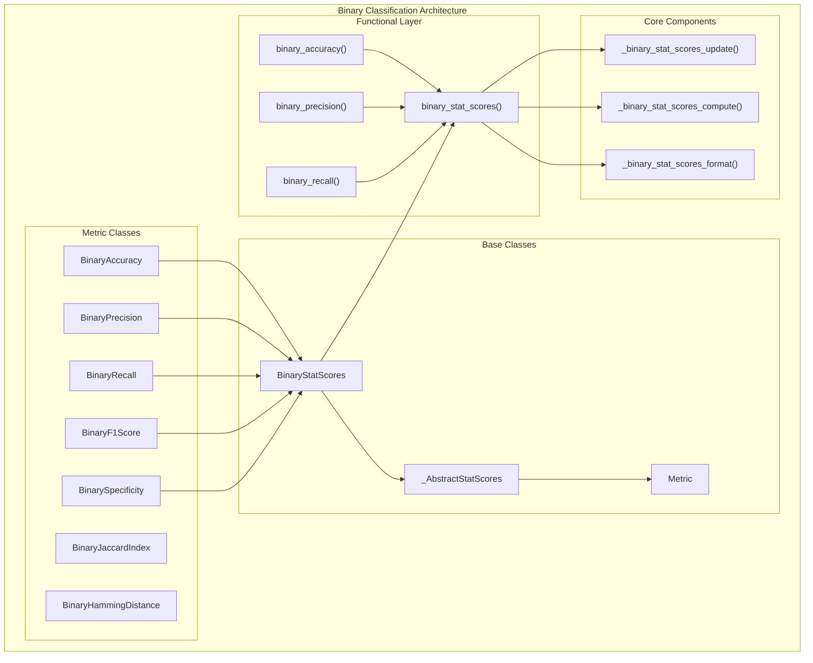
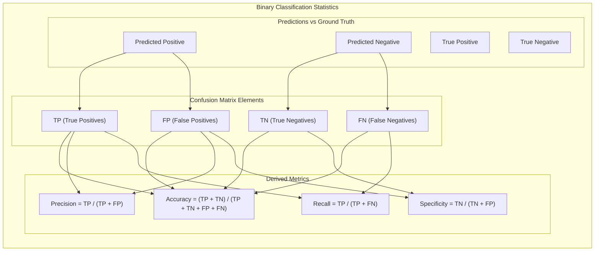
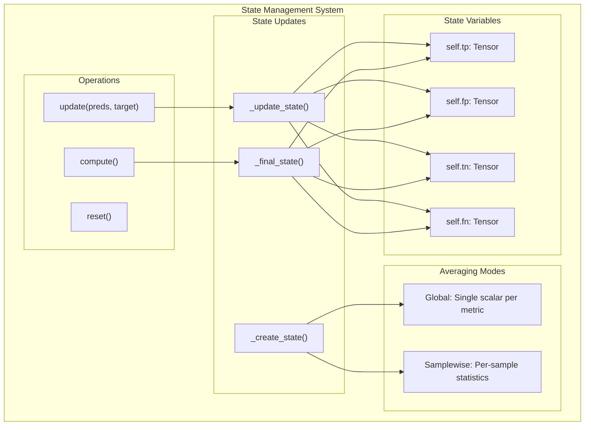
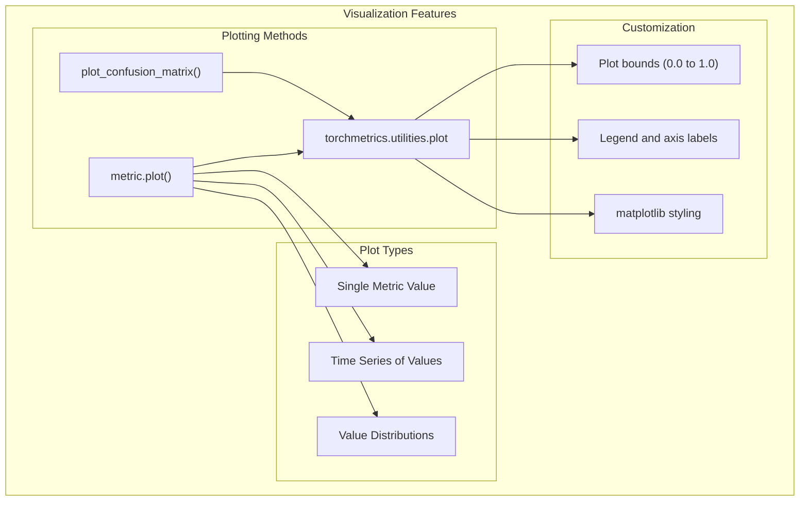

<!-- source: DeepWiki mcp.deepwiki.com · repo Lightning-AI/torchmetrics · page 3.2 Binary Classification Metrics · fetched 2026-10-21 -->

# Binary Classification Metrics

<details>
<summary>Relevant source files</summary>

The following files were used as context for generating this wiki page:

- [CHANGELOG.md](CHANGELOG.md)
- [docs/source/links.rst](docs/source/links.rst)
- [requirements/_doctest.txt](requirements/_doctest.txt)
- [requirements/_tests.txt](requirements/_tests.txt)
- [src/torchmetrics/__init__.py](src/torchmetrics/__init__.py)
- [src/torchmetrics/classification/__init__.py](src/torchmetrics/classification/__init__.py)
- [src/torchmetrics/functional/__init__.py](src/torchmetrics/functional/__init__.py)
- [src/torchmetrics/functional/classification/__init__.py](src/torchmetrics/functional/classification/__init__.py)
- [src/torchmetrics/functional/pairwise/__init__.py](src/torchmetrics/functional/pairwise/__init__.py)
- [src/torchmetrics/functional/regression/__init__.py](src/torchmetrics/functional/regression/__init__.py)
- [src/torchmetrics/regression/__init__.py](src/torchmetrics/regression/__init__.py)
- [tests/unittests/classification/test_sensitivity_specificity.py](tests/unittests/classification/test_sensitivity_specificity.py)

</details>


This page documents the binary classification metrics available in TorchMetrics, covering their architecture, implementation, and usage patterns. Binary classification metrics evaluate model performance on tasks with two classes (typically labeled as 0 and 1, negative and positive).

For multiclass classification metrics, see [Multiclass Classification Metrics](#3.2). For multilabel classification metrics, see [Multilabel Classification Metrics](#3.3). For classification curve metrics like ROC and Precision-Recall curves, see [Classification Curves](#3.4).

## Architecture Overview

Binary classification metrics in TorchMetrics follow a layered architecture built around fundamental statistical measures: true positives (TP), false positives (FP), true negatives (TN), and false negatives (FN).



**Sources:** [src/torchmetrics/classification/stat_scores.py:91-196](), [src/torchmetrics/classification/accuracy.py:32-150](), [src/torchmetrics/classification/precision_recall.py:41-169](), [src/torchmetrics/functional/classification/stat_scores.py:144-217]()

## Core Statistical Foundation

All binary classification metrics are built upon `BinaryStatScores`, which computes the four fundamental statistics of binary classification:



**Sources:** [src/torchmetrics/classification/stat_scores.py:91-196](), [src/torchmetrics/functional/classification/stat_scores.py:123-141]()

## Available Binary Metrics

### Primary Metrics

| Metric | Class | Functional | Formula | Range |
|--------|-------|------------|---------|-------|
| Accuracy | `BinaryAccuracy` | `binary_accuracy` | (TP + TN) / (TP + TN + FP + FN) | [0, 1] |
| Precision | `BinaryPrecision` | `binary_precision` | TP / (TP + FP) | [0, 1] |
| Recall | `BinaryRecall` | `binary_recall` | TP / (TP + FN) | [0, 1] |
| F1-Score | `BinaryF1Score` | `binary_f1_score` | 2 × (Precision × Recall) / (Precision + Recall) | [0, 1] |
| Specificity | `BinarySpecificity` | `binary_specificity` | TN / (TN + FP) | [0, 1] |

### Advanced Metrics

| Metric | Class | Functional | Description |
|--------|-------|------------|-------------|
| F-Beta Score | `BinaryFBetaScore` | `binary_fbeta_score` | Weighted harmonic mean of precision and recall |
| Jaccard Index | `BinaryJaccardIndex` | `binary_jaccard_index` | Intersection over Union (IoU) |
| Hamming Distance | `BinaryHammingDistance` | `binary_hamming_distance` | Fraction of incorrect predictions |
| Statistical Scores | `BinaryStatScores` | `binary_stat_scores` | Returns [TP, FP, TN, FN, Support] |

**Sources:** [src/torchmetrics/classification/accuracy.py:32-108](), [src/torchmetrics/classification/precision_recall.py:41-169](), [src/torchmetrics/classification/f_beta.py:44-149](), [src/torchmetrics/classification/specificity.py:32-147]()

## Implementation Details

### Input Handling and Preprocessing

Binary metrics accept two types of prediction inputs, with automatic preprocessing:

```mermaid
graph TB
    subgraph "Input Processing Pipeline"
        InputPreds["Input Predictions"]
        InputTargets["Input Targets"]
        
        subgraph "Prediction Types"
            IntPreds["Integer Tensor (0, 1)"]
            FloatPreds["Float Tensor (probabilities/logits)"]
        end
        
        subgraph "Preprocessing Steps"
            SigmoidCheck["Check if logits (outside [0,1])"]
            ApplySigmoid["Apply sigmoid if needed"]
            Threshold["Apply threshold (default 0.5)"]
            ToInt["Convert to integer labels"]
        end
        
        subgraph "Validation"
            ShapeCheck["Check tensor shapes match"]
            ValueCheck["Validate target values {0, 1}"]
            IgnoreIndex["Handle ignore_index"]
        end
        
        StatComputation["Statistics Computation"]
    end
    
    InputPreds --> IntPreds
    InputPreds --> FloatPreds
    
    FloatPreds --> SigmoidCheck
    SigmoidCheck --> ApplySigmoid
    ApplySigmoid --> Threshold
    Threshold --> ToInt
    
    IntPreds --> ShapeCheck
    ToInt --> ShapeCheck
    InputTargets --> ShapeCheck
    
    ShapeCheck --> ValueCheck
    ValueCheck --> IgnoreIndex
    IgnoreIndex --> StatComputation
```



**Sources:** [src/torchmetrics/functional/classification/stat_scores.py:95-120](), [src/torchmetrics/functional/classification/stat_scores.py:53-92]()

### State Management

The `BinaryStatScores` class manages metric state for incremental computation:



**Sources:** [src/torchmetrics/classification/stat_scores.py:43-88](), [src/torchmetrics/classification/stat_scores.py:184-195]()

## Configuration Options

### Common Parameters

All binary classification metrics support these configuration parameters:

| Parameter | Type | Default | Description |
|-----------|------|---------|-------------|
| `threshold` | `float` | 0.5 | Threshold for converting probabilities to binary predictions |
| `multidim_average` | `str` | "global" | How to handle additional dimensions: "global" or "samplewise" |
| `ignore_index` | `int` | None | Target value to ignore in metric calculation |
| `validate_args` | `bool` | True | Whether to validate input arguments and tensors |

### Metric-Specific Parameters

| Metric | Additional Parameters |
|--------|--------------------|
| `BinaryFBetaScore` | `beta: float` - Weighting between precision and recall |
| `BinaryFBetaScore` | `zero_division: float` - Value when TP + FP = 0 and TP + FN = 0 |
| `BinaryJaccardIndex` | `zero_division: float` - Value when intersection and union are both zero |

**Sources:** [src/torchmetrics/classification/stat_scores.py:164-182](), [src/torchmetrics/classification/f_beta.py:125-144]()

## Usage Patterns

### Basic Stateful Usage

```python
# Class-based usage with state accumulation
from torchmetrics.classification import BinaryAccuracy, BinaryPrecision

# Initialize metrics
accuracy = BinaryAccuracy()
precision = BinaryPrecision(threshold=0.7)

# Update with batches
for batch_preds, batch_targets in dataloader:
    accuracy.update(batch_preds, batch_targets)
    precision.update(batch_preds, batch_targets)

# Compute final scores
final_accuracy = accuracy.compute()
final_precision = precision.compute()
```

### Functional Usage

```python
# Stateless functional usage
from torchmetrics.functional.classification import binary_accuracy, binary_precision

# Direct computation
acc = binary_accuracy(preds, targets, threshold=0.5)
prec = binary_precision(preds, targets, threshold=0.5)
```

### Advanced Configuration

```python
# Samplewise averaging for per-sample metrics
metric = BinaryAccuracy(multidim_average='samplewise')

# Ignore specific target values
metric = BinaryPrecision(ignore_index=-1)

# Custom thresholding
metric = BinaryRecall(threshold=0.8)
```

**Sources:** [src/torchmetrics/classification/accuracy.py:70-95](), [src/torchmetrics/functional/classification/accuracy.py:91-144]()

## Visualization Support

Binary classification metrics include built-in plotting capabilities:



**Sources:** [src/torchmetrics/classification/accuracy.py:109-149](), [src/torchmetrics/utilities/plot.py:64-172](), [src/torchmetrics/utilities/plot.py:219-293]()

---

