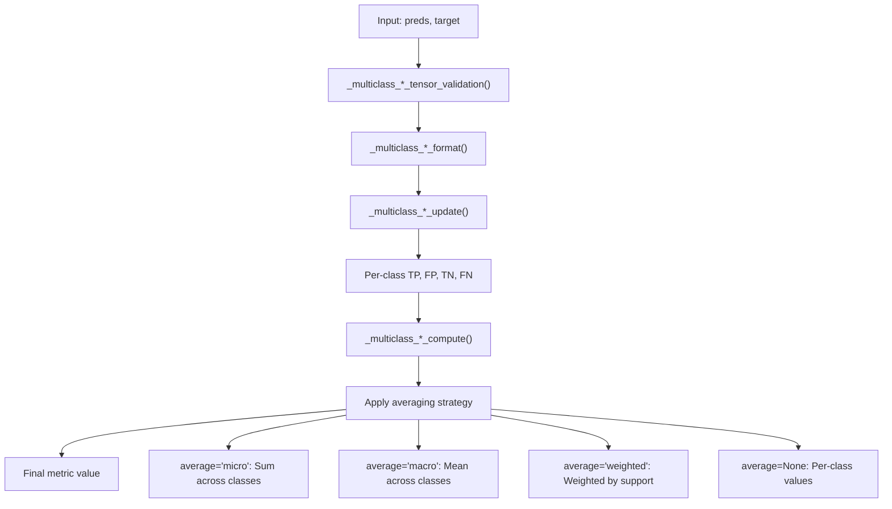
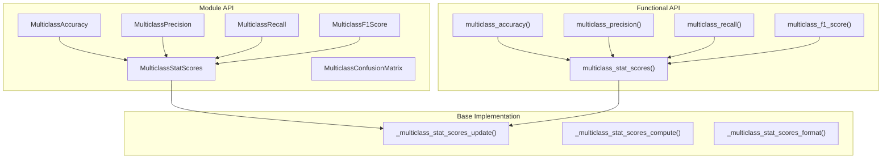
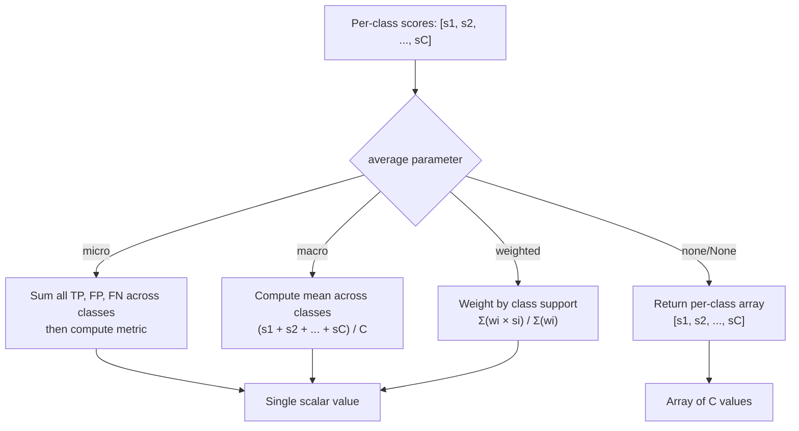
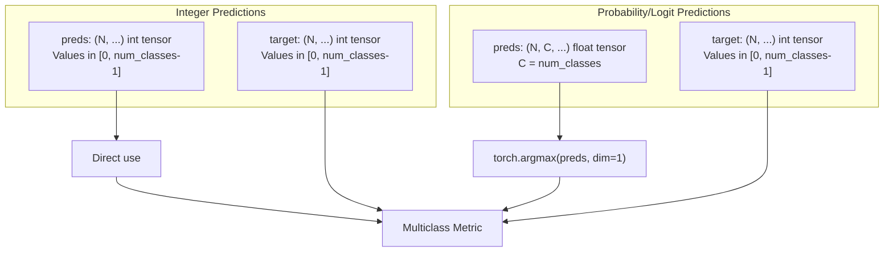
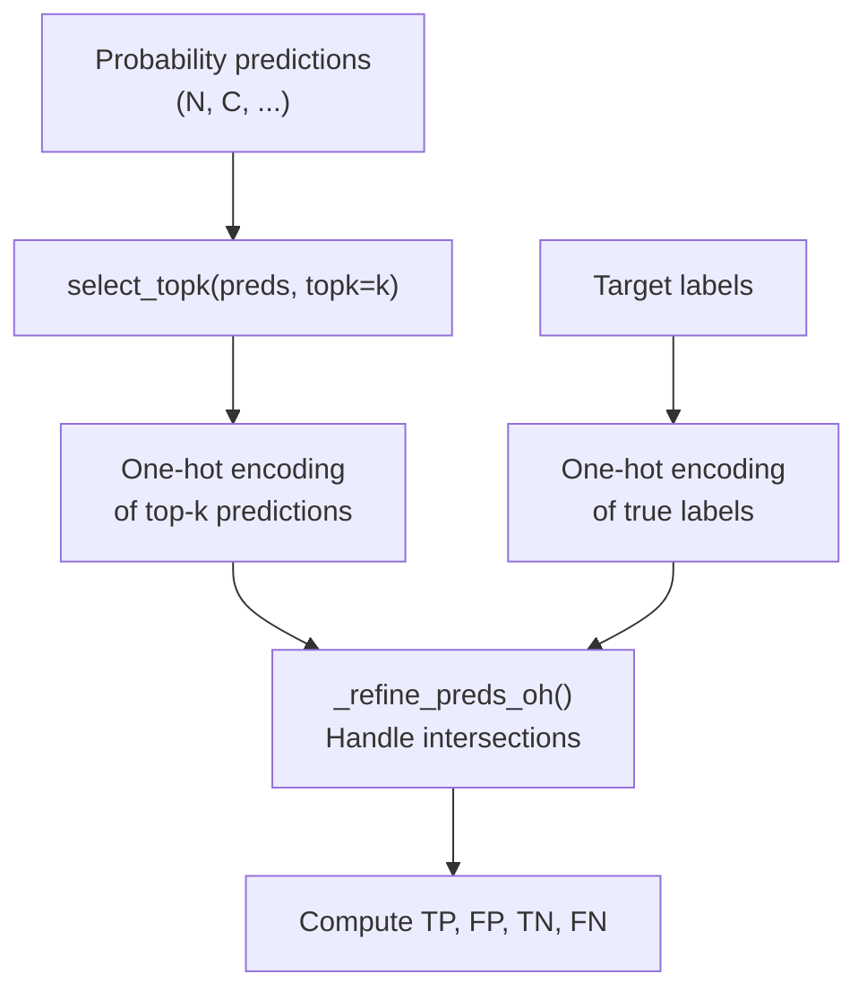

<!-- source: DeepWiki mcp.deepwiki.com · repo Lightning-AI/torchmetrics · page 3.3 Multiclass Classification Metrics · fetched 2026-10-21 -->

# Multiclass Classification Metrics

Relevant source files

The following files were used as context for generating this wiki page:

- [CHANGELOG.md](CHANGELOG.md)
- [docs/source/links.rst](docs/source/links.rst)
- [src/torchmetrics/__init__.py](src/torchmetrics/__init__.py)
- [src/torchmetrics/classification/__init__.py](src/torchmetrics/classification/__init__.py)
- [src/torchmetrics/functional/__init__.py](src/torchmetrics/functional/__init__.py)
- [src/torchmetrics/functional/classification/__init__.py](src/torchmetrics/functional/classification/__init__.py)
- [src/torchmetrics/functional/pairwise/__init__.py](src/torchmetrics/functional/pairwise/__init__.py)
- [src/torchmetrics/functional/regression/__init__.py](src/torchmetrics/functional/regression/__init__.py)
- [src/torchmetrics/regression/__init__.py](src/torchmetrics/regression/__init__.py)

This page covers metrics designed for multiclass classification tasks where each sample belongs to exactly one of multiple classes (3 or more classes). These metrics support various averaging strategies to aggregate results across classes and provide both module-based (stateful) and functional (stateless) implementations.

For binary classification metrics, see [Binary Classification Metrics](#3.1). For multilabel classification where samples can belong to multiple classes simultaneously, see [Multilabel Classification Metrics](#3.3).

## Core Architecture

Multiclass classification metrics in TorchMetrics follow a unified architecture built around statistical scores (true positives, false positives, true negatives, false negatives) that are computed per class and then aggregated according to specified averaging strategies.

### Multiclass Metric Computation Flow

Sources: [src/torchmetrics/functional/classification/stat_scores.py:328-594](), [src/torchmetrics/classification/stat_scores.py:308-353]()

### Core Classes and Functions

Sources: [src/torchmetrics/classification/stat_scores.py:198-353](), [src/torchmetrics/classification/accuracy.py:152-305](), [src/torchmetrics/functional/classification/stat_scores.py:483-594]()

## Available Multiclass Metrics

### Statistical Score Metrics

| Metric Class | Functional | Purpose |
|--------------|------------|---------|
| `MulticlassStatScores` | `multiclass_stat_scores` | Computes TP, FP, TN, FN, support for each class |
| `MulticlassAccuracy` | `multiclass_accuracy` | Fraction of correctly classified samples |
| `MulticlassPrecision` | `multiclass_precision` | TP / (TP + FP) per class |
| `MulticlassRecall` | `multiclass_recall` | TP / (TP + FN) per class |
| `MulticlassF1Score` | `multiclass_f1_score` | Harmonic mean of precision and recall |

Sources: [src/torchmetrics/classification/stat_scores.py:198-353](), [src/torchmetrics/classification/accuracy.py:152-305](), [src/torchmetrics/classification/precision_recall.py:172-612]()

### Additional Multiclass Metrics

| Metric Class | Functional | Purpose |
|--------------|------------|---------|
| `MulticlassConfusionMatrix` | `multiclass_confusion_matrix` | NxN matrix showing true vs predicted labels |
| `MulticlassSpecificity` | `multiclass_specificity` | TN / (TN + FP) per class |
| `MulticlassJaccardIndex` | `multiclass_jaccard_index` | Intersection over Union per class |

Sources: [src/torchmetrics/classification/confusion_matrix.py:191-378](), [src/torchmetrics/classification/specificity.py:150-451]()

## Averaging Strategies

Multiclass metrics support four averaging strategies controlled by the `average` parameter:

### Averaging Strategy Details

Sources: [src/torchmetrics/functional/classification/stat_scores.py:454-481]()

### Implementation Details

- **Micro**: Aggregates statistics globally across all classes before computing the metric
- **Macro**: Computes metric for each class independently, then averages (equal weight per class)
- **Weighted**: Like macro, but weights each class by its support (number of true instances)
- **None**: Returns the metric value for each class without reduction

Sources: [src/torchmetrics/functional/classification/stat_scores.py:469-479]()

## Input and Output Formats

### Input Tensor Formats

Multiclass metrics accept two input tensor formats:

Sources: [src/torchmetrics/functional/classification/stat_scores.py:264-326]()

### Output Shapes

Output tensor shapes depend on `average` and `multidim_average` parameters:

| `multidim_average` | `average` | Output Shape |
|-------------------|-----------|--------------|
| `"global"` | `"micro"/"macro"/"weighted"` | `()` (scalar) |
| `"global"` | `None/"none"` | `(C,)` where C = num_classes |
| `"samplewise"` | `"micro"/"macro"/"weighted"` | `(N,)` where N = batch size |
| `"samplewise"` | `None/"none"` | `(N, C)` |

Sources: [src/torchmetrics/classification/stat_scores.py:215-226]()

## Key Parameters

### Required Parameters

- `num_classes`: Integer specifying the number of classes in the classification task

### Optional Parameters

- `average`: Averaging strategy (`"micro"`, `"macro"`, `"weighted"`, `None`)
- `top_k`: Number of highest probability predictions to consider (for probability inputs)
- `multidim_average`: How to handle additional dimensions (`"global"`, `"samplewise"`)
- `ignore_index`: Target value to ignore in metric calculation
- `validate_args`: Whether to validate input arguments and tensors

Sources: [src/torchmetrics/classification/stat_scores.py:230-253]()

## Top-K Classification

Multiclass metrics support top-k evaluation where a prediction is considered correct if the true class is among the top-k highest probability predictions:

### Top-K Implementation

Sources: [src/torchmetrics/functional/classification/stat_scores.py:347-371](), [src/torchmetrics/functional/classification/stat_scores.py:402-404]()

The `_refine_preds_oh` function handles cases where the true label intersects with top-k predictions, ensuring accurate statistical computation.

Sources: [src/torchmetrics/functional/classification/stat_scores.py:347-371]()

---

