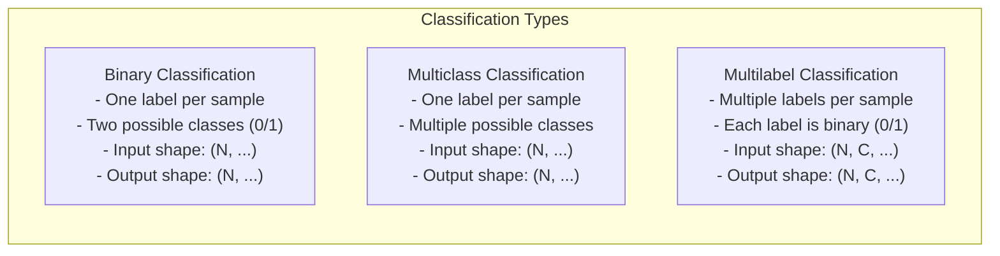
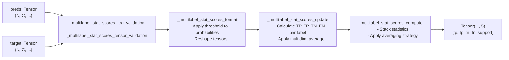
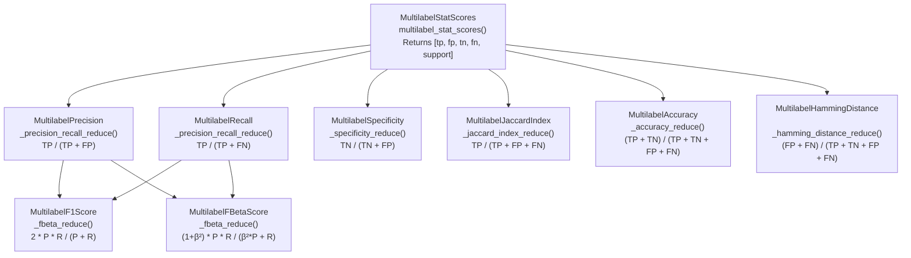
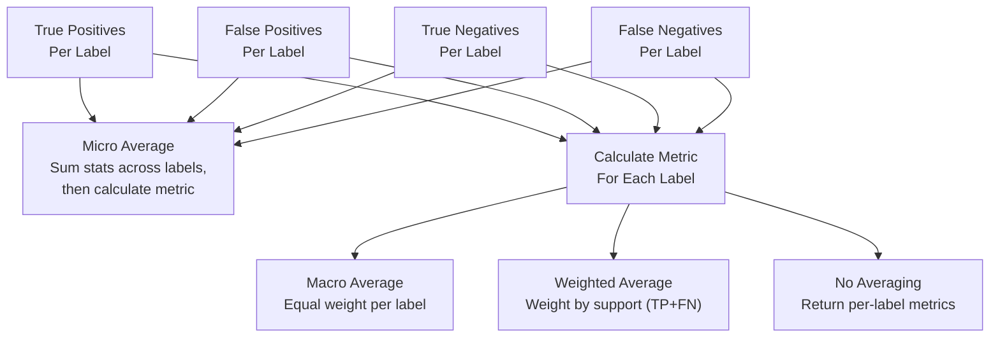
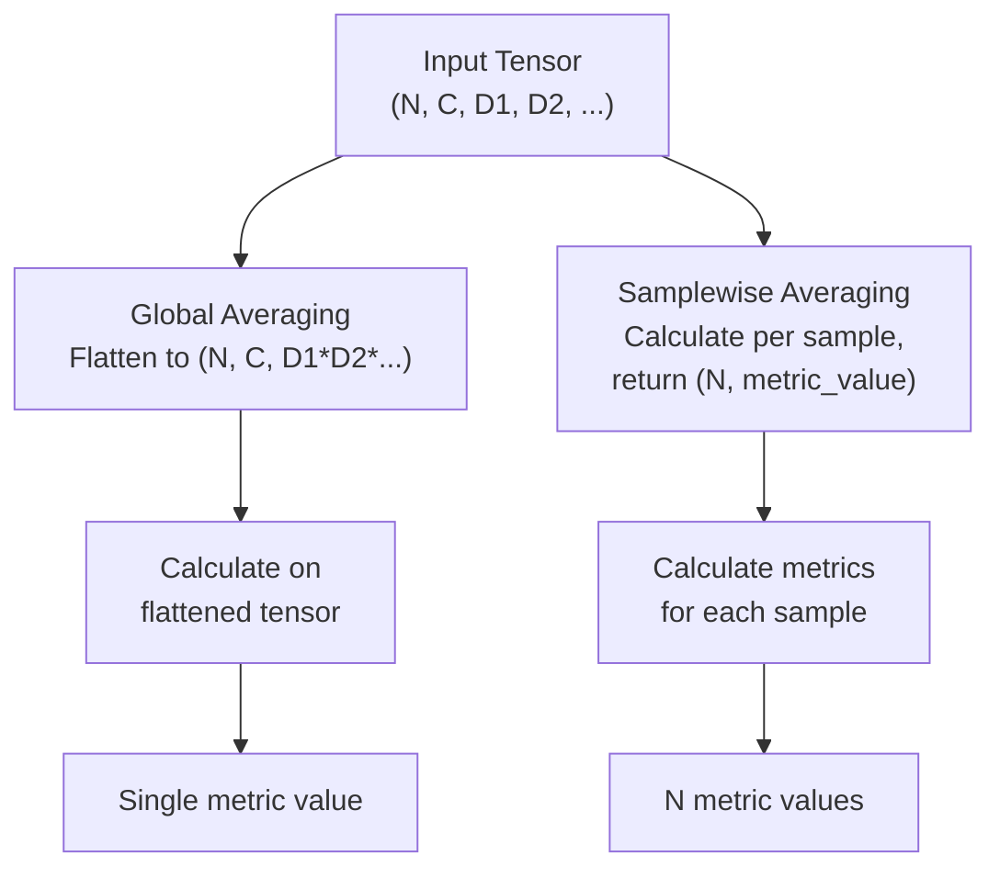

<!-- source: DeepWiki mcp.deepwiki.com · repo Lightning-AI/torchmetrics · page 3.4 Multilabel Classification Metrics · fetched 2026-10-21 -->

# Multilabel Classification Metrics

<details>
<summary>Relevant source files</summary>

The following files were used as context for generating this wiki page:

- [CHANGELOG.md](CHANGELOG.md)
- [docs/source/links.rst](docs/source/links.rst)
- [src/torchmetrics/__init__.py](src/torchmetrics/__init__.py)
- [src/torchmetrics/classification/__init__.py](src/torchmetrics/classification/__init__.py)
- [src/torchmetrics/functional/__init__.py](src/torchmetrics/functional/__init__.py)
- [src/torchmetrics/functional/classification/__init__.py](src/torchmetrics/functional/classification/__init__.py)
- [src/torchmetrics/functional/pairwise/__init__.py](src/torchmetrics/functional/pairwise/__init__.py)
- [src/torchmetrics/functional/regression/__init__.py](src/torchmetrics/functional/regression/__init__.py)
- [src/torchmetrics/regression/__init__.py](src/torchmetrics/regression/__init__.py)

</details>


This document covers the multilabel classification metrics available in TorchMetrics. Unlike binary classification (where each sample belongs to one of two classes) or multiclass classification (where each sample belongs to exactly one of multiple classes), multilabel classification allows samples to belong to multiple classes simultaneously. For example, an image might contain both a dog and a car, or a text document might be about both science and politics.

For binary classification metrics, see [Binary Classification Metrics](#3.1), and for multiclass classification metrics, see [Multiclass Classification Metrics](#3.2).

## Understanding Multilabel Classification

Multilabel classification deals with predicting multiple binary labels for each sample:



Sources: [src/torchmetrics/functional/classification/stat_scores.py:242-337](). [src/torchmetrics/functional/classification/jaccard.py:254-344]()

## Metric Calculation Process

Multilabel metrics follow a consistent pattern in their implementation:



Sources: [src/torchmetrics/functional/classification/stat_scores.py:597-743](). [src/torchmetrics/utilities/compute.py:49-82]()

## Available Multilabel Metrics

TorchMetrics provides a comprehensive suite of metrics for evaluating multilabel classification models:

| Category | Metrics |
|----------|---------|
| Basic | MultilabelAccuracy, MultilabelPrecision, MultilabelRecall, MultilabelSpecificity |
| Composite | MultilabelF1Score, MultilabelFBetaScore, MultilabelJaccardIndex |
| Error | MultilabelHammingDistance, MultilabelEER |
| Matrix | MultilabelConfusionMatrix, MultilabelMatthewsCorrCoef |
| Curve-based | MultilabelROC, MultilabelPrecisionRecallCurve, MultilabelAUROC, MultilabelLogAUC |
| Advanced | MultilabelAveragePrecision, MultilabelCoverageError, MultilabelRankingAveragePrecision, MultilabelRankingLoss |
| Threshold-adaptive | MultilabelPrecisionAtFixedRecall, MultilabelRecallAtFixedPrecision, MultilabelSensitivityAtSpecificity, MultilabelSpecificityAtSensitivity |

Sources: [src/torchmetrics/classification/__init__.py:202-227](). [src/torchmetrics/functional/classification/__init__.py:222-246]()

## Metric Hierarchy

Most multilabel metrics build upon the fundamental statistical scores:



Sources: [src/torchmetrics/classification/stat_scores.py:355-500](). [src/torchmetrics/functional/classification/stat_scores.py:746-755]()

## Key Parameters

Multilabel metrics typically accept the following parameters:

| Parameter | Description |
|-----------|-------------|
| `preds` | Tensor with predictions, shape `(N, C, ...)`. Can be probabilities (requiring thresholding) or binary values. |
| `target` | Tensor with target values, shape `(N, C, ...)`. Contains binary values (0 or 1). |
| `num_labels` | Integer specifying the number of labels (C). |
| `threshold` | Float threshold for converting probabilities to binary predictions (default: 0.5). |
| `average` | Method for averaging results across labels: "micro", "macro", "weighted", or "none". |
| `multidim_average` | How to handle additional dimensions: "global" (flatten) or "samplewise" (per-sample). |
| `ignore_index` | Optional target value to ignore in calculations. |
| `validate_args` | Bool indicating if input arguments should be validated for correctness (default: True). |
| `zero_division` | Value to return when division by zero occurs (0 or 1). Available for derived metrics like precision/recall. |

Sources: [src/torchmetrics/functional/classification/stat_scores.py:746-755](). [src/torchmetrics/functional/classification/precision_recall.py:502-515]()

## Averaging Methods

Multilabel metrics support multiple averaging strategies:

1. **micro**: Calculate metrics globally by aggregating statistics across all labels
2. **macro**: Calculate metrics for each label independently and then average (equal weight per label)
3. **weighted**: Calculate metrics for each label and average weighted by support (number of true instances)
4. **none**: Calculate metrics for each label independently without averaging



Sources: [src/torchmetrics/functional/classification/stat_scores.py:454-480](). [src/torchmetrics/utilities/compute.py:81-93]()

## Usage Examples

### Using the Module-based Interface

```python
import torch
from torchmetrics.classification import MultilabelF1Score

# Initialize the metric
metric = MultilabelF1Score(num_labels=3, average="macro")

# Add batches of predictions and targets
preds = torch.tensor([[0.9, 0.2, 0.7], [0.2, 0.8, 0.3]])  # Shape: (2, 3)
target = torch.tensor([[1, 0, 1], [0, 1, 0]])  # Shape: (2, 3)
metric.update(preds, target)

# Compute the metric
result = metric.compute()  # Macro-averaged F1 score
```

### Using the Functional Interface

```python
import torch
from torchmetrics.functional.classification import multilabel_f1_score

# Generate predictions and targets
preds = torch.tensor([[0.9, 0.2, 0.7], [0.2, 0.8, 0.3]])  # Shape: (2, 3)
target = torch.tensor([[1, 0, 1], [0, 1, 0]])  # Shape: (2, 3)

# Calculate the metric directly
result = multilabel_f1_score(
    preds=preds,
    target=target,
    num_labels=3,
    threshold=0.5,
    average="macro"
)
```

Sources: [tests/unittests/classification/test_f_beta.py:456-632](). [tests/unittests/classification/test_jaccard.py:325-471]()

## Handling Multidimensional Inputs

Multilabel metrics can handle inputs with additional dimensions beyond the batch and label dimensions through the `multidim_average` parameter:

1. **global**: Flatten all additional dimensions, treating the input as one large batch
2. **samplewise**: Calculate metrics independently for each sample in the batch



Sources: [src/torchmetrics/functional/classification/stat_scores.py:123-134](). [tests/unittests/classification/test_precision_recall.py:95-105]()


## Integration with PyTorch Lightning

Multilabel metrics can be easily integrated with PyTorch Lightning for automatic metric calculation and logging:

```python
import pytorch_lightning as pl
from torchmetrics.classification import MultilabelPrecision, MultilabelRecall, MultilabelF1Score

class MultiLabelClassifier(pl.LightningModule):
    def __init__(self):
        super().__init__()
        self.model = ...  # Your multilabel classification model
        
        # Initialize metrics
        self.train_precision = MultilabelPrecision(num_labels=10)
        self.train_recall = MultilabelRecall(num_labels=10)
        self.train_f1 = MultilabelF1Score(num_labels=10)
        
        # Same metrics for validation
        self.val_precision = MultilabelPrecision(num_labels=10)
        self.val_recall = MultilabelRecall(num_labels=10)
        self.val_f1 = MultilabelF1Score(num_labels=10)
    
    def training_step(self, batch, batch_idx):
        x, y = batch
        y_hat = self.model(x)
        loss = self.criterion(y_hat, y)
        
        # Update and log metrics
        self.train_precision(y_hat, y)
        self.train_recall(y_hat, y)
        self.train_f1(y_hat, y)
        
        self.log('train_precision', self.train_precision, on_step=False, on_epoch=True)
        self.log('train_recall', self.train_recall, on_step=False, on_epoch=True)
        self.log('train_f1', self.train_f1, on_step=False, on_epoch=True)
        
        return loss
```

Sources: [src/torchmetrics/__init__.py:56-81](). [src/torchmetrics/metric.py:100-135]()

## Implementation Details

### MultilabelStatScores

The foundation of most multilabel metrics is the `multilabel_stat_scores` function, which calculates true positives, false positives, true negatives, false negatives, and support:

```python
def multilabel_stat_scores(
    preds: Tensor,
    target: Tensor,
    num_labels: int,
    threshold: float = 0.5,
    average: Optional[Literal["micro", "macro", "weighted", "none"]] = "macro",
    multidim_average: Literal["global", "samplewise"] = "global",
    ignore_index: Optional[int] = None,
    validate_args: bool = True,
) -> Tensor:
    # Implementation details...
```

This function implements the standard multilabel metric calculation pipeline:
1. `_multilabel_stat_scores_arg_validation` - Validates non-tensor arguments
2. `_multilabel_stat_scores_tensor_validation` - Validates tensor shapes and values
3. `_multilabel_stat_scores_format` - Applies thresholding and reshapes tensors
4. `_multilabel_stat_scores_update` - Computes TP, FP, TN, FN for each label
5. `_multilabel_stat_scores_compute` - Stacks results and applies averaging

The output is a tensor of shape `(..., 5)`, where the last dimension contains `[TP, FP, TN, FN, support]`.

Sources: [src/torchmetrics/functional/classification/stat_scores.py:746-755](). [src/torchmetrics/functional/classification/stat_scores.py:597-743]()

### Safe Division and Zero Division Handling

Metrics that involve division (precision, recall, etc.) use the `_safe_divide` utility function to handle cases where the denominator might be zero:

```python
def _safe_divide(
    num: Tensor,
    denom: Tensor,
    zero_division: float = 0.0,
) -> Tensor:
    # Return num / denom, but replace NaN with zero_division value
    # Implementation details...
```

This function ensures that metrics are well-defined even when the denominator is zero, using the `zero_division` parameter (typically 0 or 1) as the fallback value.

Sources: [src/torchmetrics/utilities/compute.py:49-79](). [tests/unittests/classification/test_precision_recall.py:96-126]()

## Conclusion

Multilabel classification metrics in TorchMetrics provide a comprehensive toolkit for evaluating models that predict multiple binary labels per sample. These metrics follow a consistent implementation pattern, build on core statistical measures, and offer flexibility through various averaging methods and configuration options.

By understanding the available metrics and their usage patterns, you can effectively evaluate and improve your multilabel classification models within the PyTorch and PyTorch Lightning ecosystems.

---

