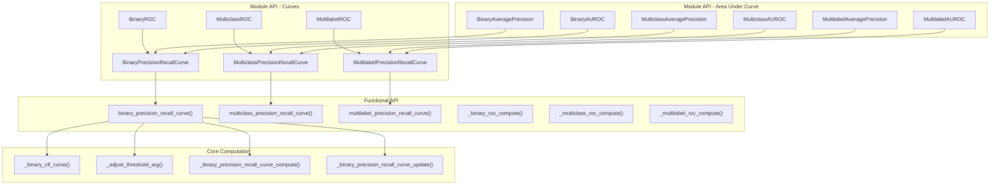
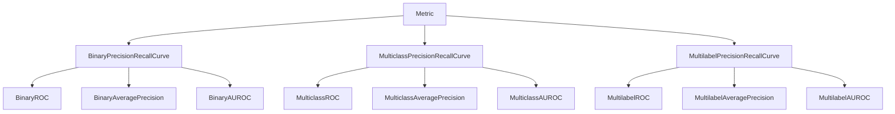

<!-- source: DeepWiki mcp.deepwiki.com · repo Lightning-AI/torchmetrics · page 3.5 Classification Curves and Thresholds · fetched 2026-10-21 -->

# Classification Curves and Thresholds

<details>
<summary>Relevant source files</summary>

The following files were used as context for generating this wiki page:

- [CHANGELOG.md](CHANGELOG.md)
- [requirements/_doctest.txt](requirements/_doctest.txt)
- [requirements/_tests.txt](requirements/_tests.txt)
- [tests/unittests/classification/test_sensitivity_specificity.py](tests/unittests/classification/test_sensitivity_specificity.py)

</details>


This document covers curve-based classification metrics and threshold-dependent metrics in TorchMetrics. These metrics evaluate model performance across different decision thresholds by either generating curves showing tradeoffs between performance measures or finding optimal thresholds based on specific constraints.

For basic classification metrics like accuracy and F1-score, see [Binary Classification Metrics](#3.1), [Multiclass Classification Metrics](#3.2), and [Multilabel Classification Metrics](#3.3).

## Overview

Classification curves and threshold-based metrics provide comprehensive performance evaluation by analyzing model behavior across decision thresholds. TorchMetrics implements several categories:

- **Precision-Recall (PR) Curves**: Show the tradeoff between precision and recall
- **Receiver Operating Characteristic (ROC) Curves**: Show the tradeoff between true positive rate and false positive rate
- **Calibration Metrics**: Measure reliability of predicted probabilities
- **Threshold-Constrained Metrics**: Find optimal thresholds subject to constraints (e.g., SensitivityAtSpecificity)

Each metric type supports binary, multiclass, and multilabel classification tasks with both memory-efficient binned implementations and accurate non-binned implementations.

## Architecture

### Curve Metrics System Architecture



Sources: [src/torchmetrics/classification/precision_recall_curve.py:1-629](), [src/torchmetrics/classification/roc.py:1-617](), [src/torchmetrics/classification/average_precision.py:1-487](), [src/torchmetrics/classification/auroc.py:1-457]()

### Inheritance Hierarchy



Sources: [src/torchmetrics/classification/roc.py:42-175](), [src/torchmetrics/classification/average_precision.py:47-163](), [src/torchmetrics/classification/auroc.py:44-169]()

## Precision-Recall Curves

Precision-Recall curves show the tradeoff between precision and recall at different classification thresholds. The curve consists of multiple (precision, recall, threshold) triplets.

### Core Implementation

The precision-recall curve implementation uses `_binary_clf_curve()` to compute true positives and false positives for all unique thresholds, then derives precision and recall:

| Component | Function | Purpose |
|-----------|----------|---------|
| Validation | `_binary_precision_recall_curve_arg_validation()` | Validates threshold and ignore_index arguments |
| Tensor Validation | `_binary_precision_recall_curve_tensor_validation()` | Validates input tensor shapes and types |
| Formatting | `_binary_precision_recall_curve_format()` | Flattens tensors and applies sigmoid normalization |
| State Update | `_binary_precision_recall_curve_update()` | Returns state for curve computation |
| Computation | `_binary_precision_recall_curve_compute()` | Computes final precision/recall curves |

### Memory vs Accuracy Tradeoff

The implementation supports two modes controlled by the `thresholds` parameter:

**Non-binned Mode (`thresholds=None`)**:
- Uses memory of size O(n_samples)
- Most accurate but memory intensive
- Computes thresholds dynamically from all unique prediction values

**Binned Mode (`thresholds` specified)**:
- Uses constant memory O(n_thresholds) 
- Less accurate but memory efficient
- Uses predetermined threshold values

The choice between vectorized and loop-based updates depends on sample size:

```python
if preds.numel() <= 50_000:
    update_fn = _binary_precision_recall_curve_update_vectorized
else:
    update_fn = _binary_precision_recall_curve_update_loop
```

Sources: [src/torchmetrics/functional/classification/precision_recall_curve.py:30-291](), [src/torchmetrics/functional/classification/precision_recall_curve.py:204-251]()

### Multiclass Support

Multiclass precision-recall curves support multiple averaging strategies:

| Strategy | Description |
|----------|-------------|
| `None` | Returns separate curve for each class |
| `"micro"` | Aggregates curves by one-hot encoding and flattening |
| `"macro"` | Interpolates individual class curves then averages |

The `"micro"` averaging treats all classes jointly as a binary problem, while `"macro"` averaging first interpolates curves from each class at a combined set of thresholds.

Sources: [src/torchmetrics/functional/classification/precision_recall_curve.py:369-709]()

## ROC Curves

ROC curves show the tradeoff between true positive rate (TPR) and false positive rate (FPR) at different thresholds.

### Implementation Pattern

ROC curve classes inherit from their corresponding precision-recall curve classes and override the `compute()` method:

```python
class BinaryROC(BinaryPrecisionRecallCurve):
    def compute(self) -> tuple[Tensor, Tensor, Tensor]:
        state = [dim_zero_cat(self.preds), dim_zero_cat(self.target)] if self.thresholds is None else self.confmat
        return _binary_roc_compute(state, self.thresholds)
```

This inheritance pattern allows ROC curves to reuse all the state management, validation, and update logic from precision-recall curves while providing different computation.

### Threshold Ordering

ROC curves return thresholds in **descending order** to ensure FPR and TPR are monotonically increasing, which is the standard convention for ROC curves.

Sources: [src/torchmetrics/classification/roc.py:42-173](), [src/torchmetrics/functional/classification/roc.py:1-300]()

## Area Under Curve Metrics

### Average Precision

Average Precision (AP) summarizes precision-recall curves as a weighted mean where the weight is the difference in recall:

```
AP = Σ(R_n - R_{n-1}) * P_n
```

The `BinaryAveragePrecision`, `MulticlassAveragePrecision`, and `MultilabelAveragePrecision` classes inherit from their respective precision-recall curve classes and override `compute()` to return a scalar value instead of curve coordinates.

### AUROC

Area Under ROC Curve (AUROC) summarizes ROC curves into a single value. Like Average Precision, AUROC classes inherit from precision-recall curve classes and provide scalar computation.

**Binary AUROC**:
- Perfect score: 1.0
- Random guessing: 0.5
- Supports partial AUC with `max_fpr` parameter

**Multiclass AUROC**:
- Uses one-vs-rest approach
- Supports `"macro"`, `"weighted"`, and `None` averaging
- One-vs-one is not currently supported

Sources: [src/torchmetrics/classification/average_precision.py:47-162](), [src/torchmetrics/classification/auroc.py:44-168]()

## Threshold Management

### Threshold Argument Processing

The `_adjust_threshold_arg()` function standardizes threshold inputs:

| Input Type | Processing |
|------------|------------|
| `int` | Creates linearly spaced thresholds from 0 to 1 |
| `list[float]` | Converts to tensor |
| `Tensor` | Used directly |
| `None` | Enables non-binned mode |

### State Management Patterns

Curve metrics use two different state management approaches:

**Non-binned State**:
```python
self.add_state("preds", default=[], dist_reduce_fx="cat")
self.add_state("target", default=[], dist_reduce_fx="cat")
```

**Binned State**:
```python
self.add_state("confmat", default=torch.zeros(len(thresholds), 2, 2, dtype=torch.long), dist_reduce_fx="sum")
```

The choice depends on whether `thresholds` is specified during initialization.

Sources: [src/torchmetrics/functional/classification/precision_recall_curve.py:85-94](), [src/torchmetrics/classification/precision_recall_curve.py:137-160]()

## Visualization Support

All curve metrics include `plot()` methods that leverage matplotlib for visualization:

**Curve Plotting**:
- Precision-Recall curves plot recall vs precision
- ROC curves plot false positive rate vs true positive rate  
- Supports optional area-under-curve scores on plots

**Scalar Plotting**:
- Average Precision and AUROC metrics support plotting scalar values
- Can plot single values or sequences of values for trend analysis

The plotting functionality automatically handles both single curves and multi-class scenarios with appropriate legends and labels.

Sources: [src/torchmetrics/classification/precision_recall_curve.py:179-225](), [src/torchmetrics/classification/roc.py:125-172]()

---

