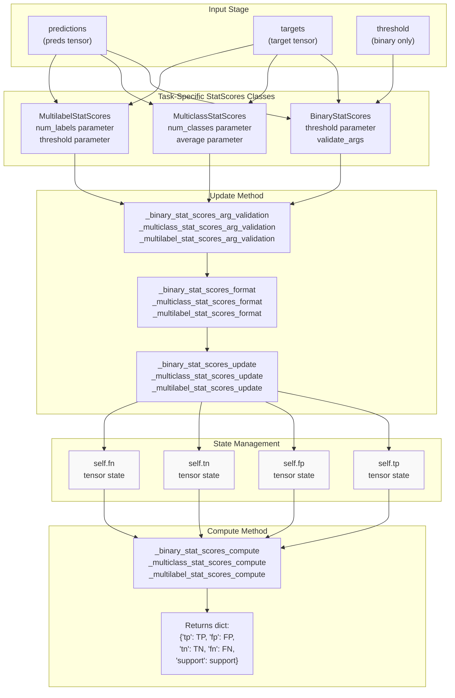
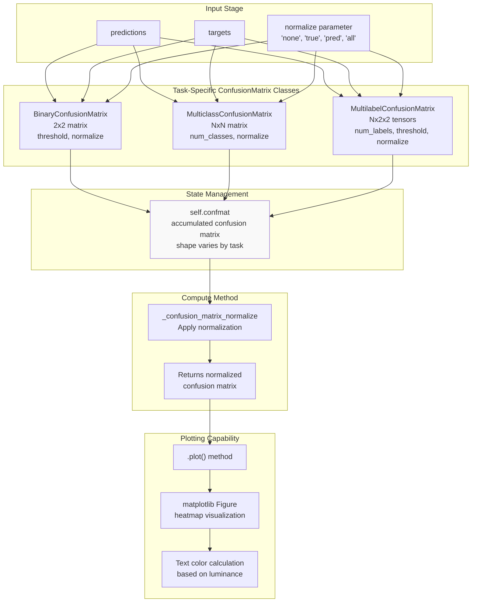
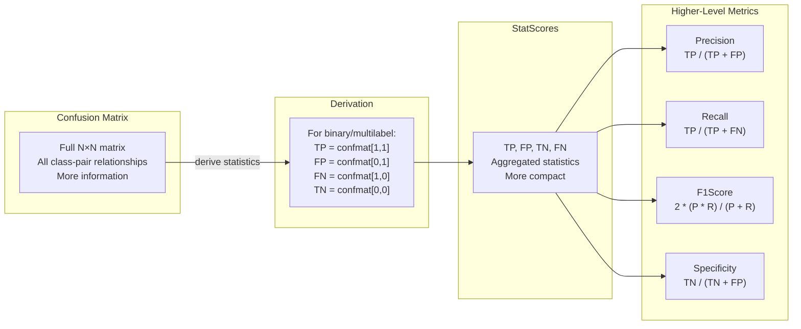

<!-- source: DeepWiki mcp.deepwiki.com · repo Lightning-AI/torchmetrics · page 3.6 StatScores and Confusion Matrix · fetched 2026-10-21 -->

# StatScores and Confusion Matrix

<details>
<summary>Relevant source files</summary>

The following files were used as context for generating this wiki page:

- [CHANGELOG.md](CHANGELOG.md)
- [docs/source/links.rst](docs/source/links.rst)
- [src/torchmetrics/__init__.py](src/torchmetrics/__init__.py)
- [src/torchmetrics/classification/__init__.py](src/torchmetrics/classification/__init__.py)
- [src/torchmetrics/functional/__init__.py](src/torchmetrics/functional/__init__.py)
- [src/torchmetrics/functional/classification/__init__.py](src/torchmetrics/functional/classification/__init__.py)
- [src/torchmetrics/functional/pairwise/__init__.py](src/torchmetrics/functional/pairwise/__init__.py)
- [src/torchmetrics/functional/regression/__init__.py](src/torchmetrics/functional/regression/__init__.py)
- [src/torchmetrics/regression/__init__.py](src/torchmetrics/regression/__init__.py)

</details>


## Purpose and Scope

This page documents the foundational classification metric components `StatScores` and `ConfusionMatrix`, which serve as the computational backbone for most classification metrics in TorchMetrics. These components compute the core classification statistics (True Positives, False Positives, True Negatives, False Negatives) and the confusion matrix structure that higher-level metrics like `Precision`, `Recall`, `F1Score`, and others build upon.

For information about the classification metrics that use these components, see [Binary Classification Metrics](#3.2), [Multiclass Classification Metrics](#3.3), and [Multilabel Classification Metrics](#3.4). For the task-based organization that defines these variants, see [Classification Refactor and Task-Based Organization](#3.1).

## Overview

`StatScores` and `ConfusionMatrix` are fundamental building blocks in the classification metrics hierarchy. After the v0.9.0-v1.0.0 refactor, both follow the task-based organization pattern with explicit variants:

- **Binary variants**: `BinaryStatScores`, `BinaryConfusionMatrix`
- **Multiclass variants**: `MulticlassStatScores`, `MulticlassConfusionMatrix`
- **Multilabel variants**: `MultilabelStatScores`, `MultilabelConfusionMatrix`

Both components follow the dual-interface pattern, providing stateful class-based APIs and stateless functional APIs.

**Sources:** [src/torchmetrics/classification/__init__.py:28-33](), [src/torchmetrics/classification/__init__.py:125-130]()

## StatScores: The Core Statistics Component

### What StatScores Computes

`StatScores` computes the four fundamental classification statistics for binary and multiclass problems:

| Statistic | Symbol | Definition |
|-----------|--------|------------|
| True Positives | TP | Correctly predicted positive samples |
| False Positives | FP | Incorrectly predicted as positive |
| True Negatives | TN | Correctly predicted negative samples |
| False Negatives | FN | Incorrectly predicted as negative |

For multiclass problems, these statistics can be computed per-class and then aggregated using different strategies (micro, macro, weighted).

### StatScores Computation Architecture



**Sources:** [src/torchmetrics/classification/__init__.py:125-130](), [src/torchmetrics/functional/classification/__init__.py:144-149]()

### Task-Specific Parameters

Each StatScores variant has task-specific parameters:

**BinaryStatScores:**
- `threshold`: Decision threshold for converting probabilities to binary predictions (default: 0.5)
- `multidim_average`: How to aggregate statistics across multiple dimensions
- `ignore_index`: Optional class index to ignore
- `validate_args`: Whether to validate input tensors

**MulticlassStatScores:**
- `num_classes`: Number of classes in the classification problem
- `average`: Aggregation strategy (`'micro'`, `'macro'`, `'weighted'`, or `None`)
- `top_k`: Consider top-k predictions as correct
- `multidim_average`: Multi-dimensional aggregation strategy
- `ignore_index`: Optional class index to ignore

**MultilabelStatScores:**
- `num_labels`: Number of labels in the multilabel problem
- `threshold`: Decision threshold per label
- `average`: Aggregation strategy (`'micro'`, `'macro'`, `'weighted'`, or `None`)
- `multidim_average`: Multi-dimensional aggregation strategy
- `ignore_index`: Optional label index to ignore

**Sources:** [src/torchmetrics/classification/__init__.py:125-130]()

### Functional API

The functional API provides stateless computation:

```python
# Binary
binary_stat_scores(preds, target, threshold=0.5, multidim_average='global', ignore_index=None, validate_args=True)

# Multiclass
multiclass_stat_scores(preds, target, num_classes, average='micro', top_k=1, multidim_average='global', ignore_index=None, validate_args=True)

# Multilabel
multilabel_stat_scores(preds, target, num_labels, threshold=0.5, average='micro', multidim_average='global', ignore_index=None, validate_args=True)
```

**Sources:** [src/torchmetrics/functional/classification/__init__.py:144-149]()

## ConfusionMatrix Component

### What ConfusionMatrix Represents

The confusion matrix is a table representation of classification predictions versus ground truth. For a multiclass problem with N classes, it is an N×N matrix where:
- Rows represent the true classes
- Columns represent the predicted classes
- Cell (i, j) contains the count of samples with true class i predicted as class j

For binary classification, this reduces to a 2×2 matrix:

|  | Predicted Negative | Predicted Positive |
|--|-------------------|-------------------|
| **Actually Negative** | TN | FP |
| **Actually Positive** | FN | TP |

### ConfusionMatrix Architecture



**Sources:** [src/torchmetrics/classification/__init__.py:28-33](), [CHANGELOG.md:322](), [CHANGELOG.md:396](), [CHANGELOG.md:537]()

### Normalization Strategies

The `normalize` parameter controls how the confusion matrix is normalized:

| Strategy | Description | Use Case |
|----------|-------------|----------|
| `'none'` | Raw counts (default) | Absolute numbers matter |
| `'true'` | Normalize by true class (rows sum to 1) | Per-class recall analysis |
| `'pred'` | Normalize by predicted class (columns sum to 1) | Per-class precision analysis |
| `'all'` | Normalize by total samples (all cells sum to 1) | Overall distribution |

### Multilabel Confusion Matrix

For multilabel problems, `MultilabelConfusionMatrix` computes a separate 2×2 confusion matrix for each label, resulting in a tensor of shape `(num_labels, 2, 2)`. Each label is treated as an independent binary classification problem.

**Sources:** [docs/source/links.rst:15-16]()

### Plotting Capabilities

All ConfusionMatrix variants support visualization via the `.plot()` method:

- **Binary**: 2×2 heatmap with TP, FP, TN, FN labels
- **Multiclass**: N×N heatmap with class labels on axes
- **Multilabel**: Multiple 2×2 heatmaps, one per label

The plotting system automatically calculates text color based on cell luminance for readability and supports custom labels.

**Sources:** [CHANGELOG.md:322](), [CHANGELOG.md:396](), [CHANGELOG.md:537](), [CHANGELOG.md:205]()

## Relationship Between StatScores and ConfusionMatrix

### Conceptual Relationship



### When to Use Which

**Use StatScores when:**
- You need aggregated statistics (TP, FP, TN, FN) for metric computation
- Building metrics like Precision, Recall, F1Score, Specificity
- Memory efficiency is important (stores 4-5 values instead of N×N matrix)
- Working with binary or multilabel problems where per-class pairs aren't needed

**Use ConfusionMatrix when:**
- You need full class-to-class prediction information
- Analyzing which classes are confused with each other
- Visualizing classification performance across all classes
- Debugging misclassifications in multiclass problems

**Sources:** [src/torchmetrics/classification/__init__.py:28-33](), [src/torchmetrics/classification/__init__.py:125-130]()

## Integration with Higher-Level Metrics

### How Metrics Use StatScores

Most classification metrics inherit from or depend on `StatScores`:

```mermaid
graph TB
    subgraph "StatScores Foundation"
        BSS["BinaryStatScores"]
        MCSS["MulticlassStatScores"]
        MLSS["MultilabelStatScores"]
    end
    
    subgraph "Derived Metrics"
        BPREC["BinaryPrecision<br/>TP / (TP + FP)"]
        BREC["BinaryRecall<br/>TP / (TP + FN)"]
        BF1["BinaryF1Score<br/>harmonic mean"]
        BSPEC["BinarySpecificity<br/>TN / (TN + FP)"]
        BNPV["BinaryNegativePredictiveValue<br/>TN / (TN + FN)"]
        BMCC["BinaryMatthewsCorrCoef<br/>uses all 4 values"]
    end
    
    subgraph "Multiclass Derived"
        MCPREC["MulticlassPrecision"]
        MCREC["MulticlassRecall"]
        MCF1["MulticlassF1Score"]
        MCSPEC["MulticlassSpecificity"]
    end
    
    subgraph "Multilabel Derived"
        MLPREC["MultilabelPrecision"]
        MLREC["MultilabelRecall"]
        MLF1["MultilabelF1Score"]
        MLSPEC["MultilabelSpecificity"]
    end
    
    BSS -->|"compute stats"| BPREC
    BSS -->|"compute stats"| BREC
    BSS -->|"compute stats"| BF1
    BSS -->|"compute stats"| BSPEC
    BSS -->|"compute stats"| BNPV
    BSS -->|"compute stats"| BMCC
    
    MCSS -->|"compute stats"| MCPREC
    MCSS -->|"compute stats"| MCREC
    MCSS -->|"compute stats"| MCF1
    MCSS -->|"compute stats"| MCSPEC
    
    MLSS -->|"compute stats"| MLPREC
    MLSS -->|"compute stats"| MLREC
    MLSS -->|"compute stats"| MLF1
    MLSS -->|"compute stats"| MLSPEC
    
    style BSS fill:#f9f9f9
    style MCSS fill:#f9f9f9
    style MLSS fill:#f9f9f9
```



### Compute Groups Optimization

When multiple metrics that depend on `StatScores` are used together in a `MetricCollection`, the library can optimize computation by sharing the StatScores calculation. This is part of the compute groups optimization that can provide 2-3x speedup.

For example, if you use `Precision`, `Recall`, and `F1Score` together, they all need the same TP, FP, TN, FN values. Instead of computing these statistics three times, the metrics are grouped and the statistics are computed once and shared.

**Sources:** [src/torchmetrics/classification/__init__.py:79-89]()

## Implementation Details

### State Management

**StatScores** uses tensor states for efficient accumulation:

- States: `self.tp`, `self.fp`, `self.tn`, `self.fn`, optionally `self.support`
- `dist_reduce_fx`: `'sum'` for all states (accumulates across distributed processes)
- Memory: O(1) for binary, O(num_classes) for multiclass with per-class statistics

**ConfusionMatrix** uses a tensor state for the full matrix:

- State: `self.confmat`
- `dist_reduce_fx`: `'sum'` (accumulates confusion matrices across processes)
- Memory: O(num_classes²) for multiclass

### Functional API Pattern

The functional API mirrors the class-based API structure:

**Functional StatScores:**
```python
torchmetrics.functional.classification.binary_stat_scores
torchmetrics.functional.classification.multiclass_stat_scores
torchmetrics.functional.classification.multilabel_stat_scores
```

**Functional ConfusionMatrix:**
```python
torchmetrics.functional.classification.binary_confusion_matrix
torchmetrics.functional.classification.multiclass_confusion_matrix
torchmetrics.functional.classification.multilabel_confusion_matrix
```

These functional variants perform one-shot computation without maintaining state, useful for single-batch evaluation or when state management is handled externally.

**Sources:** [src/torchmetrics/functional/classification/__init__.py:33-38](), [src/torchmetrics/functional/classification/__init__.py:144-149]()

### Validation and Formatting

Both components implement strict input validation through helper functions:

- `_*_stat_scores_arg_validation`: Validates tensor shapes, data types, and parameter values
- `_*_stat_scores_format`: Formats inputs to consistent shapes and types
- `_*_confusion_matrix_arg_validation`: Validates confusion matrix inputs
- `_*_confusion_matrix_format`: Formats confusion matrix inputs

This validation ensures type safety and provides clear error messages when inputs don't match expected formats.

### Zero Division Handling

Several metrics that use StatScores support a `zero_division` parameter to control behavior when denominators are zero (e.g., when there are no positive predictions for precision). This parameter was added to improve robustness in edge cases.

**Sources:** [CHANGELOG.md:354]()

## Common Issues and Fixes

### Fixed Issues (from CHANGELOG)

**Plotting improvements:**
- Text color in confusion matrix plots now calculated based on luminance for better readability
- Fixed x/y labels when plotting confusion matrices  
- Fixed plotting of multilabel confusion matrix

**Computational fixes:**
- Fixed integration between classwise wrapper and metric tracker for StatScores-based metrics
- Fixed `top_k` behavior in multiclass accuracy (which uses StatScores internally)
- Fixed `ignore_index` handling in multilabel exact match

**Sources:** [CHANGELOG.md:322](), [CHANGELOG.md:537](), [CHANGELOG.md:205](), [CHANGELOG.md:159](), [CHANGELOG.md:106](), [CHANGELOG.md:120]()

---

