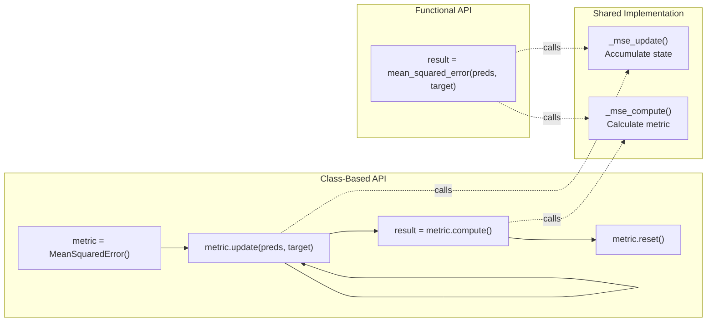
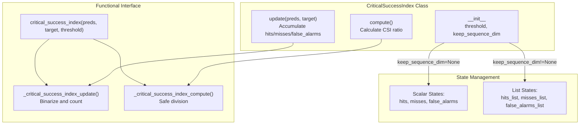
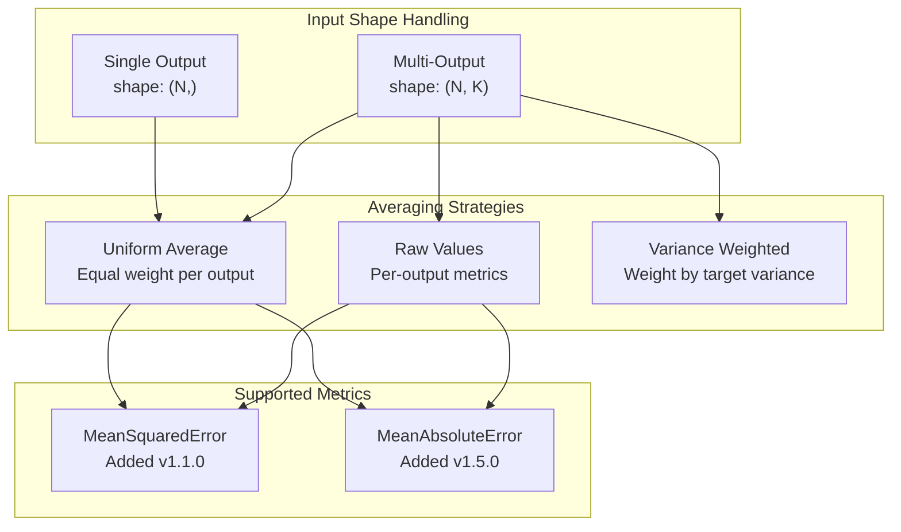
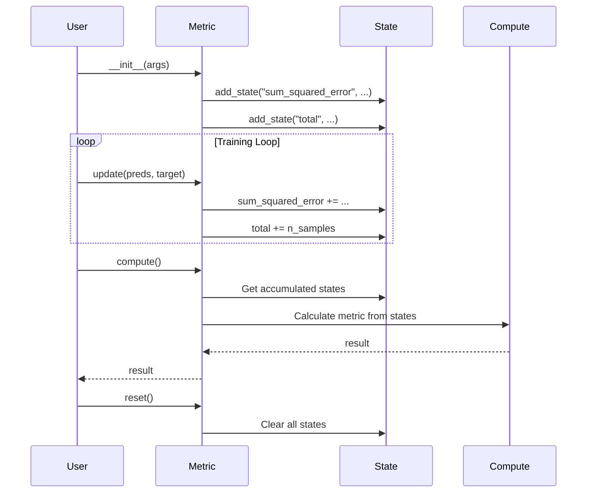

<!-- source: DeepWiki mcp.deepwiki.com · repo Lightning-AI/torchmetrics · page 4 Regression Metrics · fetched 2026-10-21 -->

# Regression Metrics

<details>
<summary>Relevant source files</summary>

The following files were used as context for generating this wiki page:

- [CHANGELOG.md](CHANGELOG.md)
- [docs/source/links.rst](docs/source/links.rst)
- [docs/source/regression/critical_success_index.rst](docs/source/regression/critical_success_index.rst)
- [examples/audio/text_to_speech.py](examples/audio/text_to_speech.py)
- [requirements/_docs.txt](requirements/_docs.txt)
- [requirements/classification_test.txt](requirements/classification_test.txt)
- [requirements/image_test.txt](requirements/image_test.txt)
- [requirements/nominal_test.txt](requirements/nominal_test.txt)
- [requirements/segmentation_test.txt](requirements/segmentation_test.txt)
- [requirements/visual.txt](requirements/visual.txt)
- [src/torchmetrics/__init__.py](src/torchmetrics/__init__.py)
- [src/torchmetrics/classification/__init__.py](src/torchmetrics/classification/__init__.py)
- [src/torchmetrics/functional/__init__.py](src/torchmetrics/functional/__init__.py)
- [src/torchmetrics/functional/classification/__init__.py](src/torchmetrics/functional/classification/__init__.py)
- [src/torchmetrics/functional/image/__init__.py](src/torchmetrics/functional/image/__init__.py)
- [src/torchmetrics/functional/pairwise/__init__.py](src/torchmetrics/functional/pairwise/__init__.py)
- [src/torchmetrics/functional/regression/__init__.py](src/torchmetrics/functional/regression/__init__.py)
- [src/torchmetrics/functional/regression/csi.py](src/torchmetrics/functional/regression/csi.py)
- [src/torchmetrics/image/__init__.py](src/torchmetrics/image/__init__.py)
- [src/torchmetrics/regression/__init__.py](src/torchmetrics/regression/__init__.py)
- [src/torchmetrics/regression/csi.py](src/torchmetrics/regression/csi.py)
- [tests/unittests/image/test_csi.py](tests/unittests/image/test_csi.py)

</details>


## Purpose and Scope

This document covers the regression metrics domain within TorchMetrics, which provides metrics for evaluating continuous value predictions. Regression metrics assess how well predicted values match ground truth continuous targets through various statistical measures including error-based metrics (MSE, MAE), correlation coefficients (Pearson, Spearman, Kendall), goodness-of-fit measures (R²), and specialized probabilistic metrics (CRPS).

For classification metrics that evaluate discrete predictions, see [Classification Metrics](#3). For image quality assessment metrics that may use regression-style calculations, see [Image Metrics](#5).

---

## Regression Metrics Architecture

Regression metrics in TorchMetrics follow the standard dual-API pattern with both class-based (stateful) and functional (stateless) implementations, inheriting from the `Metric` base class described in [Metric Base Class](#2.1).

### Class Hierarchy and Organization

```mermaid
graph TB
    subgraph "Base Infrastructure"
        Metric["Metric Base Class<br/>torchmetrics.Metric"]
    end
    
    subgraph "Core Regression Metrics"
        MSE["MeanSquaredError<br/>regression.mse"]
        MAE["MeanAbsoluteError<br/>regression.mae"]
        RMSE["MeanSquaredLogError<br/>regression.msle"]
    end
    
    subgraph "Correlation Metrics"
        Pearson["PearsonCorrCoef<br/>regression.pearson"]
        Spearman["SpearmanCorrCoef<br/>regression.spearman"]
        Kendall["KendallRankCorrCoef<br/>regression.kendall"]
        Cosine["CosineSimilarity<br/>regression.cosine"]
    end
    
    subgraph "Goodness of Fit"
        R2["R2Score<br/>regression.r2"]
        ExplainedVar["ExplainedVariance<br/>regression.explained_variance"]
    end
    
    subgraph "Specialized Metrics"
        CRPS["ContinuousRankedProbabilityScore<br/>regression.crps"]
        CSI["CriticalSuccessIndex<br/>regression.csi"]
        Minkowski["MinkowskiDistance<br/>regression.minkowski"]
        JSD["JensenShannonDivergence<br/>regression.jsd"]
        KLD["KLDivergence<br/>regression.kld"]
        RSE["RelativeSquaredError<br/>regression.rse"]
        NRMSE["NormalizedRootMeanSquaredError<br/>regression.nrmse"]
    end
    
    Metric --> MSE & MAE & RMSE
    Metric --> Pearson & Spearman & Kendall & Cosine
    Metric --> R2 & ExplainedVar
    Metric --> CRPS & CSI & Minkowski & JSD & KLD & RSE & NRMSE
```



**Sources:** [CHANGELOG.md:66](), [CHANGELOG.md:144](), [CHANGELOG.md:218](), [CHANGELOG.md:605](), [CHANGELOG.md:627](), [src/torchmetrics/regression/csi.py:24-113]()

### Dual API Pattern: Class-Based vs Functional

Regression metrics implement both stateful class-based and stateless functional interfaces, following the pattern described in [Functional API](#2.5).



**Sources:** [CHANGELOG.md:1-50](), diagram based on architectural patterns from [Core Architecture](#2)

---

## Basic Error Metrics

### Mean Squared Error (MSE)

The `MeanSquaredError` metric computes the mean squared error between predictions and targets:

$$\text{MSE} = \frac{1}{N}\sum_{i=1}^{N}(y_i - \hat{y}_i)^2$$

**Key Features:**
- Supports multi-output evaluation via `squared` and `num_outputs` parameters
- Configurable averaging across samples and outputs
- Penalizes large errors more heavily than MAE

**Class-based usage:**
```python
from torchmetrics.regression import MeanSquaredError

metric = MeanSquaredError()
metric.update(preds, target)
result = metric.compute()
```

**Functional usage:**
```python
from torchmetrics.functional.regression import mean_squared_error

result = mean_squared_error(preds, target)
```

**Sources:** [CHANGELOG.md:520]() (multioutput support added)

### Mean Absolute Error (MAE)

The `MeanAbsoluteError` metric computes the mean absolute error:

$$\text{MAE} = \frac{1}{N}\sum_{i=1}^{N}|y_i - \hat{y}_i|$$

**Key Features:**
- Multi-output support added in version 1.5.0
- More robust to outliers compared to MSE
- Linear penalty for prediction errors

**Sources:** [CHANGELOG.md:274]() (multi-output support)

### Root Mean Squared Error (RMSE)

Computed as the square root of MSE, providing error in the same units as the target variable.

---

## Correlation Coefficients

### Pearson Correlation Coefficient

The `PearsonCorrCoef` metric measures linear correlation between predictions and targets:

$$r = \frac{\text{cov}(X,Y)}{\sigma_X \sigma_Y}$$

**Numerical Stability Improvements:**

The Pearson correlation implementation has undergone multiple numerical stability enhancements:

| Version | Change | PR |
|---------|--------|-----|
| 1.7.4 | Improved numerical stability calculation | [#3152]() |
| 1.7.4 | Fixed incorrect shape handling | [#3168]() |
| 1.6.2 | Fixed corner case with constant input | [#2975](), [#2980]() |
| 1.4.3 | Fixed input modification bug | [#2765]() |

**Implementation Details:**

The correlation coefficient calculation uses a numerically stable approach to handle edge cases:
- Small variance detection with dtype-specific thresholds
- Warning when input variance is too small for accurate computation
- Robust handling of constant inputs

**Sources:** [CHANGELOG.md:90](), [CHANGELOG.md:98](), [CHANGELOG.md:189](), [CHANGELOG.md:192](), [CHANGELOG.md:297]()

### Spearman Rank Correlation

The `SpearmanCorrCoef` metric computes rank-based correlation, robust to non-linear monotonic relationships. Performance improvements were made in version 1.7.2 with enhanced `_rank_data` implementation.

**Sources:** [CHANGELOG.md:114]()

### Kendall Rank Correlation

The `KendallRankCorrCoef` metric measures ordinal association between predictions and targets using concordant and discordant pairs.

---

## Goodness-of-Fit Metrics

### R² Score (Coefficient of Determination)

The `R2Score` metric quantifies the proportion of variance in the target explained by the model:

$$R^2 = 1 - \frac{\sum_{i}(y_i - \hat{y}_i)^2}{\sum_{i}(y_i - \bar{y})^2}$$

**Configuration Changes:**

| Version | Change | Notes |
|---------|--------|-------|
| 1.6.0 | Removed `num_outputs` parameter | Deprecated in 1.5.0 |
| 1.5.0 | Deprecated `num_outputs` | Use alternative configuration |

The `num_outputs` parameter was removed to simplify the API, with multi-output support handled through tensor shape inference.

**Sources:** [CHANGELOG.md:235](), [CHANGELOG.md:284]()

### Explained Variance

The `ExplainedVariance` metric computes the explained variance score, similar to R² but without the bias correction term.

---

## Specialized Regression Metrics

### Continuous Ranked Probability Score (CRPS)

Added in version 1.8.0, the `ContinuousRankedProbabilityScore` metric evaluates probabilistic forecasts by comparing the predicted cumulative distribution function with the observed value.

**Use Cases:**
- Probabilistic weather forecasting
- Uncertainty quantification
- Ensemble prediction evaluation

**Sources:** [CHANGELOG.md:66]()

### Critical Success Index (CSI)

The `CriticalSuccessIndex` metric (also known as threat score) is used in weather forecasting to measure forecast performance over binarized inputs:

$$\text{CSI} = \frac{\text{TP}}{\text{TP}+\text{FN}+\text{FP}}$$

**Implementation Architecture:**



**Key Features:**
- `threshold`: Binarization threshold for predictions and targets
- `keep_sequence_dim`: Optional parameter to compute scores separately for each image in a sequence
- State management adapts based on whether sequence dimension is preserved

**Example Usage:**

```python
# Scalar output
from torchmetrics.regression import CriticalSuccessIndex
csi = CriticalSuccessIndex(threshold=0.5)
csi.update(preds, target)
score = csi.compute()  # Returns scalar

# Per-sequence output
csi_seq = CriticalSuccessIndex(threshold=0.5, keep_sequence_dim=0)
csi_seq.update(preds_sequence, target_sequence)
scores = csi_seq.compute()  # Returns vector of scores
```

**Sources:** [src/torchmetrics/regression/csi.py:24-113](), [src/torchmetrics/functional/regression/csi.py:1-113](), [tests/unittests/image/test_csi.py:1-94](), [docs/source/regression/critical_success_index.rst:1-23]()

### Jensen-Shannon Divergence

Added in version 1.7.0, the `JensenShannonDivergence` metric measures similarity between probability distributions as a symmetrized and smoothed version of KL divergence.

**Sources:** [CHANGELOG.md:144]()

### KL Divergence

The `KLDivergence` metric underwent API changes in version 1.6.0, with renamed arguments and reordered inputs for improved consistency.

**Sources:** [CHANGELOG.md:225]()

### MinkowskiDistance

Added in version 1.0.0, the `MinkowskiDistance` metric computes the Minkowski distance (generalized norm) between predictions and targets:

$$d(x,y) = \left(\sum_{i=1}^{n}|x_i - y_i|^p\right)^{1/p}$$

Special cases:
- p=1: Manhattan distance (L1)
- p=2: Euclidean distance (L2)
- p=∞: Chebyshev distance

**Sources:** [CHANGELOG.md:605]()

### Normalized Root Mean Squared Error (NRMSE)

Added in version 1.6.0, the `NormalizedRootMeanSquaredError` metric normalizes RMSE by a scaling factor (typically the range or mean of targets) to enable comparison across different scales.

**Sources:** [CHANGELOG.md:218]()

### Relative Squared Error (RSE)

Added in version 1.0.0, the `RelativeSquaredError` metric normalizes squared error relative to a baseline predictor (typically the mean).

**Sources:** [CHANGELOG.md:627]()

---

## Multi-Output Support

Several regression metrics support multi-output evaluation where predictions and targets have multiple output dimensions.

### Multi-Output Configuration



**Multi-Output MSE:**
- Added support in version 1.1.0
- Controlled via `squared` parameter and output dimension handling
- Can return per-output metrics or aggregate across outputs

**Multi-Output MAE:**
- Added support in version 1.5.0
- Provides per-output error metrics when aggregation is disabled

**Sources:** [CHANGELOG.md:520](), [CHANGELOG.md:274]()

---

## State Management and Update Patterns

### Standard Update-Compute Pattern

Regression metrics follow the standard lifecycle described in [Metric Base Class](#2.1):



**Common State Variables:**

| Metric Type | Typical States | Distribution Reduction |
|-------------|---------------|----------------------|
| Error Metrics | `sum_squared_error`, `total` | `sum` |
| Correlation | `sum_x`, `sum_y`, `sum_xy`, `sum_x2`, `sum_y2`, `n_samples` | `sum` |
| CSI | `hits`, `misses`, `false_alarms` | `sum` |
| Sequence-aware | `*_list` variants | `cat` |

**Sources:** Based on patterns from [src/torchmetrics/regression/csi.py:79-100]()

### Distributed Training Support

Regression metrics leverage the distributed synchronization mechanisms described in [Distributed Training Support](#2.2):

- **Automatic synchronization:** Metrics sync across processes before `compute()`
- **Reduction functions:** Most regression metrics use `dist_reduce_fx="sum"` for states
- **Manual control:** Use `sync()` and `unsync()` methods for fine-grained control

**List-based state reduction:**

For sequence-aware metrics like `CriticalSuccessIndex` with `keep_sequence_dim`, states use `dist_reduce_fx="cat"` to concatenate tensors across distributed processes:

```python
self.add_state("hits_list", default=[], dist_reduce_fx="cat")
```

**Sources:** [src/torchmetrics/regression/csi.py:84-86]()

---

## Testing and Validation

### Reference Implementation Validation

Regression metrics are validated against reference implementations from established libraries:

| Metric Category | Reference Library | Test Files |
|----------------|------------------|-----------|
| Correlation | `scipy.stats` | `classification_test.txt` |
| Error Metrics | `sklearn.metrics` | Standard test dependencies |
| CSI | `sklearn.metrics.jaccard_score` | `image_test.txt` |

**CSI Test Pattern:**

The `CriticalSuccessIndex` metric is tested using sklearn's Jaccard score as reference:

```python
def _reference_sklearn_jaccard(preds, target, threshold):
    preds, target = preds.numpy(), target.numpy()
    preds = preds >= threshold
    target = target >= threshold
    return jaccard_score(preds.ravel(), target.ravel())
```

Test coverage includes:
- Class-based implementation
- Functional implementation  
- Half-precision (fp16) support on CPU and GPU
- Distributed data parallel (DDP) execution

**Sources:** [tests/unittests/image/test_csi.py:34-86](), [requirements/classification_test.txt:1-14](), [requirements/image_test.txt:1-12]()

### Test Dependencies

Regression metric testing relies on multiple reference implementation packages:

```
# From classification_test.txt
pandas >1.4.0, <=2.3.2
numpy <2.4.0

# From image_test.txt
scikit-image >=0.19.0, <0.26.0
numpy <2.4.0

# From segmentation_test.txt
scipy >1.0.0, <1.17.0
monai ==1.4.0

# From nominal_test.txt
pandas >1.4.0, <=2.3.2
scipy >1.0.0, <1.17.0
statsmodels >0.13.5, <0.15.0
```

**Sources:** [requirements/classification_test.txt:1-14](), [requirements/image_test.txt:1-12](), [requirements/segmentation_test.txt:1-6](), [requirements/nominal_test.txt:1-8]()

---

## Common Usage Patterns

### Pattern 1: Single Metric Evaluation

```python
from torchmetrics.regression import MeanSquaredError

# Initialize
mse = MeanSquaredError()

# Accumulate over batches
for batch in dataloader:
    preds, targets = model(batch), batch.targets
    mse.update(preds, targets)

# Compute final metric
final_mse = mse.compute()
print(f"MSE: {final_mse}")

# Reset for next epoch
mse.reset()
```

### Pattern 2: Multiple Regression Metrics

Using `MetricCollection` (see [MetricCollection](#2.4)):

```python
from torchmetrics import MetricCollection
from torchmetrics.regression import (
    MeanSquaredError, 
    MeanAbsoluteError,
    R2Score,
    PearsonCorrCoef
)

metrics = MetricCollection({
    'mse': MeanSquaredError(),
    'mae': MeanAbsoluteError(), 
    'r2': R2Score(),
    'pearson': PearsonCorrCoef()
})

# Update all metrics at once
metrics.update(preds, targets)

# Compute all metrics
results = metrics.compute()
# Returns: {'mse': ..., 'mae': ..., 'r2': ..., 'pearson': ...}
```

### Pattern 3: Functional API for Quick Evaluation

```python
from torchmetrics.functional.regression import (
    mean_squared_error,
    pearson_corrcoef,
    r2_score
)

# Direct computation without state
mse = mean_squared_error(preds, targets)
pearson = pearson_corrcoef(preds, targets)
r2 = r2_score(preds, targets)
```

### Pattern 4: Sequence-Aware Evaluation

For evaluating temporal sequences or batches of images separately:

```python
from torchmetrics.regression import CriticalSuccessIndex

# Evaluate each frame in video sequence separately
csi = CriticalSuccessIndex(threshold=0.5, keep_sequence_dim=0)

# Input shape: (T, H, W) where T is time dimension
video_preds = torch.rand(10, 256, 256)
video_targets = torch.rand(10, 256, 256)

csi.update(video_preds, video_targets)
per_frame_scores = csi.compute()  # Returns tensor of shape (10,)
```

**Sources:** [src/torchmetrics/regression/csi.py:50-58]()

---

## Integration with PyTorch Lightning

Regression metrics integrate seamlessly with PyTorch Lightning as described in [Integration with PyTorch Lightning](#1.2):

```python
import pytorch_lightning as pl
from torchmetrics.regression import MeanSquaredError

class RegressionModel(pl.LightningModule):
    def __init__(self):
        super().__init__()
        self.train_mse = MeanSquaredError()
        self.val_mse = MeanSquaredError()
    
    def training_step(self, batch, batch_idx):
        x, y = batch
        preds = self(x)
        loss = F.mse_loss(preds, y)
        
        # Automatic device handling
        self.train_mse(preds, y)
        
        # Log with automatic sync in DDP
        self.log('train_loss', loss)
        self.log('train_mse', self.train_mse)
        return loss
    
    def validation_step(self, batch, batch_idx):
        x, y = batch
        preds = self(x)
        self.val_mse(preds, y)
        self.log('val_mse', self.val_mse)
```

**Automatic Features:**
- Device placement handled by Lightning
- Distributed synchronization automatic on `compute()`
- Logging integration with `self.log()`
- Automatic reset at epoch boundaries

---

## Visualization Support

Several regression metrics support plotting through the `.plot()` method introduced in version 1.0.0 (see [Visualization and Plotting](#13)):

```python
from torchmetrics.regression import MeanSquaredError

mse = MeanSquaredError()
# ... accumulate data ...
fig, ax = mse.plot()
```

**Available Plot Parameters:**
- `vals`: Display individual values or aggregated result
- Custom matplotlib styling through returned `Figure` and `Axes` objects

**Sources:** [CHANGELOG.md:579-601]() (plotting support added across metrics)

---

## Dependency Requirements

### Core Dependencies

Regression metrics require only the base TorchMetrics dependencies:
- `torch >= 2.0`
- `numpy`
- `packaging`

### Optional Test Dependencies

For testing against reference implementations:
- `scikit-learn` (error metrics, correlation)
- `scipy` (statistical functions)
- `pandas` (data handling in tests)

**Sources:** [requirements/classification_test.txt:1-14](), [requirements/image_test.txt:1-12]()

---

## Performance Considerations

### Memory Management

Regression metrics use efficient state accumulation strategies:

1. **Sum-based accumulation:** Error metrics accumulate sum of errors and count, avoiding storing all samples
2. **Correlation metrics:** Store sufficient statistics (sums, squared sums, cross-products) rather than full data
3. **List-based states:** Only used when necessary (e.g., sequence-aware metrics)

For memory optimization strategies, see [Memory Management and Performance](#2.3).

### Numerical Stability

Recent improvements focus on numerical stability:

| Issue | Solution | Version |
|-------|----------|---------|
| Pearson with small variance | Variance threshold checks | 1.7.4 |
| Constant input handling | Special case handling | 1.6.2 |
| Input modification | Defensive copying | 1.4.3 |

**Sources:** [CHANGELOG.md:90](), [CHANGELOG.md:189](), [CHANGELOG.md:297]()

### Deterministic Evaluation

Regression metrics support deterministic evaluation on GPU for metrics using `torch.cumsum` (added in version 1.0.0):

```python
# Enable deterministic mode for reproducibility
torch.use_deterministic_algorithms(True)

# Metrics will use deterministic operations
mse = MeanSquaredError()
result = mse(preds, targets)
```

**Sources:** [CHANGELOG.md:615]()

---

