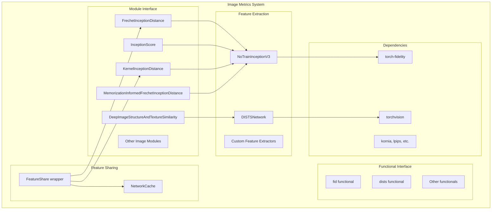
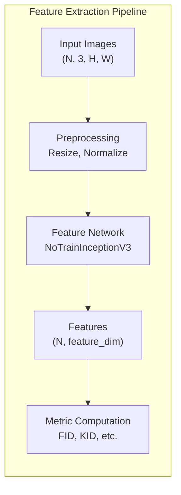
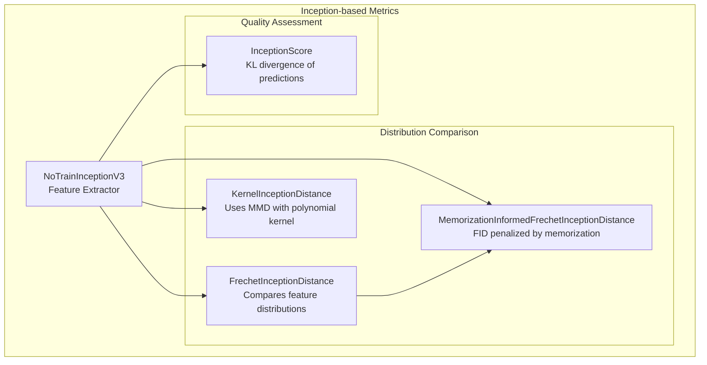
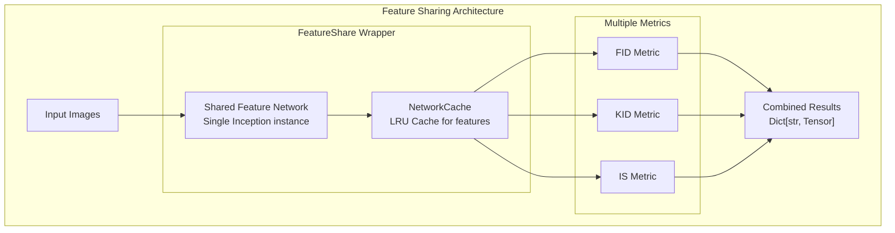
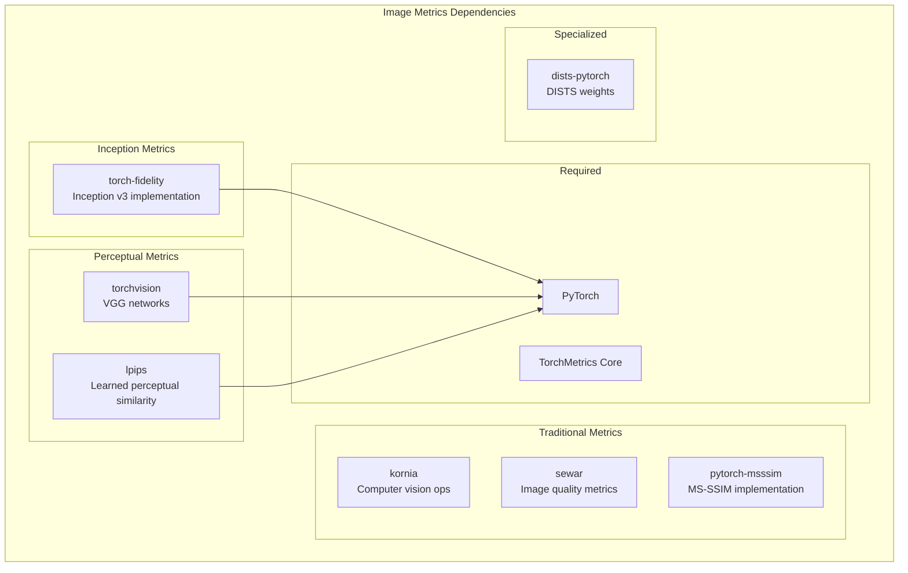

<!-- source: DeepWiki mcp.deepwiki.com · repo Lightning-AI/torchmetrics · page 5 Image Metrics · fetched 2026-10-21 -->

# Image Metrics

<details>
<summary>Relevant source files</summary>

The following files were used as context for generating this wiki page:

- [CHANGELOG.md](CHANGELOG.md)
- [docs/source/regression/critical_success_index.rst](docs/source/regression/critical_success_index.rst)
- [examples/audio/text_to_speech.py](examples/audio/text_to_speech.py)
- [requirements/_docs.txt](requirements/_docs.txt)
- [requirements/classification_test.txt](requirements/classification_test.txt)
- [requirements/image_test.txt](requirements/image_test.txt)
- [requirements/nominal_test.txt](requirements/nominal_test.txt)
- [requirements/segmentation_test.txt](requirements/segmentation_test.txt)
- [requirements/visual.txt](requirements/visual.txt)
- [src/torchmetrics/functional/image/__init__.py](src/torchmetrics/functional/image/__init__.py)
- [src/torchmetrics/functional/image/ssim.py](src/torchmetrics/functional/image/ssim.py)
- [src/torchmetrics/functional/regression/csi.py](src/torchmetrics/functional/regression/csi.py)
- [src/torchmetrics/image/__init__.py](src/torchmetrics/image/__init__.py)
- [src/torchmetrics/image/ssim.py](src/torchmetrics/image/ssim.py)
- [src/torchmetrics/regression/csi.py](src/torchmetrics/regression/csi.py)
- [src/torchmetrics/utilities/data.py](src/torchmetrics/utilities/data.py)
- [src/torchmetrics/utilities/imports.py](src/torchmetrics/utilities/imports.py)
- [tests/unittests/image/test_csi.py](tests/unittests/image/test_csi.py)
- [tests/unittests/image/test_ms_ssim.py](tests/unittests/image/test_ms_ssim.py)
- [tests/unittests/image/test_ssim.py](tests/unittests/image/test_ssim.py)
- [tests/unittests/utilities/test_utilities.py](tests/unittests/utilities/test_utilities.py)

</details>


Image Metrics in TorchMetrics provides a comprehensive collection of metrics for evaluating image quality, particularly for generative models and image processing tasks. This system focuses on metrics that assess visual similarity, perceptual quality, and distributional differences between image sets.

For classification-based image metrics, see [Classification Metrics](#3). For general metric architecture and base classes, see [Core Architecture](#2).

## Architecture Overview

The image metrics system follows TorchMetrics' dual-interface pattern with both module and functional implementations, but adds specialized components for expensive feature extraction and sharing.

### Image Metrics System Architecture



Sources: [src/torchmetrics/image/__init__.py:1-71](), [src/torchmetrics/functional/image/__init__.py:1-59](), [src/torchmetrics/wrappers/feature_share.py:1-136]()

## Core Components

### Module vs Functional Interfaces

Image metrics follow the standard TorchMetrics pattern with both stateful module and stateless functional implementations:

| Interface | Purpose | Example |
|-----------|---------|---------|
| Module | Stateful, accumulates features across batches | `FrechetInceptionDistance()` |
| Functional | Stateless, processes single batch | `frechet_inception_distance()` |

### Feature Extraction Pipeline

Most image metrics rely on pre-trained neural networks for feature extraction, particularly Inception v3:



The `NoTrainInceptionV3` class ensures the network never leaves evaluation mode and provides consistent feature extraction:

Sources: [src/torchmetrics/image/fid.py:45-172]()

## Key Image Metrics

### Inception-based Metrics

Several metrics use Inception v3 features for evaluation:



**Fréchet Inception Distance (FID)**: Compares multivariate Gaussians fitted to real and fake image features.
- Formula: `FID = ||μ₁ - μ₂||² + Tr(Σ₁ + Σ₂ - 2(Σ₁Σ₂)^(1/2))`
- Lower is better

**Kernel Inception Distance (KID)**: Uses Maximum Mean Discrepancy with polynomial kernels.
- More unbiased than FID for small sample sizes
- Returns mean and standard deviation over subsets

**Memorization-Informed FID (MiFID)**: FID divided by memorization penalty.
- Formula: `MiFID = FID(F_real, F_fake) / M(F_real, F_fake)`
- Penalizes generators that memorize training data

**Inception Score (IS)**: Measures quality and diversity of generated images.
- Formula: `IS = exp(E_x[KL(p(y|x) || p(y))])`
- Higher is better

Sources: [src/torchmetrics/image/fid.py:197-496](), [src/torchmetrics/image/kid.py:71-359](), [src/torchmetrics/image/mifid.py:67-298](), [src/torchmetrics/image/inception.py:35-222]()

### Perceptual Metrics

**Deep Image Structure and Texture Similarity (DISTS)**: Uses VGG-based features to measure perceptual similarity.
- Combines structural and textural similarity measurements
- Based on deep CNN representations
- Lower is better

Sources: [src/torchmetrics/image/dists.py:31-137](), [src/torchmetrics/functional/image/dists.py:78-218]()

### Traditional Image Quality Metrics

The system also includes classical image quality metrics:

| Metric | Purpose | Module Class |
|--------|---------|--------------|
| SSIM | Structural similarity | `StructuralSimilarityIndexMeasure` |
| PSNR | Peak signal-to-noise ratio | `PeakSignalNoiseRatio` |
| LPIPS | Learned perceptual similarity | `LearnedPerceptualImagePatchSimilarity` |

Sources: [src/torchmetrics/image/__init__.py:14-52]()

## Feature Sharing System

The `FeatureShare` wrapper enables efficient computation when multiple metrics use the same feature extractor:



### Usage Pattern

```python
# Instead of separate feature extraction
fid = FrechetInceptionDistance()
kid = KernelInceptionDistance()

# Use feature sharing
fs = FeatureShare([
    FrechetInceptionDistance(),
    KernelInceptionDistance()
])
```

The `NetworkCache` implements LRU caching with configurable cache size to optimize memory usage.

Sources: [src/torchmetrics/wrappers/feature_share.py:46-136]()

## Dependencies and Requirements

### Core Dependencies

Image metrics have several optional dependencies based on functionality:



### Installation Requirements

Most metrics require specific packages:
- Inception-based metrics: `torch-fidelity`
- DISTS: `torchvision` + weights file
- LPIPS: `torchvision` + `lpips`

Sources: [requirements/image_test.txt:1-12]()

## Common Usage Patterns

### Basic Metric Usage

```python
# Module interface - stateful
fid = FrechetInceptionDistance(feature=2048)
fid.update(real_images, real=True)
fid.update(fake_images, real=False) 
score = fid.compute()

# Functional interface - stateless  
score = frechet_inception_distance(real_features, fake_features)
```

### Custom Feature Extractors

Metrics support custom feature extraction networks:

```python
# Custom feature extractor
custom_net = MyFeatureExtractor()
fid = FrechetInceptionDistance(feature=custom_net)
```

### Memory Optimization

For large datasets, several strategies help manage memory:

1. **Reset real features**: Cache real dataset features
```python
fid = FrechetInceptionDistance(reset_real_features=False)
```

2. **Feature sharing**: Share extraction across metrics
```python
fs = FeatureShare([FID(), KID()], max_cache_size=100)
```

3. **Dtype management**: Use appropriate precision
```python
fid.set_dtype(torch.float64)  # For numerical stability
```

Sources: [src/torchmetrics/image/fid.py:314-445](), [tests/unittests/image/test_fid.py:165-192]()

---

