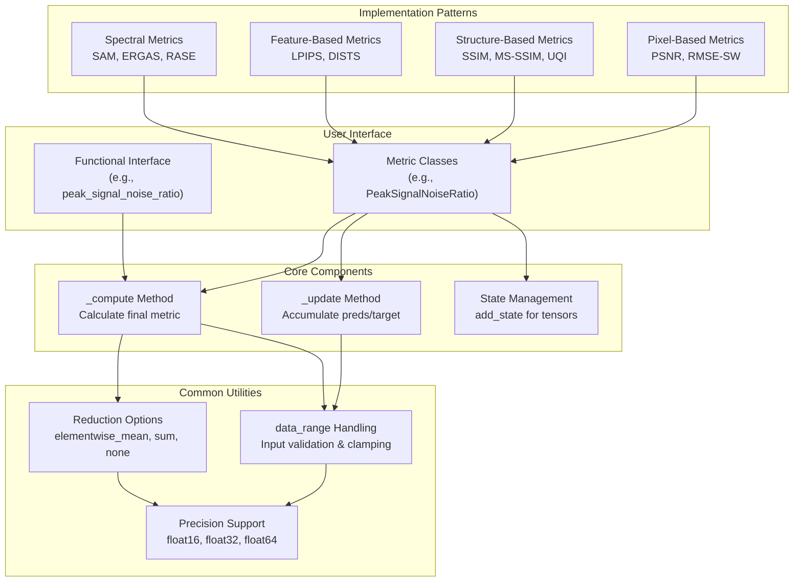
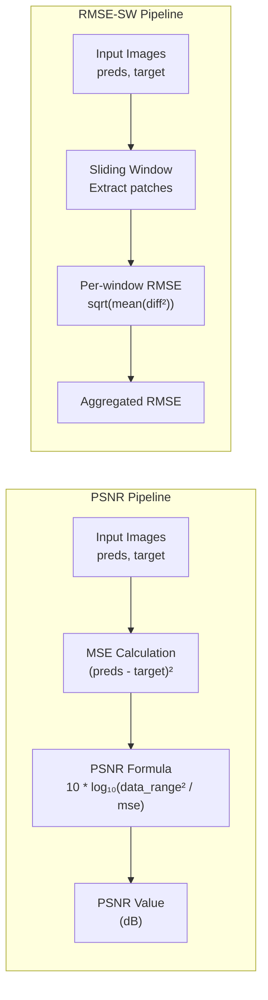
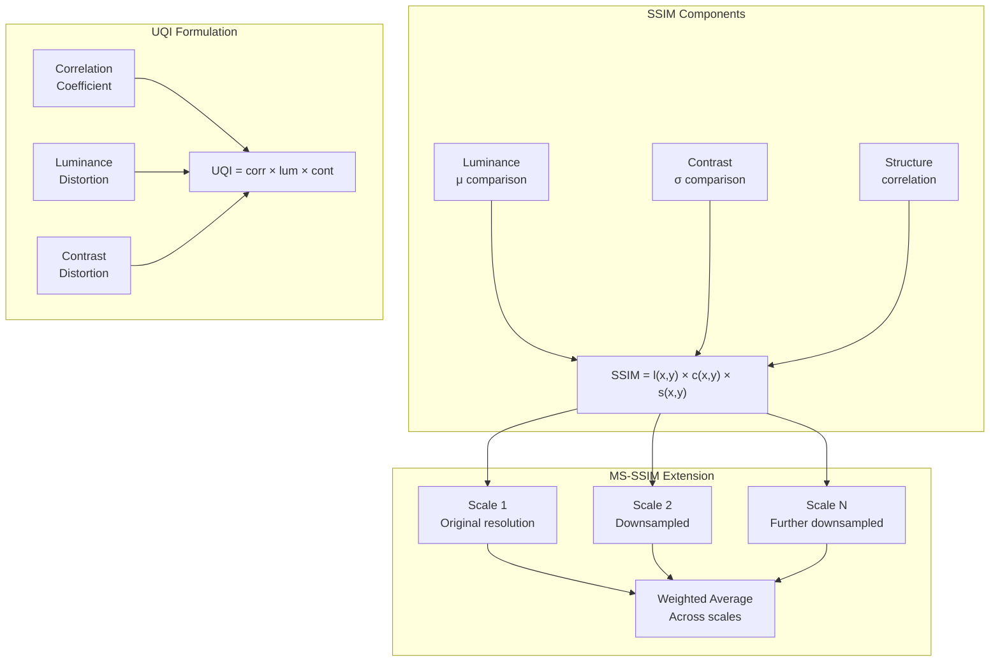
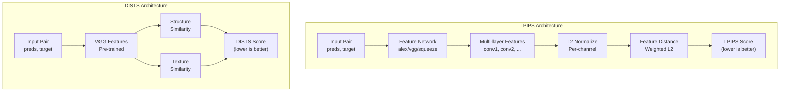
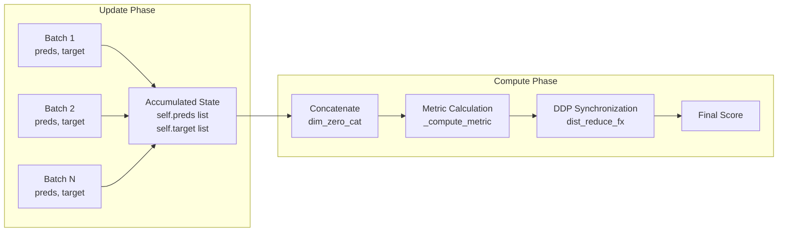

<!-- source: DeepWiki mcp.deepwiki.com · repo Lightning-AI/torchmetrics · page 5.1 Reference-Based Image Metrics · fetched 2026-10-21 -->

# Reference-Based Image Metrics

<details>
<summary>Relevant source files</summary>

The following files were used as context for generating this wiki page:

- [CHANGELOG.md](CHANGELOG.md)
- [docs/source/regression/critical_success_index.rst](docs/source/regression/critical_success_index.rst)
- [examples/audio/text_to_speech.py](examples/audio/text_to_speech.py)
- [requirements/_docs.txt](requirements/_docs.txt)
- [requirements/classification_test.txt](requirements/classification_test.txt)
- [requirements/image_test.txt](requirements/image_test.txt)
- [requirements/nominal_test.txt](requirements/nominal_test.txt)
- [requirements/segmentation_test.txt](requirements/segmentation_test.txt)
- [requirements/visual.txt](requirements/visual.txt)
- [src/torchmetrics/functional/image/__init__.py](src/torchmetrics/functional/image/__init__.py)
- [src/torchmetrics/functional/image/ssim.py](src/torchmetrics/functional/image/ssim.py)
- [src/torchmetrics/functional/regression/csi.py](src/torchmetrics/functional/regression/csi.py)
- [src/torchmetrics/image/__init__.py](src/torchmetrics/image/__init__.py)
- [src/torchmetrics/image/ssim.py](src/torchmetrics/image/ssim.py)
- [src/torchmetrics/regression/csi.py](src/torchmetrics/regression/csi.py)
- [src/torchmetrics/utilities/data.py](src/torchmetrics/utilities/data.py)
- [src/torchmetrics/utilities/imports.py](src/torchmetrics/utilities/imports.py)
- [tests/unittests/image/test_csi.py](tests/unittests/image/test_csi.py)
- [tests/unittests/image/test_ms_ssim.py](tests/unittests/image/test_ms_ssim.py)
- [tests/unittests/image/test_ssim.py](tests/unittests/image/test_ssim.py)
- [tests/unittests/utilities/test_utilities.py](tests/unittests/utilities/test_utilities.py)

</details>


Reference-based image metrics quantitatively assess image quality by comparing a distorted or generated image against a ground truth reference image. These metrics are essential for evaluating image processing algorithms, compression techniques, super-resolution models, and generative models where a reference image is available for comparison.

This page covers metrics that require paired images (prediction and target) for evaluation. For metrics that assess quality without reference images, see [No-Reference Image Metrics](#5.3). For metrics that evaluate image distributions using learned features, see [Feature-Based Image Metrics](#5.2).

## Available Reference-Based Metrics

TorchMetrics provides a comprehensive suite of reference-based image quality assessment metrics. The following table categorizes them by their primary use case:

| Metric | Class Name | Primary Use Case | Key Characteristic |
|--------|-----------|------------------|-------------------|
| PSNR | `PeakSignalNoiseRatio` | General quality assessment | Pixel-level fidelity |
| SSIM | `StructuralSimilarityIndexMeasure` | Perceptual quality | Structural similarity |
| MS-SSIM | `MultiScaleStructuralSimilarityIndexMeasure` | Multi-scale perceptual quality | Hierarchical structure |
| LPIPS | `LearnedPerceptualImagePatchSimilarity` | Perceptual similarity | Deep learning based |
| VIF | `VisualInformationFidelity` | Information fidelity | Visual information theory |
| UQI | `UniversalImageQualityIndex` | General quality | Correlation, luminance, contrast |
| ERGAS | `ErrorRelativeGlobalDimensionlessSynthesis` | Multispectral/remote sensing | Dimensionless error |
| SAM | `SpectralAngleMapper` | Spectral similarity | Angle between spectral vectors |
| SCC | `SpatialCorrelationCoefficient` | Spatial correlation | Pixel correlation |
| RASE | `RelativeAverageSpectralError` | Spectral error | Average spectral deviation |
| RMSE-SW | `RootMeanSquaredErrorUsingSlidingWindow` | Local error | Sliding window RMSE |
| PSNRB | `PeakSignalNoiseRatioWithBlockedEffect` | Quality with blocking artifacts | PSNR with block effects |
| DISTS | `DeepImageStructureAndTextureSimilarity` | Structure and texture | Deep feature-based |

Sources: [src/torchmetrics/image/__init__.py:14-29]()

## Metric Architecture Overview



**Diagram: Reference-Based Metrics Architecture**

This diagram illustrates how reference-based metrics are structured within TorchMetrics. All metrics inherit from the base `Metric` class and follow the update/compute pattern for distributed training support.

Sources: [src/torchmetrics/image/__init__.py:1-71](), [CHANGELOG.md:77-77]()

## Common Parameters and Concepts

### Data Range Parameter

The `data_range` parameter is critical for many reference-based metrics as it defines the dynamic range of the input images. This affects how differences between images are normalized and interpreted.

**Key Points:**
- **Required for PSNR**: As of version 1.8.0, `data_range` is a required argument for `PeakSignalNoiseRatio` ([CHANGELOG.md:77]())
- **Auto-clamping**: Inputs are automatically clamped to the specified `data_range` to prevent numerical issues ([CHANGELOG.md:618]())
- **Integer handling**: Special handling for integer-type inputs to prevent precision loss ([CHANGELOG.md:289]())

**Typical Values:**
- `data_range=1.0`: For images normalized to [0, 1]
- `data_range=255.0`: For images in [0, 255] range
- `data_range=2.0`: For images in [-1, 1] range

### Reduction Options

Most reference-based metrics support different reduction strategies to control output dimensionality:

| Reduction | Behavior | Output Shape | Use Case |
|-----------|----------|--------------|----------|
| `"elementwise_mean"` | Average across all dimensions | Scalar | Overall quality score |
| `"sum"` | Sum across all dimensions | Scalar | Total error |
| `"none"` | No reduction | Same as input batch | Per-image scores |

**Recent Additions:**
- VIF gained `reduction='none'` support ([CHANGELOG.md:53]())
- LPIPS gained `reduction='none'` support ([CHANGELOG.md:68]())

Sources: [CHANGELOG.md:53-68]()

## Metric Categories and Implementation

### Pixel-Based Metrics



**Diagram: Pixel-Based Metric Computation Flow**

**PeakSignalNoiseRatio (PSNR)**

PSNR is the most widely used pixel-level metric, measuring the ratio between maximum signal power and noise power in decibels (dB).

- **Class**: `PeakSignalNoiseRatio` in [src/torchmetrics/image/psnr.py]()
- **Functional**: `peak_signal_noise_ratio` in [src/torchmetrics/functional/image/psnr.py]()
- **Formula**: `PSNR = 10 * log₁₀(data_range² / MSE)`
- **Higher is better**: Yes
- **Differentiable**: Yes
- **Key change**: `data_range` is now required ([CHANGELOG.md:77]())

**RootMeanSquaredErrorUsingSlidingWindow (RMSE-SW)**

RMSE-SW computes RMSE over sliding windows, useful for detecting localized distortions.

- **Class**: `RootMeanSquaredErrorUsingSlidingWindow` in [src/torchmetrics/image/rmse_sw.py]()
- **Functional**: `root_mean_squared_error_using_sliding_window` in [src/torchmetrics/functional/image/rmse_sw.py]()

Sources: [src/torchmetrics/image/__init__.py:19-23](), [CHANGELOG.md:77-289]()

### Structure-Based Metrics

Structure-based metrics assess perceptual quality by evaluating structural information, luminance, and contrast rather than simple pixel differences.



**Diagram: Structure-Based Metrics Computation**

**StructuralSimilarityIndexMeasure (SSIM)**

SSIM measures structural similarity by comparing luminance, contrast, and structure between images.

- **Class**: `StructuralSimilarityIndexMeasure` in [src/torchmetrics/image/ssim.py]()
- **Functional**: `structural_similarity_index_measure` in [src/torchmetrics/functional/image/ssim.py]()
- **Components**: Combines luminance, contrast, and structural comparisons
- **Higher is better**: Yes
- **Range**: [-1, 1], typically [0, 1]
- **Fixed issues**: Padding calculation errors ([CHANGELOG.md:312]()), dist_reduce_fx with `reduction=None` ([CHANGELOG.md:95-96]())

**MultiScaleStructuralSimilarityIndexMeasure (MS-SSIM)**

MS-SSIM extends SSIM by evaluating structural similarity across multiple scales.

- **Class**: `MultiScaleStructuralSimilarityIndexMeasure` in [src/torchmetrics/image/ssim.py]()
- **Functional**: `multiscale_structural_similarity_index_measure` in [src/torchmetrics/functional/image/ssim.py]()
- **Multi-scale**: Evaluates at multiple image resolutions
- **Better for diverse content**: Captures both fine details and coarse structure

**UniversalImageQualityIndex (UQI)**

UQI assesses image quality based on correlation, luminance distortion, and contrast distortion.

- **Class**: `UniversalImageQualityIndex` in [src/torchmetrics/image/uqi.py]()
- **Functional**: `universal_image_quality_index` in [src/torchmetrics/functional/image/uqi.py]()
- **Numerical stability**: Fixed in version 1.2.1 ([CHANGELOG.md:454]())

Sources: [src/torchmetrics/image/__init__.py:26-28](), [CHANGELOG.md:95-312]()

### Feature-Based Metrics

Feature-based metrics use deep neural networks to extract perceptual features and compare them in learned feature spaces.



**Diagram: Feature-Based Metric Processing**

**LearnedPerceptualImagePatchSimilarity (LPIPS)**

LPIPS uses deep features from pre-trained networks to measure perceptual similarity, correlating better with human judgment than pixel-based metrics.

- **Class**: `LearnedPerceptualImagePatchSimilarity` in [src/torchmetrics/image/lpip.py]()
- **Functional**: `learned_perceptual_image_patch_similarity` in [src/torchmetrics/functional/image/lpips.py]()
- **Network options**: `'alex'`, `'vgg'`, `'squeeze'`
- **No third-party dependency**: Implementation removed reliance on external `lpips` package ([CHANGELOG.md:641]())
- **Numerical stability**: Fixed in version 1.2.1 ([CHANGELOG.md:453]())
- **Reduction support**: Added `reduction='none'` ([CHANGELOG.md:68]())
- **Backprop handling**: Fixed in version 1.3.1 ([CHANGELOG.md:389]())

**DeepImageStructureAndTextureSimilarity (DISTS)**

DISTS evaluates both structure and texture similarity using VGG features.

- **Class**: `DeepImageStructureAndTextureSimilarity` in [src/torchmetrics/image/dists.py]()
- **Functional**: `deep_image_structure_and_texture_similarity` in [src/torchmetrics/functional/image/dists.py]()
- **Added in**: Version 1.7.0 ([CHANGELOG.md:142]())

Sources: [src/torchmetrics/image/__init__.py:67-70](), [CHANGELOG.md:68-641]()

### Spectral and Remote Sensing Metrics

These metrics are designed for multispectral and hyperspectral image analysis, common in remote sensing applications.

**SpectralAngleMapper (SAM)**

SAM measures the spectral similarity by computing the angle between spectral vectors.

- **Class**: `SpectralAngleMapper` in [src/torchmetrics/image/sam.py]()
- **Functional**: `spectral_angle_mapper` in [src/torchmetrics/functional/image/sam.py]()
- **Use case**: Multispectral/hyperspectral image comparison
- **Lower is better**: Yes (angle in radians)

**ErrorRelativeGlobalDimensionlessSynthesis (ERGAS)**

ERGAS provides a dimensionless measure of spectral quality, particularly for pansharpened images.

- **Class**: `ErrorRelativeGlobalDimensionlessSynthesis` in [src/torchmetrics/image/ergas.py]()
- **Functional**: `error_relative_global_dimensionless_synthesis` in [src/torchmetrics/functional/image/ergas.py]()
- **Bug fix**: Computation error fixed in version 1.4.0 ([CHANGELOG.md:366]())

**RelativeAverageSpectralError (RASE)**

RASE computes the average spectral error relative to the mean radiance.

- **Class**: `RelativeAverageSpectralError` in [src/torchmetrics/image/rase.py]()
- **Functional**: `relative_average_spectral_error` in [src/torchmetrics/functional/image/rase.py]()
- **Added in**: Version 1.0.0 ([CHANGELOG.md:577]())

**SpatialDistortionIndex & SpectralDistortionIndex**

These metrics assess spatial and spectral distortion separately.

- **Spatial**: `SpatialDistortionIndex` in [src/torchmetrics/image/d_s.py]()
- **Spectral**: `SpectralDistortionIndex` in [src/torchmetrics/image/d_lambda.py]()

**SpatialCorrelationCoefficient (SCC)**

SCC measures the spatial correlation between images.

- **Class**: `SpatialCorrelationCoefficient` in [src/torchmetrics/image/scc.py]()
- **Functional**: `spatial_correlation_coefficient` in [src/torchmetrics/functional/image/scc.py]()
- **Added in**: Version 1.3.0 ([CHANGELOG.md:409]())

Sources: [src/torchmetrics/image/__init__.py:14-25](), [CHANGELOG.md:366-577]()

### Information-Theoretic Metrics

**VisualInformationFidelity (VIF)**

VIF quantifies the mutual information between reference and distorted images in the wavelet domain.

- **Class**: `VisualInformationFidelity` in [src/torchmetrics/image/vif.py]()
- **Functional**: `visual_information_fidelity` in [src/torchmetrics/functional/image/vif.py]()
- **Theory**: Based on natural scene statistics and information theory
- **Higher is better**: Yes
- **Reduction support**: Added `reduction='none'` in version 1.8.1 ([CHANGELOG.md:53]())
- **Added in**: Version 1.1.0 ([CHANGELOG.md:515]())

**PeakSignalNoiseRatioWithBlockedEffect (PSNRB)**

PSNRB extends PSNR to account for blocking artifacts common in compressed images.

- **Class**: `PeakSignalNoiseRatioWithBlockedEffect` in [src/torchmetrics/image/psnrb.py]()
- **Functional**: `peak_signal_noise_ratio_with_blocked_effect` in [src/torchmetrics/functional/image/psnrb.py]()
- **Use case**: Evaluating compressed images with block artifacts
- **Added in**: Version 1.0.0 ([CHANGELOG.md:611]())

Sources: [src/torchmetrics/image/__init__.py:20-29](), [CHANGELOG.md:53-611]()

## Usage Patterns

### Basic Usage with Class Interface

```python
from torchmetrics.image import PeakSignalNoiseRatio
import torch

# Initialize metric with required data_range
psnr = PeakSignalNoiseRatio(data_range=1.0)

# Update with batches of images
for preds, target in dataloader:
    psnr.update(preds, target)

# Compute final metric
final_psnr = psnr.compute()
```

### Functional Interface for One-Time Computation

```python
from torchmetrics.functional.image import structural_similarity_index_measure

preds = torch.rand(16, 3, 256, 256)  # Batch of 16 RGB images
target = torch.rand(16, 3, 256, 256)

# Direct computation without state
ssim_score = structural_similarity_index_measure(preds, target, data_range=1.0)
```

### Per-Image Scores with reduction='none'

```python
from torchmetrics.image import VisualInformationFidelity

# Get per-image scores instead of averaged score
vif = VisualInformationFidelity(reduction='none')
scores = vif(preds, target)  # Shape: (batch_size,)
```

Sources: [src/torchmetrics/image/__init__.py:1-71](), [src/torchmetrics/functional/image/__init__.py:1-59]()

## Implementation Details

### State Management

Reference-based metrics typically accumulate predictions and targets in lists for batch-wise computation:



**Diagram: State Accumulation and Computation Pattern**

Metrics inherit the `add_state` mechanism from the base `Metric` class to register tensors or lists that persist across `update()` calls and synchronize across distributed processes.

### Numerical Stability Improvements

Several numerical stability fixes have been implemented:

1. **Negative variance handling**: Fixed in image metrics ([CHANGELOG.md:377]())
2. **LPIPS stability**: Addressed numerical issues ([CHANGELOG.md:453]())
3. **UQI stability**: Fixed numerical issues ([CHANGELOG.md:454]())

### Distributed Training Support

All reference-based metrics support distributed data parallel (DDP) training through automatic state synchronization. The `dist_reduce_fx` parameter in `add_state()` controls how states are reduced across processes:

- `dist_reduce_fx="cat"`: Concatenates lists of tensors
- `dist_reduce_fx="sum"`: Sums scalar values
- `dist_reduce_fx="mean"`: Averages values

Sources: [CHANGELOG.md:377-454]()

## Key Considerations

### Data Range Selection

Incorrect `data_range` values lead to incorrect metric scores. Always match the range to your data:

- **Normalized images [0, 1]**: `data_range=1.0`
- **Byte images [0, 255]**: `data_range=255.0`  
- **Centered images [-1, 1]**: `data_range=2.0`

### Precision and Performance

- **Half precision**: Most metrics support `torch.float16` on both CPU and GPU
- **Integer inputs**: Special handling to prevent precision loss in PSNR ([CHANGELOG.md:289]())
- **Device placement**: Metrics automatically move to the device of input tensors

### Memory Considerations

When using `reduction='none'` or accumulating many batches, memory usage increases linearly with batch count. Consider:

- Computing metrics more frequently
- Using smaller batch sizes
- Leveraging DDP to distribute memory across GPUs

Sources: [CHANGELOG.md:77-289]()

## Testing and Validation

Reference-based metrics are validated against established implementations:

**Reference Implementations:**
- `scikit-image`: For SSIM, PSNR validation ([requirements/image_test.txt:4]())
- `kornia`: Alternative implementations ([requirements/image_test.txt:5]())
- `pytorch-msssim`: MS-SSIM validation ([requirements/image_test.txt:6]())
- `sewar`: Additional reference metrics ([requirements/image_test.txt:7]())
- `lpips`: LPIPS reference (no longer runtime dependency but used for testing) ([requirements/image_test.txt:10]())

The test suite ensures correctness across:
- Different input shapes
- Various data ranges
- CPU and GPU execution
- Half and double precision
- Distributed training scenarios

Sources: [requirements/image_test.txt:1-12]()

---

