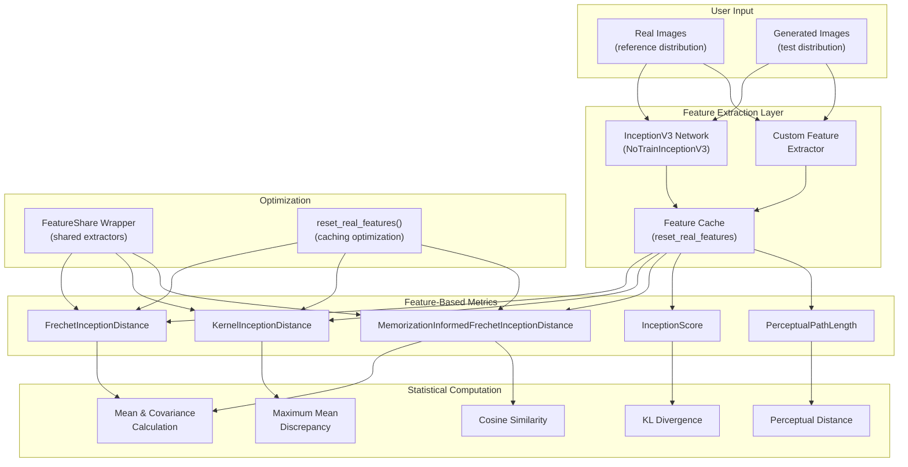
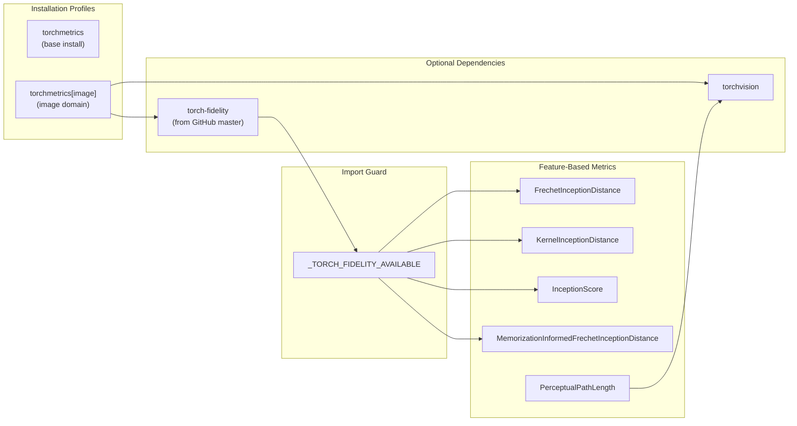
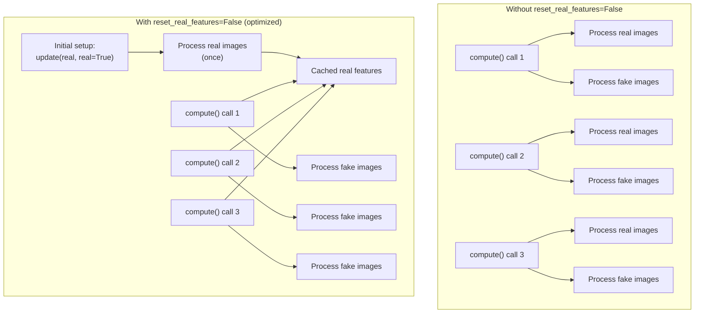
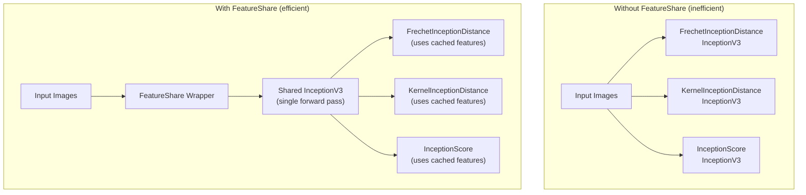
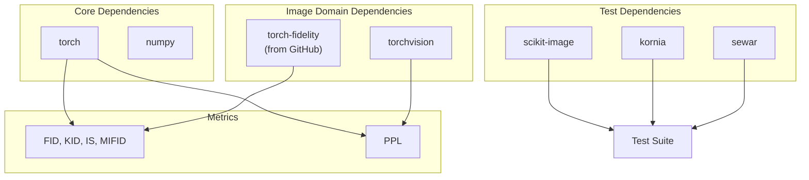

<!-- source: DeepWiki mcp.deepwiki.com · repo Lightning-AI/torchmetrics · page 5.2 Feature-Based Image Metrics · fetched 2026-10-21 -->

# Feature-Based Image Metrics

<details>
<summary>Relevant source files</summary>

The following files were used as context for generating this wiki page:

- [CHANGELOG.md](CHANGELOG.md)
- [docs/source/regression/critical_success_index.rst](docs/source/regression/critical_success_index.rst)
- [examples/audio/text_to_speech.py](examples/audio/text_to_speech.py)
- [requirements/_docs.txt](requirements/_docs.txt)
- [requirements/classification_test.txt](requirements/classification_test.txt)
- [requirements/image_test.txt](requirements/image_test.txt)
- [requirements/nominal_test.txt](requirements/nominal_test.txt)
- [requirements/segmentation_test.txt](requirements/segmentation_test.txt)
- [requirements/visual.txt](requirements/visual.txt)
- [src/torchmetrics/functional/image/__init__.py](src/torchmetrics/functional/image/__init__.py)
- [src/torchmetrics/functional/regression/csi.py](src/torchmetrics/functional/regression/csi.py)
- [src/torchmetrics/image/__init__.py](src/torchmetrics/image/__init__.py)
- [src/torchmetrics/regression/csi.py](src/torchmetrics/regression/csi.py)
- [tests/unittests/image/test_csi.py](tests/unittests/image/test_csi.py)

</details>


## Purpose and Scope

This page documents feature-based image quality metrics that assess image distributions by extracting features using pre-trained neural networks. These metrics compare statistical properties of feature representations rather than pixel-level differences, making them suitable for evaluating generative models and image synthesis quality.

For pixel-level comparison metrics like PSNR and SSIM, see [Reference-Based Image Metrics](#5.1). For metrics that assess quality without reference images but do not use feature extraction, see [No-Reference Image Metrics](#5.3).

## Overview

Feature-based metrics extract high-level features from images using pre-trained neural networks (typically InceptionV3) and compare statistical distributions between real and generated images. The main metrics in this category are:

| Metric | Full Name | Purpose | Distribution Comparison |
|--------|-----------|---------|------------------------|
| `FrechetInceptionDistance` (FID) | Fréchet Inception Distance | Measures similarity between two image distributions | Gaussian distribution parameters (mean, covariance) |
| `KernelInceptionDistance` (KID) | Kernel Inception Distance | Unbiased alternative to FID | Maximum Mean Discrepancy with polynomial kernel |
| `InceptionScore` (IS) | Inception Score | Evaluates quality and diversity of generated images | KL divergence between conditional and marginal distributions |
| `MemorizationInformedFrechetInceptionDistance` (MIFID) | Memorization-Informed FID | FID that detects memorization in generative models | Cosine similarity + FID |
| `PerceptualPathLength` (PPL) | Perceptual Path Length | Measures smoothness of latent space interpolation | Pairwise perceptual distances |

Sources: [src/torchmetrics/image/__init__.py:55-70](), [CHANGELOG.md:628]()

## Architecture and Feature Extraction

### Core Components

Feature-based metrics share a common architecture centered around feature extraction from pre-trained networks:



Sources: [src/torchmetrics/image/__init__.py:55-70](), [CHANGELOG.md:405]()

### Feature Extractor Dependencies

All feature-based metrics in this module conditionally depend on the `torch-fidelity` package, which provides the `NoTrainInceptionV3` implementation:



Sources: [src/torchmetrics/image/__init__.py:30-70](), [requirements/image_test.txt:9]()

## Individual Metrics

### Fréchet Inception Distance (FID)

`FrechetInceptionDistance` measures the distance between distributions of real and generated images by comparing their feature statistics extracted from InceptionV3.

**Key Parameters:**
- `feature`: Which InceptionV3 layer to extract features from (default: 2048-dimensional output)
- `reset_real_features`: Whether to cache real features between calls (optimization)
- `normalize`: Whether to normalize input images
- `antialias`: Apply antialiasing when resizing images (added in v1.8.0)

**Update Pattern:**
```python
# FID requires separate updates for real and fake images
fid.update(real_images, real=True)   # Update real distribution
fid.update(fake_images, real=False)  # Update fake distribution
result = fid.compute()
```

**State Management:**
The metric maintains separate statistics for real and fake distributions:
- `real_features_sum`, `real_features_cov_sum`, `real_features_num_samples`
- `fake_features_sum`, `fake_features_cov_sum`, `fake_features_num_samples`

**Special Features:**
- Supports custom feature extractors via `feature` parameter
- Supports `torch.float64` precision (added in v1.4.0)
- Raises error if too few samples provided (minimum required)
- Supports custom weights path for InceptionV3

Sources: [CHANGELOG.md:200](), [CHANGELOG.md:353](), [CHANGELOG.md:639-642](), [CHANGELOG.md:72]()

### Kernel Inception Distance (KID)

`KernelInceptionDistance` is an unbiased alternative to FID that uses Maximum Mean Discrepancy with a polynomial kernel instead of Gaussian assumptions.

**Key Parameters:**
- `feature`: InceptionV3 layer for feature extraction
- `subsets`: Number of subsets for computing variance (default: 100)
- `subset_size`: Size of each subset (default: 1000)
- `degree`: Degree of polynomial kernel
- `gamma`: Kernel coefficient
- `coef`: Kernel bias term

**Advantages over FID:**
- Unbiased estimator
- Does not assume Gaussian distributions
- Provides variance estimate through subset sampling

Sources: [src/torchmetrics/image/__init__.py:58]()

### Inception Score (IS)

`InceptionScore` evaluates quality and diversity of generated images using the conditional and marginal label distributions from InceptionV3 predictions.

**Computation:**
- Calculates KL divergence between conditional class distribution (per image) and marginal distribution (across all images)
- Higher scores indicate both high quality (confident predictions) and diversity (varied classes)

**Key Parameters:**
- `feature`: InceptionV3 layer (typically final softmax layer)
- `splits`: Number of splits for computing mean and std

**Update Pattern:**
```python
# IS only needs fake/generated images
inception_score.update(generated_images)
score_mean, score_std = inception_score.compute()
```

Sources: [src/torchmetrics/image/__init__.py:57]()

### Memorization-Informed Fréchet Inception Distance (MIFID)

`MemorizationInformedFrechetInceptionDistance` extends FID to detect when generative models memorize training data by incorporating cosine similarity checks.

**Key Features:**
- Detects near-duplicates between generated and training images
- Combines FID with memorization penalty
- Uses cosine similarity threshold to identify memorized samples

**Parameters:**
- Same as FID, plus memorization detection threshold
- Requires both training set and generated images

Sources: [src/torchmetrics/image/__init__.py:18](), [CHANGELOG.md:628]()

### Perceptual Path Length (PPL)

`PerceptualPathLength` measures the smoothness of latent space interpolation by computing perceptual distances along interpolation paths.

**Use Case:**
- Evaluates generative model latent space quality
- Lower values indicate smoother, more linear interpolation

**Key Parameters:**
- `num_samples`: Number of interpolation samples
- `epsilon`: Step size for interpolation
- Uses `LearnedPerceptualImagePatchSimilarity` (LPIPS) for distance computation

**Dependency:**
Requires `torchvision` (not `torch-fidelity`) and shares backend with LPIPS metric.

Sources: [src/torchmetrics/image/__init__.py:68-70](), [CHANGELOG.md:519]()

## Optimization Patterns

### reset_real_features Flag

For metrics comparing real vs. generated distributions (FID, KID, MIFID), the `reset_real_features` parameter enables caching of real image features:



**Usage Pattern:**
```python
# Initialize with caching enabled
fid = FrechetInceptionDistance(reset_real_features=False)

# Process real images once
fid.update(real_images, real=True)

# Now can compute multiple times with different fake sets
fid.update(fake_batch_1, real=False)
score_1 = fid.compute()

fid.update(fake_batch_2, real=False)  # Real features still cached
score_2 = fid.compute()

# Manually reset when real set changes
fid.reset_real_features()
fid.update(new_real_images, real=True)
```

Sources: [CHANGELOG.md:405]()

### FeatureShare Wrapper

`FeatureShare` is a wrapper that enables multiple metrics to share the same feature extractor, avoiding redundant forward passes:



**Usage Pattern:**
```python
from torchmetrics.wrappers import FeatureShare
from torchmetrics.image import FrechetInceptionDistance, KernelInceptionDistance

# Create metrics that would normally duplicate feature extraction
fid = FrechetInceptionDistance(feature=2048)
kid = KernelInceptionDistance(feature=2048)

# Wrap them to share the InceptionV3 network
shared_metrics = FeatureShare([fid, kid])

# Now both metrics share one forward pass through InceptionV3
shared_metrics.update(images)
results = shared_metrics.compute()  # {'FrechetInceptionDistance': ..., 'KernelInceptionDistance': ...}
```

**Benefits:**
- Reduces computational cost by ~50% when using 2+ feature-based metrics
- Reduces memory usage (single feature extractor instance)
- Maintains full metric accuracy

**Limitations:**
- Only works when metrics use the same feature extractor configuration
- Cached network must be moved to correct device manually if needed

Sources: [CHANGELOG.md:405](), [CHANGELOG.md:392]()

## Feature Extractor Configuration

### NoTrainInceptionV3

The default feature extractor is `NoTrainInceptionV3` from `torch-fidelity`, which provides a non-trainable InceptionV3 model:

**Layer Options (feature parameter):**
- `64`: Output of first convolutional block
- `192`: Output of second convolutional block
- `768`: Output of mixed_6e block
- `2048`: Output before final classification layer (default, most common)

**Custom Feature Extractors:**
```python
# Using custom feature extractor
class CustomExtractor(torch.nn.Module):
    def forward(self, x):
        return features  # Must return features of consistent shape

fid = FrechetInceptionDistance(feature=CustomExtractor())
```

Sources: [CHANGELOG.md:431]()

### Weight Loading and Initialization

FID supports custom weight paths (added in v1.6.1):

```python
fid = FrechetInceptionDistance(
    feature=2048,
    # Custom weights path can be specified for InceptionV3
    # Implementation detail: passed to underlying torch-fidelity
)
```

**Initialization Error Handling:**
If `torch-fidelity` is not installed, attempting to instantiate these metrics raises an informative error (added in v1.2.1).

Sources: [CHANGELOG.md:200](), [CHANGELOG.md:439]()

## Input Requirements and Preprocessing

### Image Format

Feature-based metrics accept images in standard PyTorch format:

**Expected Input Shape:**
- `(N, C, H, W)` - Batch of images
  - N: batch size
  - C: channels (typically 3 for RGB)
  - H, W: height and width (automatically resized to 299×299 for InceptionV3)

**Data Types:**
- `torch.uint8`: Automatically normalized to [0, 1]
- `torch.float32`: Expected range [0, 1] by default
- `torch.float64`: Supported for FID (added in v1.4.0)

**Normalization:**
The `normalize` parameter controls whether inputs are normalized to InceptionV3's expected range:
- When `True`: applies ImageNet normalization
- When `False`: assumes inputs are already appropriately scaled

Sources: [CHANGELOG.md:639]()

### Antialiasing and Resizing

FID now supports antialiasing during image resizing (added in v1.8.0):

```python
fid = FrechetInceptionDistance(antialias=True)
```

This prevents aliasing artifacts when images are resized to 299×299 for InceptionV3 input.

Sources: [CHANGELOG.md:72]()

## Distribution Requirements and Error Handling

### Minimum Sample Requirements

FID raises an error if too few samples are provided (added in v1.3.0):

```python
# Will raise error if too few samples
fid.update(too_few_real_images, real=True)
fid.update(fake_images, real=False)
fid.compute()  # Error: insufficient samples for covariance estimation
```

The minimum depends on feature dimension (typically need at least `feature_dim + 1` samples).

Sources: [CHANGELOG.md:639]()

### Numerical Stability

Matrix square root calculation in FID was changed from `scipy` to `torch` for better numerical stability (v1.0.0):

**Previous Issues:**
- Negative variance estimates in certain cases
- Precision loss during scipy/torch conversion

**Current Implementation:**
- Pure PyTorch implementation using `torch.linalg.sqrtm` or equivalent
- Better gradient flow
- Improved numerical stability

Sources: [CHANGELOG.md:377](), [CHANGELOG.md:642]()

## Integration with MetricCollection and Compute Groups

Feature-based metrics can be used within `MetricCollection`, and when using `FeatureShare`, they form efficient compute groups:

```python
from torchmetrics import MetricCollection
from torchmetrics.image import FrechetInceptionDistance, KernelInceptionDistance
from torchmetrics.wrappers import FeatureShare

# Manual sharing
fid = FrechetInceptionDistance()
kid = KernelInceptionDistance()
shared = FeatureShare([fid, kid])

collection = MetricCollection({"shared_metrics": shared})

# Compute groups automatically recognize shared state
collection.update(images)
results = collection.compute()
```

Sources: [CHANGELOG.md:405]()

## Testing and Validation

### Reference Implementations

Feature-based metrics are validated against reference implementations from:

**torch-fidelity:**
- Primary reference for FID, KID, IS
- Used in integration tests

**Test Dependencies:**
```
torch-fidelity @ git+https://github.com/toshas/torch-fidelity@master
```

**Test Files:**
- Tests verify exact numerical agreement with reference implementations
- Validate distributed training behavior
- Test edge cases (too few samples, dimension mismatches)

Sources: [requirements/image_test.txt:9]()

## Common Pitfalls and Best Practices

### 1. Insufficient Sample Size

**Problem:** Computing FID/KID with too few samples leads to unreliable estimates.

**Solution:**
- Use at least 2048 samples for reliable FID scores
- KID requires sufficient samples per subset (default: 1000)

### 2. Forgetting real=True Flag

**Problem:** Not specifying `real=True` when updating with real images.

**Solution:**
```python
# Correct
fid.update(real_images, real=True)
fid.update(fake_images, real=False)

# Incorrect - treats everything as fake
fid.update(real_images)
fid.update(fake_images)
```

### 3. Feature Extractor Mismatch

**Problem:** Comparing scores from different feature extractors or layers.

**Solution:**
- Always use the same `feature` parameter value when comparing FID scores
- Document which layer was used (default: 2048)

### 4. Memory Issues with Large Batches

**Problem:** Loading too many images causes OOM errors.

**Solution:**
```python
# Process in smaller batches
for batch in data_loader:
    fid.update(batch, real=False)
# Compute after all batches processed
score = fid.compute()
```

### 5. Not Leveraging FeatureShare

**Problem:** Computing multiple feature-based metrics independently wastes computation.

**Solution:**
- Use `FeatureShare` wrapper when computing 2+ feature-based metrics
- Reduces computation time by ~50%

## Dependencies Summary



**Installation:**
```bash
# Base installation (no feature-based metrics)
pip install torchmetrics

# With image domain (includes FID, KID, IS, MIFID, PPL)
pip install torchmetrics[image]

# Development mode with all test dependencies
pip install -e .[dev]
```

Sources: [requirements/image_test.txt:1-12](), [src/torchmetrics/image/__init__.py:30-33]()

---

