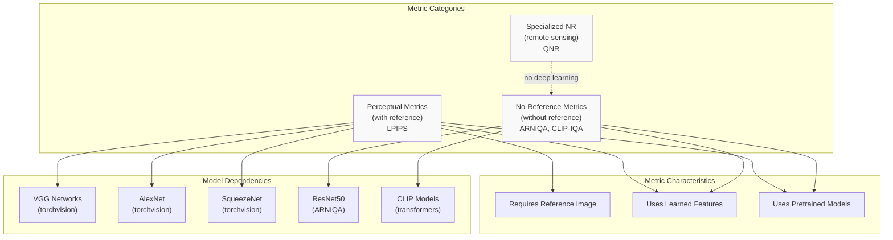
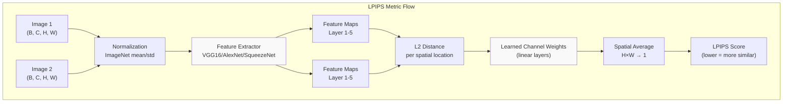
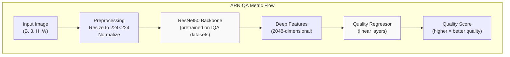
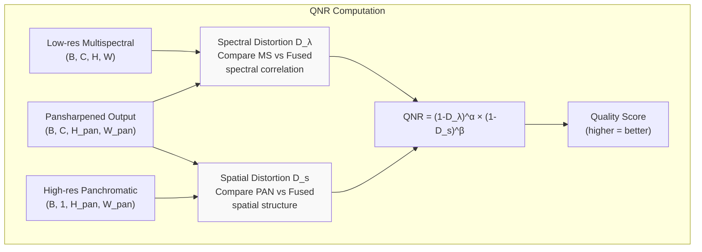
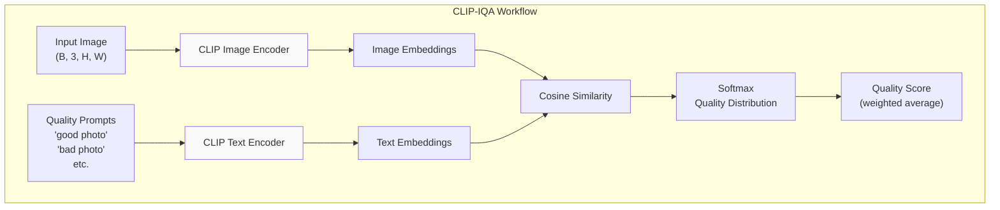
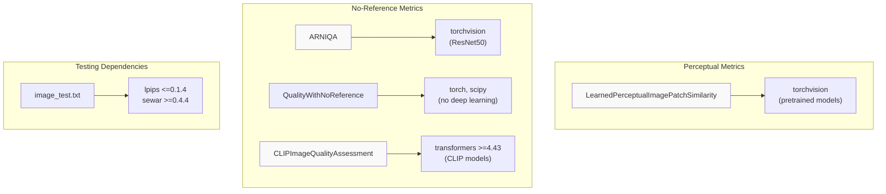
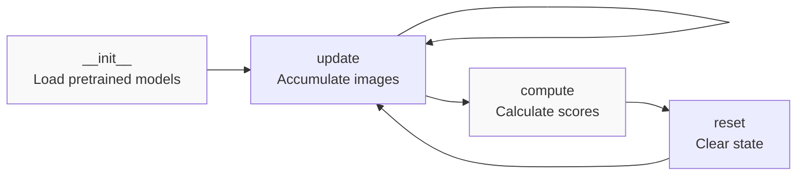

<!-- source: DeepWiki mcp.deepwiki.com · repo Lightning-AI/torchmetrics · page 5.3 Perceptual and No-Reference Metrics · fetched 2026-10-21 -->

# Perceptual and No-Reference Metrics

<details>
<summary>Relevant source files</summary>

The following files were used as context for generating this wiki page:

- [CHANGELOG.md](CHANGELOG.md)
- [docs/source/regression/critical_success_index.rst](docs/source/regression/critical_success_index.rst)
- [examples/audio/text_to_speech.py](examples/audio/text_to_speech.py)
- [requirements/_docs.txt](requirements/_docs.txt)
- [requirements/classification_test.txt](requirements/classification_test.txt)
- [requirements/image_test.txt](requirements/image_test.txt)
- [requirements/nominal_test.txt](requirements/nominal_test.txt)
- [requirements/segmentation_test.txt](requirements/segmentation_test.txt)
- [requirements/visual.txt](requirements/visual.txt)
- [src/torchmetrics/functional/image/__init__.py](src/torchmetrics/functional/image/__init__.py)
- [src/torchmetrics/functional/regression/csi.py](src/torchmetrics/functional/regression/csi.py)
- [src/torchmetrics/image/__init__.py](src/torchmetrics/image/__init__.py)
- [src/torchmetrics/regression/csi.py](src/torchmetrics/regression/csi.py)
- [tests/unittests/image/test_csi.py](tests/unittests/image/test_csi.py)

</details>


This page documents perceptual and no-reference image quality metrics in TorchMetrics. These metrics evaluate image quality using learned perceptual features or without requiring reference images, in contrast to traditional reference-based metrics like PSNR and SSIM.

**Scope**: This page covers:
- Perceptual metrics that use neural network features to assess similarity (LPIPS)
- No-reference metrics that evaluate quality without reference images (ARNIQA, CLIP-IQA)
- Specialized no-reference metrics for remote sensing applications (QNR)

For traditional reference-based metrics (PSNR, SSIM, etc.), see [Reference-Based Image Metrics](#5.1). For feature distribution metrics (FID, KID), see [Feature-Based Image Metrics](#5.2). For hyperspectral metrics with references, see [Spectral and Hyperspectral Metrics](#5.4).

---

## Overview: Perceptual vs No-Reference Metrics

**Perceptual metrics** measure image similarity using learned features from deep neural networks that correlate better with human perception than pixel-level metrics. These metrics still require a reference image but evaluate perceptual similarity rather than pixel-wise error.

**No-reference (NR) metrics** evaluate image quality without requiring a reference image, predicting absolute quality scores based on learned quality representations. These are useful when ground truth is unavailable or for assessing natural image quality.



**Sources**: [CHANGELOG.md:141](), [CHANGELOG.md:347](), [CHANGELOG.md:523](), [src/torchmetrics/image/__init__.py:67-70]()

---

## Learned Perceptual Image Patch Similarity (LPIPS)

**LPIPS** measures perceptual similarity between two images by computing distances in deep feature space. It uses pretrained networks (VGG, AlexNet, or SqueezeNet) to extract features and computes weighted L2 distances across feature layers.

### Architecture and Implementation



### Class and Functional Interfaces

The LPIPS metric is available as both a class-based and functional interface:

**Class**: `torchmetrics.image.LearnedPerceptualImagePatchSimilarity`
- Located at: [src/torchmetrics/image/lpip.py]()
- Requires: `torchvision` (conditional import)

**Functional**: `torchmetrics.functional.image.learned_perceptual_image_patch_similarity`
- Located at: [src/torchmetrics/functional/image/lpips.py]()

```python
# Class-based usage (stateful)
from torchmetrics.image import LearnedPerceptualImagePatchSimilarity

lpips = LearnedPerceptualImagePatchSimilarity(net_type='vgg', reduction='mean')
lpips.update(pred_images, target_images)
score = lpips.compute()

# Functional usage (stateless)
from torchmetrics.functional.image import learned_perceptual_image_patch_similarity

score = learned_perceptual_image_patch_similarity(
    pred_images, 
    target_images, 
    net_type='alex'
)
```

### Key Configuration Parameters

| Parameter | Options | Description |
|-----------|---------|-------------|
| `net_type` | `'alex'`, `'vgg'`, `'squeeze'` | Pretrained network backbone |
| `reduction` | `'mean'`, `'sum'`, `'none'` | How to reduce spatial dimensions |
| `normalize` | `bool` | Apply ImageNet normalization |

**Reduction Modes** (added in v1.8.0):
- `reduction='mean'`: Average LPIPS across batch and spatial dimensions
- `reduction='sum'`: Sum LPIPS scores
- `reduction='none'`: Return per-pixel LPIPS maps `(B, H, W)`

### Implementation Changes

**v1.0.0 Refactor**: The LPIPS implementation was rewritten to remove dependency on the third-party `lpips` package. The metric now uses native PyTorch and torchvision components:

- **Old**: Relied on `import lpips` package
- **New**: Native implementation using `torchvision.models`
- **Benefits**: 
  - Better integration with TorchMetrics state management
  - Full control over forward/backward passes
  - Improved numerical stability (fixed in v1.2.1)

**Numerical Stability Fix** (v1.2.1): Addressed numerical precision issues when computing distances in feature space.

**Sources**: [CHANGELOG.md:641](), [CHANGELOG.md:453](), [CHANGELOG.md:68](), [src/torchmetrics/image/__init__.py:67-68](), [src/torchmetrics/functional/image/__init__.py:20]()

---

## ARNIQA: No-Reference Image Quality Assessment

**ARNIQA** (Article on No-Reference Image Quality Assessment) is a deep learning-based no-reference metric that predicts image quality scores without requiring reference images. It uses a pretrained ResNet50 backbone trained on image quality datasets.

### Architecture Overview



### Usage

```python
from torchmetrics.image import ARNIQA
from torchmetrics.functional.image import arniqa

# Class-based (stateful)
metric = ARNIQA()
metric.update(images)
quality_score = metric.compute()

# Functional (stateless)
quality_score = arniqa(images)
```

**Class Location**: [src/torchmetrics/image/arniqa.py]()
**Functional Location**: [src/torchmetrics/functional/image/arniqa.py]()

### Characteristics

- **Input**: RGB images, automatically resized to 224×224
- **Output**: Quality scores (higher values indicate better quality)
- **Use Cases**: 
  - Evaluating image compression artifacts
  - Assessing generative model outputs
  - Quality control in image processing pipelines
- **Added**: v1.7.0

**Sources**: [CHANGELOG.md:141](), [src/torchmetrics/functional/image/__init__.py:14]()

---

## QualityWithNoReference (QNR): Hyperspectral/Multispectral Metric

**QNR** is a no-reference quality metric specifically designed for pansharpened multispectral/hyperspectral images. It evaluates quality without requiring the original high-resolution multispectral image by analyzing spectral and spatial distortion.

### Metric Formulation

QNR combines two distortion indices:

```
QNR = (1 - D_λ)^α × (1 - D_s)^β
```

Where:
- **D_λ**: Spectral distortion index (measures spectral fidelity)
- **D_s**: Spatial distortion index (measures spatial consistency)
- **α, β**: Weighting parameters (default: 1)



### Usage

```python
from torchmetrics.image import QualityWithNoReference
from torchmetrics.functional.image import quality_with_no_reference

# Class-based
qnr = QualityWithNoReference()
qnr.update(ms, pan, fused)
score = qnr.compute()

# Functional
score = quality_with_no_reference(ms, pan, fused, alpha=1, beta=1)
```

**Class Location**: [src/torchmetrics/image/qnr.py]()
**Functional Location**: [src/torchmetrics/functional/image/qnr.py]()

### Relationship to Other Metrics

QNR relies on the spectral and spatial distortion indices, which are also available as standalone metrics:
- **SpectralDistortionIndex (D_λ)**: See [Spectral and Hyperspectral Metrics](#5.4)
- **SpatialDistortionIndex (D_s)**: See [Spectral and Hyperspectral Metrics](#5.4)

**Sources**: [CHANGELOG.md:347](), [src/torchmetrics/image/__init__.py:21](), [src/torchmetrics/functional/image/__init__.py:24]()

---

## CLIPImageQualityAssessment (CLIP-IQA): Multimodal Quality Prediction

**CLIP-IQA** leverages CLIP (Contrastive Language-Image Pre-training) models to assess image quality by comparing images against quality-related text prompts. This metric is located in the multimodal package due to its cross-modal nature.

### Architecture



### Usage

```python
from torchmetrics.multimodal import CLIPImageQualityAssessment

# Initialize with specific CLIP model
clip_iqa = CLIPImageQualityAssessment(model_name_or_path='openai/clip-vit-base-patch32')

# Evaluate image quality
clip_iqa.update(images)
quality_score = clip_iqa.compute()
```

**Class Location**: [src/torchmetrics/multimodal/clip_iqa.py]()

### Model Support

CLIP-IQA supports various CLIP model variants (enhanced in v1.7.0):
- OpenAI CLIP models: `openai/clip-vit-base-patch32`, `openai/clip-vit-large-patch14`
- Jina CLIP models: `jinaai/jina-clip-v2`
- Other Hugging Face CLIP-compatible models

See [Multimodal Metrics](#9) for more details on CLIP model configuration and CLIPScore.

### Type Hints Issue

**Fixed in v1.6.2**: Incorrect type hints for CLIP-IQA parameters were corrected.

**Sources**: [CHANGELOG.md:523](), [CHANGELOG.md:193](), [CHANGELOG.md:143]()

---

## Dependencies and Requirements

### Core Dependencies



### Installation

Perceptual and no-reference metrics require specific extras:

```bash
# Install with image metrics support
pip install torchmetrics[image]

# Install with multimodal support (for CLIP-IQA)
pip install torchmetrics[multimodal]

# Install all dependencies
pip install torchmetrics[all]
```

**Required packages** (from [requirements/image.txt]()):
- `scipy` (for QNR)
- `torchvision` (for LPIPS, ARNIQA)

**Required packages** (from [requirements/multimodal.txt]()):
- `transformers >=4.43` (for CLIP-IQA)

**Test packages** (from [requirements/image_test.txt]()):
- `lpips <=0.1.4` (for validation against original LPIPS implementation)
- `sewar` (for additional validation)

**Sources**: [requirements/image_test.txt:1-12](), [src/torchmetrics/image/__init__.py:30-33]()

---

## Comparison: Perceptual vs Traditional Metrics

| Aspect | Traditional (PSNR, SSIM) | Perceptual (LPIPS) | No-Reference (ARNIQA, CLIP-IQA) |
|--------|--------------------------|--------------------|---------------------------------|
| **Reference Required** | ✓ Yes | ✓ Yes | ✗ No |
| **Uses Deep Learning** | ✗ No | ✓ Yes | ✓ Yes |
| **Human Correlation** | Medium | High | High |
| **Computational Cost** | Low | Medium | Medium-High |
| **Differentiable** | ✓ Yes | ✓ Yes | ✓ Yes (most) |
| **Use Case** | Signal fidelity | Perceptual similarity | Absolute quality |

### When to Use Each Type

**Use Traditional Metrics** (see [Reference-Based Image Metrics](#5.1)):
- When pixel-level accuracy matters (medical imaging, satellite imagery)
- For compression evaluation with ground truth
- When computational efficiency is critical

**Use Perceptual Metrics** (LPIPS):
- For generative models (GANs, VAEs, diffusion models)
- When perceptual similarity matters more than pixel accuracy
- For evaluating super-resolution or denoising where human judgment is important

**Use No-Reference Metrics** (ARNIQA, CLIP-IQA):
- When ground truth is unavailable
- For user-generated content quality assessment
- For monitoring model outputs in production

**Use QNR**:
- Specifically for pansharpened multispectral/hyperspectral images
- When evaluating fusion algorithms without reference images

**Sources**: [CHANGELOG.md:641](), [CHANGELOG.md:347](), [CHANGELOG.md:141]()

---

## Integration with Metric System

### State Management

All perceptual and no-reference metrics follow the standard TorchMetrics lifecycle:



**Key Considerations**:

1. **Model Loading**: Pretrained models are loaded during `__init__` and cached
2. **List States**: Most perceptual metrics use list states to accumulate images (growing memory)
3. **DDP Support**: All metrics support distributed training with proper state synchronization
4. **Device Placement**: Models automatically move to the same device as input tensors

### Using with MetricCollection

```python
from torchmetrics import MetricCollection
from torchmetrics.image import LearnedPerceptualImagePatchSimilarity, StructuralSimilarityIndexMeasure

metrics = MetricCollection({
    'lpips': LearnedPerceptualImagePatchSimilarity(net_type='alex'),
    'ssim': StructuralSimilarityIndexMeasure(),
})

metrics.update(pred, target)
results = metrics.compute()
# {'lpips': tensor(0.234), 'ssim': tensor(0.891)}
```

**Note**: When using LPIPS with `MetricCollection`, the pretrained network is instantiated once and reused efficiently. See [FeatureShare and MetricInputTransformer](#12.6) for advanced feature sharing between metrics.

**Sources**: [src/torchmetrics/image/__init__.py:1-71](), [CHANGELOG.md:389]()

---

## Summary

**Perceptual and no-reference metrics** provide complementary approaches to image quality assessment:

1. **LPIPS**: Best-in-class perceptual similarity metric using learned features
2. **ARNIQA**: General-purpose no-reference quality assessment
3. **QNR**: Specialized metric for multispectral/hyperspectral fusion
4. **CLIP-IQA**: Leverages vision-language models for quality prediction

These metrics are particularly valuable for:
- Generative model evaluation (GANs, diffusion models)
- Production monitoring without ground truth
- Remote sensing applications (QNR)
- Cross-modal quality assessment (CLIP-IQA)

For metrics that compare against reference images using pixel-level or structural features, see [Reference-Based Image Metrics](#5.1). For metrics based on feature distributions, see [Feature-Based Image Metrics](#5.2).

**Sources**: [CHANGELOG.md:141](), [CHANGELOG.md:347](), [CHANGELOG.md:523](), [CHANGELOG.md:641](), [src/torchmetrics/image/__init__.py:1-71](), [src/torchmetrics/functional/image/__init__.py:1-59]()

---

