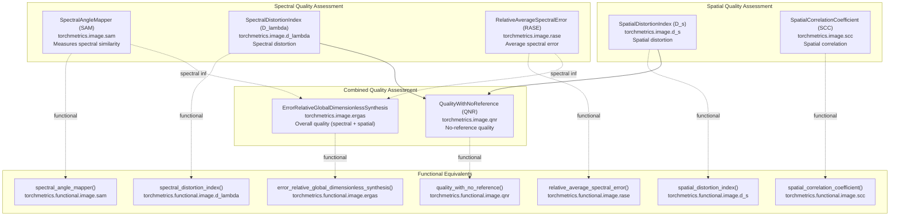
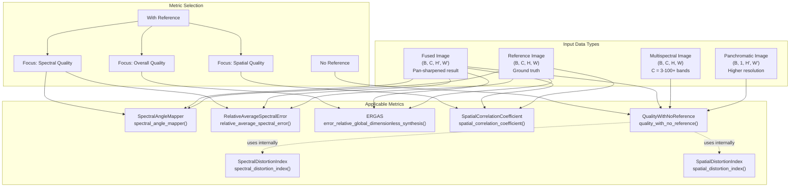
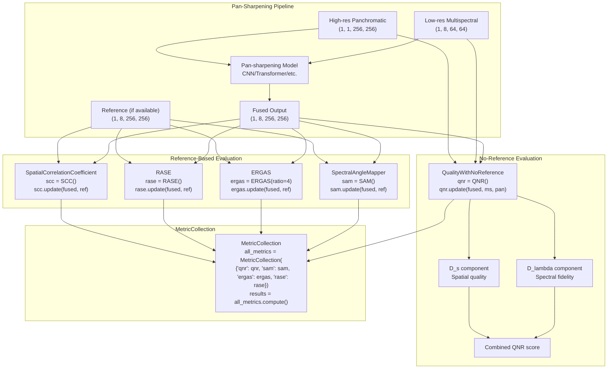

<!-- source: DeepWiki mcp.deepwiki.com · repo Lightning-AI/torchmetrics · page 5.4 Spectral and Hyperspectral Metrics · fetched 2026-10-21 -->

# Spectral and Hyperspectral Metrics

<details>
<summary>Relevant source files</summary>

The following files were used as context for generating this wiki page:

- [CHANGELOG.md](CHANGELOG.md)
- [docs/source/regression/critical_success_index.rst](docs/source/regression/critical_success_index.rst)
- [examples/audio/text_to_speech.py](examples/audio/text_to_speech.py)
- [requirements/_docs.txt](requirements/_docs.txt)
- [requirements/classification_test.txt](requirements/classification_test.txt)
- [requirements/image_test.txt](requirements/image_test.txt)
- [requirements/nominal_test.txt](requirements/nominal_test.txt)
- [requirements/segmentation_test.txt](requirements/segmentation_test.txt)
- [requirements/visual.txt](requirements/visual.txt)
- [src/torchmetrics/functional/image/__init__.py](src/torchmetrics/functional/image/__init__.py)
- [src/torchmetrics/functional/regression/csi.py](src/torchmetrics/functional/regression/csi.py)
- [src/torchmetrics/image/__init__.py](src/torchmetrics/image/__init__.py)
- [src/torchmetrics/regression/csi.py](src/torchmetrics/regression/csi.py)
- [tests/unittests/image/test_csi.py](tests/unittests/image/test_csi.py)

</details>


## Purpose and Scope

This document covers spectral and hyperspectral image quality metrics in TorchMetrics, which are specialized for evaluating remote sensing, satellite imagery, and hyperspectral imaging applications. These metrics assess spectral fidelity, spatial quality, and overall image synthesis quality for multi-band and hyperspectral images.

For general image quality metrics (PSNR, SSIM, FID), see [5.1](#5.1). For perceptual metrics (LPIPS), see [5.3](#5.3). For reference-based metrics that don't specifically address spectral information, see [5.1](#5.1).

**Sources:** [src/torchmetrics/image/__init__.py:1-71](), [CHANGELOG.md:366-577]()

---

## Overview

Spectral and hyperspectral metrics evaluate images with multiple spectral bands, where each pixel contains a spectrum of values rather than just RGB channels. These metrics are critical for applications in:
- **Remote sensing**: Evaluating satellite and aerial imagery
- **Hyperspectral imaging**: Medical imaging, agricultural monitoring, mineral detection
- **Pan-sharpening**: Fusing low-resolution multispectral with high-resolution panchromatic images
- **Image fusion**: Combining multiple sensor modalities

TorchMetrics provides six core spectral metrics, all following the standard dual-interface pattern with both class-based and functional APIs.

**Sources:** [src/torchmetrics/image/__init__.py:14-52](), [src/torchmetrics/functional/image/__init__.py:15-58]()

---

## Metric Categories and Relationships



**Diagram: Spectral and Hyperspectral Metrics Taxonomy**

This diagram shows the organization of spectral metrics into three categories: spectral quality (SAM, D_lambda, RASE), spatial quality (D_s, SCC), and combined assessment (ERGAS, QNR). The QNR metric specifically combines D_lambda and D_s for no-reference quality evaluation.

**Sources:** [src/torchmetrics/image/__init__.py:14-52](), [src/torchmetrics/functional/image/__init__.py:15-58]()

---

## SpectralAngleMapper (SAM)

The Spectral Angle Mapper measures the spectral similarity between two hyperspectral images by calculating the angle between spectral vectors. It is invariant to illumination changes and focuses purely on spectral shape rather than magnitude.

### Mathematical Definition

SAM computes the average angle (in radians) between corresponding pixel spectra:

```
SAM = (1/N) * Σ arccos((x · y) / (||x|| * ||y||))
```

where `x` and `y` are spectral vectors for corresponding pixels, `N` is the total number of pixels, and the angle is measured in radians.

### Implementation

**Class-based API:**
- Located in [src/torchmetrics/image/sam.py]()
- Class name: `SpectralAngleMapper`
- Inherits from `Metric` base class
- State management: Changed to tensor states in v1.2.1 (see [CHANGELOG.md:444]())

**Functional API:**
- Located in [src/torchmetrics/functional/image/sam.py]()
- Function name: `spectral_angle_mapper(preds, target, reduction='elementwise_mean')`

### Usage Patterns

```python
# Class-based: stateful accumulation
from torchmetrics.image import SpectralAngleMapper

sam = SpectralAngleMapper()
for preds_batch, target_batch in dataloader:
    sam.update(preds_batch, target_batch)
final_sam = sam.compute()

# Functional: one-shot computation
from torchmetrics.functional.image import spectral_angle_mapper

sam_value = spectral_angle_mapper(preds, target)
```

### Key Parameters

- `reduction`: Method for aggregating pixel-wise angles
  - `'elementwise_mean'` (default): Average across all pixels
  - `'sum'`: Sum of all angles
  - `'none'`: Returns per-pixel angles
- **Lower is better**: SAM values closer to 0 indicate better spectral similarity
- **Units**: Radians (values typically in range [0, π/2])

**Sources:** [src/torchmetrics/image/__init__.py:24](), [src/torchmetrics/functional/image/__init__.py:27](), [CHANGELOG.md:444]()

---

## SpectralDistortionIndex (D_lambda)

The Spectral Distortion Index quantifies spectral distortion in fused or pan-sharpened images by measuring correlation changes between spectral bands.

### Mathematical Definition

D_lambda measures the absolute difference between spectral correlation matrices:

```
D_lambda = (1/L(L-1)) * Σ |Q(b_i, b_j) - Q(b̃_i, b̃_j)|
```

where `Q(b_i, b_j)` is the Universal Image Quality Index (UQI) between bands `i` and `j`, `b` represents original bands, `b̃` represents fused bands, and `L` is the number of spectral bands.

### Implementation

**Class-based API:**
- Located in [src/torchmetrics/image/d_lambda.py]()
- Class name: `SpectralDistortionIndex`
- Imported as `SpectralDistortionIndex` in [src/torchmetrics/image/__init__.py:14]()

**Functional API:**
- Located in [src/torchmetrics/functional/image/d_lambda.py]()
- Function name: `spectral_distortion_index(preds, target, p=1)`

### Key Parameters

- `p`: Exponent for computing the metric (default: 1)
  - Controls sensitivity to band correlation differences
- **Lower is better**: D_lambda values closer to 0 indicate less spectral distortion
- **Range**: [0, 1] typically, though can exceed 1 in extreme cases

### Typical Use Case

D_lambda is primarily used in pan-sharpening evaluation, where a low-resolution multispectral image is fused with a high-resolution panchromatic image. It ensures the fused image preserves the spectral characteristics of the original multispectral data.

**Sources:** [src/torchmetrics/image/__init__.py:14](), [src/torchmetrics/functional/image/__init__.py:15](), [CHANGELOG.md:407]()

---

## SpatialDistortionIndex (D_s)

The Spatial Distortion Index measures spatial distortion in fused images by evaluating correlation changes within each spectral band.

### Mathematical Definition

D_s measures spatial quality degradation:

```
D_s = (1/L) * Σ |Q(MS_l, MS_l^LR) - Q(Fused_l, MS_l)|
```

where `Q` is the Universal Image Quality Index, `MS_l` is the l-th band of the multispectral image, `MS_l^LR` is its low-resolution version, `Fused_l` is the l-th band of the fused image, and `L` is the number of bands.

### Implementation

**Class-based API:**
- Located in [src/torchmetrics/image/d_s.py]()
- Class name: `SpatialDistortionIndex`
- Added in v1.3.0 (see [CHANGELOG.md:407]())

**Functional API:**
- Located in [src/torchmetrics/functional/image/d_s.py]()
- Function name: `spatial_distortion_index(preds, ms, pan, p=1)`

### Key Parameters

- `preds`: Fused/pan-sharpened image
- `ms`: Original multispectral image (low-resolution)
- `pan`: Panchromatic image (high-resolution)
- `p`: Exponent for computing the metric (default: 1)
- **Lower is better**: D_s values closer to 0 indicate less spatial distortion
- **Range**: [0, 1] typically

### Note on Input Requirements

Unlike most metrics that take `(preds, target)`, D_s requires three inputs: the fused image (`preds`), the original multispectral image (`ms`), and the panchromatic image (`pan`). This reflects the pan-sharpening context where the metric is used.

**Sources:** [src/torchmetrics/image/__init__.py:15](), [src/torchmetrics/functional/image/__init__.py:16](), [CHANGELOG.md:407]()

---

## ErrorRelativeGlobalDimensionlessSynthesis (ERGAS)

ERGAS provides a global measure of synthesis quality for multi-band images, combining spectral and spatial information into a single dimensionless metric. It is particularly popular in remote sensing for evaluating pan-sharpening and image fusion algorithms.

### Mathematical Definition

ERGAS is computed as:

```
ERGAS = 100 * (h/l) * sqrt((1/L) * Σ (RMSE_i / MEAN_i)²)
```

where:
- `h/l` is the ratio of pixel sizes (spatial resolution ratio)
- `L` is the number of spectral bands
- `RMSE_i` is the root mean squared error for band `i`
- `MEAN_i` is the mean pixel value for band `i` in the reference image

### Implementation

**Class-based API:**
- Located in [src/torchmetrics/image/ergas.py]()
- Class name: `ErrorRelativeGlobalDimensionlessSynthesis`
- Bug fix in computation in v1.4.0 (see [CHANGELOG.md:366]())

**Functional API:**
- Located in [src/torchmetrics/functional/image/ergas.py]()
- Function name: `error_relative_global_dimensionless_synthesis(preds, target, ratio=1)`

### Key Parameters

- `ratio`: Ratio between the spatial dimensions of the panchromatic and multispectral images (default: 1)
  - Typically 4 for standard pan-sharpening (4x resolution increase)
- **Lower is better**: Ideal value is 0
- **Interpretation**:
  - ERGAS < 3: Excellent quality
  - ERGAS < 5: Good quality
  - ERGAS > 5: Poor quality

### Bug Fix History

The computation of ERGAS had a bug that was fixed in v1.4.0 ([CHANGELOG.md:366]()). Users should ensure they are using version 1.4.0 or later for correct ERGAS calculations.

**Sources:** [src/torchmetrics/image/__init__.py:17](), [src/torchmetrics/functional/image/__init__.py:18](), [CHANGELOG.md:366]()

---

## RelativeAverageSpectralError (RASE)

RASE measures the average spectral error relative to the mean radiance, providing a percentage-based quality metric that is scale-invariant.

### Mathematical Definition

RASE is computed as:

```
RASE = (100 / M) * sqrt((1/L) * Σ RMSE_i²)
```

where:
- `M` is the mean radiance across all bands
- `L` is the number of spectral bands
- `RMSE_i` is the root mean squared error for band `i`

### Implementation

**Class-based API:**
- Located in [src/torchmetrics/image/rase.py]()
- Class name: `RelativeAverageSpectralError`
- Added in v1.0.0 (see [CHANGELOG.md:577]())

**Functional API:**
- Located in [src/torchmetrics/functional/image/rase.py]()
- Function name: `relative_average_spectral_error(preds, target, window_size=8)`

### Key Parameters

- `window_size`: Size of the sliding window for local computations (default: 8)
  - Used when computing window-based variants
- **Lower is better**: Ideal value is 0
- **Units**: Percentage (%)
- **Interpretation**:
  - RASE < 10%: Excellent quality
  - RASE < 20%: Good quality
  - RASE > 20%: Poor quality

**Sources:** [src/torchmetrics/image/__init__.py:22](), [src/torchmetrics/functional/image/__init__.py:25](), [CHANGELOG.md:577]()

---

## SpatialCorrelationCoefficient (SCC)

SCC measures the spatial correlation between predicted and target images, evaluating how well spatial structures are preserved.

### Mathematical Definition

SCC computes the correlation coefficient between spatial features:

```
SCC = correlation(spatial_features(pred), spatial_features(target))
```

where spatial features are typically extracted using gradient operators or other spatial filters.

### Implementation

**Class-based API:**
- Located in [src/torchmetrics/image/scc.py]()
- Class name: `SpatialCorrelationCoefficient`
- Added in v1.3.0 (see [CHANGELOG.md:409]())

**Functional API:**
- Located in [src/torchmetrics/functional/image/scc.py]()
- Function name: `spatial_correlation_coefficient(preds, target, hp_filter='avg')`

### Key Parameters

- `hp_filter`: High-pass filter type for extracting spatial features
  - `'avg'` (default): Average pooling-based high-pass filter
  - Other filter types may be supported depending on implementation
- **Higher is better**: Values closer to 1 indicate better spatial correlation
- **Range**: [-1, 1], with 1 being perfect correlation

**Sources:** [src/torchmetrics/image/__init__.py:25](), [src/torchmetrics/functional/image/__init__.py:28](), [CHANGELOG.md:409]()

---

## QualityWithNoReference (QNR)

QNR provides a no-reference quality assessment for pan-sharpened images by combining spectral and spatial distortion indices. It is particularly useful when a high-resolution multispectral reference is not available.

### Mathematical Definition

QNR is computed as:

```
QNR = (1 - D_lambda)^α * (1 - D_s)^β
```

where:
- `D_lambda` is the Spectral Distortion Index
- `D_s` is the Spatial Distortion Index
- `α` and `β` are weighting exponents (typically both set to 1)

### Implementation

**Class-based API:**
- Located in [src/torchmetrics/image/qnr.py]()
- Class name: `QualityWithNoReference`
- Added in v1.4.0 (see [CHANGELOG.md:347]())

**Functional API:**
- Located in [src/torchmetrics/functional/image/qnr.py]()
- Function name: `quality_with_no_reference(preds, ms, pan, alpha=1, beta=1, p=1)`

### Key Parameters

- `preds`: Fused/pan-sharpened image
- `ms`: Original multispectral image (low-resolution)
- `pan`: Panchromatic image (high-resolution)
- `alpha`: Weight for spectral distortion (default: 1)
- `beta`: Weight for spatial distortion (default: 1)
- `p`: Exponent for D_lambda and D_s computation (default: 1)
- **Higher is better**: Values closer to 1 indicate better quality
- **Range**: [0, 1]

### Relationship to Other Metrics

QNR internally computes both D_lambda and D_s, then combines them. This makes it a comprehensive no-reference metric that doesn't require a high-resolution multispectral reference image, which is often unavailable in practice.

**Sources:** [src/torchmetrics/image/__init__.py:21](), [src/torchmetrics/functional/image/__init__.py:24](), [CHANGELOG.md:347]()

---

## Usage Patterns and Integration



**Diagram: Metric Selection Based on Available Data and Quality Focus**

This diagram illustrates how to select appropriate spectral metrics based on:
1. **Data availability**: Whether a high-resolution reference is available
2. **Quality focus**: Spectral, spatial, or overall quality
3. **Input requirements**: Different metrics require different combinations of inputs

**Sources:** [src/torchmetrics/image/__init__.py:1-71](), [src/torchmetrics/functional/image/__init__.py:1-59]()

---

## Metric State Management and Distributed Training

```mermaid
graph TB
    subgraph "Metric Lifecycle"
        INIT["__init__()<br/>Configure parameters<br/>register states"]
        UPDATE["update(preds, target)<br/>Accumulate statistics<br/>Band-wise calculations"]
        COMPUTE["compute()<br/>Aggregate across batches<br/>Calculate final metric"]
        RESET["reset()<br/>Clear accumulated states"]
    end
    
    subgraph "State Types for Spectral Metrics"
        TENSOR_STATE["Tensor States<br/>sum_scores, num_samples<br/>O(1) memory"]
        CHANGE["State Type Change (v1.2.1)<br/>SAM/UQI moved to tensors"]
    end
    
    subgraph "Distributed Training Support"
        SYNC["DDP Synchronization<br/>dist_reduce_fx='sum'<br/>or 'mean'"]
        ALLGATHER["All-gather operations<br/>for band statistics"]
    end
    
    INIT --> UPDATE
    UPDATE --> UPDATE
    UPDATE --> COMPUTE
    COMPUTE --> RESET
    RESET --> UPDATE
    
    UPDATE --> TENSOR_STATE
    TENSOR_STATE --> SYNC
    SYNC --> COMPUTE
    
    CHANGE -.improved in v1.2.1.-> TENSOR_STATE
```

**Diagram: State Management for Spectral Metrics**

Spectral metrics follow the standard TorchMetrics lifecycle but with specific considerations:

1. **State Type Change**: In v1.2.1, SpectralAngleMapper and UniversalImageQualityIndex were changed from using list states to tensor states for better memory efficiency and performance ([CHANGELOG.md:444]())

2. **Band-wise Computation**: Many spectral metrics compute statistics separately for each spectral band, then aggregate

3. **Distributed Support**: All spectral metrics support distributed training with appropriate `dist_reduce_fx` settings

**Sources:** [CHANGELOG.md:444](), [src/torchmetrics/image/__init__.py:14-52]()

---

## Integration Example: Pan-Sharpening Evaluation



**Diagram: Comprehensive Pan-Sharpening Evaluation Pipeline**

This diagram shows a typical evaluation setup for pan-sharpening:

1. **Input Processing**: Low-resolution multispectral and high-resolution panchromatic images
2. **Model Inference**: Pan-sharpening model produces fused high-resolution multispectral output
3. **No-Reference Evaluation**: QNR when reference is unavailable
4. **Reference-Based Evaluation**: SAM, ERGAS, RASE, SCC when reference is available
5. **Metric Collection**: Using MetricCollection for efficient computation (see [2.4](#2.4))

**Sources:** [src/torchmetrics/image/__init__.py:1-71](), [src/torchmetrics/functional/image/__init__.py:1-59]()

---

## Common Pitfalls and Best Practices

### Input Shape Requirements

| Metric | Expected Shape | Notes |
|--------|----------------|-------|
| SAM | `(B, C, H, W)` | Both inputs must have same shape; C is number of spectral bands |
| ERGAS | `(B, C, H, W)` | Requires `ratio` parameter matching resolution difference |
| RASE | `(B, C, H, W)` | Window size must be compatible with spatial dimensions |
| D_lambda | `(B, C, H, W)` | Requires at least 2 spectral bands |
| D_s | Multiple inputs | `preds: (B, C, H', W')`, `ms: (B, C, H, W)`, `pan: (B, 1, H', W')` |
| QNR | Multiple inputs | Same as D_s (uses both D_lambda and D_s) |
| SCC | `(B, C, H, W)` | Spatial dimensions must be sufficient for gradient computation |

### Performance Considerations

1. **Tensor States**: Since v1.2.1, SAM uses tensor states for O(1) memory complexity rather than list states that grow with batch count ([CHANGELOG.md:444]())

2. **Batch Processing**: Spectral metrics can be memory-intensive for large hyperspectral images. Consider processing in smaller batches:
   ```python
   metric = SpectralAngleMapper()
   for batch in dataloader:
       metric.update(batch['pred'], batch['target'])
   result = metric.compute()  # Aggregates across all batches
   ```

3. **Compute Groups**: When using multiple spectral metrics with MetricCollection, they can share computations if they have compatible reduction operations

### Common Errors

**Error 1: Mismatched Spectral Dimensions**
```
ValueError: Expected preds and target to have same number of channels
```
**Solution**: Ensure both inputs have the same number of spectral bands in dimension 1

**Error 2: ERGAS Ratio Mismatch**
```
# Incorrect
ergas = ERGAS(ratio=1)  # But actual resolution ratio is 4
```
**Solution**: Set `ratio` parameter to match actual spatial resolution ratio between panchromatic and multispectral images

**Error 3: QNR Input Order**
```
# Incorrect
qnr(ms_image, pan_image, fused_image)

# Correct
qnr(fused_image, ms_image, pan_image)
```
**Solution**: First argument is the fused result, followed by multispectral and panchromatic inputs

### Best Practices

1. **Normalization**: Ensure input images are properly normalized. Most spectral metrics expect inputs in similar value ranges

2. **Metric Combination**: Use MetricCollection to evaluate multiple metrics efficiently:
   ```python
   from torchmetrics import MetricCollection
   from torchmetrics.image import SpectralAngleMapper, ERGAS
   
   metrics = MetricCollection({
       'sam': SpectralAngleMapper(),
       'ergas': ERGAS(ratio=4)
   })
   ```

3. **Reference vs No-Reference**: Choose metrics based on data availability:
   - **With reference**: SAM, ERGAS, RASE, SCC
   - **Without reference**: QNR (D_lambda + D_s)

4. **Validation**: For remote sensing applications, typical quality thresholds:
   - SAM < 0.1 radians: Excellent
   - ERGAS < 3: Excellent, < 5: Good
   - RASE < 10%: Excellent, < 20%: Good
   - QNR > 0.9: Excellent, > 0.8: Good

**Sources:** [CHANGELOG.md:366-577](), [src/torchmetrics/image/__init__.py:1-71]()

---

## Version History and Changes

| Version | Change | Impact |
|---------|--------|--------|
| v1.0.0 | Added RASE and RootMeanSquaredErrorUsingSlidingWindow | New spectral metrics for remote sensing [CHANGELOG.md:577]() |
| v1.2.1 | Changed SAM and UQI default state to tensors | Performance improvement, better memory efficiency [CHANGELOG.md:444]() |
| v1.3.0 | Added SpatialDistortionIndex (D_s) | New metric for pan-sharpening evaluation [CHANGELOG.md:407]() |
| v1.3.0 | Added SpatialCorrelationCoefficient | New spatial quality metric [CHANGELOG.md:409]() |
| v1.4.0 | Fixed bug in ERGAS computation | Correctness fix - update required [CHANGELOG.md:366]() |
| v1.4.0 | Added QualityWithNoReference | No-reference quality assessment [CHANGELOG.md:347]() |

**Critical Note**: If using ERGAS, upgrade to v1.4.0 or later due to the bug fix in computation ([CHANGELOG.md:366]()).

**Sources:** [CHANGELOG.md:366-577]()

---

## Relationship to Other Metric Domains

Spectral metrics complement other image quality metrics in the TorchMetrics library:

- **General Image Quality** ([5.1](#5.1)): PSNR, SSIM focus on standard RGB images, while spectral metrics handle multi-band data
- **Feature-Based Metrics** ([5.2](#5.2)): FID, KID evaluate distribution similarity; spectral metrics evaluate per-pixel spectral fidelity
- **Perceptual Metrics** ([5.3](#5.3)): LPIPS uses deep features; spectral metrics use domain-specific formulations for remote sensing
- **Visualization** ([13](#13)): Spectral metrics support the standard `.plot()` method for visualization

**Cross-Domain Usage**: While primarily for hyperspectral imaging, spectral metrics can be applied to:
- Medical imaging with multiple modalities
- Multispectral document analysis
- Agricultural monitoring with vegetation indices
- Mineral detection and geological surveys

**Sources:** [src/torchmetrics/image/__init__.py:1-71]()

---

