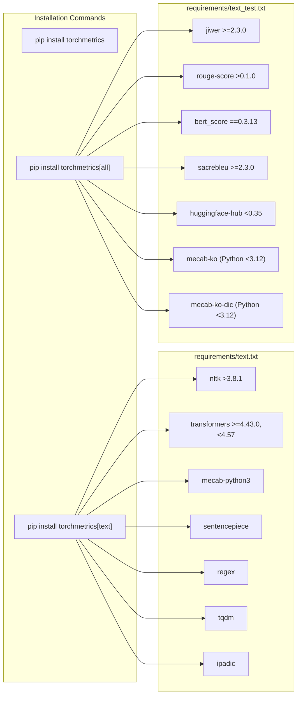
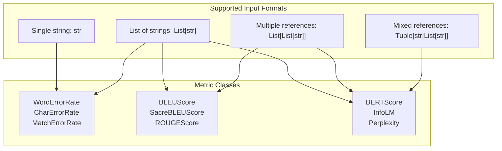
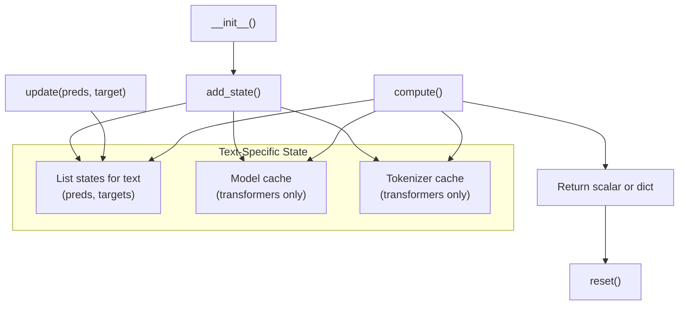
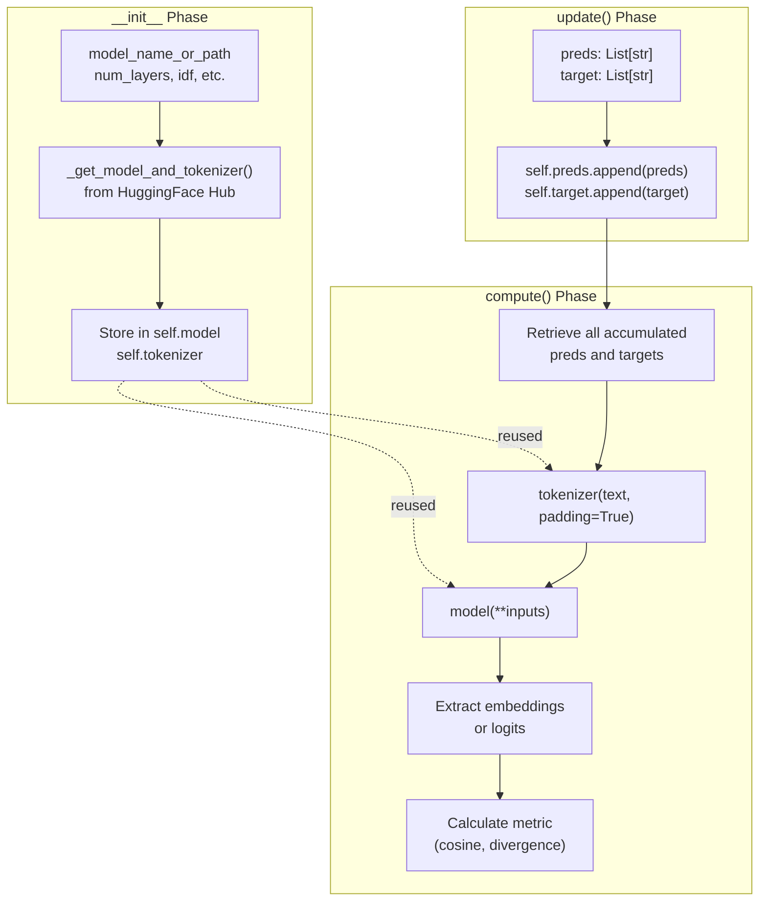
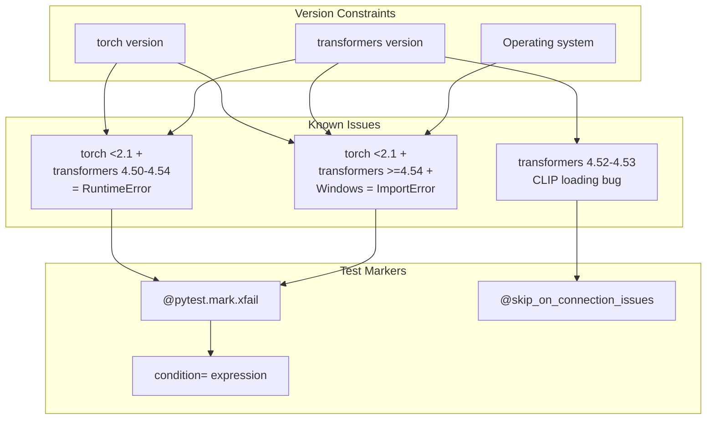
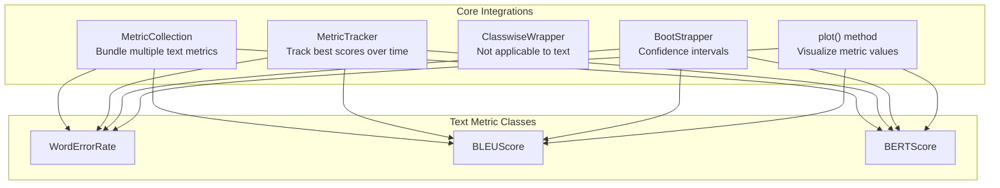

<!-- source: DeepWiki mcp.deepwiki.com · repo Lightning-AI/torchmetrics · page 6 Text Metrics · fetched 2026-10-21 -->

# Text Metrics

<details>
<summary>Relevant source files</summary>

The following files were used as context for generating this wiki page:

- [CHANGELOG.md](CHANGELOG.md)
- [docs/source/links.rst](docs/source/links.rst)
- [requirements/multimodal.txt](requirements/multimodal.txt)
- [requirements/text.txt](requirements/text.txt)
- [requirements/text_test.txt](requirements/text_test.txt)
- [src/torchmetrics/__init__.py](src/torchmetrics/__init__.py)
- [src/torchmetrics/classification/__init__.py](src/torchmetrics/classification/__init__.py)
- [src/torchmetrics/functional/__init__.py](src/torchmetrics/functional/__init__.py)
- [src/torchmetrics/functional/classification/__init__.py](src/torchmetrics/functional/classification/__init__.py)
- [src/torchmetrics/functional/pairwise/__init__.py](src/torchmetrics/functional/pairwise/__init__.py)
- [src/torchmetrics/functional/regression/__init__.py](src/torchmetrics/functional/regression/__init__.py)
- [src/torchmetrics/regression/__init__.py](src/torchmetrics/regression/__init__.py)
- [tests/unittests/_helpers/__init__.py](tests/unittests/_helpers/__init__.py)
- [tests/unittests/multimodal/test_clip_score.py](tests/unittests/multimodal/test_clip_score.py)
- [tests/unittests/text/test_bertscore.py](tests/unittests/text/test_bertscore.py)
- [tests/unittests/text/test_infolm.py](tests/unittests/text/test_infolm.py)
- [tests/unittests/utilities/test_plot.py](tests/unittests/utilities/test_plot.py)

</details>


## Purpose and Scope

This document provides an overview of text and NLP metrics in TorchMetrics. Text metrics evaluate the quality of generated or predicted text by comparing it against reference text(s). They are used in machine translation, text summarization, question answering, speech recognition, and other NLP tasks.

Text metrics are organized into four main categories:

1. **N-gram Based Metrics** - Statistical overlap measures using token sequences (BLEU, SacreBLEU, ROUGE, CHRFScore)
2. **Edit Distance Metrics** - Character or word-level edit operations (WER, CER, MER, TER, EditDistance)
3. **Semantic/Transformer-Based Metrics** - Neural embeddings for semantic similarity (BERTScore, InfoLM, Perplexity)
4. **Question Answering Metrics** - Task-specific evaluation (SQuAD)

For detailed implementations of traditional metrics, see [Traditional Text Metrics](#6.1). For transformer-based metrics with model configuration and compatibility details, see [Transformer-Based Text Metrics](#6.2). For multimodal metrics like CLIPScore, see [Multimodal Metrics](#9).

**Sources:** [requirements/text.txt:1-12](), [src/torchmetrics/__init__.py:148-159]()

## Text Metrics in Code Structure

Text metrics are implemented in `src/torchmetrics/text/` with parallel functional interfaces in `src/torchmetrics/functional/text/`. The following diagram maps metric categories to their actual implementations:

```mermaid
graph TB
    subgraph "torchmetrics.Metric"
        BaseMetric["Metric<br/>(src/torchmetrics/metric.py)"]
    end
    
    subgraph "N-gram Based Metrics"
        BLEU["BLEUScore<br/>(text.bleu)"]
        SacreBLEU["SacreBLEUScore<br/>(text.sacre_bleu)"]
        ROUGE["ROUGEScore<br/>(text.rouge)"]
        CHRF["CHRFScore<br/>(text.chrf)"]
    end
    
    subgraph "Edit Distance Metrics"
        WER["WordErrorRate<br/>(text.wer)"]
        CER["CharErrorRate<br/>(text.cer)"]
        MER["MatchErrorRate<br/>(text.mer)"]
        TER["TranslationEditRate<br/>(text.ter)"]
        EditDist["EditDistance<br/>(text.edit)"]
        ExtEditDist["ExtendedEditDistance<br/>(text.eed)"]
        WIP["WordInfoPreserved<br/>(text.wip)"]
        WIL["WordInfoLost<br/>(text.wil)"]
    end
    
    subgraph "Semantic Metrics"
        BERTScore["BERTScore<br/>(text.bert)"]
        InfoLM["InfoLM<br/>(text.infolm)"]
        Perplexity["Perplexity<br/>(text.perplexity)"]
    end
    
    subgraph "QA Metrics"
        SQuAD["SQuAD<br/>(text.squad)"]
    end
    
    subgraph "Functional Interfaces"
        FuncBERT["bert_score()<br/>(functional.text.bert)"]
        FuncWER["word_error_rate()<br/>(functional.text.wer)"]
        FuncBLEU["bleu_score()<br/>(functional.text.bleu)"]
        FuncOthers["... other functional APIs"]
    end
    
    BaseMetric --> BLEU & SacreBLEU & ROUGE & CHRF
    BaseMetric --> WER & CER & MER & TER & EditDist & ExtEditDist & WIP & WIL
    BaseMetric --> BERTScore & InfoLM & Perplexity
    BaseMetric --> SQuAD
    
    BERTScore -.implements.-> FuncBERT
    WER -.implements.-> FuncWER
    BLEU -.implements.-> FuncBLEU
    SacreBLEU & ROUGE & InfoLM & Perplexity -.implement.-> FuncOthers
```



**Key implementation details:**
- All text metrics inherit from `torchmetrics.Metric` ([src/torchmetrics/metric.py]())
- Class-based metrics are stateful and accumulate across `update()` calls
- Functional APIs provide stateless, single-shot computation
- Imports are exposed through `torchmetrics.text.*` and `torchmetrics.functional.text.*`

**Sources:** [src/torchmetrics/__init__.py:148-159](), [src/torchmetrics/functional/__init__.py:129-141](), [tests/unittests/utilities/test_plot.py:639-676]()

## Metric Categories and Characteristics

The following table organizes text metrics by their computational approach and typical use cases:

| Category | Class Names | Key Dependencies | Computational Approach | Primary Use Cases |
|----------|-------------|------------------|------------------------|-------------------|
| **N-gram Based** | `BLEUScore`, `SacreBLEUScore`, `ROUGEScore`, `CHRFScore` | `nltk`, `sacrebleu`, `rouge-score`, `mecab-python3` | Token n-gram overlap, precision/recall | Machine translation, summarization |
| **Edit Distance** | `WordErrorRate`, `CharErrorRate`, `MatchErrorRate`, `TranslationEditRate`, `EditDistance`, `ExtendedEditDistance`, `WordInfoPreserved`, `WordInfoLost` | `jiwer` | Levenshtein distance, insertions/deletions/substitutions | ASR, OCR, error analysis |
| **Semantic/Transformer** | `BERTScore`, `InfoLM`, `Perplexity` | `transformers>=4.43.0`, `bert_score==0.3.13` | Neural embeddings, contextual similarity, information divergence | Semantic evaluation, quality assessment |
| **QA-Specific** | `SQuAD` | None (pure PyTorch) | Exact match + F1 score | Question answering systems |

**Computational characteristics:**
- **N-gram based**: Fast, deterministic, no GPU required, lexical similarity only
- **Edit distance**: Fast, deterministic, character/word-level alignment
- **Semantic/Transformer**: Slower, requires model downloads, captures semantic similarity, benefits from GPU
- **QA-Specific**: Fast, specialized for extractive QA format

**Sources:** [requirements/text.txt:1-12](), [requirements/text_test.txt:1-12](), [src/torchmetrics/__init__.py:148-159]()

## Dependencies and Installation

Text metrics have modular dependencies defined in `requirements/text.txt` and `requirements/text_test.txt`:



**Critical dependency constraints:**
- **transformers**: Excludes 4.52-4.53 due to CLIP model loading bug ([requirements/text.txt:7-8]())
- **bert_score**: Pinned to 0.3.13 for reference validation ([requirements/text_test.txt:6]())
- **mecab-ko/mecab-ko-dic**: Python version restriction `<3.12` ([requirements/text_test.txt:10-11]())
- **sentencepiece**: Required for multilingual tokenization ([requirements/text.txt:11]())

**Sources:** [requirements/text.txt:1-12](), [requirements/text_test.txt:1-12]()

## Common Implementation Patterns

### Input Format Conventions

Text metrics follow consistent input conventions for predictions and references:



**Multiple reference support** (feature timeline):
- **BLEU/SacreBLEU**: Multiple references by design for MT evaluation
- **BERTScore**: Multiple references added in v1.8.0 ([CHANGELOG.md:69-70]())
- **WER/CER/MER**: Single reference only (ASR domain convention)
- **Single string support**: Added to `BERTScore` functional API in v1.8.0 ([CHANGELOG.md:69]())

### Metric Lifecycle Integration

Text metrics follow the standard `Metric` base class lifecycle:



**State management patterns:**
- **Traditional metrics**: Store predictions/targets as Python lists using `add_state(..., dist_reduce_fx="cat")`
- **Transformer metrics**: Additionally cache models and tokenizers in `__init__()` for reuse
- **Compute phase**: Process accumulated lists in single batch for efficiency

**Sources:** [src/torchmetrics/metric.py](), [tests/unittests/text/test_bertscore.py:114-146]()

## Transformer-Based Metrics: Model Management

Semantic metrics using transformers follow a specialized initialization and caching pattern:



**Key implementation classes:**
- `BERTScore` ([src/torchmetrics/text/bert.py]()): Uses BERT/RoBERTa for token-level similarity
- `InfoLM` ([src/torchmetrics/text/infolm.py]()): Measures information-theoretic divergence
- `Perplexity` ([src/torchmetrics/text/perplexity.py]()): Evaluates language model probability

**Model caching behavior:**
- Models loaded once in `__init__()` and cached in metric instance
- Caching location: `~/.cache/huggingface/` (controlled by `TRANSFORMERS_CACHE` env var)
- No model sharing between metric instances (each loads its own copy)
- For memory optimization with multiple metrics, see `FeatureShare` wrapper (page [12.6](#12.6))

**Sources:** [tests/unittests/text/test_bertscore.py:114-146](), [tests/unittests/text/test_infolm.py:118-155]()

## Known Compatibility Issues

Text metrics have several known compatibility constraints documented in test files:



**Documented compatibility flags** ([tests/unittests/_helpers/__init__.py:38-41]()):
- `_TORCH_LESS_THAN_2_1`: Boolean flag for torch version
- `_TRANSFORMERS_RANGE_GE_4_50_LT_4_54`: Known incompatibility range
- `_TRANSFORMERS_GREATER_EQUAL_4_54`: Windows-specific issues
- `_IS_WINDOWS`: Platform detection

**Test annotations** for BERTScore and InfoLM:
```python
@pytest.mark.xfail(
    RuntimeError,
    condition=_TORCH_LESS_THAN_2_1 and _TRANSFORMERS_RANGE_GE_4_50_LT_4_54,
    reason="could be due to torch compatibility issues with transformers",
)
```

**Requirements constraints** ([requirements/text.txt:7-8]()):
```
# transformers==4.52 and 4.53 has a bug with the clip model loading
transformers >=4.43.0,<4.57
```

**Sources:** [tests/unittests/_helpers/__init__.py:35-41](), [tests/unittests/text/test_bertscore.py:101-112](), [requirements/text.txt:7-8]()

## Basic Usage Examples

### N-gram Based Metrics

```python
from torchmetrics.text import BLEUScore, ROUGEScore

# BLEU for machine translation
bleu = BLEUScore()
preds = ["the cat is on the mat"]
refs = [["there is a cat on the mat", "a cat is on the mat"]]
score = bleu(preds, refs)

# ROUGE for summarization
rouge = ROUGEScore()
preds = ["hello there"]
refs = ["hello there"]
scores = rouge(preds, refs)  # Returns dict with rouge1, rouge2, rougeL
```

### Edit Distance Metrics

```python
from torchmetrics.text import WordErrorRate, CharErrorRate

# WER for ASR evaluation
wer = WordErrorRate()
preds = ["this is the prediction"]
refs = ["this is the reference"]
error_rate = wer(preds, refs)

# CER for OCR evaluation
cer = CharErrorRate()
score = cer(preds, refs)
```

### Semantic Metrics

```python
from torchmetrics.text import BERTScore, InfoLM

# BERTScore with custom model
bert_score = BERTScore(model_name_or_path="albert-base-v2")
preds = ["hello there"]
refs = ["hello there"]
scores = bert_score(preds, refs)
# Returns: {'precision': tensor, 'recall': tensor, 'f1': tensor}

# InfoLM with KL divergence
infolm = InfoLM(
    model_name_or_path="google/bert_uncased_L-2_H-128_A-2",
    information_measure="kl_divergence"
)
score = infolm(preds, refs)
```

For detailed usage patterns, tokenization options, and advanced configurations, see [Traditional Text Metrics](#6.1) and [Transformer-Based Text Metrics](#6.2).

**Sources:** [tests/unittests/text/test_bertscore.py:270-287](), [tests/unittests/text/test_infolm.py:127-155]()

## Metric Output Formats

Text metrics return different output formats depending on the metric type:

| Metric Category | Return Type | Example Keys/Values |
|----------------|-------------|---------------------|
| **N-gram Based** | `torch.Tensor` (scalar) or `dict` | BLEU: scalar, ROUGE: `{'rouge1', 'rouge2', 'rougeL'}` |
| **Edit Distance** | `torch.Tensor` (scalar) | Single error rate value |
| **Semantic** | `dict` with multiple scores | BERTScore: `{'precision', 'recall', 'f1'}`, InfoLM: scalar in dict |
| **QA-Specific** | `dict` | SQuAD: `{'exact_match', 'f1'}` |

**Common patterns:**
- Scalar outputs represent single aggregate metric
- Dict outputs provide multiple perspectives (precision/recall, multiple rouge variants)
- All outputs are `torch.Tensor` types for gradient compatibility

**Sources:** [tests/unittests/text/test_bertscore.py:270-287](), [tests/unittests/utilities/test_plot.py:639-676]()

## Integration with Core Features

Text metrics integrate with TorchMetrics core features:



**Integration notes:**
- `MetricCollection`: Group multiple text metrics for joint evaluation
- `MetricTracker`: Track metrics like BLEU/ROUGE across training epochs
- `ClasswiseWrapper`: Not applicable (text metrics don't have classes)
- `BootStrapper`: Compute confidence intervals for any text metric
- `.plot()`: All text metrics support visualization ([tests/unittests/utilities/test_plot.py:639-676]())

**Sources:** [tests/unittests/utilities/test_plot.py:639-676](), [src/torchmetrics/collections.py]()

## Related Pages

- [Traditional Text Metrics](#6.1): Detailed documentation for BLEU, ROUGE, WER, etc.
- [Transformer-Based Text Metrics](#6.2): Detailed documentation for BERTScore, InfoLM, Perplexity
- [Multimodal Metrics](#9): For CLIPScore and other cross-modal metrics
- [Core Architecture](#2): Understanding the base Metric class
- [Dependency Management](#14): More details on requirement handling

---

