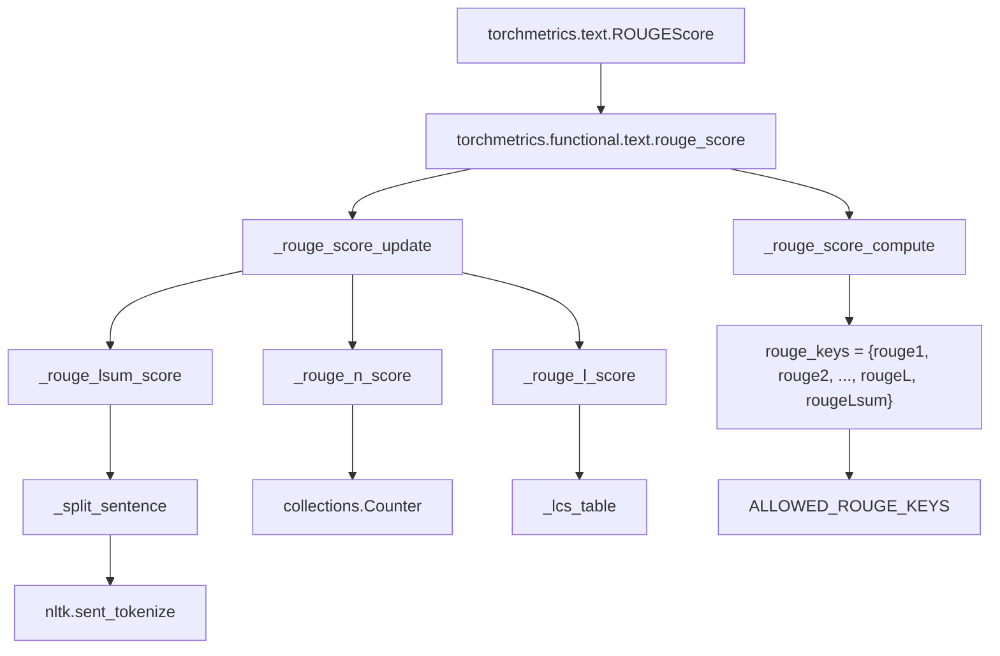
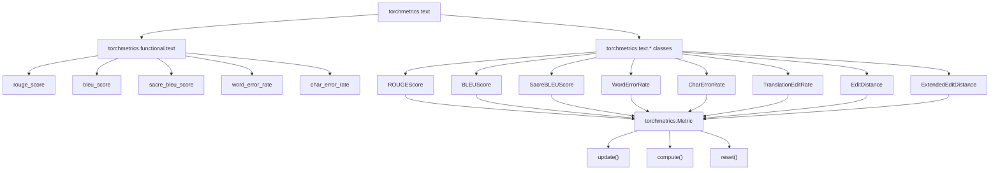
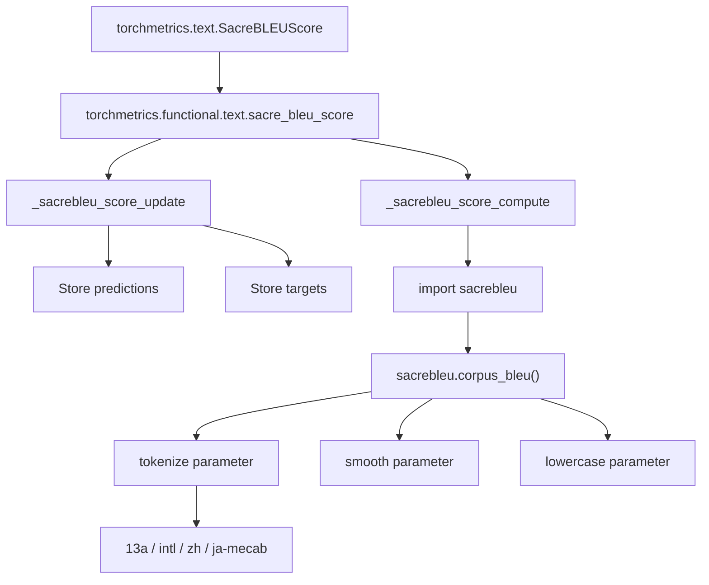
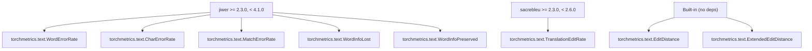
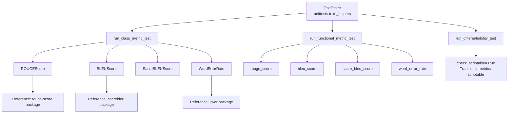

<!-- source: DeepWiki mcp.deepwiki.com · repo Lightning-AI/torchmetrics · page 6.1 Traditional Text Metrics · fetched 2026-10-21 -->

# Traditional Text Metrics

<details>
<summary>Relevant source files</summary>

The following files were used as context for generating this wiki page:

- [CHANGELOG.md](CHANGELOG.md)
- [requirements/multimodal.txt](requirements/multimodal.txt)
- [requirements/text.txt](requirements/text.txt)
- [requirements/text_test.txt](requirements/text_test.txt)
- [tests/unittests/_helpers/__init__.py](tests/unittests/_helpers/__init__.py)
- [tests/unittests/multimodal/test_clip_score.py](tests/unittests/multimodal/test_clip_score.py)
- [tests/unittests/text/test_bertscore.py](tests/unittests/text/test_bertscore.py)
- [tests/unittests/text/test_infolm.py](tests/unittests/text/test_infolm.py)
- [tests/unittests/utilities/test_plot.py](tests/unittests/utilities/test_plot.py)

</details>


This page documents traditional text evaluation metrics implemented in TorchMetrics, including ROUGE, BLEU, SacreBLEU, CHRF, WER, CER, MER, and EditDistance. These metrics are commonly used for evaluating text generation tasks like summarization and machine translation. For transformer-based text metrics (BERTScore, InfoLM, Perplexity), see page 6.2.

## Traditional Text Metrics Overview

TorchMetrics provides traditional text evaluation metrics that can be categorized based on their approach to measuring text similarity:

**Traditional Text Metrics Classification**

```mermaid
flowchart TD
    A["torchmetrics.text<br/>(Traditional Metrics)"] --> B["N-gram Overlap"]
    A --> C["Sequence-based"]
    A --> D["Edit Distance"]
    
    B --> E["ROUGEScore<br/>torchmetrics.text.ROUGEScore"]
    B --> F["BLEUScore<br/>torchmetrics.text.BLEUScore"]
    B --> G["SacreBLEUScore<br/>torchmetrics.text.SacreBLEUScore"]
    B --> H["CHRFScore<br/>torchmetrics.text.CHRFScore"]
    
    C --> I["ROUGEScore (rougeL)<br/>LCS-based"]
    C --> J["ROUGEScore (rougeLsum)<br/>Sentence-level LCS"]
    
    D --> K["WordErrorRate<br/>torchmetrics.text.WordErrorRate"]
    D --> L["CharErrorRate<br/>torchmetrics.text.CharErrorRate"]
    D --> M["MatchErrorRate<br/>torchmetrics.text.MatchErrorRate"]
    D --> N["EditDistance<br/>torchmetrics.text.EditDistance"]
    D --> O["ExtendedEditDistance<br/>torchmetrics.text.ExtendedEditDistance"]
    D --> P["TranslationEditRate<br/>torchmetrics.text.TranslationEditRate"]
```


### Key Dependencies

Traditional text metrics require specific external libraries:

| Dependency | Version | Used By |
|------------|---------|---------|
| `rouge-score` | >0.1.0, <=0.1.2 | `ROUGEScore` |
| `sacrebleu` | >=2.3.0, <2.6.0 | `SacreBLEUScore`, `TranslationEditRate`, `CHRFScore` |
| `nltk` | >3.8.1, <=3.9.1 | Text tokenization (ROUGE-Lsum) |
| `jiwer` | >=2.3.0, <4.1.0 | `WordErrorRate`, `CharErrorRate`, `MatchErrorRate` |
| `regex` | >=2021.9.24, <=2025.9.1 | Text processing |
| `mecab-python3` | >=1.0.6, <1.1.0 | Japanese tokenization |
| `ipadic` | >=1.0.0, <1.1.0 | Japanese dictionary |

Sources: 
- [requirements/text.txt:1-12]()
- [requirements/text_test.txt:1-12]()

## ROUGE Metric Family

ROUGE comprises several variants that measure text similarity based on different types of overlapping units between generated and reference texts.

### ROUGE-N

ROUGE-N measures n-gram overlap between prediction and reference texts. It calculates:

- **Precision**: How many of the n-grams in the prediction appear in the reference
- **Recall**: How many of the n-grams in the reference appear in the prediction
- **F1-score**: Harmonic mean of precision and recall

TorchMetrics supports ROUGE-1 through ROUGE-9, with ROUGE-1 (unigram) and ROUGE-2 (bigram) being the most commonly used.

### ROUGE-L

ROUGE-L uses the Longest Common Subsequence (LCS) to measure similarity between texts. Unlike n-grams, LCS doesn't require consecutive matches but in-sequence matches, making it more flexible for evaluating texts with different word orders.

### ROUGE-Lsum

ROUGE-Lsum applies ROUGE-L at the sentence level, which is particularly useful for evaluating summaries that may reorder content from source documents. It splits texts into sentences, computes LCS for each sentence, and then combines the results.

**ROUGE Implementation Architecture**


Sources:
- [torchmetrics/functional/text/rouge.py:203-226]()
- [torchmetrics/functional/text/rouge.py:229-242]()
- [torchmetrics/functional/text/rouge.py:245-285]()
- [torchmetrics/functional/text/rouge.py:27-39]()

## Implementation Architecture

TorchMetrics provides both functional and class-based APIs for text metrics:

**Text Metrics Package Structure**


Sources:
- [torchmetrics/functional/text/rouge.py:409-513]()
- [torchmetrics/text/rouge.py]()
- [tests/unittests/utilities/test_plot.py:165-181]()

### Functional API vs. Class API

- **Functional API**: Pure functions (e.g., `rouge_score()`) that compute metrics in a single call
- **Class API**: Metric classes (e.g., `ROUGEScore`) that inherit from the `Metric` base class and allow state accumulation across batches

Both APIs provide the same metrics but serve different use cases.

## Usage Examples

### Using ROUGE with Functional API

```python
from torchmetrics.functional.text.rouge import rouge_score

preds = "My name is John"
target = "Is your name John"
score = rouge_score(preds, target)
print(score)
# Output includes precision, recall, and F1 for each ROUGE variant
```

### Using ROUGE with Class API

```python
from torchmetrics.text.rouge import ROUGEScore

rouge = ROUGEScore()
rouge.update("My name is John", "Is your name John")
rouge.update("Another prediction", "Another reference")
score = rouge.compute()
print(score)
```

### With PyTorch Lightning

```python
from pytorch_lightning import LightningModule
from torchmetrics.text.rouge import ROUGEScore

class SummarizationModel(LightningModule):
    def __init__(self):
        super().__init__()
        self.rouge = ROUGEScore()
    
    def validation_step(self, batch, batch_idx):
        preds, target = self.generate_summaries(batch)
        # Log all ROUGE metrics
        self.log_dict(self.rouge(preds, target))
```

## Advanced Features

### Multiple References

ROUGE supports evaluation against multiple reference texts:

```python
from torchmetrics.functional.text.rouge import rouge_score

preds = ["Summary 1", "Summary 2"]
targets = [["Ref 1-A", "Ref 1-B"], ["Ref 2"]]  # Multiple references for first prediction

# Take best score across references
scores_best = rouge_score(preds, targets, accumulate="best")  

# Or average scores across references
scores_avg = rouge_score(preds, targets, accumulate="avg")
```

The `accumulate` parameter controls how scores are aggregated when multiple references are provided:
- `"best"`: Uses the reference that gives the highest F1 score
- `"avg"`: Averages scores across all references

Sources:
- src/torchmetrics/functional/text/rouge.py:288-388

### Customizing Text Processing

ROUGE metrics can be customized with:

- **Stemming**: Using Porter stemmer to normalize word forms
- **Custom tokenization**: Supply your own tokenization function
- **Custom normalization**: Supply your own text normalization function

```python
import re
from torchmetrics.text.rouge import ROUGEScore

# Custom text processing
normalizer = lambda text: re.sub(r"[^a-z0-9]+", " ", text.lower())
tokenizer = lambda text: re.split(r"\s+", text)

rouge = ROUGEScore(
    use_stemmer=True,
    normalizer=normalizer,
    tokenizer=tokenizer,
    rouge_keys=("rouge1", "rouge2", "rougeL")
)
```

Sources:
- src/torchmetrics/functional/text/rouge.py:167-200

### Selecting ROUGE Variants

Choose which ROUGE variants to compute:

```python
from torchmetrics.text.rouge import ROUGEScore

# Only compute ROUGE-1 and ROUGE-L
rouge = ROUGEScore(rouge_keys=("rouge1", "rougeL"))
```

The available ROUGE keys are defined in the `ALLOWED_ROUGE_KEYS` dictionary:

```
ALLOWED_ROUGE_KEYS = {
    "rouge1": 1,
    "rouge2": 2,
    "rouge3": 3,
    "rouge4": 4,
    "rouge5": 5,
    "rouge6": 6,
    "rouge7": 7,
    "rouge8": 8,
    "rouge9": 9,
    "rougeL": "L",
    "rougeLsum": "Lsum",
}
```

### Tokenization and Normalization Options

Many traditional text metrics support customization of tokenization and normalization:

```python
import re
from torchmetrics.text import ROUGEScore

# Custom text normalization
normalizer = lambda text: re.sub(r"[^a-z0-9]+", " ", text.lower())

# Custom tokenization
tokenizer = lambda text: re.split(r"\s+", text)

# Apply custom processing to ROUGE
rouge = ROUGEScore(
    use_stemmer=True,
    normalizer=normalizer,
    tokenizer=tokenizer,
    rouge_keys=("rouge1", "rouge2", "rougeL")
)
```

SacreBLEU provides built-in tokenizer options:

```python
from torchmetrics.text import SacreBLEUScore

# Various tokenization methods
bleu = SacreBLEUScore(tokenize="13a")  # Default
bleu = SacreBLEUScore(tokenize="intl")  # International
bleu = SacreBLEUScore(tokenize="zh")    # Chinese
bleu = SacreBLEUScore(tokenize="ja-mecab")  # Japanese with MeCab
```

Sources:
- [requirements/text.txt:4-11]()
- [requirements/text_test.txt:3-9]()
- [CHANGELOG.md:402]()

## BLEU and SacreBLEU Metrics

BLEU (Bilingual Evaluation Understudy) measures precision-based n-gram overlap between generated and reference texts, commonly used for machine translation evaluation.

### BLEUScore

The basic `BLEUScore` implementation calculates modified n-gram precision with brevity penalty:

```python
from torchmetrics.text import BLEUScore

# Default: 4-gram BLEU
bleu = BLEUScore()
preds = ["the cat is on the mat"]
target = [["there is a cat on the mat", "a cat is on the mat"]]
score = bleu(preds, target)
```

### SacreBLEU

`SacreBLEUScore` provides a standardized BLEU implementation with consistent preprocessing:

```python
from torchmetrics.text import SacreBLEUScore

# SacreBLEU with tokenization options
sacrebleu = SacreBLEUScore(
    n_gram=4,
    smooth=False,
    tokenize="13a",  # Standard tokenization
    lowercase=False
)

preds = ["the cat is on the mat"]
target = [["there is a cat on the mat", "a cat is on the mat"]]
score = sacrebleu(preds, target)
```

**Available tokenizers in SacreBLEU:**
- `"13a"`: Default Moses tokenizer
- `"intl"`: International tokenization
- `"zh"`: Chinese tokenization
- `"ja-mecab"`: Japanese tokenization with MeCab

**SacreBLEU Implementation Architecture**


Sources:
- [tests/unittests/utilities/test_plot.py:646-676]()
- [requirements/text_test.txt:8]()
- [CHANGELOG.md:402]()

## CHRF Metric

Character n-gram F-score (CHRF) measures character-level overlap between predictions and references. It was previously available but temporarily removed due to licensing issues with upstream dependencies.

```python
# Note: CHRFScore was removed in v1.4.1 and re-added in v1.4.2
from torchmetrics.text import CHRFScore  # Available in v1.4.2+

chrf = CHRFScore()
preds = ["the cat is on the mat"]
target = [["there is a cat on the mat"]]
score = chrf(preds, target)
```

Sources:
- [CHANGELOG.md:328]()
- [CHANGELOG.md:306]()

## Edit Distance Metrics

Edit distance metrics measure the minimum number of operations needed to transform one sequence into another.

### WordErrorRate (WER)

WER measures word-level edit distance, commonly used in speech recognition:

```python
from torchmetrics.text import WordErrorRate

wer = WordErrorRate()
preds = ["this is the prediction", "there is an other sample"]
target = ["this is the reference", "there is another one"]
score = wer(preds, target)
```

### CharErrorRate (CER)

CER measures character-level edit distance:

```python
from torchmetrics.text import CharErrorRate

cer = CharErrorRate()
preds = ["this is the prediction"]
target = ["this is the reference"]
score = cer(preds, target)
```

### MatchErrorRate (MER)

MER is similar to WER but uses a different calculation:

```python
from torchmetrics.text import MatchErrorRate

mer = MatchErrorRate()
preds = ["this is the prediction"]
target = ["this is the reference"]
score = mer(preds, target)
```

### EditDistance

Computes Levenshtein distance between sequences:

```python
from torchmetrics.text import EditDistance

edit_dist = EditDistance()
preds = ["this is the prediction"]
target = ["this is the reference"]
score = edit_dist(preds, target)
```

### ExtendedEditDistance

Enhanced edit distance with additional features:

```python
from torchmetrics.text import ExtendedEditDistance

ext_edit = ExtendedEditDistance()
preds = ["this is the prediction"]
target = ["this is the reference"]
score = ext_edit(preds, target)
```

### TranslationEditRate (TER)

TER measures the number of edits needed to change predictions into references:

```python
from torchmetrics.text import TranslationEditRate

ter = TranslationEditRate()
preds = ["the cat is on the mat"]
target = [["there is a cat on the mat"]]
score = ter(preds, target)
```

**Edit Distance Metrics Dependencies**


Sources:
- [requirements/text_test.txt:4]()
- [requirements/text_test.txt:8]()
- [tests/unittests/utilities/test_plot.py:639-646]()

## Additional Traditional Text Metrics

TorchMetrics provides additional traditional text evaluation metrics:

| Metric | Class API | Functional API | Primary Dependencies | Description |
|--------|-----------|----------------|---------------------|-------------|
| WIL/WIP | `WordInfoLost`/`WordInfoPreserved` | `word_information_lost`/`word_information_preserved` | `jiwer` | Information preservation metrics |
| SQuAD | `SQuAD` | `squad` | Built-in | Question answering metric |

Sources:
- [requirements/text_test.txt:1-12]()
- [tests/unittests/utilities/test_plot.py:639-676]()

## Implementation Details

The ROUGE implementation follows the original paper by Chin-Yew Lin (2004) with several optimizations:

1. **Efficient n-gram calculation**: Using Python's `collections.Counter` objects to track n-gram frequency
2. **Dynamic programming for LCS**: Efficient implementation of the Longest Common Subsequence algorithm via `_lcs_table`
3. **Edge case handling**: Proper handling of empty strings, singleton inputs, etc.
4. **Distributed computation**: Compatible with PyTorch's Distributed Data Parallel (DDP)

For ROUGE-Lsum calculations, sentence splitting is performed using NLTK's `sent_tokenize` function:

```python
def _split_sentence(x: str) -> Sequence[str]:
    """Split sentence to get rougeLsum scores matching published rougeL scores for BART and PEGASUS."""
    import nltk
    _ensure_nltk_punkt_is_downloaded()
    re.sub("<n>", "", x)  # remove pegasus newline char
    return nltk.sent_tokenize(x)
```

### Text Metric Testing Framework

TorchMetrics includes comprehensive testing for traditional text metrics using the `TextTester` base class:

**Traditional Text Metric Testing Architecture**


Sources:
- [tests/unittests/utilities/test_plot.py:639-676]()
- [requirements/text_test.txt:4-8]()

## Performance Considerations

When working with large texts or many evaluation pairs, consider:

1. **Batch processing**: The class-based API efficiently handles batched updates
2. **Memory usage**: ROUGE-Lsum requires sentence splitting which may increase memory usage
3. **NLTK resources**: ROUGE-Lsum requires the `punkt` resource from NLTK, which is downloaded automatically
4. **Stemming overhead**: Using stemming (`use_stemmer=True`) introduces additional computation

For large-scale evaluation tasks, the class-based API with progressive updates is recommended for memory efficiency.

---

