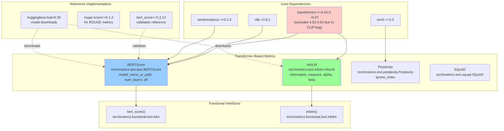
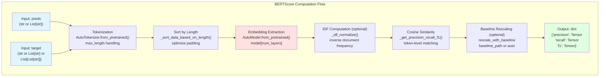
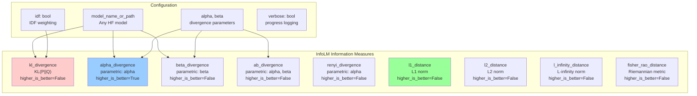
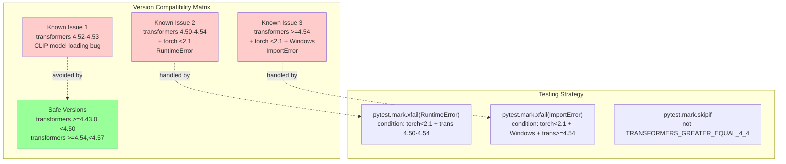

<!-- source: DeepWiki mcp.deepwiki.com · repo Lightning-AI/torchmetrics · page 6.2 Transformer-Based Text Metrics · fetched 2026-10-21 -->

# Transformer-Based Text Metrics

<details>
<summary>Relevant source files</summary>

The following files were used as context for generating this wiki page:

- [CHANGELOG.md](CHANGELOG.md)
- [requirements/multimodal.txt](requirements/multimodal.txt)
- [requirements/text.txt](requirements/text.txt)
- [requirements/text_test.txt](requirements/text_test.txt)
- [tests/unittests/_helpers/__init__.py](tests/unittests/_helpers/__init__.py)
- [tests/unittests/multimodal/test_clip_score.py](tests/unittests/multimodal/test_clip_score.py)
- [tests/unittests/text/test_bertscore.py](tests/unittests/text/test_bertscore.py)
- [tests/unittests/text/test_infolm.py](tests/unittests/text/test_infolm.py)
- [tests/unittests/utilities/test_plot.py](tests/unittests/utilities/test_plot.py)

</details>


This page documents text/NLP metrics that rely on transformer models from the `transformers` library for semantic evaluation. For traditional n-gram and edit distance metrics, see [Traditional Text Metrics](#6.1). For multimodal metrics that use CLIP, see [Multimodal Metrics](#9).

## Overview

Transformer-based text metrics leverage pre-trained language models to compute semantic similarity and quality measures. These metrics provide deeper semantic understanding compared to surface-level n-gram matching, but require significant computational resources and careful dependency management.

**Key Metrics:**
- **BERTScore** - BERT embedding-based similarity (precision, recall, F1)
- **InfoLM** - Information-theoretic divergence measures
- **Perplexity** - Language model probability evaluation
- **SQuAD** - Question answering evaluation (F1 + Exact Match)

All transformer-based metrics support both class-based and functional APIs, following the standard TorchMetrics dual-interface pattern (see [Functional API](#2.5)).

Sources: [CHANGELOG.md:69-70](), [requirements/text.txt:1-12](), [tests/unittests/utilities/test_plot.py:170-179]()

---

## Architecture and Dependencies



**Diagram: Transformer-Based Metrics Dependencies**

The `transformers` library is the critical dependency, with strict version bounds to avoid compatibility issues. The version constraint `>=4.43.0,<4.57` excludes versions 4.52-4.53 which have a CLIP model loading bug.

Sources: [requirements/text.txt:1-12](), [requirements/text_test.txt:1-12](), [CHANGELOG.md:1-50]()

---

## BERTScore

### Overview

`BERTScore` computes semantic similarity between prediction and reference texts using BERT embeddings. It produces three scores: precision, recall, and F1, based on token-level cosine similarity in the embedding space.

**Class:** [src/torchmetrics/text/bert.py]()  
**Functional:** [src/torchmetrics/functional/text/bert.py]()



**Diagram: BERTScore Computation Pipeline**

Sources: [tests/unittests/text/test_bertscore.py:52-81](), [tests/unittests/text/test_bertscore.py:118-146]()

### Key Configuration Parameters

| Parameter | Type | Default | Description |
|-----------|------|---------|-------------|
| `model_name_or_path` | str | "roberta-large" | HuggingFace model identifier or path |
| `num_layers` | int | None | Which layer to extract embeddings from (None = all layers) |
| `all_layers` | bool | False | Average embeddings across all layers |
| `idf` | bool | False | Use inverse document frequency weighting |
| `rescale_with_baseline` | bool | False | Rescale scores using pre-computed baseline |
| `baseline_path` | Optional[str] | None | Path to baseline file (auto-downloads if None) |
| `max_length` | int | 512 | Maximum sequence length (truncation point) |
| `truncation` | bool | True | Whether to truncate long sequences |

**Example Usage:**

```python
from torchmetrics.text import BERTScore

# Basic usage with default model
metric = BERTScore()
preds = ["the cat is on the mat"]
target = ["there is a cat on the mat"]
scores = metric(preds, target)
# scores = {'precision': tensor([...]), 'recall': tensor([...]), 'f1': tensor([...])}

# Custom model with IDF weighting
metric = BERTScore(
    model_name_or_path="bert-base-uncased",
    num_layers=8,
    idf=True,
    rescale_with_baseline=True
)
```

Sources: [tests/unittests/text/test_bertscore.py:83-95](), [tests/unittests/text/test_bertscore.py:118-146]()

### Multiple References Support

BERTScore supports evaluating predictions against multiple references per sample, selecting the best match:

```python
# Single prediction against multiple references
preds = ["general kenobi"]
target = [["hello there", "master kenobi"]]  # List of reference lists
scores = metric(preds, target)

# Multiple predictions with varying reference counts
preds = ["hello there", "I'm in the middle", "general kenobi"]
target = (
    ["hello there", "master kenobi"],  # 2 refs for pred 0
    "I'm here",                          # 1 ref for pred 1
    ("hello there", "master kenobi")    # 2 refs for pred 2
)
scores = metric(preds, target)
```

The metric computes scores against each reference and selects the maximum (best match) for each prediction.

Sources: [CHANGELOG.md:69-70](), [tests/unittests/text/test_bertscore.py:289-340]()

### Truncation Handling

Long sequences exceeding the model's `max_position_embeddings` are automatically truncated when `truncation=True`. A warning is issued for sequences that require truncation:

```python
metric = BERTScore(truncation=True)

# Long caption will trigger warning and be truncated
long_caption = "word " * 2000
metric.update(predictions, [long_caption])
# UserWarning: Encountered caption longer than max_position_embeddings=512. 
# Will truncate captions to this length.
```

If `truncation=False`, a `RuntimeError` is raised when sequences exceed the limit.

Sources: [CHANGELOG.md:275-276](), [tests/unittests/text/test_bertscore.py:241-254](), [tests/unittests/multimodal/test_clip_score.py:175-186]()

### State Management

BERTScore uses list states that grow with each batch:

```python
# State variables (see Metric.add_state documentation)
self.add_state("preds", default=[], dist_reduce_fx="cat")
self.add_state("target", default=[], dist_reduce_fx="cat")
```

In distributed settings, predictions and targets are concatenated across processes during synchronization.

Sources: [tests/unittests/text/test_bertscore.py:117-146]()

---

## InfoLM

### Overview

`InfoLM` computes information-theoretic divergence measures between prediction and reference language model distributions. Unlike BERTScore's token-level matching, InfoLM evaluates distributional differences using various divergence measures.

**Class:** [src/torchmetrics/text/infolm.py]()  
**Functional:** [src/torchmetrics/functional/text/infolm.py]()



**Diagram: InfoLM Information Measures and Parameters**

Sources: [tests/unittests/text/test_infolm.py:36-85](), [CHANGELOG.md:279-280]()

### Dynamic `higher_is_better` Property

InfoLM dynamically sets its `higher_is_better` property based on the selected information measure:

```python
metric = InfoLM(
    model_name_or_path="google/bert_uncased_L-2_H-128_A-2",
    information_measure="kl_divergence"
)
assert metric.higher_is_better == False  # Lower KL divergence is better

metric = InfoLM(
    model_name_or_path="google/bert_uncased_L-2_H-128_A-2",
    information_measure="alpha_divergence",
    alpha=0.4
)
assert metric.higher_is_better == True  # Higher alpha divergence is better
```

This dynamic property enables correct behavior in wrappers like `MetricTracker` (see [MetricTracker and Temporal Tracking](#12.2)).

Sources: [CHANGELOG.md:279-280](), [tests/unittests/text/test_infolm.py:202-214]()

### Information Measure Parameters

| Measure | Parameters | Higher is Better | Description |
|---------|-----------|------------------|-------------|
| `kl_divergence` | - | False | Kullback-Leibler divergence |
| `alpha_divergence` | `alpha` | True | Parametric divergence family |
| `beta_divergence` | `beta` | False | Bregman divergence |
| `ab_divergence` | `alpha`, `beta` | False | Combined alpha-beta divergence |
| `renyi_divergence` | `alpha` | False | Rényi divergence |
| `l1_distance` | - | False | L1 distance between distributions |
| `l2_distance` | - | False | L2 distance between distributions |
| `l_infinity_distance` | - | False | L-infinity distance |
| `fisher_rao_distance` | - | False | Fisher-Rao metric |

**Example Usage:**

```python
from torchmetrics.text import InfoLM

metric = InfoLM(
    model_name_or_path="bert-base-uncased",
    information_measure="kl_divergence",
    idf=True,
    max_length=128,
    verbose=False
)

preds = ["the cat sits on the mat"]
target = ["a cat is sitting on a mat"]
score = metric(preds, target)
```

Sources: [tests/unittests/text/test_infolm.py:87-100](), [tests/unittests/text/test_infolm.py:38-74]()

---

## Perplexity

### Overview

`Perplexity` measures how well a probability model predicts a sample, based on the exponential of the average negative log-likelihood:

```
perplexity = exp(-1/N * sum(log P(x_i)))
```

**Class:** [src/torchmetrics/text/perplexity.py]()

**Key Parameters:**
- `ignore_index` (int, optional): Index to ignore in target (e.g., padding tokens)

**Example Usage:**

```python
from torchmetrics.text import Perplexity

# logits: [batch_size, seq_len, vocab_size]
# target: [batch_size, seq_len]
metric = Perplexity(ignore_index=-100)
logits = torch.rand(2, 8, 5)
target = torch.randint(5, (2, 8))
perplexity = metric(logits, target)
```

### Memory Management

Perplexity was optimized to reduce memory consumption in distributed settings:

```python
# Fixed in PR #2346 - high memory consumption issue resolved
# Now uses more efficient state accumulation
```

Sources: [CHANGELOG.md:390-391](), [tests/unittests/utilities/test_plot.py:667-667]()

---

## SQuAD

### Overview

`SQuAD` (Stanford Question Answering Dataset) metric computes F1 score and Exact Match for question answering tasks. It compares predicted answers against reference answers with token-level alignment.

**Class:** [src/torchmetrics/text/squad.py]()

**Input Format:**

```python
from torchmetrics.text import SQuAD

predictions = [
    {"prediction_text": "1976", "id": "56e10a3be3433e1400422b22"}
]
references = [
    {
        "answers": {
            "answer_start": [97],
            "text": ["1976"]
        },
        "id": "56e10a3be3433e1400422b22"
    }
]

metric = SQuAD()
scores = metric(predictions, references)
# scores = {'exact_match': tensor(...), 'f1': tensor(...)}
```

The metric returns both exact match (binary) and F1 score (token overlap) between predicted and reference answers.

Sources: [tests/unittests/utilities/test_plot.py:671-675]()

---

## Version Compatibility and Known Issues

### Transformers Version Constraints



**Diagram: Version Compatibility Matrix and Testing Strategy**

Sources: [requirements/text.txt:7-8](), [tests/unittests/text/test_bertscore.py:26-32](), [tests/unittests/_helpers/__init__.py:35-41]()

### Issue 1: CLIP Model Loading Bug (4.52-4.53)

Transformers versions 4.52 and 4.53 contain a bug preventing CLIP model loading. The version constraint explicitly excludes these:

```python
# requirements/text.txt
# transformers==4.52 and 4.53 has a bug with the clip model loading
transformers >=4.43.0,<4.57
```

This affects both text metrics using BERT-like models and multimodal metrics using CLIP.

Sources: [requirements/text.txt:7-8](), [requirements/multimodal.txt:4-5]()

### Issue 2: Torch Compatibility (4.50-4.54 with torch <2.1)

A compatibility issue exists between transformers 4.50-4.54 and torch versions below 2.1, causing `RuntimeError` in certain operations:

```python
# Test marker to handle known failures
@pytest.mark.xfail(
    RuntimeError,
    condition=_TORCH_LESS_THAN_2_1 and _TRANSFORMERS_RANGE_GE_4_50_LT_4_54,
    reason="could be due to torch compatibility issues with transformers",
)
```

Tests using BERTScore and InfoLM include this marker to prevent false test failures.

Sources: [tests/unittests/text/test_bertscore.py:101-107](), [tests/unittests/text/test_infolm.py:106-112](), [tests/unittests/_helpers/__init__.py:38-40]()

### Issue 3: Windows Import Error (torch <2.1, transformers >=4.54)

An additional `ImportError` occurs on Windows with torch <2.1 and transformers >=4.54:

```python
@pytest.mark.xfail(
    ImportError,
    condition=_TORCH_LESS_THAN_2_1 and _IS_WINDOWS and _TRANSFORMERS_GREATER_EQUAL_4_54,
    reason="another strange behaviour of transformers on windows",
)
```

This is a Windows-specific issue with unclear root cause.

Sources: [tests/unittests/text/test_bertscore.py:108-112](), [tests/unittests/text/test_infolm.py:113-117](), [tests/unittests/_helpers/__init__.py:35-41]()

---

## Testing Infrastructure

### Reference Implementations

Transformer-based metrics are validated against official reference implementations:

| Metric | Reference Package | Version | Purpose |
|--------|------------------|---------|---------|
| BERTScore | `bert_score` | 0.3.13 | Validation against original implementation |
| InfoLM | Hard-coded results | N/A | No reference package available; uses pre-computed values |
| SQuAD | Built-in | N/A | Official SQuAD evaluation script |

```python
# BERTScore reference validation
def _reference_bert_score(preds, target, num_layers, all_layers, idf, 
                          rescale_with_baseline, metric_key):
    from bert_score import score as original_bert_score
    score_tuple = original_bert_score(
        preds, target,
        model_type=MODEL_NAME,
        num_layers=num_layers,
        all_layers=all_layers,
        idf=idf,
        batch_size=len(preds),
        rescale_with_baseline=rescale_with_baseline,
    )
    return score_tuple[_METRIC_KEY_TO_IDX[metric_key]]
```

Sources: [tests/unittests/text/test_bertscore.py:52-81](), [requirements/text_test.txt:6-6](), [tests/unittests/text/test_infolm.py:37-85]()

### Test Parametrization

Tests cover extensive parameter combinations:

**BERTScore Test Matrix:**
- `num_layers`: [8, 12]
- `all_layers`: [True, False]
- `idf`: [True, False]
- `rescale_with_baseline`: [True, False]
- `metric_key`: ["precision", "recall", "f1"]

**InfoLM Test Matrix:**
- `information_measure`: 9 different measures
- `idf`: [True, False]
- `alpha`: [0.25, 0.3, 0.4, None]
- `beta`: [0.1, 0.25, 0.3, 0.6, None]

Sources: [tests/unittests/text/test_bertscore.py:83-95](), [tests/unittests/text/test_infolm.py:87-100]()

### Connection Issues Handling

Tests that download models from HuggingFace Hub use the `@skip_on_connection_issues()` decorator to avoid failures in offline environments:

```python
@skip_on_connection_issues()
@pytest.mark.skipif(not _TRANSFORMERS_GREATER_EQUAL_4_4, 
                    reason="test requires transformers>4.4")
def test_bertscore_class(self, ddp, preds, targets, ...):
    # Test implementation
```

This decorator catches connection errors and skips tests gracefully rather than failing.

Sources: [tests/unittests/text/test_bertscore.py:52-53](), [tests/unittests/text/test_infolm.py:118-118]()

### DDP Testing

All transformer-based metrics support distributed data parallel (DDP) testing:

```python
@pytest.mark.parametrize("ddp", [pytest.param(True, marks=pytest.mark.DDP), False])
def test_bertscore_class(self, ddp, preds, targets, ...):
    self.run_class_metric_test(
        ddp=ddp,
        preds=preds,
        targets=targets,
        metric_class=BERTScore,
        reference_metric=reference_bert_score_metric,
        metric_args=metric_args,
        check_scriptable=False,  # transformers not scriptable
        ignore_order=ddp,  # ignore order when DDP used
    )
```

The `ignore_order=ddp` flag accounts for potential reordering of predictions in distributed settings.

Sources: [tests/unittests/text/test_bertscore.py:117-146](), [tests/unittests/text/test_infolm.py:125-154]()

---

## Plotting Support

All transformer-based metrics support visualization through the `.plot()` method:

```python
from torchmetrics.text import BERTScore

metric = BERTScore()
metric.update(preds, targets)
fig, ax = metric.plot()  # Returns matplotlib Figure and Axes

# Plot multiple values over time
vals = []
for batch in data:
    val = metric(*batch)
    vals.append(val['f1'])
fig, ax = metric.plot(vals)
```

See [Visualization and Plotting](#13) for details on the plotting interface.

Sources: [tests/unittests/utilities/test_plot.py:648-666](), [tests/unittests/utilities/test_plot.py:698-715]()

---

## Best Practices

### Model Selection

Choose models based on your use case:

```python
# Fast, lightweight models for development/CI
BERTScore(model_name_or_path="google/bert_uncased_L-2_H-128_A-2")

# Standard models for evaluation
BERTScore(model_name_or_path="bert-base-uncased")

# High-quality models for publication
BERTScore(model_name_or_path="roberta-large")  # default
```

### Memory Management

For large-scale evaluation, consider:

1. **Batch size management**: Process in smaller batches to avoid OOM
2. **Model layer selection**: Use fewer layers with `num_layers` parameter
3. **Truncation**: Enable `truncation=True` for long sequences
4. **Disable gradient**: Use `torch.no_grad()` context for inference

```python
with torch.no_grad():
    for batch in dataloader:
        metric.update(batch['preds'], batch['targets'])
    
final_score = metric.compute()
metric.reset()  # Clear states for next epoch
```

### Reproducibility

Set `TOKENIZERS_PARALLELISM` to avoid non-deterministic behavior:

```python
import os
os.environ["TOKENIZERS_PARALLELISM"] = "false"
```

This disables tokenizer parallelism which can cause forking issues in multiprocessing contexts.

Sources: [tests/unittests/text/test_bertscore.py:48-49]()

---

