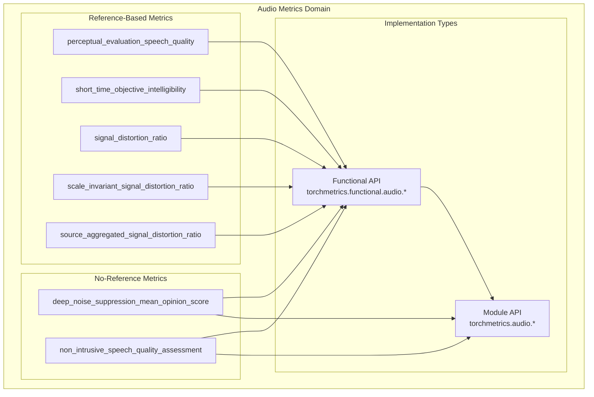
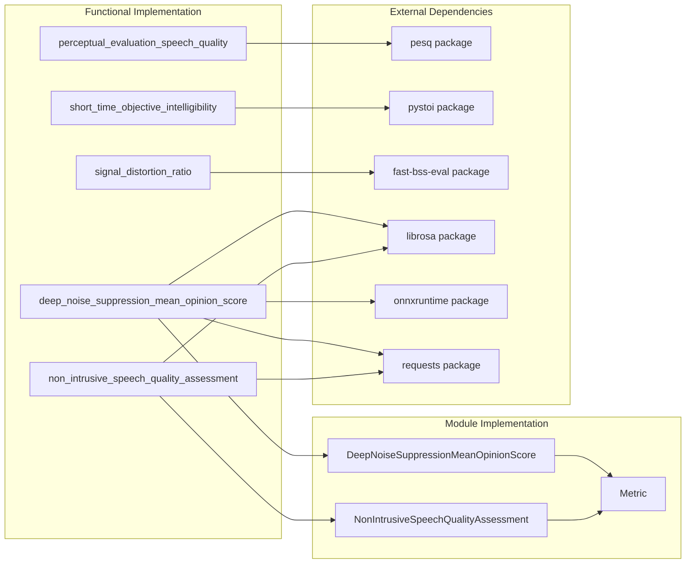
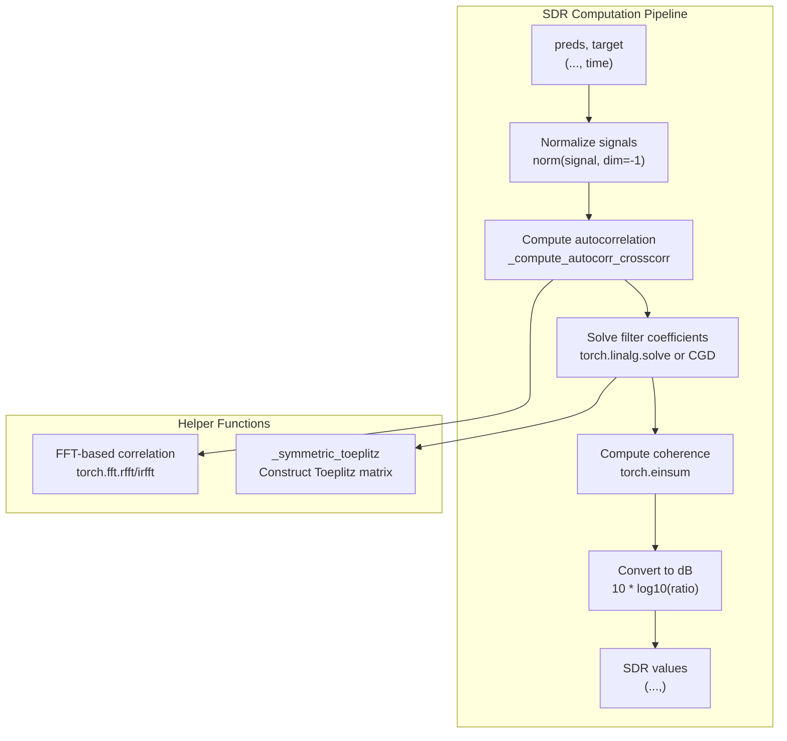
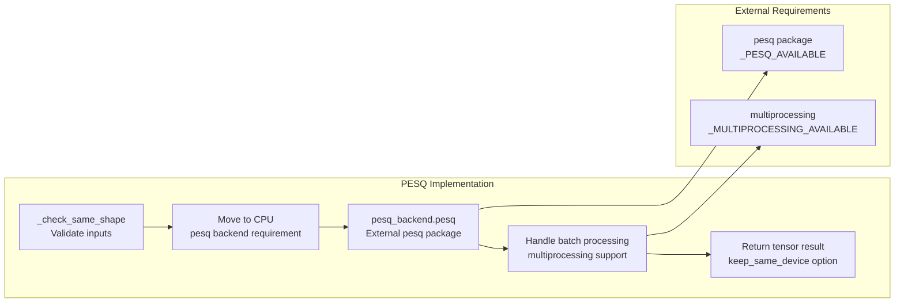
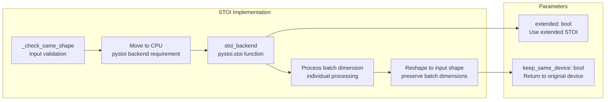
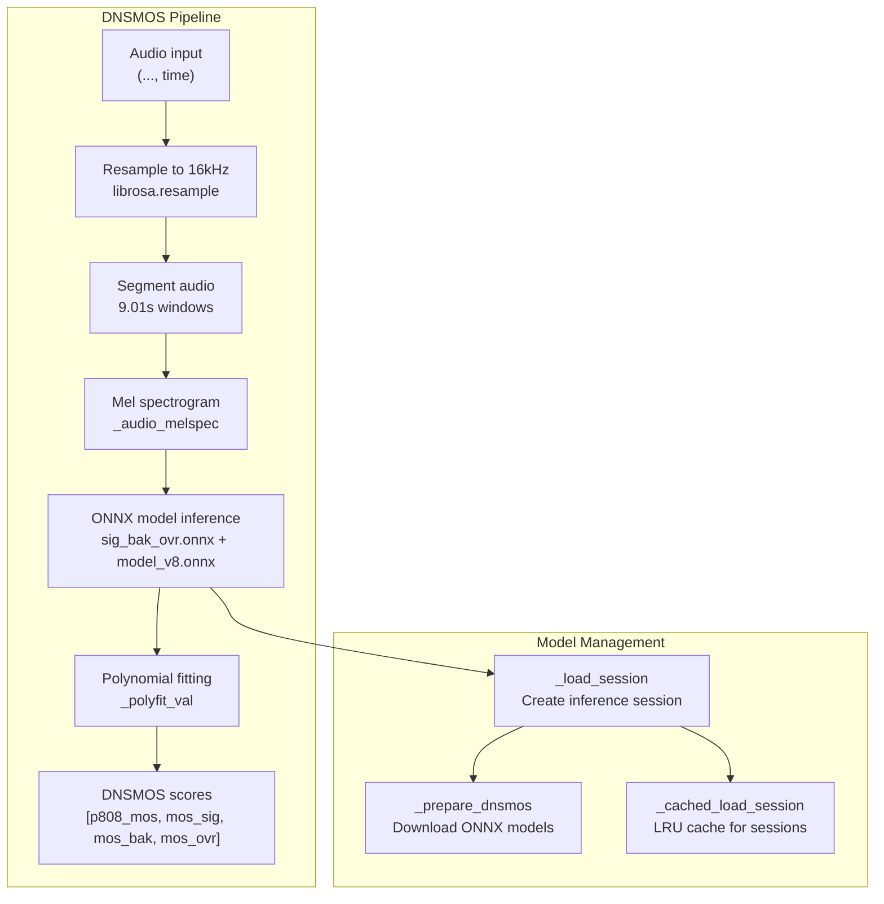
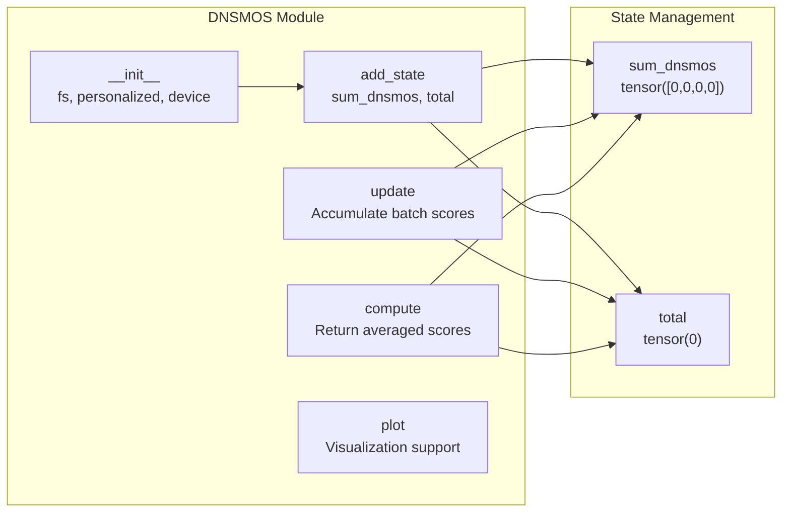
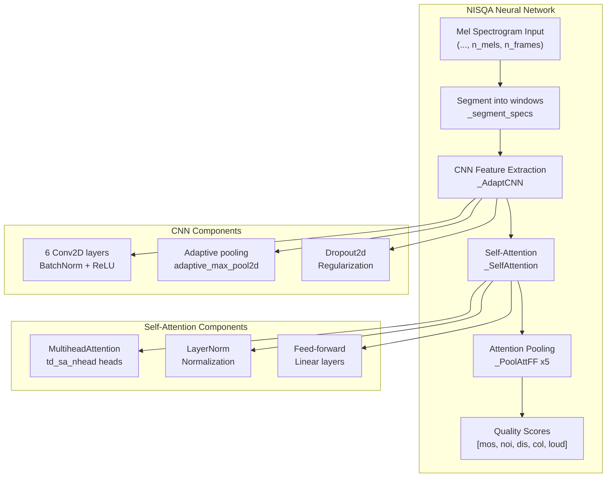
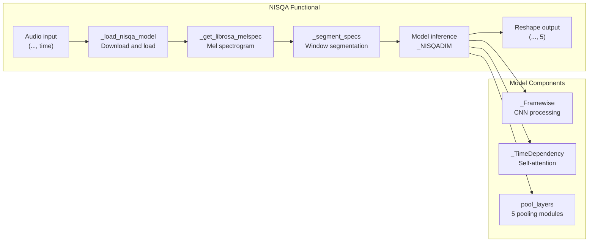
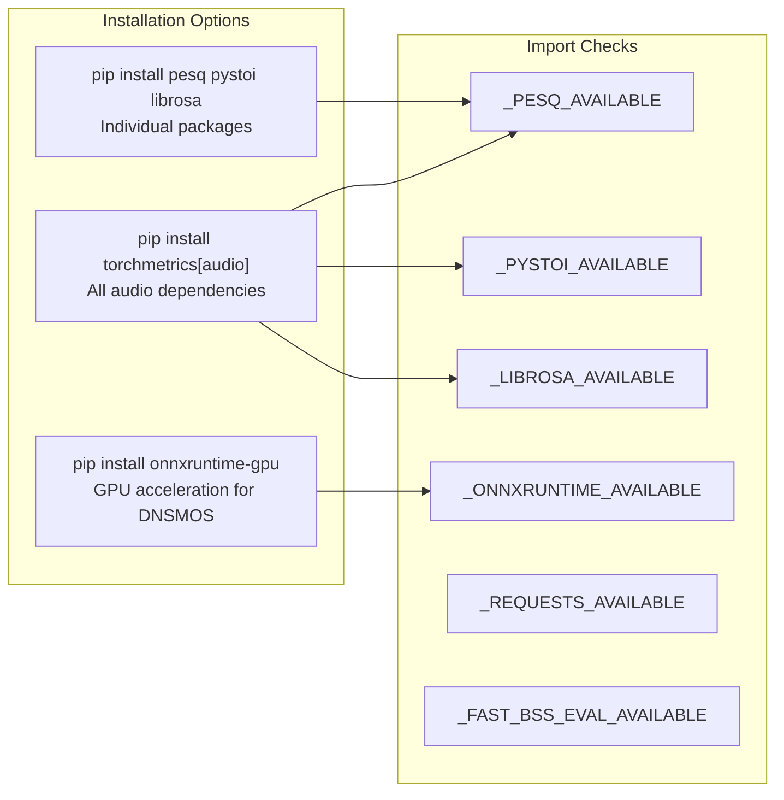

<!-- source: DeepWiki mcp.deepwiki.com · repo Lightning-AI/torchmetrics · page 7 Audio Metrics · fetched 2026-10-21 -->

# Audio Metrics

<details>
<summary>Relevant source files</summary>

The following files were used as context for generating this wiki page:

- [CHANGELOG.md](CHANGELOG.md)
- [docs/source/links.rst](docs/source/links.rst)
- [requirements/audio_test.txt](requirements/audio_test.txt)
- [src/torchmetrics/__init__.py](src/torchmetrics/__init__.py)
- [src/torchmetrics/classification/__init__.py](src/torchmetrics/classification/__init__.py)
- [src/torchmetrics/functional/__init__.py](src/torchmetrics/functional/__init__.py)
- [src/torchmetrics/functional/classification/__init__.py](src/torchmetrics/functional/classification/__init__.py)
- [src/torchmetrics/functional/pairwise/__init__.py](src/torchmetrics/functional/pairwise/__init__.py)
- [src/torchmetrics/functional/regression/__init__.py](src/torchmetrics/functional/regression/__init__.py)
- [src/torchmetrics/regression/__init__.py](src/torchmetrics/regression/__init__.py)

</details>


This document covers the audio quality assessment metrics available in TorchMetrics, which provide evaluation tools for speech and audio processing tasks. These metrics assess various aspects of audio quality including intelligibility, distortion, noise suppression effectiveness, and perceptual quality.

For image quality metrics, see [Image Metrics](#5). For text similarity metrics, see [Text Metrics](#6).

## Overview

TorchMetrics provides a comprehensive suite of audio quality assessment metrics designed for evaluating speech enhancement, noise suppression, source separation, and general audio processing algorithms. The audio metrics domain includes both reference-based metrics (requiring clean target audio) and no-reference metrics (requiring only the processed audio).



Sources: [src/torchmetrics/functional/audio/pesq.py](), [src/torchmetrics/functional/audio/stoi.py](), [src/torchmetrics/functional/audio/sdr.py](), [src/torchmetrics/functional/audio/dnsmos.py](), [src/torchmetrics/functional/audio/nisqa.py](), [src/torchmetrics/audio/dnsmos.py](), [src/torchmetrics/audio/nisqa.py]()

## Architecture

The audio metrics follow the standard TorchMetrics dual API pattern with functional (stateless) and module (stateful) implementations. Unlike some domains where all metrics have both implementations, only certain audio metrics provide module classes due to their computational complexity and external dependencies.



Sources: [src/torchmetrics/functional/audio/](), [src/torchmetrics/audio/](), [requirements/audio_test.txt]()

## Signal Distortion Ratio (SDR) Metrics

The SDR family of metrics measures the quality of source separation and signal reconstruction by comparing predicted signals to reference targets.

### Core SDR Functions

The SDR implementation provides three main variants:

| Function | Purpose | Key Parameters |
|----------|---------|----------------|
| `signal_distortion_ratio` | Standard SDR computation with distortion filter | `use_cg_iter`, `filter_length`, `zero_mean` |
| `scale_invariant_signal_distortion_ratio` | Scale-invariant variant (SI-SDR) | `zero_mean` |
| `source_aggregated_signal_distortion_ratio` | Source-aggregated variant (SA-SDR) | `scale_invariant`, `zero_mean` |



Sources: [src/torchmetrics/functional/audio/sdr.py:88-198](), [src/torchmetrics/functional/audio/sdr.py:200-239](), [src/torchmetrics/functional/audio/sdr.py:241-304]()

## PESQ (Perceptual Evaluation of Speech Quality)

PESQ provides industry-standard perceptual quality assessment for speech signals, returning scores between -0.5 and 4.5.



Sources: [src/torchmetrics/functional/audio/pesq.py:26-121]()

## STOI (Short-Time Objective Intelligibility)

STOI measures speech intelligibility correlation, particularly useful for evaluating the impact of noise reduction and other processing on speech comprehension.



Sources: [src/torchmetrics/functional/audio/stoi.py:25-96]()

## DNSMOS (Deep Noise Suppression Mean Opinion Score)

DNSMOS provides no-reference speech quality assessment using deep neural networks, particularly designed for evaluating noise suppression algorithms.

### DNSMOS Architecture



### DNSMOS Module Class

The `DeepNoiseSuppressionMeanOpinionScore` class provides stateful metric tracking:



Sources: [src/torchmetrics/functional/audio/dnsmos.py:184-292](), [src/torchmetrics/audio/dnsmos.py:36-187]()

## NISQA (Non-Intrusive Speech Quality Assessment)

NISQA provides multidimensional speech quality prediction using a deep CNN-self-attention model, outputting scores for overall MOS, noisiness, discontinuity, coloration, and loudness.

### NISQA Model Architecture



### NISQA Processing Pipeline



Sources: [src/torchmetrics/functional/audio/nisqa.py:66-121](), [src/torchmetrics/functional/audio/nisqa.py:155-398](), [src/torchmetrics/audio/nisqa.py:35-156]()

## Dependencies and Installation

Audio metrics have specific external dependencies that must be installed separately:

| Metric | Required Packages | Installation Notes |
|--------|-------------------|-------------------|
| PESQ | `pesq` | Compiles with current numpy version |
| STOI | `pystoi` | CPU-only implementation |
| SDR | `fast-bss-eval` (optional), `torch_complex` | Conjugate gradient optimization |
| DNSMOS | `librosa`, `onnxruntime`, `requests` | Downloads ONNX models |
| NISQA | `librosa`, `requests` | Downloads PyTorch model weights |



Sources: [requirements/audio_test.txt](), [src/torchmetrics/functional/audio/pesq.py:21](), [src/torchmetrics/functional/audio/stoi.py:19](), [src/torchmetrics/functional/audio/dnsmos.py:23-31](), [src/torchmetrics/functional/audio/nisqa.py:53-59]()

## Usage Patterns

### Reference-Based Metrics Usage

```python
# PESQ, STOI, SDR require both predictions and targets
from torchmetrics.functional.audio import (
    perceptual_evaluation_speech_quality,
    short_time_objective_intelligibility,
    signal_distortion_ratio
)

# Example usage with 8kHz audio
pesq_score = perceptual_evaluation_speech_quality(preds, target, fs=8000, mode='nb')
stoi_score = short_time_objective_intelligibility(preds, target, fs=8000)
sdr_score = signal_distortion_ratio(preds, target)
```

### No-Reference Metrics Usage

```python
# DNSMOS and NISQA only require predictions
from torchmetrics.functional.audio import (
    deep_noise_suppression_mean_opinion_score,
    non_intrusive_speech_quality_assessment
)
from torchmetrics.audio import (
    DeepNoiseSuppressionMeanOpinionScore,
    NonIntrusiveSpeechQualityAssessment
)

# Functional usage
dnsmos_scores = deep_noise_suppression_mean_opinion_score(preds, fs=16000, personalized=False)
nisqa_scores = non_intrusive_speech_quality_assessment(preds, fs=16000)

# Module usage for accumulation across batches
dnsmos_metric = DeepNoiseSuppressionMeanOpinionScore(fs=16000, personalized=False)
dnsmos_metric.update(preds)
final_scores = dnsmos_metric.compute()
```

Sources: [src/torchmetrics/functional/audio/pesq.py:72-80](), [src/torchmetrics/functional/audio/dnsmos.py:227-233](), [src/torchmetrics/audio/dnsmos.py:83-88]()

---

