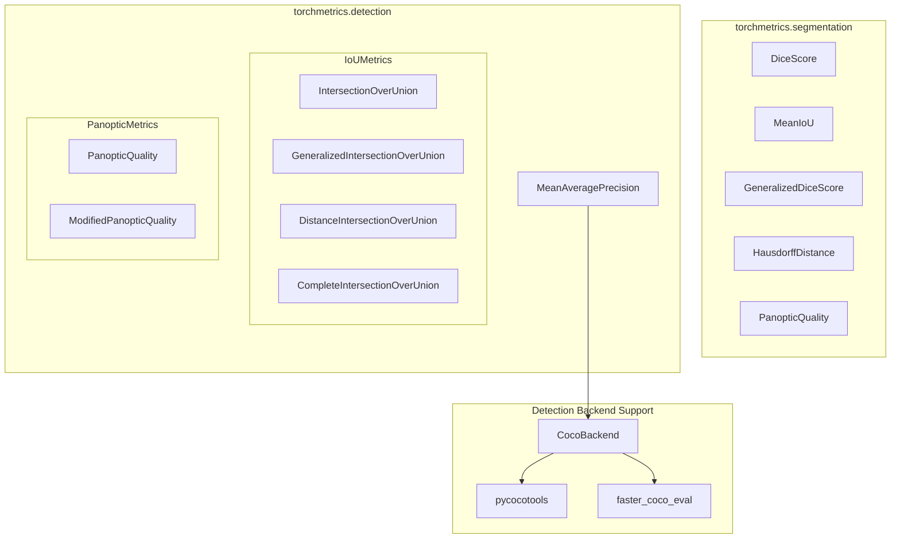
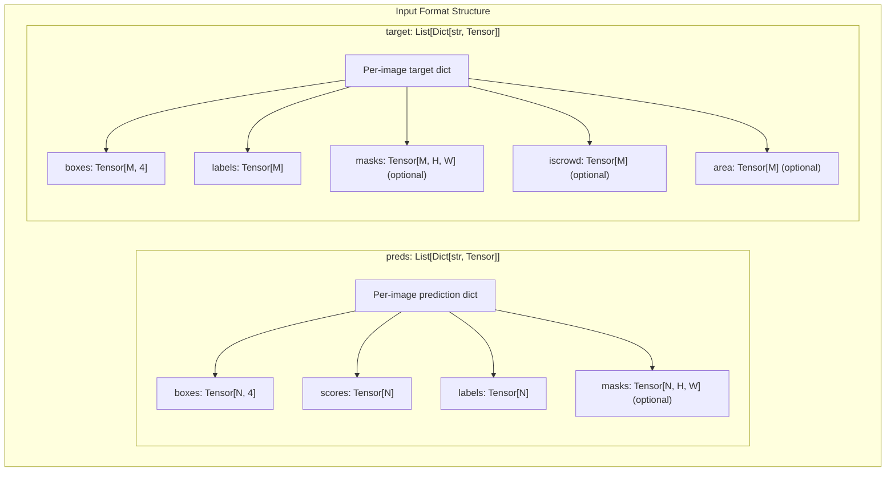
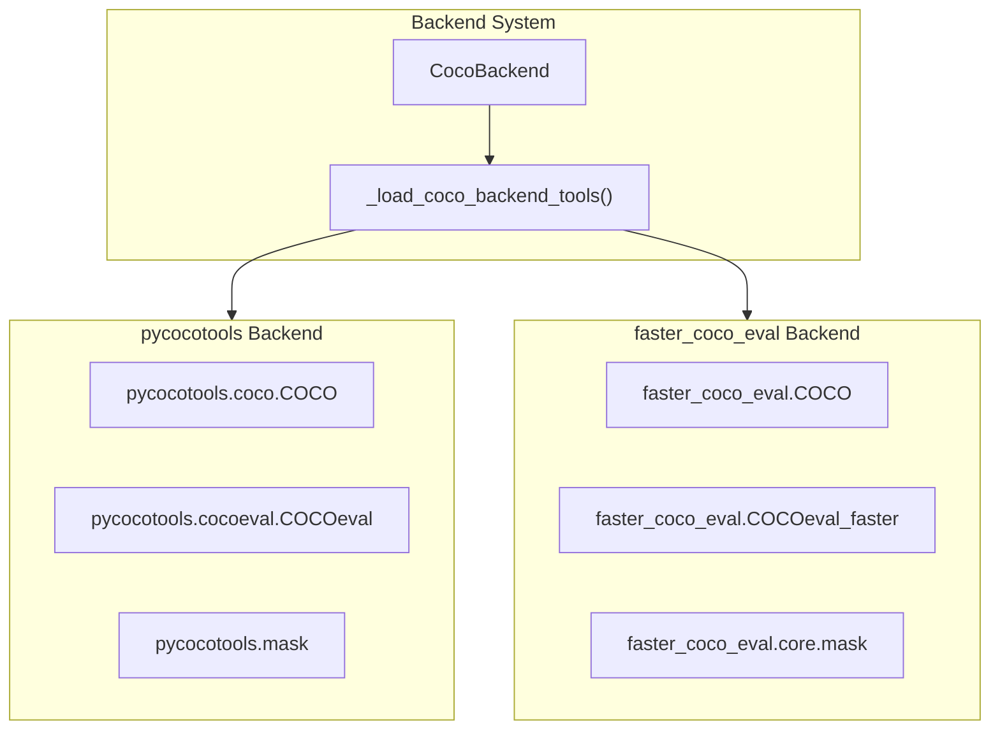
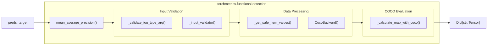
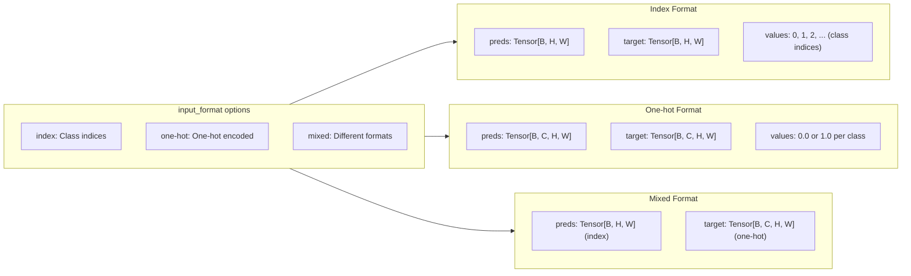
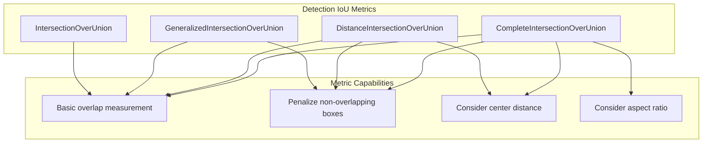

<!-- source: DeepWiki mcp.deepwiki.com · repo Lightning-AI/torchmetrics · page 8 Detection and Segmentation Metrics · fetched 2026-10-21 -->

# Detection and Segmentation Metrics

<details>
<summary>Relevant source files</summary>

The following files were used as context for generating this wiki page:

- [CHANGELOG.md](CHANGELOG.md)
- [docs/source/detection/mean_average_precision.rst](docs/source/detection/mean_average_precision.rst)
- [docs/source/regression/critical_success_index.rst](docs/source/regression/critical_success_index.rst)
- [examples/audio/text_to_speech.py](examples/audio/text_to_speech.py)
- [requirements/_docs.txt](requirements/_docs.txt)
- [requirements/classification_test.txt](requirements/classification_test.txt)
- [requirements/detection_test.txt](requirements/detection_test.txt)
- [requirements/image_test.txt](requirements/image_test.txt)
- [requirements/nominal_test.txt](requirements/nominal_test.txt)
- [requirements/segmentation_test.txt](requirements/segmentation_test.txt)
- [requirements/visual.txt](requirements/visual.txt)
- [src/torchmetrics/detection/_mean_ap.py](src/torchmetrics/detection/_mean_ap.py)
- [src/torchmetrics/detection/helpers.py](src/torchmetrics/detection/helpers.py)
- [src/torchmetrics/detection/mean_ap.py](src/torchmetrics/detection/mean_ap.py)
- [src/torchmetrics/functional/detection/map.py](src/torchmetrics/functional/detection/map.py)
- [src/torchmetrics/functional/image/__init__.py](src/torchmetrics/functional/image/__init__.py)
- [src/torchmetrics/functional/regression/csi.py](src/torchmetrics/functional/regression/csi.py)
- [src/torchmetrics/image/__init__.py](src/torchmetrics/image/__init__.py)
- [src/torchmetrics/regression/csi.py](src/torchmetrics/regression/csi.py)
- [tests/README.md](tests/README.md)
- [tests/unittests/detection/test_map.py](tests/unittests/detection/test_map.py)
- [tests/unittests/image/test_csi.py](tests/unittests/image/test_csi.py)

</details>


Detection and segmentation metrics in TorchMetrics evaluate object detection and image segmentation models using industry-standard protocols. The detection domain provides Mean Average Precision (mAP) following COCO evaluation methodology, while the segmentation domain offers metrics like Dice Score, IoU, and specialized measures for medical imaging and panoptic segmentation.

## Overview of Detection and Segmentation Metrics

TorchMetrics provides two primary metric categories: detection metrics for evaluating object localization and classification, and segmentation metrics for assessing pixel-wise prediction quality.

**Detection and Segmentation Metrics Architecture**


Sources: [src/torchmetrics/detection/__init__.py:14-32](), [src/torchmetrics/detection/mean_ap.py:50-312](), [src/torchmetrics/detection/helpers.py:152-191](), [CHANGELOG.md:67-81](), [CHANGELOG.md:269-273](), [CHANGELOG.md:349-351]()

## Mean Average Precision (mAP)

`MeanAveragePrecision` implements the COCO evaluation protocol for object detection and instance segmentation. It computes mAP across multiple IoU thresholds (0.5-0.95) and different object sizes, providing comprehensive evaluation metrics.

**mAP Evaluation Pipeline**

```mermaid
flowchart LR
    subgraph InputValidation["Input Processing"]
        _input_validator["_input_validator"]
        _get_safe_item_values["_get_safe_item_values"]
    end
    
    subgraph CocoEvaluation["COCO Evaluation"]
        _get_coco_datasets["_get_coco_datasets"]
        COCOeval["COCOeval"]
        _calculate_map_with_coco["_calculate_map_with_coco"]
    end
    
    subgraph OutputGeneration["Result Processing"]
        _coco_stats_to_tensor_dict["_coco_stats_to_tensor_dict"]
        compute["compute()"]
    end
    
    preds_targets["preds, target"] --> InputValidation
    InputValidation --> CocoEvaluation
    CocoEvaluation --> OutputGeneration
    OutputGeneration --> map_results["mAP results dict"]
```


Sources: [src/torchmetrics/detection/mean_ap.py:50-585](), [src/torchmetrics/detection/helpers.py:41-103]()

### MeanAveragePrecision Class

The `MeanAveragePrecision` class implements COCO-style evaluation for both bounding box (`iou_type="bbox"`) and instance segmentation (`iou_type="segm"`) tasks. It uses either `pycocotools` or `faster_coco_eval` backends for evaluation.

**Class Configuration Parameters**

| Parameter | Type | Description | Default |
|-----------|------|-------------|---------|
| `box_format` | `Literal["xyxy", "xywh", "cxcywh"]` | Input box coordinate format | `"xyxy"` |
| `iou_type` | `Union[Literal["bbox", "segm"], tuple]` | Evaluation type: boxes or masks | `"bbox"` |
| `iou_thresholds` | `Optional[list[float]]` | IoU thresholds for mAP calculation | `[0.5, 0.55, ..., 0.95]` |
| `rec_thresholds` | `Optional[list[float]]` | Recall thresholds for evaluation | `[0.0, 0.01, ..., 1.0]` |
| `max_detection_thresholds` | `Optional[list[int]]` | Max detections per image | `[1, 10, 100]` |
| `class_metrics` | `bool` | Enable per-class mAP and mAR | `False` |
| `extended_summary` | `bool` | Include IoU, precision, recall arrays | `False` |
| `average` | `Literal["macro", "micro"]` | Label averaging method | `"macro"` |
| `backend` | `Literal["pycocotools", "faster_coco_eval"]` | Evaluation backend | `"pycocotools"` |

**State Variables**
The metric maintains several internal state lists for accumulating predictions and targets across batches:
- `detection_box`, `detection_mask`: Predicted boxes/masks  
- `detection_scores`, `detection_labels`: Prediction scores and labels
- `groundtruth_box`, `groundtruth_mask`: Ground truth boxes/masks
- `groundtruth_labels`, `groundtruth_crowds`, `groundtruth_area`: Ground truth metadata

Sources: [src/torchmetrics/detection/mean_ap.py:344-426](), [src/torchmetrics/detection/mean_ap.py:320-329]()

### Input Format

`MeanAveragePrecision.update()` expects predictions and targets as lists of dictionaries, where each dictionary represents a single image.

**Input Structure**


**Input Validation**
The `_input_validator` function enforces format requirements:
- Validates required keys (`boxes`/`masks`, `scores`, `labels` for preds; `boxes`/`masks`, `labels` for targets)
- Ensures tensor types and matching lengths within each dictionary
- Supports both `"bbox"` and `"segm"` evaluation modes

**Box Format Conversion**
The `_get_safe_item_values` helper converts box formats and processes masks:
- Converts input boxes to `"xyxy"` format using `torchvision.ops.box_convert`
- Encodes boolean masks to RLE format using `pycocotools.mask.encode` for segmentation evaluation

Sources: [src/torchmetrics/detection/mean_ap.py:64-96](), [src/torchmetrics/detection/helpers.py:41-103](), [src/torchmetrics/detection/helpers.py:588-644]()

### Output Metrics

The `compute()` method returns a dictionary with COCO evaluation metrics. The exact keys depend on configuration parameters like `max_detection_thresholds`.

**Standard Output Keys**

| Key | Description | Shape |
|-----|-------------|-------|
| `map` | Global mAP averaged over IoU thresholds 0.5-0.95 | `Tensor([1])` |
| `map_50` | mAP at IoU=0.50 threshold | `Tensor([1])` |
| `map_75` | mAP at IoU=0.75 threshold | `Tensor([1])` |
| `map_small` | mAP for small objects (area < 32²) | `Tensor([1])` |
| `map_medium` | mAP for medium objects (32² ≤ area < 96²) | `Tensor([1])` |
| `map_large` | mAP for large objects (area ≥ 96²) | `Tensor([1])` |
| `mar_{mdt[0]}` | mAR with `max_detection_thresholds[0]` detections | `Tensor([1])` |
| `mar_{mdt[1]}` | mAR with `max_detection_thresholds[1]` detections | `Tensor([1])` |
| `mar_{mdt[2]}` | mAR with `max_detection_thresholds[2]` detections | `Tensor([1])` |
| `mar_small` | mAR for small objects | `Tensor([1])` |
| `mar_medium` | mAR for medium objects | `Tensor([1])` |
| `mar_large` | mAR for large objects | `Tensor([1])` |
| `classes` | All observed class labels | `Tensor([num_classes])` |

**Class-wise Metrics** (when `class_metrics=True`)
- `map_per_class`: Per-class mAP values
- `mar_{mdt[2]}_per_class`: Per-class mAR values at highest detection threshold

**Extended Summary** (when `extended_summary=True`)
- `ious`: IoU values per image/class combination
- `precision`: Precision array with shape `(T×R×K×A×M)`
- `recall`: Recall array with shape `(T×K×A×M)`  
- `scores`: Confidence scores array with shape `(T×R×K×A×M)`

Where `T`=IoU thresholds, `R`=recall thresholds, `K`=classes, `A`=area ranges, `M`=max detections.

Sources: [src/torchmetrics/detection/mean_ap.py:97-127](), [src/torchmetrics/detection/mean_ap.py:564-584](), [src/torchmetrics/detection/helpers.py:246-264]()

### Usage Examples

**Basic bounding box evaluation:**
```python
from torch import tensor
from torchmetrics.detection import MeanAveragePrecision

# Initialize metric
metric = MeanAveragePrecision(iou_type="bbox", box_format="xyxy")

# Single image prediction and ground truth
preds = [
    {
        "boxes": tensor([[258.0, 41.0, 606.0, 285.0]]),
        "scores": tensor([0.536]),
        "labels": tensor([0]),
    }
]
target = [
    {
        "boxes": tensor([[214.0, 41.0, 562.0, 285.0]]),
        "labels": tensor([0]),
    }
]

# Update and compute
metric.update(preds, target)
results = metric.compute()
print(f"mAP: {results['map']:.4f}, mAP@50: {results['map_50']:.4f}")
```

**Segmentation mask evaluation:**
```python
# For instance segmentation
metric = MeanAveragePrecision(iou_type="segm")

# Boolean mask format
mask_pred = tensor([
    [0, 0, 0, 0, 0],
    [0, 0, 1, 1, 0], 
    [0, 0, 1, 1, 0],
    [0, 0, 0, 0, 0],
    [0, 0, 0, 0, 0],
], dtype=torch.bool)

preds = [{"masks": mask_pred.unsqueeze(0), "scores": tensor([0.536]), "labels": tensor([0])}]
target = [{"masks": mask_target.unsqueeze(0), "labels": tensor([0])}]
```

**Class-wise metrics:**
```python
# Enable per-class evaluation
metric = MeanAveragePrecision(class_metrics=True, extended_summary=True)
metric.update(preds, target)
results = metric.compute()

# Access per-class results
print(f"Per-class mAP: {results['map_per_class']}")
print(f"Observed classes: {results['classes']}")
```

Sources: [src/torchmetrics/detection/mean_ap.py:218-311](), [src/torchmetrics/functional/detection/map.py:99-157]()

### Utilities and Visualization

**Conversion Utilities**
The `MeanAveragePrecision` class provides methods for interoperability with COCO format:

```python
# Export TorchMetrics format to COCO JSON files
metric.tm_to_coco("output_name")  # Creates output_name_preds.json, output_name_target.json

# Import from COCO JSON files  
preds, targets = MeanAveragePrecision.coco_to_tm(
    "coco_predictions.json", 
    "coco_annotations.json", 
    iou_type="bbox"
)
```

**Visualization**
The `.plot()` method creates mAP visualization when matplotlib is available:

```python
# Plot single result
fig, ax = metric.plot(val=results)

# Plot multiple results for comparison
fig, ax = metric.plot(val=[results1, results2, results3])
```

**Distributed Training Support** 
The metric automatically handles distributed training through:
- Custom `_sync_dist()` method for proper state synchronization
- Special handling for mask data that cannot be tensorfied
- `_gather_tuple_list()` for gathering RLE-encoded masks across processes

Sources: [src/torchmetrics/detection/mean_ap.py:427-507](), [src/torchmetrics/detection/mean_ap.py:586-643](), [src/torchmetrics/detection/mean_ap.py:658-689]()

### Backend Architecture

`MeanAveragePrecision` uses a `CocoBackend` abstraction layer to support two evaluation backends with identical APIs but different performance characteristics.

**Backend Selection System**


**Backend Comparison**

| Backend | Package | Performance | Maintenance | API Compatibility |
|---------|---------|-------------|-------------|-------------------|
| `pycocotools` | `pycocotools` (fork recommended) | Standard | Official/Fork | Reference implementation |
| `faster_coco_eval` | `faster-coco-eval` | Optimized (faster) | Active open-source | Drop-in replacement |

**Backend Methods**
The `CocoBackend` class provides unified access to backend functionality:
- `.coco`: Returns COCO dataset loader
- `.cocoeval`: Returns evaluation engine  
- `.mask_utils`: Returns mask utilities
- `._get_coco_datasets()`: Creates COCO-format datasets
- `.coco_to_tm()`: Converts COCO JSON to TorchMetrics format
- `.tm_to_coco()`: Exports TorchMetrics data to COCO JSON

Sources: [src/torchmetrics/detection/mean_ap.py:137-148](), [src/torchmetrics/detection/helpers.py:126-191](), [src/torchmetrics/detection/helpers.py:267-376]()

## Functional Interface

TorchMetrics provides a functional API for direct evaluation without creating metric instances.

**Functional mean_average_precision**


The functional interface accepts the same parameters as the class-based metric but computes results immediately:

```python
from torchmetrics.functional.detection import mean_average_precision

results = mean_average_precision(
    preds, target,
    box_format="xyxy",
    iou_type="bbox", 
    class_metrics=True,
    backend="faster_coco_eval"
)
```

This approach is suitable for one-time evaluation without maintaining metric state across batches.

Sources: [src/torchmetrics/functional/detection/map.py:39-220](), [src/torchmetrics/functional/detection/__init__.py:22-35]()

## Segmentation Metrics

Segmentation metrics evaluate pixel-wise prediction quality for semantic segmentation, instance segmentation, and medical imaging tasks. TorchMetrics provides several standard metrics with support for multiple input formats.

### Input Format Support

Segmentation metrics in TorchMetrics support three input formats through the `input_format` parameter:

**Input Format Types**


- **`"index"`**: Predictions and targets are tensors of shape `[B, H, W]` or `[B, 1, H, W]` containing class indices
- **`"one-hot"`**: Predictions and targets are one-hot encoded tensors of shape `[B, C, H, W]` where `C` is the number of classes
- **`"mixed"`**: Predictions are in index format while targets are in one-hot format, or vice versa

Float inputs are also supported for soft predictions (e.g., from softmax outputs) as of version 1.8.1.

Sources: [CHANGELOG.md:54](), [CHANGELOG.md:73](), [CHANGELOG.md:273]()

### DiceScore

`DiceScore` computes the Dice coefficient (also known as F1 score or Sørensen-Dice coefficient), a widely used metric in medical image segmentation that measures overlap between predicted and ground truth regions.

**Mathematical Definition**

The Dice coefficient is defined as:

```
Dice = 2 * |X ∩ Y| / (|X| + |Y|)
```

Where `X` is the predicted segmentation and `Y` is the ground truth. The coefficient ranges from 0 (no overlap) to 1 (perfect overlap).

**Class Parameters**

| Parameter | Type | Description | Default |
|-----------|------|-------------|---------|
| `num_classes` | `Optional[int]` | Number of classes; optional for one-hot inputs | `None` |
| `include_background` | `bool` | Whether to include background class (class 0) | `True` |
| `per_class` | `bool` | Return per-class scores | `False` |
| `input_format` | `Literal["index", "one-hot", "mixed"]` | Input tensor format | `"index"` |
| `aggregation_level` | `Literal["image", "batch"]` | Aggregation level for computation | `"image"` |
| `average` | `Literal["micro", "macro", "none"]` | Averaging method across classes | `"macro"` |

The `aggregation_level` parameter controls how the metric aggregates across batches:
- **`"image"`**: Computes Dice score per image, then averages (default behavior)
- **`"batch"`**: Pools all predictions and targets before computing the score

Sources: [CHANGELOG.md:21](), [CHANGELOG.md:67](), [CHANGELOG.md:81](), [CHANGELOG.md:176](), [CHANGELOG.md:219](), [CHANGELOG.md:239]()

**Usage Examples**

```python
from torchmetrics.segmentation import DiceScore
import torch

# Binary segmentation (2 classes)
metric = DiceScore(num_classes=2)
preds = torch.tensor([[0, 1, 1], [1, 0, 1]])
target = torch.tensor([[0, 1, 1], [1, 1, 1]])
score = metric(preds, target)

# Multi-class with one-hot encoding
metric = DiceScore(input_format="one-hot", average="macro")
preds = torch.randn(4, 3, 128, 128).softmax(dim=1)  # [B, C, H, W]
target = torch.randint(0, 3, (4, 128, 128))  # [B, H, W]
# Note: Using mixed format (one-hot preds, index target)
metric_mixed = DiceScore(input_format="mixed", num_classes=3)
score = metric_mixed(preds, target)

# Per-class scores with batch aggregation
metric = DiceScore(num_classes=3, per_class=True, aggregation_level="batch")
score = metric(preds, target)  # Returns tensor of shape [3] with per-class scores
```

**Zero Division Handling**

The metric previously included a `zero_division` parameter to control behavior when both prediction and target are empty. This parameter was removed in version 1.8.0. The metric now returns NaN in such cases, which is the standard behavior.

Sources: [CHANGELOG.md:176](), [CHANGELOG.md:187](), [CHANGELOG.md:206]()

### MeanIoU

`MeanIoU` (Mean Intersection over Union, also known as Jaccard Index) measures the overlap between predicted and ground truth segments, commonly used in semantic segmentation tasks.

**Mathematical Definition**

IoU for a single class is defined as:

```
IoU = |X ∩ Y| / |X ∪ Y|
```

Mean IoU averages the IoU scores across all classes.

**Class Parameters**

| Parameter | Type | Description | Default |
|-----------|------|-------------|---------|
| `num_classes` | `Optional[int]` | Number of classes; optional for one-hot inputs | `None` |
| `include_background` | `bool` | Whether to include background class | `True` |
| `per_class` | `bool` | Return per-class IoU scores | `False` |
| `input_format` | `Literal["index", "one-hot", "mixed"]` | Input tensor format | `"index"` |
| `average` | `Literal["micro", "macro", "none"]` | Averaging method | `"macro"` |

**Usage Examples**

```python
from torchmetrics.segmentation import MeanIoU
import torch

# Basic usage with index format
metric = MeanIoU(num_classes=3)
preds = torch.randint(0, 3, (4, 128, 128))
target = torch.randint(0, 3, (4, 128, 128))
iou = metric(preds, target)

# With one-hot encoding (num_classes is optional)
metric = MeanIoU(input_format="one-hot")
preds = torch.randn(4, 3, 128, 128).softmax(dim=1)  # [B, C, H, W]
target_onehot = torch.zeros(4, 3, 128, 128)
target_onehot.scatter_(1, torch.randint(0, 3, (4, 1, 128, 128)), 1)
iou = metric(preds, target_onehot)

# Per-class IoU scores
metric = MeanIoU(num_classes=3, per_class=True, average="none")
iou_per_class = metric(preds, target)  # Returns tensor of shape [3]
```

**Empty Prediction Handling**

The metric handles corner cases such as empty predictions gracefully. In version 1.7.4, fixes were applied to handle zero and negative predictions properly, and version 1.5.0 addressed empty prediction tensors.

Sources: [CHANGELOG.md:151](), [CHANGELOG.md:288](), [CHANGELOG.md:310-311](), [CHANGELOG.md:349]()

### GeneralizedDiceScore

`GeneralizedDiceScore` is a weighted variant of the Dice score that addresses class imbalance by assigning weights inversely proportional to class frequencies. It's particularly useful for medical imaging where certain structures are much smaller than others.

**Mathematical Definition**

The generalized Dice coefficient applies per-class weights:

```
GDice = 2 * Σ(w_c * |X_c ∩ Y_c|) / Σ(w_c * (|X_c| + |Y_c|))
```

Where `w_c` are class-specific weights, typically set as `w_c = 1 / (frequency_c)²`.

**Class Parameters**

| Parameter | Type | Description | Default |
|-----------|------|-------------|---------|
| `num_classes` | `int` | Number of classes | Required |
| `include_background` | `bool` | Whether to include background class | `True` |
| `per_class` | `bool` | Return per-class scores | `False` |
| `weight_type` | `Literal["square", "simple", "uniform"]` | Weight calculation method | `"square"` |
| `input_format` | `Literal["index", "one-hot", "mixed"]` | Input tensor format | `"index"` |

The `weight_type` parameter controls how class weights are computed:
- **`"square"`**: `w_c = 1 / (frequency_c)²` (default, recommended for high class imbalance)
- **`"simple"`**: `w_c = 1 / frequency_c`
- **`"uniform"`**: `w_c = 1` (equivalent to standard Dice)

**Usage Examples**

```python
from torchmetrics.segmentation import GeneralizedDiceScore
import torch

# Medical imaging example with class imbalance
metric = GeneralizedDiceScore(num_classes=4, weight_type="square")
preds = torch.randint(0, 4, (2, 256, 256))
target = torch.randint(0, 4, (2, 256, 256))
score = metric(preds, target)

# Exclude background and get per-class scores
metric = GeneralizedDiceScore(
    num_classes=4,
    include_background=False,
    per_class=True,
    weight_type="simple"
)
scores = metric(preds, target)  # Returns tensor of shape [3] (excluding background)
```

Sources: [CHANGELOG.md:239](), [CHANGELOG.md:350]()

### HausdorffDistance

`HausdorffDistance` measures the maximum distance between the boundaries of predicted and ground truth segments. It's particularly useful in medical imaging for assessing boundary localization quality.

**Mathematical Definition**

The Hausdorff distance between two sets X and Y is:

```
HD(X, Y) = max(h(X, Y), h(Y, X))
```

Where `h(X, Y) = max_{x∈X} min_{y∈Y} d(x, y)` is the directed Hausdorff distance.

**Class Parameters**

| Parameter | Type | Description | Default |
|-----------|------|-------------|---------|
| `num_classes` | `int` | Number of classes | Required |
| `include_background` | `bool` | Whether to include background class | `True` |
| `distance_metric` | `Literal["euclidean", "chessboard", "taxicab"]` | Distance metric for computation | `"euclidean"` |
| `spacing` | `Optional[Union[float, list[float]]]` | Pixel/voxel spacing | `None` |
| `input_format` | `Literal["index", "one-hot", "mixed"]` | Input tensor format | `"index"` |

**Usage Examples**

```python
from torchmetrics.segmentation import HausdorffDistance
import torch

# 2D segmentation example
metric = HausdorffDistance(num_classes=2, distance_metric="euclidean")
preds = torch.randint(0, 2, (4, 128, 128))
target = torch.randint(0, 2, (4, 128, 128))
distance = metric(preds, target)

# 3D medical imaging with voxel spacing
metric = HausdorffDistance(
    num_classes=3,
    distance_metric="euclidean",
    spacing=[1.0, 1.0, 2.5]  # Different spacing in z-direction
)
preds_3d = torch.randint(0, 3, (2, 64, 64, 32))
target_3d = torch.randint(0, 3, (2, 64, 64, 32))
distance = metric(preds_3d, target_3d)
```

The `spacing` parameter accounts for anisotropic voxel dimensions common in medical imaging (e.g., CT scans with thicker slices).

Sources: [CHANGELOG.md:269]()

### PanopticQuality

`PanopticQuality` evaluates panoptic segmentation, which combines semantic and instance segmentation. It measures both segmentation quality (SQ) and recognition quality (RQ).

**Mathematical Definition**

Panoptic Quality is defined as:

```
PQ = (Σ IoU(p, g)) / (|TP| + 0.5 * |FP| + 0.5 * |FN|)
   = SQ × RQ
```

Where:
- **SQ (Segmentation Quality)**: Average IoU of matched segments
- **RQ (Recognition Quality)**: F1 score of segment detection

**Class Parameters**

| Parameter | Type | Description | Default |
|-----------|------|-------------|---------|
| `things` | `set[int]` | Set of "thing" class IDs (countable objects) | Required |
| `stuffs` | `set[int]` | Set of "stuff" class IDs (amorphous regions) | Required |
| `allow_unknown_category` | `bool` | Allow predictions with unknown classes | `False` |
| `return_sq_and_rq` | `bool` | Return SQ and RQ separately | `False` |
| `return_per_class` | `bool` | Return per-class metrics | `False` |

**Usage Examples**

```python
from torchmetrics.detection import PanopticQuality
import torch

# Define thing and stuff classes
metric = PanopticQuality(
    things={1, 2, 3},  # Person, car, bicycle
    stuffs={0, 4, 5},  # Background, road, sky
    return_sq_and_rq=True,
    return_per_class=True
)

# Predictions and targets are segmentation maps with class IDs
preds = torch.randint(0, 6, (2, 256, 256))
target = torch.randint(0, 6, (2, 256, 256))

results = metric(preds, target)
# Returns dict with 'pq', 'sq', 'rq' and per-class variants
print(f"PQ: {results['pq']:.4f}")
print(f"SQ: {results['sq']:.4f}")  # Segmentation Quality
print(f"RQ: {results['rq']:.4f}")  # Recognition Quality
```

**Integration with Detection Module**

The `PanopticQuality` metric is available in both `torchmetrics.detection` and `torchmetrics.segmentation` modules, as panoptic segmentation bridges both domains.

Sources: [CHANGELOG.md:351](), [CHANGELOG.md:607-610](), [CHANGELOG.md:619]()

## Detection Metrics: IoU-based Evaluation

The detection module provides IoU (Intersection over Union) metrics for evaluating bounding box localization quality. These metrics extend the basic IoU with geometric constraints.

**IoU Metric Variants**


These metrics are implemented in [src/torchmetrics/detection/__init__.py]() and extend the basic IoU calculation with additional geometric penalties:

- **`IntersectionOverUnion`**: Standard IoU = |A ∩ B| / |A ∪ B|
- **`GeneralizedIntersectionOverUnion`**: Adds penalty for non-overlapping boxes based on smallest enclosing box
- **`DistanceIntersectionOverUnion`**: Further penalizes based on normalized center distance
- **`CompleteIntersectionOverUnion`**: Additionally considers aspect ratio consistency

Sources: [CHANGELOG.md:621-625](), [src/torchmetrics/detection/__init__.py:14-32]()

## Panoptic Quality Metrics

In addition to the `PanopticQuality` metric described in the segmentation section, the detection module provides `ModifiedPanopticQuality`, a variant that adapts the standard panoptic quality computation.

Sources: [src/torchmetrics/functional/detection/__init__.py:15-20]()

## Functional Interface

Both detection and segmentation metrics provide functional interfaces for stateless computation:

**Detection Functional API**
```python
from torchmetrics.functional.detection import mean_average_precision

# Calculate mAP directly without creating a metric instance
results = mean_average_precision(preds, target, box_format="xyxy", iou_type="bbox")
```

**Segmentation Functional API**
```python
from torchmetrics.functional.segmentation import dice, mean_iou, generalized_dice_score

# Direct computation without metric instances
dice_score = dice(preds, target, num_classes=3)
iou_score = mean_iou(preds, target, num_classes=3)
gdice_score = generalized_dice_score(preds, target, num_classes=3)
```

The functional interfaces accept the same parameters as their class-based counterparts but compute results immediately without maintaining state.

Sources: [src/torchmetrics/functional/detection/map.py:39-220]()

## Integration with PyTorch Lightning

Detection metrics in TorchMetrics are designed to integrate seamlessly with PyTorch Lightning:

```python
import pytorch_lightning as pl
from torchmetrics.detection import MeanAveragePrecision

class DetectionModel(pl.LightningModule):
    def __init__(self):
        super().__init__()
        self.model = ...  # Your detection model
        self.val_map = MeanAveragePrecision()
        self.test_map = MeanAveragePrecision(class_metrics=True)
    
    def validation_step(self, batch, batch_idx):
        images, targets = batch
        preds = self.model(images)
        self.val_map.update(preds, targets)
    
    def validation_epoch_end(self, outputs):
        map_results = self.val_map.compute()
        self.log("val/mAP", map_results["map"])
        self.log("val/mAP_50", map_results["map_50"])
```

The metrics handle distributed training environments automatically, synchronizing results across devices.

Sources: [src/torchmetrics/detection/mean_ap.py:412-425](), [CHANGELOG.md:169-170]()

## Summary

TorchMetrics provides a comprehensive suite of detection metrics for evaluating object detection models, with the `MeanAveragePrecision` metric being the primary tool. These metrics support both bounding box and segmentation mask evaluation, offer various configuration options, and integrate seamlessly with PyTorch Lightning.

By using these metrics, you can:
- Evaluate detection models with industry-standard metrics
- Calculate mean average precision across different IoU thresholds
- Analyze performance for objects of different sizes
- Compare performance across different classes
- Visualize results for better understanding

---

