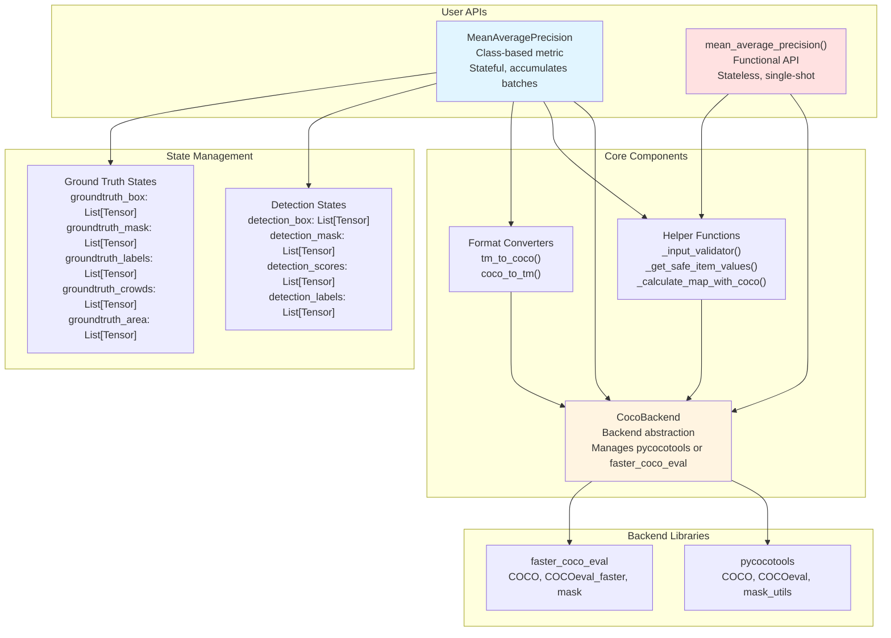
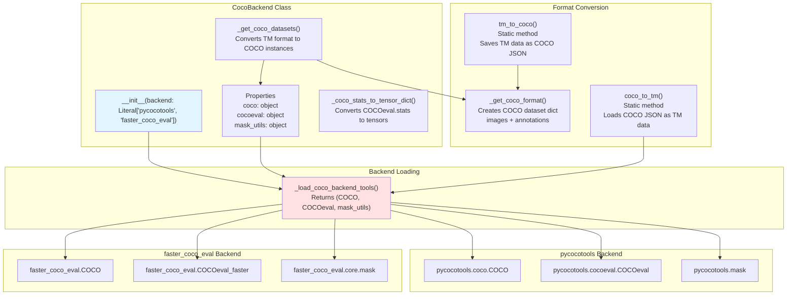
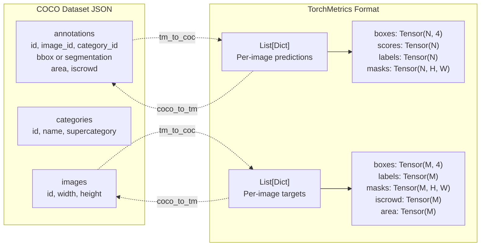
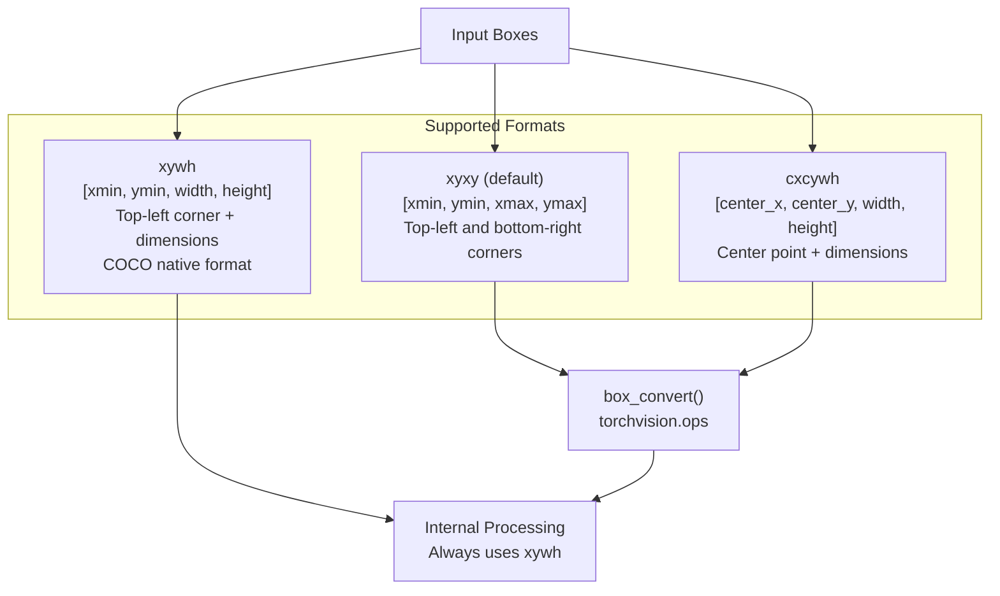
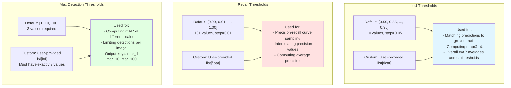
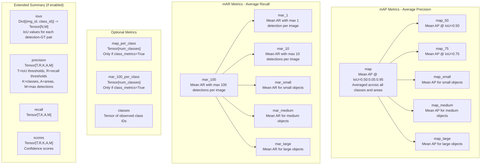
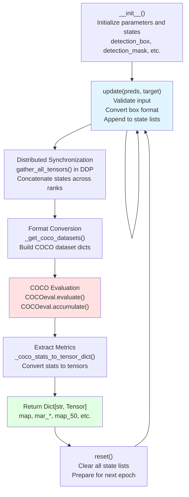
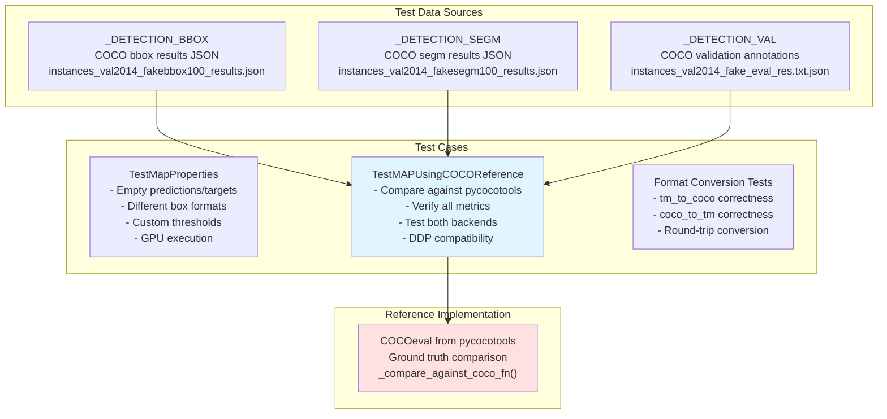

<!-- source: DeepWiki mcp.deepwiki.com · repo Lightning-AI/torchmetrics · page 8.1 MeanAveragePrecision and COCO Evaluation · fetched 2026-10-21 -->

# MeanAveragePrecision and COCO Evaluation

<details>
<summary>Relevant source files</summary>

The following files were used as context for generating this wiki page:

- [CHANGELOG.md](CHANGELOG.md)
- [docs/source/detection/mean_average_precision.rst](docs/source/detection/mean_average_precision.rst)
- [requirements/detection_test.txt](requirements/detection_test.txt)
- [src/torchmetrics/detection/_mean_ap.py](src/torchmetrics/detection/_mean_ap.py)
- [src/torchmetrics/detection/helpers.py](src/torchmetrics/detection/helpers.py)
- [src/torchmetrics/detection/mean_ap.py](src/torchmetrics/detection/mean_ap.py)
- [src/torchmetrics/functional/detection/map.py](src/torchmetrics/functional/detection/map.py)
- [tests/README.md](tests/README.md)
- [tests/unittests/detection/test_map.py](tests/unittests/detection/test_map.py)

</details>


## Purpose and Scope

This document describes the `MeanAveragePrecision` (mAP) metric implementation in TorchMetrics, which evaluates object detection and instance segmentation predictions using the Common Objects in Context (COCO) evaluation protocol. The metric supports both bounding box (`bbox`) and segmentation mask (`segm`) evaluation modes.

The implementation provides:
- A class-based stateful metric API (`MeanAveragePrecision`) that accumulates predictions across batches
- A functional stateless API (`mean_average_precision`) for one-shot computation
- Abstraction over two COCO evaluation backends: `pycocotools` and `faster_coco_eval`
- Utilities for converting between TorchMetrics format and COCO JSON format

For general detection metrics overview, see [8](#8). For IoU-based detection metrics, see the detection package documentation.

**Sources:** [src/torchmetrics/detection/mean_ap.py:50-312](), [src/torchmetrics/functional/detection/map.py:39-220]()

---

## High-Level Architecture

The mAP evaluation system consists of three main layers: the user-facing metric APIs, the backend abstraction layer, and the underlying COCO evaluation libraries.



**Diagram: MeanAveragePrecision Architecture Overview**

The `MeanAveragePrecision` class inherits from `Metric` and manages state across multiple `update()` calls, storing predictions and targets in list-based states. The `compute()` method synchronizes states in distributed settings and delegates evaluation to the `CocoBackend`. The functional API bypasses state management and performs evaluation directly.

**Sources:** [src/torchmetrics/detection/mean_ap.py:50-343](), [src/torchmetrics/detection/helpers.py:152-244](), [src/torchmetrics/functional/detection/map.py:39-220]()

---

## CocoBackend Abstraction Layer

The `CocoBackend` class provides a unified interface over two COCO evaluation implementations, allowing users to choose between the standard `pycocotools` library and the optimized `faster_coco_eval` alternative.



**Diagram: CocoBackend Implementation Structure**

The backend abstraction serves several purposes:
1. **Backend Selection**: Users can choose `pycocotools` (standard implementation) or `faster_coco_eval` (optimized fork) via the `backend` parameter
2. **Lazy Loading**: Backend libraries are loaded on-demand through properties to avoid import errors when dependencies are missing
3. **Unified Interface**: Both backends expose the same API (COCO, COCOeval, mask_utils), ensuring consistent behavior regardless of choice

The `faster_coco_eval` backend is recommended for production use as it is faster, better maintained, and corrects certain corner cases in the original implementation while producing identical results.

**Sources:** [src/torchmetrics/detection/helpers.py:126-191](), [src/torchmetrics/detection/mean_ap.py:354-415]()

---

## COCO Format and Data Conversion

The COCO format is a standardized JSON structure for object detection and segmentation datasets. TorchMetrics provides bidirectional conversion between its tensor-based format and COCO JSON format.

### COCO Format Structure



**Diagram: COCO Format and TorchMetrics Format Relationship**

### Conversion Utilities

The `CocoBackend` class provides two static methods for format conversion:

**`coco_to_tm(coco_preds, coco_target, iou_type, backend)`**
- Loads COCO JSON files and converts to TorchMetrics format
- Returns `(preds, targets)` as lists of dictionaries with tensors
- Handles both bbox and segm annotations
- Usage: Load official COCO results for evaluation

**`tm_to_coco(groundtruth_labels, groundtruth_box, ..., name, iou_type)`**
- Converts accumulated TorchMetrics state to COCO JSON format
- Saves as `{name}_preds.json` and `{name}_target.json`
- Useful for debugging, visualization, or comparison with other tools
- Handles RLE encoding for segmentation masks

**Sources:** [src/torchmetrics/detection/helpers.py:267-376](), [src/torchmetrics/detection/helpers.py:378-506](), [src/torchmetrics/detection/mean_ap.py:427-506]()

---

## Input Format and Validation

The `MeanAveragePrecision` metric expects predictions and targets as lists of dictionaries, where each dictionary corresponds to a single image.

### Input Structure

| Component | Predictions (preds) | Targets (target) |
|-----------|---------------------|------------------|
| **Required Keys** | `boxes` or `masks`, `scores`, `labels` | `boxes` or `masks`, `labels` |
| **Optional Keys** | - | `iscrowd`, `area` |
| **Format** | `List[Dict[str, Tensor]]` | `List[Dict[str, Tensor]]` |
| **Batch Correspondence** | `len(preds) == len(targets)` | One dict per image |

### Box Format Support



**Diagram: Box Format Conversion Flow**

All box formats are converted to `xywh` internally, as this is the native COCO format. The conversion is performed by `torchvision.ops.box_convert` in the `_get_safe_item_values` function.

### IOU Type Support

The metric supports two evaluation modes controlled by the `iou_type` parameter:

| IOU Type | Required Keys | Description |
|----------|---------------|-------------|
| `"bbox"` | `boxes` | Bounding box detection evaluation using box IoU |
| `"segm"` | `masks` | Instance segmentation evaluation using mask IoU |
| `("bbox", "segm")` | `boxes` and `masks` | Evaluate both simultaneously, returns prefixed metrics |

When both types are specified, the metric evaluates each independently and returns results with prefixes: `bbox_map`, `bbox_mar_100`, `segm_map`, `segm_mar_100`, etc.

**Sources:** [src/torchmetrics/detection/mean_ap.py:64-96](), [src/torchmetrics/detection/helpers.py:41-103](), [src/torchmetrics/detection/helpers.py:507-605]()

---

## Evaluation Parameters and Thresholds

The COCO evaluation protocol uses multiple threshold parameters to compute comprehensive detection metrics.

### Threshold Configuration



**Diagram: Threshold Parameter Configuration**

### Area Ranges

Predictions and ground truth boxes are categorized by area for size-specific metrics:

| Category | Area Range (pixels²) | Description |
|----------|---------------------|-------------|
| `small` | 0² to 32² | Small objects (< 32×32 pixels) |
| `medium` | 32² to 96² | Medium objects (32×32 to 96×96 pixels) |
| `large` | 96² to 10⁵² | Large objects (> 96×96 pixels) |
| `all` | 0² to 10⁵² | All objects regardless of size |

Area is automatically computed from boxes/masks if not provided in the `area` key of target dictionaries. Size-specific metrics include: `map_small`, `map_medium`, `map_large`, `mar_small`, `mar_medium`, `mar_large`.

**Sources:** [src/torchmetrics/detection/mean_ap.py:378-401](), [src/torchmetrics/detection/helpers.py:673-727]()

---

## Output Metrics and Interpretation

The `compute()` method returns a dictionary containing comprehensive evaluation metrics following the COCO evaluation standard.

### Core Metrics



**Diagram: Output Metrics Hierarchy**

### Metric Definitions

**Mean Average Precision (mAP)**
- Primary metric for detection quality
- Computed as area under precision-recall curve
- `map`: Average across all IoU thresholds (0.50 to 0.95)
- `map_50`: Stricter matching at IoU=0.50 (easier, higher values)
- `map_75`: Strict matching at IoU=0.75 (harder, lower values)

**Mean Average Recall (mAR)**
- Measures completeness of detection
- Maximum recall given a fixed number of detections per image
- `mar_1`: Useful for single-object scenarios
- `mar_10`: Useful for scenes with few objects
- `mar_100`: Standard metric for general detection

### Class-wise Metrics

When `class_metrics=True`, the metric computes per-class precision and recall:

```python
result = metric.compute()
# result["map_per_class"] -> Tensor with shape (num_classes,)
# result["mar_100_per_class"] -> Tensor with shape (num_classes,)
# result["classes"] -> Tensor of class IDs corresponding to per-class metrics
```

This enables analysis of model performance on specific object categories but has a performance impact that scales linearly with the number of classes.

**Sources:** [src/torchmetrics/detection/mean_ap.py:98-127](), [src/torchmetrics/detection/helpers.py:246-264]()

---

## State Management and Computation Flow

The `MeanAveragePrecision` class follows the standard TorchMetrics lifecycle: initialization, update, compute, and reset.

### Computation Pipeline



**Diagram: MeanAveragePrecision Computation Flow**

### State Variables

The metric maintains separate lists for predictions and ground truth:

**Detection States:**
- `detection_box: List[Tensor]` - Bounding boxes in xywh format
- `detection_mask: List[Tensor]` - Segmentation masks (RLE encoded)
- `detection_scores: List[Tensor]` - Confidence scores
- `detection_labels: List[Tensor]` - Class labels

**Ground Truth States:**
- `groundtruth_box: List[Tensor]` - Ground truth boxes
- `groundtruth_mask: List[Tensor]` - Ground truth masks
- `groundtruth_labels: List[Tensor]` - Ground truth class labels
- `groundtruth_crowds: List[Tensor]` - Crowd annotations (0/1)
- `groundtruth_area: List[Tensor]` - Object areas

All states use `dist_reduce_fx=None` because they require custom synchronization logic in the `_get_coco_datasets` method that handles list concatenation across processes.

### Detection Limit Warning

The metric includes a warning mechanism for excessive detections. If more than `max_detection_thresholds[-1]` (default 100) detections are found in a single image, a warning is issued once per run. This can be disabled by setting `warn_on_many_detections=False`.

**Sources:** [src/torchmetrics/detection/mean_ap.py:417-585](), [src/torchmetrics/detection/helpers.py:192-244](), [src/torchmetrics/detection/helpers.py:507-672]()

---

## Backend Selection and Performance

The choice between `pycocotools` and `faster_coco_eval` backends affects performance and compatibility.

### Backend Comparison

| Aspect | pycocotools | faster_coco_eval |
|--------|-------------|------------------|
| **Source** | Official COCO implementation | Maintained open-source fork |
| **Installation** | `pip install pycocotools` | `pip install faster-coco-eval` |
| **Performance** | Baseline | Faster (optimized C++ code) |
| **Correctness** | Reference implementation | Fixes corner cases, same results |
| **Maintenance** | Less active | Actively maintained |
| **Default** | Yes | No (opt-in) |
| **Version Issues** | pycocotools 2.0.10 COCO format changes | Compatible |

### Version Compatibility

Recent changes in `pycocotools==2.0.10` modified COCO format handling. TorchMetrics includes compatibility fixes:

```python
# Check if pycocotools >= 2.0.9
if _PYCOCOTOOLS_GREATER_EQUAL_2_0_9:
    # Use updated format with "bbox_mode" field
    pass
else:
    # Use legacy format
    pass
```

The `faster_coco_eval` backend handles these compatibility issues internally and is recommended for production use.

### Enabling faster_coco_eval

```python
from torchmetrics.detection import MeanAveragePrecision

# Use faster backend
metric = MeanAveragePrecision(backend="faster_coco_eval")

# Or in functional API
from torchmetrics.functional.detection import mean_average_precision
result = mean_average_precision(preds, target, backend="faster_coco_eval")
```

**Sources:** [CHANGELOG.md:107-107](), [src/torchmetrics/detection/helpers.py:126-150](), [src/torchmetrics/utilities/imports.py]() (implied)

---

## Usage Examples and Integration

### Basic Usage with Bounding Boxes

```python
from torch import tensor
from torchmetrics.detection import MeanAveragePrecision

# Predictions: one image with one detection
preds = [
    {
        "boxes": tensor([[258.0, 41.0, 606.0, 285.0]]),
        "scores": tensor([0.536]),
        "labels": tensor([0]),
    }
]

# Ground truth: one image with one box
target = [
    {
        "boxes": tensor([[214.0, 41.0, 562.0, 285.0]]),
        "labels": tensor([0]),
    }
]

# Initialize and compute
metric = MeanAveragePrecision(iou_type="bbox")
metric.update(preds, target)
result = metric.compute()

print(f"mAP: {result['map']:.4f}")
print(f"mAP@0.50: {result['map_50']:.4f}")
```

### Segmentation Evaluation

```python
from torch import tensor
from torchmetrics.detection import MeanAveragePrecision

# Create binary masks
mask_pred = tensor([[0, 0, 0, 0, 0],
                    [0, 0, 1, 1, 0],
                    [0, 0, 1, 1, 0],
                    [0, 0, 0, 0, 0],
                    [0, 0, 0, 0, 0]], dtype=torch.bool)

mask_target = tensor([[0, 0, 0, 0, 0],
                      [0, 0, 1, 0, 0],
                      [0, 0, 1, 1, 0],
                      [0, 0, 1, 0, 0],
                      [0, 0, 0, 0, 0]], dtype=torch.bool)

preds = [{"masks": mask_pred.unsqueeze(0), "scores": tensor([0.8]), "labels": tensor([0])}]
target = [{"masks": mask_target.unsqueeze(0), "labels": tensor([0])}]

metric = MeanAveragePrecision(iou_type="segm")
metric.update(preds, target)
result = metric.compute()
```

### Batch Accumulation

```python
metric = MeanAveragePrecision()

# Process multiple batches
for batch_preds, batch_targets in dataloader:
    metric.update(batch_preds, batch_targets)

# Compute after all batches
final_result = metric.compute()

# Reset for next epoch
metric.reset()
```

### Class-wise Metrics

```python
metric = MeanAveragePrecision(class_metrics=True)
metric.update(preds, target)
result = metric.compute()

# Access per-class metrics
for class_id, class_map in zip(result["classes"], result["map_per_class"]):
    print(f"Class {class_id}: mAP = {class_map:.4f}")
```

### COCO Format Conversion

```python
metric = MeanAveragePrecision()

# Accumulate predictions
for preds, targets in dataloader:
    metric.update(preds, targets)

# Export to COCO format JSON
metric.tm_to_coco("my_results")
# Creates: my_results_preds.json, my_results_target.json

# Load COCO format JSON
preds, targets = MeanAveragePrecision().coco_to_tm(
    "my_results_preds.json",
    "my_results_target.json",
    iou_type="bbox"
)
```

**Sources:** [src/torchmetrics/detection/mean_ap.py:218-310](), [tests/unittests/detection/test_map.py:278-401]()

---

## Testing and Validation

The mAP implementation is validated against the official COCO evaluation results using real COCO dataset annotations.

### Test Infrastructure



**Diagram: Testing Infrastructure for MeanAveragePrecision**

### Key Test Functions

**`_compare_against_coco_fn()`** [tests/unittests/detection/test_map.py:121-176]()
- Loads official COCO JSON files
- Runs standard COCOeval
- Returns metrics in TorchMetrics format
- Used as reference for validation

**`test_map()`** [tests/unittests/detection/test_map.py:188-217]()
- Parametrized test for bbox and segm
- Tests custom IoU and recall thresholds
- Validates against COCO reference
- Runs in both single-GPU and DDP modes
- Tolerance: `atol=1e-2`

**`test_tm_to_coco()`** [tests/unittests/detection/test_map.py:72-119]()
- Tests format conversion correctness
- Ensures round-trip conversion preserves data
- Validates both bbox and segm modes

### Coverage

The test suite covers:
- ✓ Empty predictions and empty targets
- ✓ All three box formats (xyxy, xywh, cxcywh)
- ✓ Both IoU types (bbox, segm)
- ✓ Both backends (pycocotools, faster_coco_eval)
- ✓ Custom threshold configurations
- ✓ Class-wise metrics
- ✓ Extended summary mode
- ✓ Multi-GPU (DDP) execution
- ✓ Format conversion utilities

**Sources:** [tests/unittests/detection/test_map.py:1-1000](), [CHANGELOG.md:147-147]()

---

