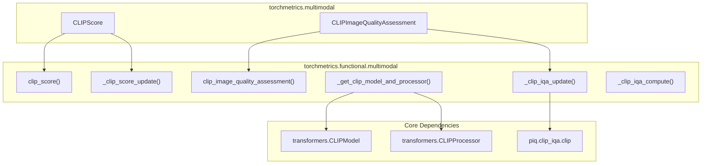
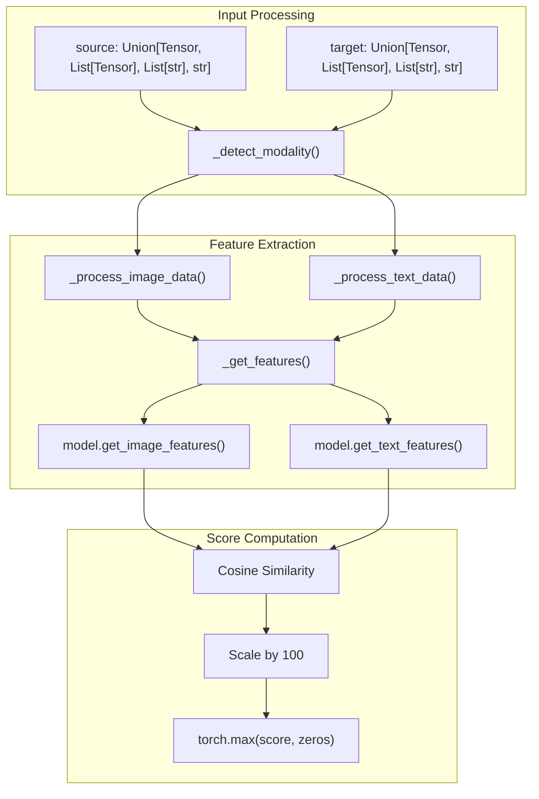
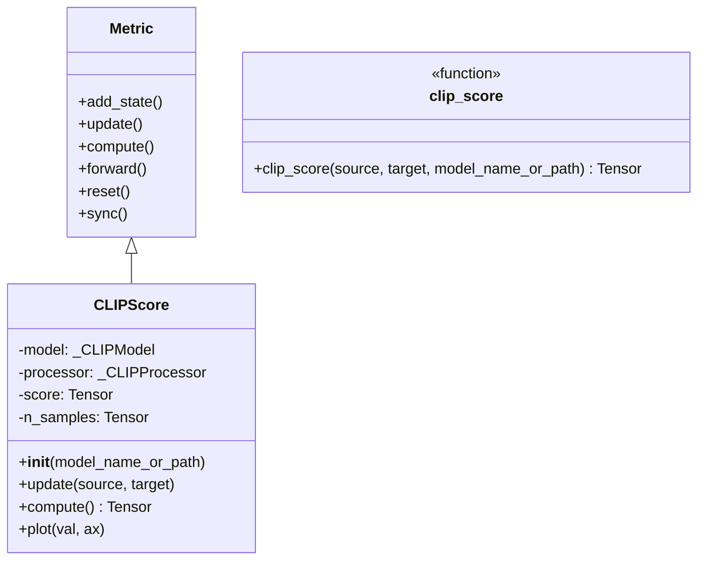
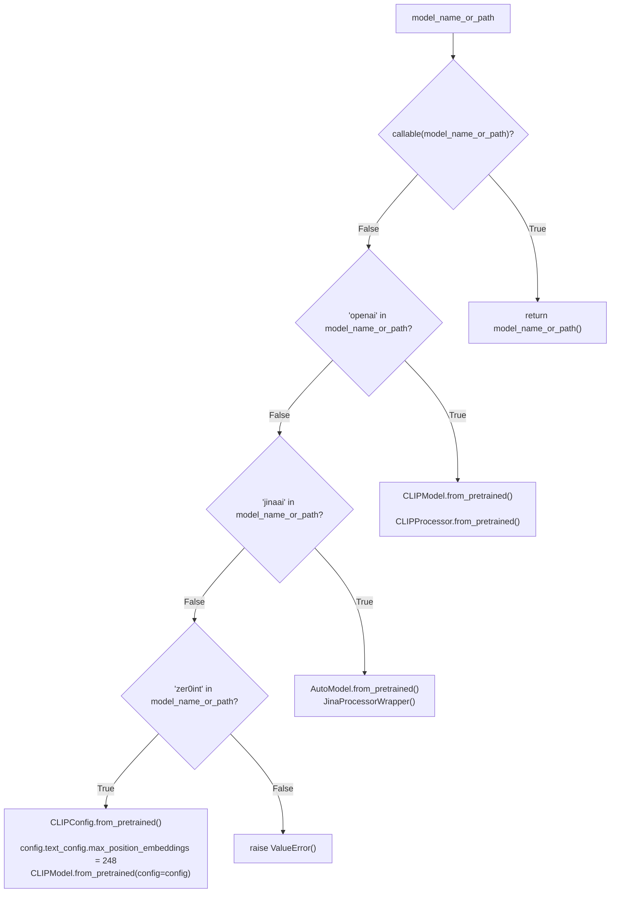
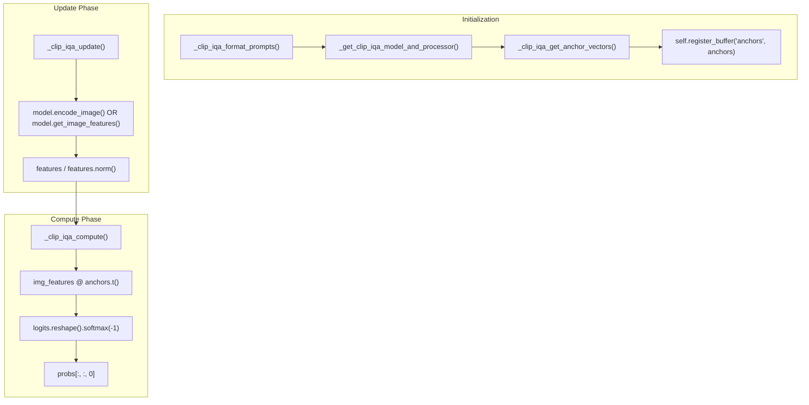
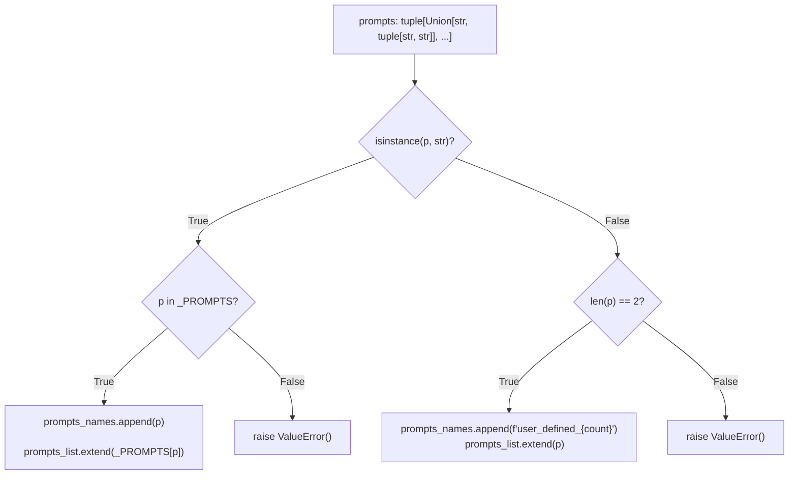
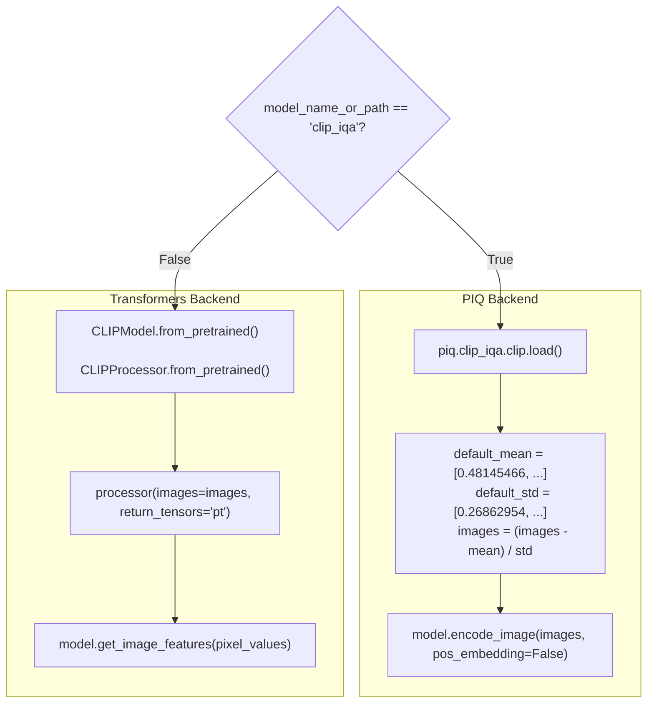
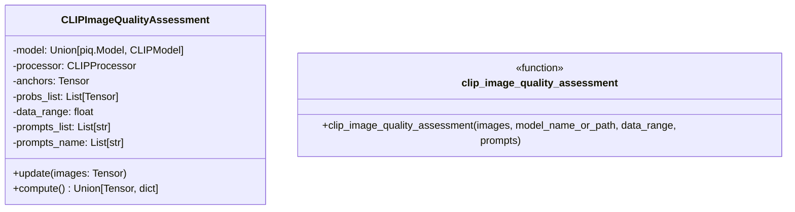
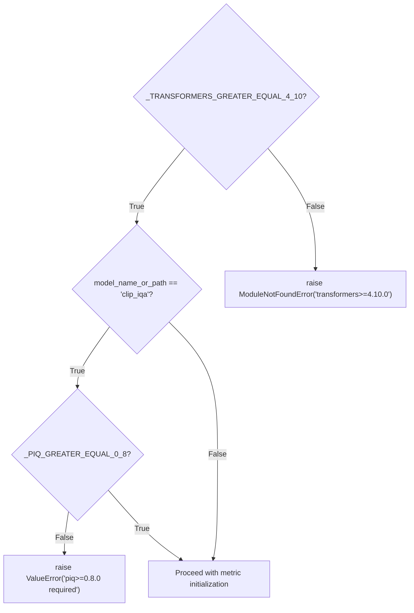
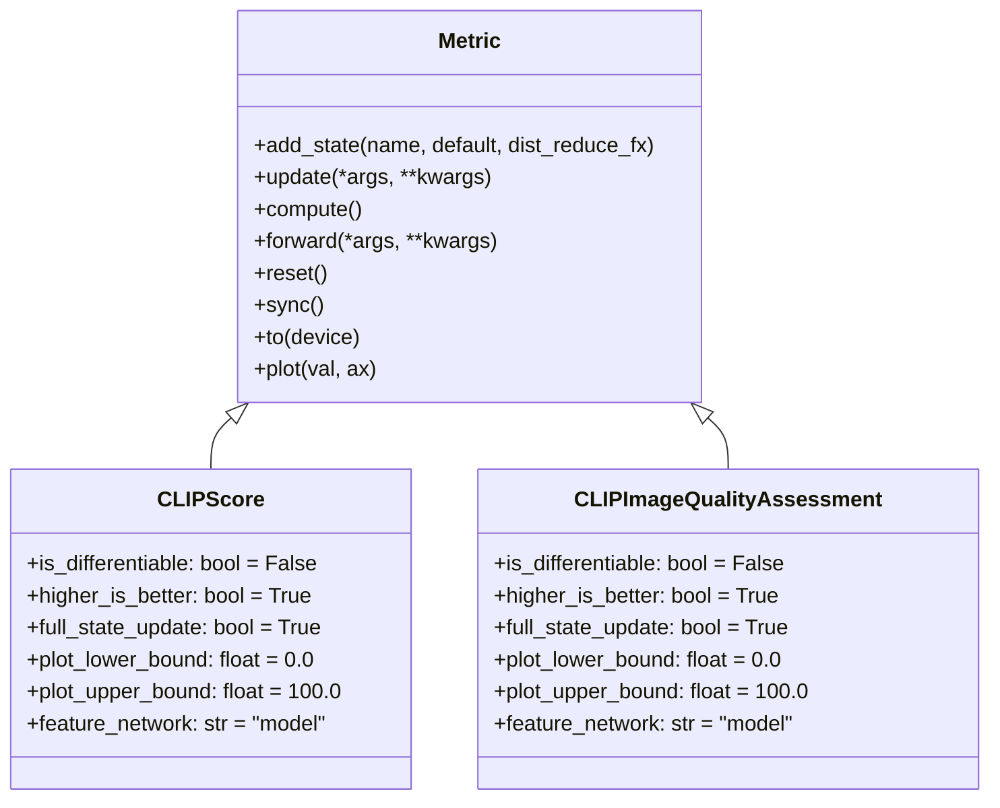

<!-- source: DeepWiki mcp.deepwiki.com · repo Lightning-AI/torchmetrics · page 9 Multimodal Metrics · fetched 2026-10-21 -->

# Multimodal Metrics

<details>
<summary>Relevant source files</summary>

The following files were used as context for generating this wiki page:

- [CHANGELOG.md](CHANGELOG.md)
- [docs/source/links.rst](docs/source/links.rst)
- [requirements/multimodal.txt](requirements/multimodal.txt)
- [requirements/text.txt](requirements/text.txt)
- [requirements/text_test.txt](requirements/text_test.txt)
- [src/torchmetrics/__init__.py](src/torchmetrics/__init__.py)
- [src/torchmetrics/classification/__init__.py](src/torchmetrics/classification/__init__.py)
- [src/torchmetrics/functional/__init__.py](src/torchmetrics/functional/__init__.py)
- [src/torchmetrics/functional/classification/__init__.py](src/torchmetrics/functional/classification/__init__.py)
- [src/torchmetrics/functional/pairwise/__init__.py](src/torchmetrics/functional/pairwise/__init__.py)
- [src/torchmetrics/functional/regression/__init__.py](src/torchmetrics/functional/regression/__init__.py)
- [src/torchmetrics/regression/__init__.py](src/torchmetrics/regression/__init__.py)
- [tests/unittests/_helpers/__init__.py](tests/unittests/_helpers/__init__.py)
- [tests/unittests/multimodal/test_clip_score.py](tests/unittests/multimodal/test_clip_score.py)
- [tests/unittests/text/test_bertscore.py](tests/unittests/text/test_bertscore.py)
- [tests/unittests/text/test_infolm.py](tests/unittests/text/test_infolm.py)
- [tests/unittests/utilities/test_plot.py](tests/unittests/utilities/test_plot.py)

</details>


Multimodal metrics evaluate cross-modal relationships between text and images using vision-language models. TorchMetrics provides two primary implementations: `CLIPScore` and `CLIPImageQualityAssessment`, both leveraging CLIP model embeddings for evaluation.

## Overview

The multimodal metrics module implements cross-modal evaluation metrics for vision-language model assessment. The core functionality resides in two main classes that inherit from the base `Metric` class.

**Module Architecture**


Sources: [src/torchmetrics/multimodal/clip_score.py:49-264](), [src/torchmetrics/multimodal/clip_iqa.py:57-274](), [src/torchmetrics/functional/multimodal/clip_score.py:248-355](), [src/torchmetrics/functional/multimodal/clip_iqa.py:220-334]()

## CLIPScore

The `CLIPScore` class implements cross-modal similarity measurement using CLIP embeddings. It supports image-text, image-image, and text-text comparisons through automatic modality detection.

### Implementation Architecture

**CLIPScore Processing Pipeline**


### Key Functions and Methods

The `CLIPScore` class delegates core functionality to helper functions in the functional module:

| Function | Location | Purpose |
|----------|----------|---------|
| `_clip_score_update()` | [src/torchmetrics/functional/multimodal/clip_score.py:151-200]() | Processes inputs and computes similarity scores |
| `_detect_modality()` | [src/torchmetrics/functional/multimodal/clip_score.py:62-90]() | Automatically determines input modality (image/text) |
| `_get_features()` | [src/torchmetrics/functional/multimodal/clip_score.py:107-149]() | Extracts CLIP features for images or text |
| `_get_clip_model_and_processor()` | [src/torchmetrics/functional/multimodal/clip_score.py:202-246]() | Loads CLIP model and processor instances |

Sources: [src/torchmetrics/multimodal/clip_score.py:49-264](), [src/torchmetrics/functional/multimodal/clip_score.py:151-200]()

### CLIPScore State Management

The `CLIPScore` class maintains internal state for batch processing and distributed training:

**Class Structure and State Variables**


**State Tensor Management**
- `self.score`: Accumulates cosine similarity scores using `dist_reduce_fx="sum"`
- `self.n_samples`: Tracks total sample count using `dist_reduce_fx="sum"`
- State tensors are registered via `self.add_state()` in `__init__()` [src/torchmetrics/multimodal/clip_score.py:194-195]()

Sources: [src/torchmetrics/multimodal/clip_score.py:176-195](), [src/torchmetrics/functional/multimodal/clip_score.py:248-354]()

### Model Loading and Configuration

The `_get_clip_model_and_processor()` function handles model instantiation with different configurations:

| Model Path | Loader Implementation | Text Sequence Length |
|------------|----------------------|----------------------|
| `"openai/clip-vit-base-patch16"` | `CLIPModel.from_pretrained()` | 77 tokens |
| `"openai/clip-vit-base-patch32"` | `CLIPModel.from_pretrained()` | 77 tokens |
| `"openai/clip-vit-large-patch14"` | `CLIPModel.from_pretrained()` (default) | 77 tokens |
| `"openai/clip-vit-large-patch14-336"` | `CLIPModel.from_pretrained()` | 77 tokens |
| `"jinaai/jina-clip-v2"` | `AutoModel.from_pretrained()` + `JinaProcessorWrapper` | Variable |
| `"zer0int/LongCLIP-L-Diffusers"` | Custom `CLIPConfig` with `max_position_embeddings=248` | 248 tokens |
| `"zer0int/LongCLIP-GmP-ViT-L-14"` | Custom `CLIPConfig` with `max_position_embeddings=248` | 248 tokens |

**Model Loading Logic**


Sources: [src/torchmetrics/functional/multimodal/clip_score.py:202-246](), [src/torchmetrics/multimodal/clip_score.py:176-189]()

### Usage Examples

The CLIPScore metric can be used to evaluate image-text, image-image, or text-text similarity:

#### Image-to-Text Similarity
```python
from torchmetrics.multimodal import CLIPScore
import torch

# Initialize the metric
metric = CLIPScore(model_name_or_path="openai/clip-vit-base-patch16")

# Score an image against a caption
image = torch.randint(255, (3, 224, 224))
score = metric(image, "a photo of a cat")
print(score)  # tensor(24.4255)
```

#### Image-to-Image Similarity
```python
from torchmetrics.multimodal import CLIPScore
import torch

# Initialize the metric
metric = CLIPScore()

# Score two images against each other
image1 = torch.randint(255, (3, 224, 224))
image2 = torch.randint(255, (3, 224, 224))
score = metric(image1, image2)
print(score)  # tensor(99.4859)
```

Sources: [src/torchmetrics/multimodal/clip_score.py:139-162](), [src/torchmetrics/functional/multimodal/clip_score.py:296-348]()

## CLIPImageQualityAssessment (CLIP-IQA)

The `CLIPImageQualityAssessment` class implements image quality assessment using pre-computed anchor vectors from prompt pairs. The metric calculates probabilities that images align with positive versus negative quality descriptions.

### Implementation Components

**CLIP-IQA Processing Pipeline**


### Core Function Implementations

| Function | Location | Purpose |
|----------|----------|---------|
| `_clip_iqa_format_prompts()` | [src/torchmetrics/functional/multimodal/clip_iqa.py:92-144]() | Converts prompt tuples to prompt lists and names |
| `_clip_iqa_get_anchor_vectors()` | [src/torchmetrics/functional/multimodal/clip_iqa.py:147-179]() | Pre-computes text embeddings for prompt pairs |
| `_clip_iqa_update()` | [src/torchmetrics/functional/multimodal/clip_iqa.py:181-202]() | Extracts and normalizes image features |
| `_clip_iqa_compute()` | [src/torchmetrics/functional/multimodal/clip_iqa.py:204-218]() | Computes softmax probabilities from similarity scores |

Sources: [src/torchmetrics/multimodal/clip_iqa.py:194-201](), [src/torchmetrics/functional/multimodal/clip_iqa.py:147-218]()

### Predefined Prompt Dictionary

The `_PROMPTS` dictionary defines 16 quality assessment dimensions as prompt pairs:

```python
_PROMPTS: dict[str, tuple[str, str]] = {
    "quality": ("Good photo.", "Bad photo."),
    "brightness": ("Bright photo.", "Dark photo."),
    "noisiness": ("Clean photo.", "Noisy photo."),
    "colorfullness": ("Colorful photo.", "Dull photo."),
    "sharpness": ("Sharp photo.", "Blurry photo."),
    "contrast": ("High contrast photo.", "Low contrast photo."),
    "complexity": ("Complex photo.", "Simple photo."),
    "natural": ("Natural photo.", "Synthetic photo."),
    "happy": ("Happy photo.", "Sad photo."),
    "scary": ("Scary photo.", "Peaceful photo."),
    "new": ("New photo.", "Old photo."),
    "warm": ("Warm photo.", "Cold photo."),
    "real": ("Real photo.", "Abstract photo."),
    "beautiful": ("Beautiful photo.", "Ugly photo."),
    "lonely": ("Lonely photo.", "Sociable photo."),
    "relaxing": ("Relaxing photo.", "Stressful photo."),
}
```

**Prompt Processing Logic**


Sources: [src/torchmetrics/functional/multimodal/clip_iqa.py:43-60](), [src/torchmetrics/functional/multimodal/clip_iqa.py:92-144]()

### Model Integration Patterns

The `CLIPImageQualityAssessment` class supports two model backends with different interfaces:

**Model Backend Selection**


**State Management for Batch Processing**


Sources: [src/torchmetrics/multimodal/clip_iqa.py:172-203](), [src/torchmetrics/functional/multimodal/clip_iqa.py:63-89](), [src/torchmetrics/functional/multimodal/clip_iqa.py:181-202]()

### Usage Examples

The CLIP-IQA metric can be used to evaluate image quality along different dimensions:

#### Single Quality Dimension
```python
from torch import randint
from torchmetrics.multimodal import CLIPImageQualityAssessment

# Create sample images
imgs = randint(255, (2, 3, 224, 224)).float()

# Initialize metric with default "quality" dimension
metric = CLIPImageQualityAssessment()
scores = metric(imgs)
print(scores)  # tensor([0.8894, 0.8902])
```

#### Multiple Quality Dimensions
```python
from torch import randint
from torchmetrics.multimodal import CLIPImageQualityAssessment

# Create sample images
imgs = randint(255, (2, 3, 224, 224)).float()

# Initialize metric with multiple dimensions
metric = CLIPImageQualityAssessment(prompts=("quality", "brightness"))
scores = metric(imgs)
print(scores)
# {'quality': tensor([0.8693, 0.8705]), 'brightness': tensor([0.5722, 0.4762])}
```

Sources: [src/torchmetrics/multimodal/clip_iqa.py:130-158](), [src/torchmetrics/functional/multimodal/clip_iqa.py:296-321]()

## Framework Integration

### Dependency Requirements

The multimodal metrics have specific package requirements based on functionality:

| Package | Version | Purpose | Required For |
|---------|---------|---------|--------------|
| `transformers` | >= 4.10.0 | CLIP model loading and inference | All multimodal metrics |
| `piq` | >= 0.8.0 | PIQ CLIP-IQA model backend | `model_name_or_path="clip_iqa"` only |
| `torch` | >= 1.8.0 | Tensor operations and neural networks | All metrics |
| `torchvision` | Latest | Image preprocessing utilities | Jina CLIP wrapper |

**Import Validation Logic**


### Metric Framework Integration

Both `CLIPScore` and `CLIPImageQualityAssessment` inherit from the base `Metric` class, providing:

**Core Metric Capabilities**


Sources: [src/torchmetrics/utilities/imports.py](), [src/torchmetrics/multimodal/clip_score.py:166-175](), [src/torchmetrics/multimodal/clip_iqa.py:162-171]()

### Visualization Capabilities

Both metrics include a `.plot()` method that can visualize the metric values:

- Single value plotting
- Multiple value plotting (e.g., tracking changes over time)
- Custom matplotlib axis support
- Pre-defined scale ranges

The plotting functionality is standardized across all TorchMetrics metrics, allowing for consistent visualization.

Sources: [src/torchmetrics/multimodal/clip_score.py:225-263](), [src/torchmetrics/multimodal/clip_iqa.py:223-261]()

## Advanced Usage

### Custom Feature Extractors

Both metrics support custom CLIP models via callable functions:

```python
from transformers import CLIPModel, CLIPProcessor

def custom_clip_provider():
    model = CLIPModel.from_pretrained("custom/model/path")
    processor = CLIPProcessor.from_pretrained("custom/processor/path")
    return model, processor

# Use custom model provider
metric = CLIPScore(model_name_or_path=custom_clip_provider)
```

Sources: [src/torchmetrics/multimodal/clip_score.py:176-192](), [src/torchmetrics/functional/multimodal/clip_score.py:203-215]()

### Custom CLIP-IQA Prompts

CLIP-IQA supports custom prompt pairs for specialized quality assessment:

```python
from torchmetrics.multimodal import CLIPImageQualityAssessment

# Create metric with custom prompt pairs
metric = CLIPImageQualityAssessment(prompts=(
    ("Super good photo.", "Super bad photo."),  # Custom pair
    "quality",  # Built-in pair
    ("Photo with people.", "Photo without people.")  # Custom pair
))

# Results will use automatically generated names
scores = metric(images)
# {'user_defined_0': tensor([0.9578]), 'quality': tensor([0.8693]), 'user_defined_1': tensor([0.7123])}
```

Sources: [src/torchmetrics/functional/multimodal/clip_iqa.py:92-144]()

## Performance Considerations

### Model Size and Speed

The choice of CLIP model significantly impacts performance:

- Smaller models (`clip-vit-base-patch32`) are faster but less accurate
- Larger models (`clip-vit-large-patch14`) are more accurate but slower
- The default `clip_iqa` model (from PIQ) is optimized for image quality assessment

### Batch Processing

Both metrics support efficient batch processing of inputs:

- For CLIPScore, inputs can be batches of images and/or text
- For CLIP-IQA, inputs should be batched images with shape `[N, C, H, W]`

### Memory Usage Warning

For CLIPScore, a warning is raised when processing very long captions that exceed the model's maximum token length (77 for standard CLIP models, 248 for LongCLIP). In such cases, the captions are truncated.

Sources: [src/torchmetrics/functional/multimodal/clip_score.py:136-146]()

## Limitations

- CLIPScore is sensitive to the specific wording of captions
- CLIP-based metrics may exhibit biases present in the CLIP pre-training data
- The transformers package is required, which can add significant dependencies
- Default CLIP models have a maximum sequence length of 77 tokens for text
- Performance depends on GPU availability for larger models

---

