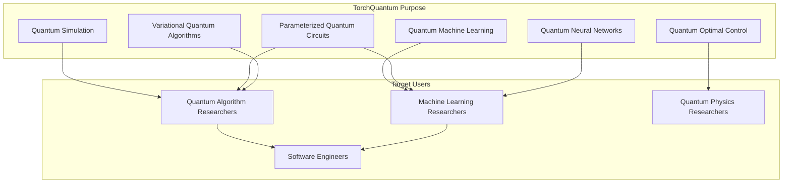
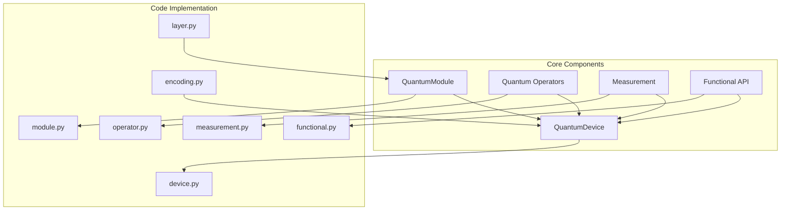
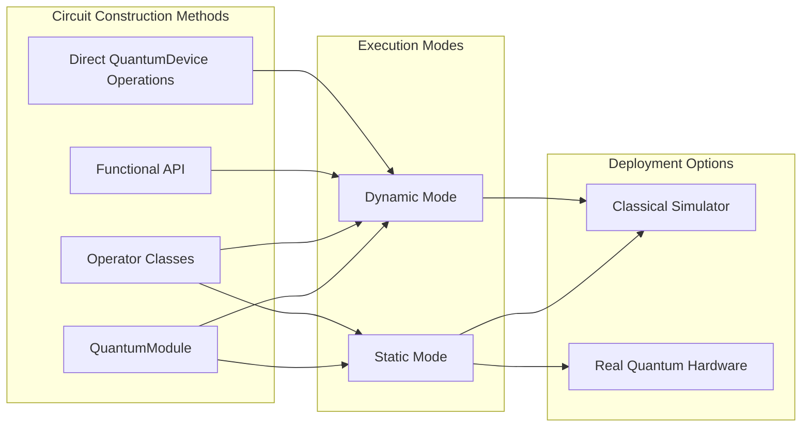

<!-- source: DeepWiki mcp.deepwiki.com · repo mit-han-lab/torchquantum · page 1 Overview · fetched 2026-10-30 -->

# Overview

<details>
<summary>Relevant source files</summary>

The following files were used as context for generating this wiki page:

- [README.md](README.md)
- [docs/Makefile](docs/Makefile)
- [docs/make.bat](docs/make.bat)
- [docs/source/_templates/classtemplate_auto.rst](docs/source/_templates/classtemplate_auto.rst)
- [docs/source/_templates/classtemplate_controlflow.rst](docs/source/_templates/classtemplate_controlflow.rst)
- [docs/source/_templates/functiontemplate.rst](docs/source/_templates/functiontemplate.rst)
- [docs/source/api_functional.rst](docs/source/api_functional.rst)
- [docs/source/api_layers.rst](docs/source/api_layers.rst)
- [docs/source/api_operators.rst](docs/source/api_operators.rst)
- [docs/source/api_torchquantum.rst](docs/source/api_torchquantum.rst)
- [docs/source/index.rst](docs/source/index.rst)
- [docs/source/usage_installation.rst](docs/source/usage_installation.rst)
- [setup.py](setup.py)
- [torchquantum/__init__.py](torchquantum/__init__.py)

</details>


TorchQuantum is a PyTorch-based framework for quantum simulation and quantum machine learning. It enables the simulation of quantum computations on classical hardware using PyTorch, supporting statevector simulation and quantum circuit construction with automatic differentiation capabilities. The framework is designed to leverage GPU acceleration for scaling up to 30+ qubits and provides seamless integration between classical and quantum computing paradigms.

This page provides a high-level overview of TorchQuantum, explaining its purpose, key features, and architectural components. For specific installation instructions, see [Installation and Requirements](#1.1), and for a detailed list of features, see [Key Features](#1.2).

## Purpose and Scope

TorchQuantum provides tools for researchers and developers working on quantum algorithm design, parameterized quantum circuit training, quantum optimal control, quantum machine learning, and quantum neural networks. Its primary goal is to make quantum computing more accessible to the PyTorch community while providing high-performance simulation capabilities.



Sources: [README.md:50-55](), [docs/source/index.rst:52-63]()

## Core Architecture

TorchQuantum's architecture is built around several key components that provide the foundation for quantum simulation and computation:



Sources: [README.md:262-275](), [docs/source/index.rst:284-317]()

The architecture consists of:

1. **QuantumDevice**: The central component that stores and manages quantum states. It serves as the quantum memory that operators act upon.

2. **Quantum Operators**: Classes that implement various quantum gates (like Hadamard, PauliX, CNOT, etc.) which manipulate the quantum states in the QuantumDevice.

3. **QuantumModule**: A PyTorch-compatible module for constructing quantum circuits in an object-oriented manner, similar to `nn.Module` in PyTorch.

4. **Measurement**: Tools for extracting classical information from quantum states, including expectation values and sampling-based measurements.

5. **Functional API**: A functional interface for applying quantum operations, offering an alternative to the object-oriented approach.

## Execution Flow and Integration

TorchQuantum integrates with the PyTorch ecosystem and enables the construction of hybrid classical-quantum computational flows:

```mermaid
sequenceDiagram
    participant CML as Classical ML (PyTorch)
    participant QD as QuantumDevice
    participant QO as Quantum Operators
    participant MS as Measurement
    participant OPT as PyTorch Optimizer
    
    CML->>QD: Create quantum device
    Note over QD: Initialize quantum state
    QD->>QO: Apply quantum gates
    Note over QO: Transform quantum state
    QD->>MS: Measure quantum state
    MS->>CML: Return classical values
    CML->>OPT: Calculate loss
    OPT->>QO: Update parameters
    Note over QO: Parameters updated via PyTorch autograd
```

Sources: [README.md:92-145](), [docs/source/index.rst:108-149]()

This execution flow demonstrates how TorchQuantum seamlessly integrates quantum computation within the PyTorch ecosystem:

1. Classical PyTorch code creates a quantum device with specified number of qubits
2. Quantum operators (gates) are applied to transform the quantum state
3. Measurements convert quantum information back to classical values
4. These classical values can be used in PyTorch's optimization process
5. The quantum circuit parameters are updated through PyTorch's autograd mechanism

## Key Differentiators

What sets TorchQuantum apart from other quantum computing frameworks like Qiskit or Pennylane:

| Feature | TorchQuantum | Other Frameworks |
|---------|--------------|------------------|
| Computation Graph | Dynamic computation graph | Static computation graph |
| Gradient Computation | Automatic via PyTorch autograd | Often manual or limited |
| GPU Support | Native support with batch processing | Limited or no GPU support |
| Debugging | Easy with PyTorch's tools | Usually more complex |
| Integration | Seamless with PyTorch ecosystem | May require adapters |
| Batch Processing | Tensorized batch processing | Often sequential |

Sources: [README.md:56-58](), [docs/source/index.rst:65-69]()

## Usage Modes

TorchQuantum offers multiple ways to construct and execute quantum circuits:



Sources: [README.md:90-145](), [docs/source/index.rst:108-149]()

TorchQuantum provides flexibility in how quantum circuits are constructed and executed:

1. Direct operations on the QuantumDevice
2. Using the functional API (similar to PyTorch's functional API)
3. Using Operator classes for a more object-oriented approach
4. Building circuits with QuantumModule (similar to PyTorch's nn.Module)

Circuits can be executed in dynamic mode (step-by-step execution with dynamic computation graph) or static mode (pre-compiled circuits), and can be deployed on classical simulators or real quantum hardware through integrations with platforms like IBMQ.

## Application Areas

TorchQuantum has been used in various quantum computing applications:

- Quantum Neural Networks for classification tasks (e.g., MNIST)
- Quantum Convolution (Quanvolution)
- Variational Quantum Algorithms (VQE, QAOA)
- Quantum Kernel Methods
- Quantum Approximate Optimization
- Noise-resilient quantum circuit design (QuantumNAS)

Sources: [README.md:171-179](), [docs/source/index.rst:174-196]()

TorchQuantum has been used in several published papers, including works on noise-adaptive search for robust quantum circuits (QuantumNAS), quantum noise-aware training, quantum on-chip training, variational quantum pulse learning, and quantum neural network compression.

## Software Components

The TorchQuantum codebase is organized into several key modules:

| Module | File | Description |
|--------|------|-------------|
| QuantumDevice | device.py | Stores and manages quantum states |
| Encoding | encoding.py | Encodes classical data into quantum states |
| Functional API | functional.py | Provides functional interface for quantum operations |
| Operators | operator.py | Implements quantum gate classes |
| Layers | layer.py | Provides layer templates for circuit construction |
| Measurement | measurement.py | Tools for measuring quantum states |
| Graph | graph.py | Quantum gate graph used in static mode |
| Qiskit Integration | plugins/qiskit* | Connectors for IBMQ deployment |

Sources: [README.md:262-275](), [docs/source/index.rst:284-317]()

This modular organization allows for flexibility and extensibility, making it easy to add new features or integrate with other quantum computing frameworks.

---

