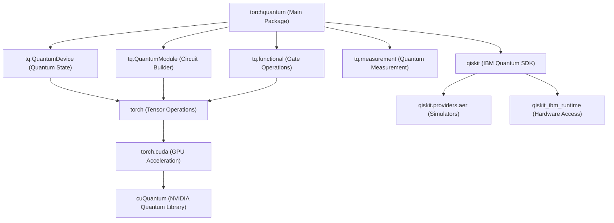
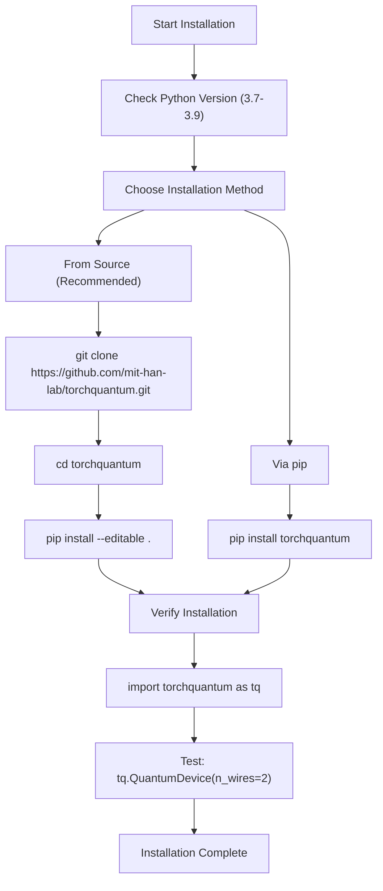

<!-- source: DeepWiki mcp.deepwiki.com · repo mit-han-lab/torchquantum · page 1.1 Installation and Requirements · fetched 2026-10-30 -->

# Installation and Requirements

<details>
<summary>Relevant source files</summary>

The following files were used as context for generating this wiki page:

- [README.md](README.md)
- [docs/requirements.txt](docs/requirements.txt)
- [docs/source/conf.py](docs/source/conf.py)
- [docs/source/examples/quanvolution/README.md](docs/source/examples/quanvolution/README.md)
- [docs/source/examples/quanvolution/quanvolution.ipynb](docs/source/examples/quanvolution/quanvolution.ipynb)
- [docs/source/examples_README.md](docs/source/examples_README.md)
- [examples/README.md](examples/README.md)
- [examples/clifford_qnn/README.md](examples/clifford_qnn/README.md)
- [examples/quanvolution/README.md](examples/quanvolution/README.md)
- [examples/quanvolution/quanvolution.ipynb](examples/quanvolution/quanvolution.ipynb)
- [readthedocs.yaml](readthedocs.yaml)
- [requirements.txt](requirements.txt)
- [setup.py](setup.py)
- [torchquantum/__init__.py](torchquantum/__init__.py)

</details>


This page details the process of installing TorchQuantum and setting up the required dependencies to run quantum simulations and quantum machine learning workloads. TorchQuantum is designed to seamlessly integrate with PyTorch, enabling quantum computing simulations on classical hardware with optional GPU acceleration.

For information about TorchQuantum's capabilities and features, see [Key Features](#1.2).

## System Requirements

### Python Version Compatibility

TorchQuantum works with Python versions between 3.7 and 3.9. Python 3.10 may have compatibility issues with the `concurrent` package used by Qiskit.

Sources: [README.md:381-387]()

### Hardware Requirements

- **CPU**: Standard CPU compatible with PyTorch
- **GPU**: NVIDIA GPUs are required for GPU-accelerated model training and simulation
- **Memory**: Requirements scale with the size of quantum systems being simulated (each additional qubit doubles the memory needs)

Sources: [README.md:386-387]()

## Installation Methods

### From Source (Recommended)

The recommended installation method is cloning the repository and installing in editable mode:

```bash
git clone https://github.com/mit-han-lab/torchquantum.git
cd torchquantum
pip install --editable .
```

Installing in editable mode allows you to modify the code and see changes immediately without reinstallation.

Sources: [README.md:83-88]()

### Via pip

TorchQuantum is also available on PyPI:

```bash
pip install torchquantum
```

Sources: [README.md:83-88]()

## Dependencies

TorchQuantum relies on several key libraries for its functionality:

### Core Dependencies

| Package | Version | Purpose |
|---------|---------|---------|
| PyTorch | ≥ 1.8.0 | Deep learning framework foundation |
| Qiskit | ≥ 0.39.0, < 1.0.0 | Quantum circuit simulation and hardware access |
| qiskit-aer | 0.13.3 | High-performance quantum simulators |
| qiskit_ibm_runtime | 0.20.0 | IBM Quantum hardware execution |
| NumPy | ≥ 1.19.2 | Numerical computations |
| SciPy | ≥ 1.5.2 | Scientific computing utilities |
| setuptools | ≥ 52.0.0 | Package installation tools |

### Additional Libraries

| Package | Purpose |
|---------|---------|
| matplotlib | Visualization of quantum states and circuits |
| tqdm | Progress tracking for quantum simulations |
| torchvision | Image processing for QML examples |
| torchpack | Training utilities |
| opt_einsum | Optimized tensor contractions |
| pathos | Parallel processing |

Sources: [requirements.txt:1-25](), [README.md:381-387]()

## TorchQuantum Architecture and Dependencies

Title: TorchQuantum Component Dependency Structure


Sources: [__init__.py:25-42](), [README.md:47-80]()

## Installation Process

Title: TorchQuantum Installation Workflow


Sources: [README.md:83-88](), [README.md:92-105]()

## Verification and Basic Usage

After installation, verify that TorchQuantum is working correctly:

```python
import torchquantum as tq
import torchquantum.functional as tqf

# Create a quantum device
qdev = tq.QuantumDevice(n_wires=2, bsz=5, device="cpu")  # use device='cuda' for GPU

# Apply quantum gates
qdev.h(wires=0)
qdev.cnot(wires=[0, 1])

# Print the current state
print(qdev)
```

This basic example creates a quantum device with 2 qubits and applies a Hadamard gate followed by a CNOT gate.

Sources: [README.md:92-115]()

## Common Issues and Troubleshooting

### Qiskit Compatibility

TorchQuantum automatically checks for compatibility with Qiskit. The package will display warnings if there are Qiskit parameterization issues that need to be fixed.

Sources: [__init__.py:43-64]()

### GPU Support

When using GPU acceleration:
- Ensure your NVIDIA drivers are up-to-date
- Verify CUDA compatibility with your PyTorch installation
- For larger quantum simulations, more GPU memory will be required

### Environment Compatibility

- For Jupyter notebooks or Google Colab: You may need to install additional visualization packages
- For containerized environments: Ensure the container has access to GPU resources if needed

## Example Installation in Jupyter/Colab

For notebook environments like Google Colab, you can install TorchQuantum with:

```python
!pip install qiskit==0.32.1  # Install compatible Qiskit version
!git clone https://github.com/mit-han-lab/torchquantum.git
%cd torchquantum
!pip install --editable .
%env PYTHONPATH=.
```

This approach is demonstrated in the Quanvolution example notebook.

Sources: [examples/quanvolution/quanvolution.ipynb:83-486]()

## Next Steps

After installation, you can explore:
- Basic quantum circuit creation in the [Core Components](#2) section
- Example notebooks in the examples directory
- Integration with Qiskit for real quantum hardware execution

The installation provides all necessary components to start building and simulating quantum circuits using the PyTorch framework, with seamless GPU acceleration for larger simulations.

---

