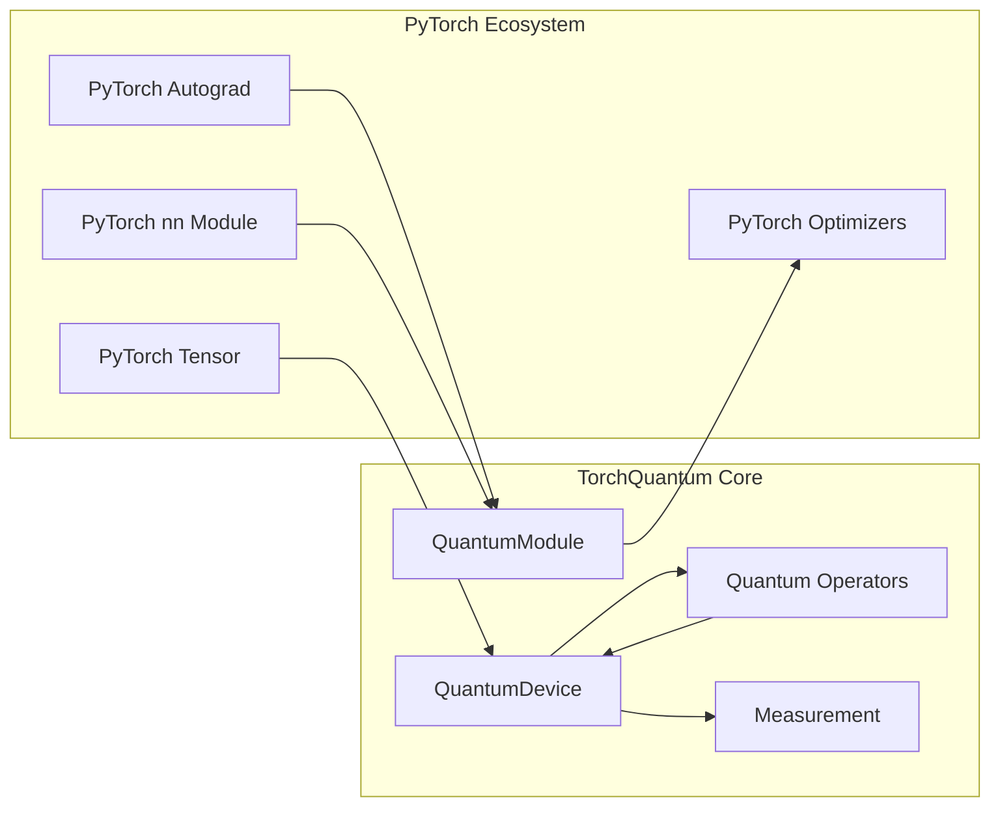
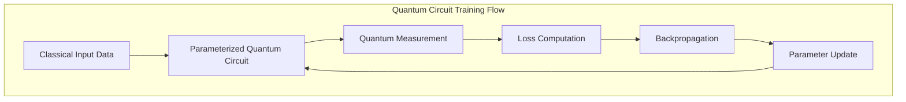
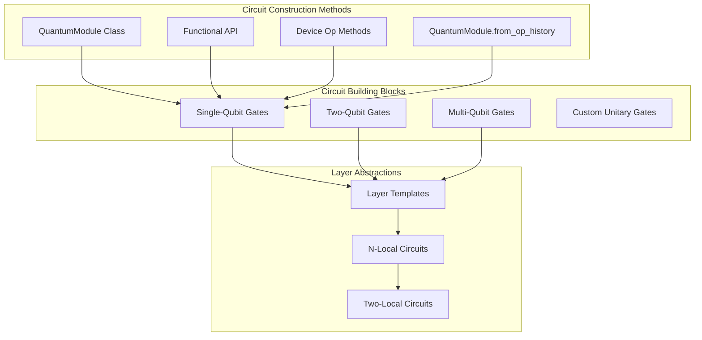
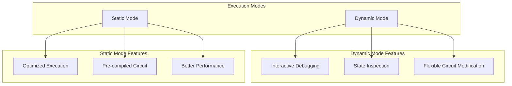

<!-- source: DeepWiki mcp.deepwiki.com · repo mit-han-lab/torchquantum · page 1.2 Key Features · fetched 2026-10-30 -->

# Key Features

<details>
<summary>Relevant source files</summary>

The following files were used as context for generating this wiki page:

- [README.md](README.md)
- [docs/Makefile](docs/Makefile)
- [docs/make.bat](docs/make.bat)
- [docs/source/_templates/classtemplate_auto.rst](docs/source/_templates/classtemplate_auto.rst)
- [docs/source/_templates/classtemplate_controlflow.rst](docs/source/_templates/classtemplate_controlflow.rst)
- [docs/source/_templates/functiontemplate.rst](docs/source/_templates/functiontemplate.rst)
- [docs/source/api_functional.rst](docs/source/api_functional.rst)
- [docs/source/api_layers.rst](docs/source/api_layers.rst)
- [docs/source/api_operators.rst](docs/source/api_operators.rst)
- [docs/source/api_torchquantum.rst](docs/source/api_torchquantum.rst)
- [docs/source/index.rst](docs/source/index.rst)
- [docs/source/usage_installation.rst](docs/source/usage_installation.rst)
- [setup.py](setup.py)
- [torchquantum/__init__.py](torchquantum/__init__.py)

</details>


This page provides an overview of the main features and capabilities of TorchQuantum, a PyTorch-based framework for quantum simulation and quantum machine learning. TorchQuantum enables researchers and developers to easily construct, simulate, and train quantum circuits using the familiar PyTorch ecosystem.

## PyTorch Integration and Design Philosophy

TorchQuantum is built on PyTorch, providing a seamless integration with the PyTorch ecosystem. The framework is designed to leverage PyTorch's capabilities while extending them to quantum computing.



Sources: [README.md:72-80](), [torchquantum/__init__.py:28-42]()

The key design features include:

### 1. Dynamic Computation Graph

Unlike some other quantum computing frameworks, TorchQuantum leverages PyTorch's dynamic computation graph, which allows for:

- Easy debugging of quantum circuits at runtime
- Step-by-step inspection of quantum states
- On-the-fly modification of circuit architecture
- Interactive development and testing

```python
# Example of dynamic graph inspection
qdev = tq.QuantumDevice(n_wires=2, bsz=5, device="cpu", record_op=True)
qdev.h(wires=0)
qdev.cnot(wires=[0, 1])

# Print the current quantum state at any point
print(qdev)  # Shows the full state vector in real-time
```

Sources: [README.md:76](), [README.md:110-111]()

### 2. Automatic Differentiation

TorchQuantum fully supports automatic differentiation through PyTorch's autograd, enabling:

- Gradient computation for trainable quantum circuit parameters
- End-to-end training of hybrid quantum-classical models
- Support for various optimization algorithms in PyTorch



Sources: [README.md:77](), [README.md:130-132]()

### 3. Batch Processing

TorchQuantum supports batch processing of quantum operations, allowing for:

- Processing multiple quantum circuit instances simultaneously
- Parallelized simulation of multiple input data samples
- Efficient training of quantum models on large datasets

```python
# Example of batch processing
qdev = tq.QuantumDevice(n_wires=4, bsz=32, device="cuda")  # Batch size of 32
```

Sources: [README.md:78](), [README.md:96]()

### 4. GPU Acceleration

TorchQuantum provides GPU support for quantum simulations, offering:

- Significant speedups for quantum circuit simulation
- Ability to scale to larger qubit systems (30+ qubits)
- Batched operations leveraging GPU parallelism

This is achieved through PyTorch's GPU support and dedicated optimizations for quantum operations.

Sources: [README.md:78](), [README.md:52]()

## Quantum Circuit Construction

TorchQuantum provides flexible ways to construct quantum circuits:



Sources: [README.md:98-106](), [README.md:136-145]()

### 1. Multiple API Styles

TorchQuantum provides multiple ways to build circuits:

- **QuantumModule API**: Object-oriented approach similar to PyTorch's nn.Module
- **Functional API**: Function-based approach for direct gate application
- **Device Operation Methods**: Direct method calls on the QuantumDevice object

```python
# Three equivalent ways to apply Hadamard gate
# 1. Using device operation methods
qdev.h(wires=0)

# 2. Using functional API
tqf.h(qdev, wires=0)

# 3. Using operator objects
h_op = tq.Hadamard()
h_op(qdev, wires=0)
```

Sources: [README.md:98-108]()

### 2. Comprehensive Gate Set

TorchQuantum provides a comprehensive set of quantum gates:

- Single-qubit gates: H, X, Y, Z, RX, RY, RZ, etc.
- Two-qubit gates: CNOT, CZ, SWAP, etc.
- Multi-qubit gates: Toffoli, QubitUnitary, etc.
- Parameterized gates with trainable parameters

Sources: [docs/source/api_operators.rst:13-67](), [docs/source/api_functional.rst:43-100]()

### 3. Layer Templates

Higher-level abstractions for building complex quantum circuits:

- Random layers
- N-local circuit templates
- Entanglement layers
- QFT layers

Sources: [docs/source/api_layers.rst:12-29]()

## Measurement and Classical Processing

TorchQuantum provides various measurement options to extract classical information from quantum states:

### 1. Measurement Types

- **Direct sampling**: Obtain bitstring samples from the quantum state
- **Expectation values**: Compute expectation values of observables
- **Analytical computation**: Exact calculation of expectation values (simulator only)
- **Stochastic sampling**: Approximation of expectation values through sampling (works on real quantum hardware)

```python
# Example of different measurement types
# Direct sampling
samples = tq.measure(qdev, n_shots=1024)

# Expectation value via sampling
from torchquantum.measurement import expval_joint_sampling
expval_sampling = expval_joint_sampling(qdev, 'ZX', n_shots=1024)

# Expectation value via analytical computation
from torchquantum.measurement import expval_joint_analytical
expval = expval_joint_analytical(qdev, 'ZX')
```

Sources: [README.md:117-128]()

## Integration Capabilities

TorchQuantum provides integration with other quantum computing frameworks and hardware:

### 1. Qiskit Integration

- Convert TorchQuantum circuits to Qiskit for execution on real IBM quantum hardware
- Obtain QASM representation of quantum circuits
- Access IBM Quantum hardware and simulators

```python
# Example of QASM conversion
from torchquantum.plugin import op_history2qasm
qasm_str = op_history2qasm(qdev.n_wires, qdev.op_history)
```

Sources: [README.md:113-115]()

### 2. NVIDIA cuQuantum Integration

- Leverage NVIDIA's cuQuantum SDK for accelerated quantum simulation
- Significant speedups for large-scale simulations

## Advanced Features

TorchQuantum includes several advanced features for quantum research:

### 1. Noise Models and Density Matrix Simulation

- Support for realistic noise modeling
- Density matrix simulation for mixed quantum states

### 2. Parameter Shift for On-Chip Training

- Implementation of parameter shift rule for gradient computation on actual quantum hardware
- Enables training directly on quantum devices

### 3. Static and Dynamic Execution Modes

- **Dynamic Mode**: Step-by-step gate application with state inspection (default)
- **Static Mode**: Pre-compiled circuit execution for performance



Sources: [README.md:76]()

### 4. Hybrid Classical-Quantum Models

TorchQuantum makes it easy to build hybrid models that combine classical neural networks with quantum circuits:

```python
# Example of hybrid classical-quantum model structure
class HybridModel(nn.Module):
    def __init__(self):
        super().__init__()
        self.classical_pre = nn.Sequential(
            nn.Conv2d(1, 16, kernel_size=5),
            nn.MaxPool2d(2),
            nn.ReLU(),
            nn.Flatten(),
            nn.Linear(16*12*12, 64)
        )
        self.quantum_layer = tq.QuantumModule(...)
        self.classical_post = nn.Linear(4, 10)
        
    def forward(self, x):
        x = self.classical_pre(x)
        x = self.quantum_layer(x)
        x = self.classical_post(x)
        return x
```

Sources: [README.md:79](), [README.md:191-240]()

## Comparison with Other Quantum Frameworks

TorchQuantum offers several distinct advantages compared to other quantum computing frameworks:

| Feature | TorchQuantum | Qiskit | PennyLane |
|---------|--------------|--------|-----------|
| Computation Graph | Dynamic | Static | Static |
| Gradient Computation | Automatic (PyTorch autograd) | Manual | Automatic |
| GPU Support | Native, optimized | Limited | Limited |
| Batch Processing | Native tensors | Limited | Limited |
| PyTorch Integration | Native | Via adapters | Via adapters |
| Debugging | Interactive state inspection | Post-execution | Post-execution |

Sources: [README.md:56-58]()

For more information about installation, see [Installation and Requirements](#1.1). For details about core components like QuantumDevice and Operators, see [Core Components](#2).

---

