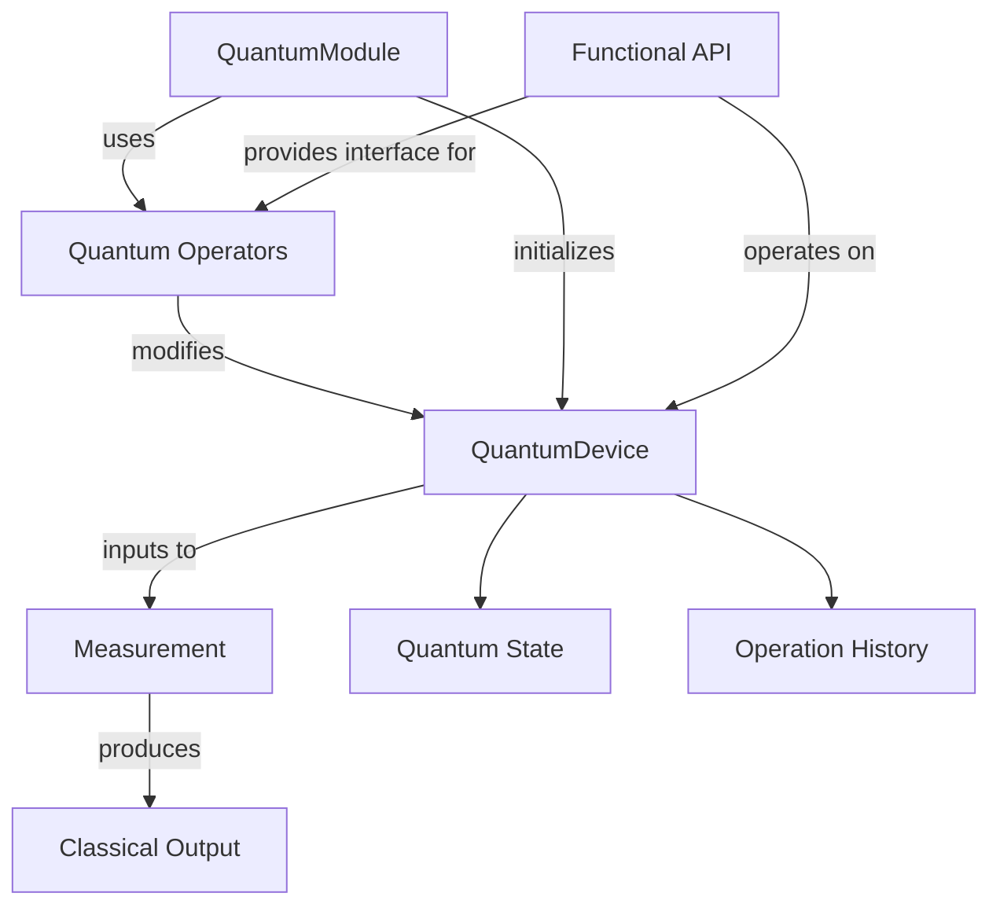
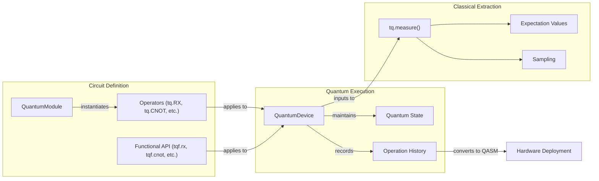
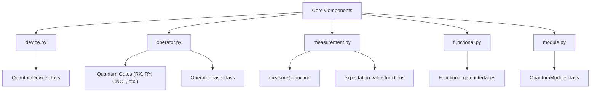

<!-- source: DeepWiki mcp.deepwiki.com · repo mit-han-lab/torchquantum · page 2 Core Components · fetched 2026-10-30 -->

# Core Components

<details>
<summary>Relevant source files</summary>

The following files were used as context for generating this wiki page:

- [README.md](README.md)
- [setup.py](setup.py)
- [torchquantum/__init__.py](torchquantum/__init__.py)
- [torchquantum/macro.py](torchquantum/macro.py)

</details>


Core Components in TorchQuantum are the fundamental building blocks that provide the foundation for quantum circuit simulation and quantum machine learning. These components work together to enable quantum operations, state management, and integration with PyTorch's ecosystem.

For information about how to build quantum circuits using these components, see [Circuit Construction](#3).

## Component Overview

TorchQuantum's architecture is built around five key core components:

1. **QuantumDevice** - Manages quantum states and tracks operation history
2. **Operators and Gates** - Quantum operations that transform quantum states
3. **Measurement** - Extracts classical information from quantum states
4. **Functional API** - Provides alternative functional interface for applying quantum operations
5. **QuantumModule** - PyTorch module-based interface for building quantum circuits

The following diagram illustrates the relationships between these components:

## Component Architecture



Sources: [torchquantum/__init__.py:29-36]()

## QuantumDevice

The `QuantumDevice` class is the central component of TorchQuantum. It stores and manages quantum states, provides methods for quantum operations, and tracks operation history.

### Key Features

- Stores quantum states (statevector or density matrix)
- Records operation history for conversion to other formats (e.g., QASM)
- Supports batch processing for parallel simulation
- Compatible with CPU and GPU backends
- Integrates with PyTorch's autograd system

### Usage Example

```python
import torchquantum as tq

# Create a quantum device with 2 qubits and batch size 5
qdev = tq.QuantumDevice(n_wires=2, bsz=5, device="cpu", record_op=True)

# Apply quantum operations directly on the device
qdev.h(wires=0)
qdev.cnot(wires=[0, 1])

# Print current state
print(qdev)

# Access operation history
print(qdev.op_history)
```

Sources: [README.md:96-101]()

## Operators and Gates

TorchQuantum provides a comprehensive set of quantum operators (gates) that can be applied to transform quantum states. These are implemented as both classes (for object-oriented usage) and functions (for functional usage).

### Categories of Operators

| Category | Examples | Description |
|----------|----------|-------------|
| Single-qubit gates | H, X, Y, Z, S, T | Act on individual qubits |
| Two-qubit gates | CNOT, CZ, SWAP | Act on pairs of qubits |
| Multi-qubit gates | Toffoli, QubitUnitary | Act on three or more qubits |
| Parameterized gates | RX, RY, RZ, U3 | Gates with trainable parameters |

### Operator Implementation

Operators in TorchQuantum inherit from a base `Operator` class and can be instantiated with configurable parameters:

```python
import torchquantum as tq

# Create a parameterized RX gate with trainable parameters
rx = tq.RX(has_params=True, trainable=True, init_params=0.5)

# Apply the gate to a quantum device
rx(qdev, wires=0)

# Get gradient after backpropagation
print(rx.params.grad)
```

Sources: [README.md:106-108]()

## Measurement

Measurement components extract classical information from quantum states, providing the interface between quantum and classical computation. TorchQuantum supports multiple measurement approaches:

### Measurement Types

- **Computational basis measurement**: Projects qubits onto computational basis states
- **Expectation values**: Computes expected values of observables
- **Sampling**: Generates measurement samples according to quantum probabilities
- **Joint measurements**: Measures multiple qubits with respect to different observables

### Measurement Functions

```python
import torchquantum as tq
from torchquantum.measurement import expval_joint_analytical, expval_joint_sampling

# Measure in computational basis with 1024 shots
result = tq.measure(qdev, n_shots=1024)

# Compute expectation value of a ZX observable analytically
expval = expval_joint_analytical(qdev, 'ZX')

# Compute expectation value by sampling (works on real quantum hardware)
expval_sample = expval_joint_sampling(qdev, 'ZX', n_shots=1024)
```

Sources: [README.md:118-128]()

## Functional API

TorchQuantum provides a functional API as an alternative to the object-oriented approach. This API offers a more direct way to apply quantum operations.

### Features

- Direct application of gates to quantum devices
- Named functions for all supported quantum operations
- Easy integration with PyTorch's autograd system

### Example Usage

```python
import torchquantum as tq
import torchquantum.functional as tqf

# Create a quantum device
qdev = tq.QuantumDevice(n_wires=2, bsz=1, device="cpu")

# Apply gates using the functional API
tqf.hadamard(qdev, wires=0)
tqf.cnot(qdev, wires=[0, 1])
tqf.rx(qdev, wires=0, params=0.5)
```

Sources: [README.md:102-104]()

## QuantumModule

The `QuantumModule` class extends PyTorch's `nn.Module` to provide a base class for quantum circuits. It allows quantum circuits to be defined and used like standard PyTorch modules.

### Features

- Inherits from PyTorch's `nn.Module`
- Manages quantum operators as submodules
- Supports forward pass for quantum circuit execution
- Can be combined with classical neural network components

### Example Usage

```python
import torchquantum as tq

# Create a QuantumModule from operation description
ops = [
    {'name': 'hadamard', 'wires': 0}, 
    {'name': 'cnot', 'wires': [0, 1]},
    {'name': 'rx', 'wires': 0, 'params': 0.5, 'trainable': True}
]

qmodule = tq.QuantumModule.from_op_history(ops)
qmodule(qdev)
```

Sources: [README.md:136-145]()

## Component Interaction Workflow

The following diagram illustrates how the core components interact during quantum circuit execution:



Sources: [README.md:96-132]()

## Code to File Mapping

The following diagram shows how the core components map to specific files in the TorchQuantum codebase:



Sources: [torchquantum/__init__.py:29-36](), [README.md:266-270]()

## Integration with PyTorch

TorchQuantum's core components are designed to integrate seamlessly with PyTorch's ecosystem:

- `QuantumModule` extends `torch.nn.Module`
- Quantum states are stored as PyTorch tensors
- Gradients flow through quantum operations via PyTorch's autograd
- Parameters of quantum gates can be optimized using PyTorch optimizers
- Batched processing enables efficient training with large datasets

This tight integration enables the development of hybrid quantum-classical models where traditional neural networks work alongside quantum circuits.

Sources: [README.md:184-239]()

## Conclusion

The core components of TorchQuantum provide a flexible and powerful foundation for quantum computing within the PyTorch ecosystem. Understanding these components is essential for building effective quantum circuits and quantum machine learning models with TorchQuantum.

For more information on how to construct quantum circuits using these components, see [Circuit Construction](#3).

---

