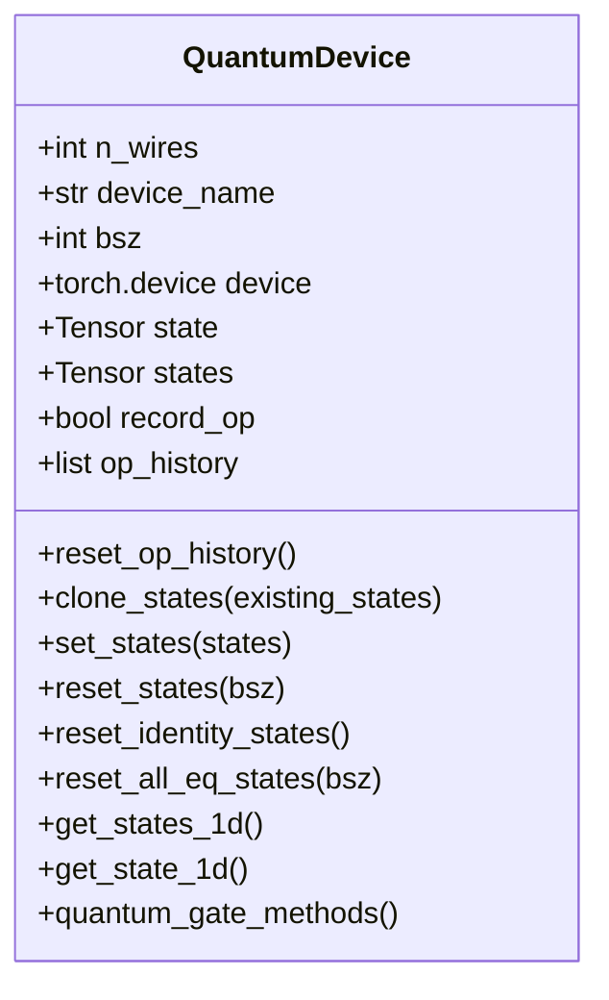
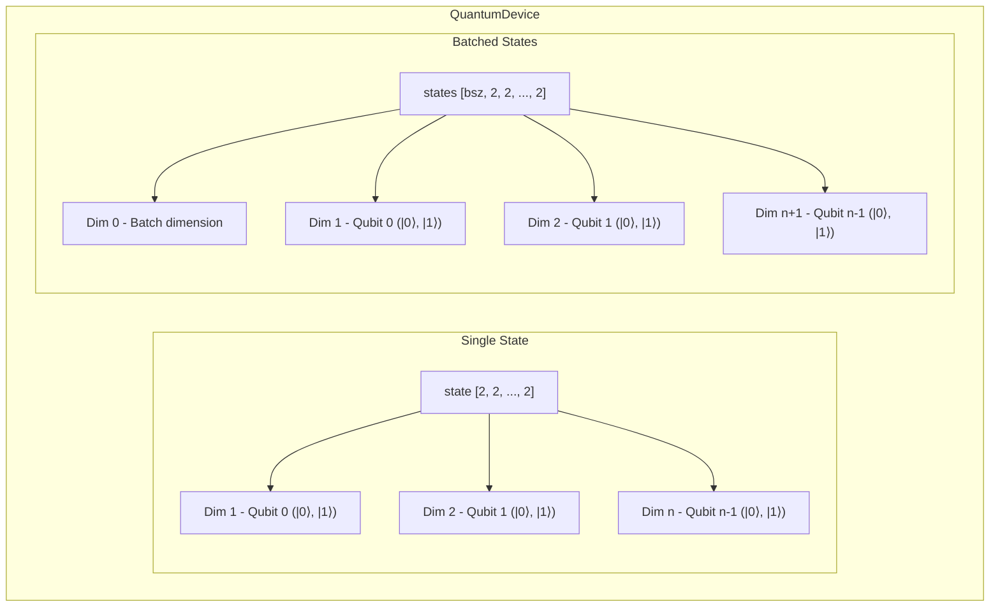
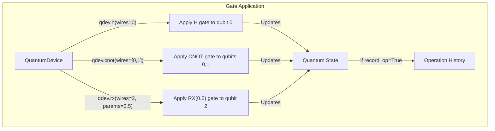
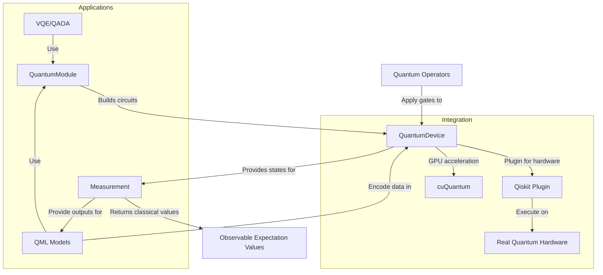

<!-- source: DeepWiki mcp.deepwiki.com · repo mit-han-lab/torchquantum · page 2.1 QuantumDevice · fetched 2026-10-30 -->

# QuantumDevice

<details>
<summary>Relevant source files</summary>

The following files were used as context for generating this wiki page:

- [README.md](README.md)
- [setup.py](setup.py)
- [test/__init__.py](test/__init__.py)
- [test/functional/test_func_mat_exp.py](test/functional/test_func_mat_exp.py)
- [test/operator/test_op_hamil_exp.py](test/operator/test_op_hamil_exp.py)
- [test/random_layer_test.py](test/random_layer_test.py)
- [test/static_mode_test.py](test/static_mode_test.py)
- [test/utils.py](test/utils.py)
- [torchquantum/__init__.py](torchquantum/__init__.py)
- [torchquantum/device/devices.py](torchquantum/device/devices.py)
- [torchquantum/operator/__init__.py](torchquantum/operator/__init__.py)

</details>


QuantumDevice is a fundamental class in TorchQuantum that provides the underlying quantum state storage and manipulation capabilities. It serves as the quantum computing equivalent of tensors in classical deep learning, managing quantum states and facilitating quantum gate operations.

## Overview

QuantumDevice maintains a quantum state vector (or multiple vectors in batch mode) and provides methods to manipulate these states through quantum operations. It bridges the gap between PyTorch's classical computation and quantum simulation by integrating with PyTorch's tensor operations and automatic differentiation.



Sources: [torchquantum/device/devices.py:37-136]()

## Initialization and Parameters

QuantumDevice is initialized with the following parameters:

```python
QuantumDevice(
    n_wires: int,
    device_name: str = "default",
    bsz: int = 1,
    device: Union[torch.device, str] = "cpu",
    record_op: bool = False
)
```

| Parameter | Type | Description |
|-----------|------|-------------|
| n_wires | int | Number of qubits in the quantum system |
| device_name | str | Name identifier for the quantum device (default: "default") |
| bsz | int | Batch size for batch processing of quantum states (default: 1) |
| device | torch.device or str | PyTorch device to use ("cpu" or "cuda") (default: "cpu") |
| record_op | bool | Whether to record operation history (default: False) |

When a QuantumDevice is created, it initializes the quantum state to |0⟩^n (all qubits in the 0 state), represented as a multi-dimensional tensor where each dimension corresponds to a qubit.

Sources: [torchquantum/device/devices.py:37-74]()

## State Representation

The quantum state in QuantumDevice is stored as a tensor with the following structure:



- **Single state**: A tensor of shape [2, 2, ..., 2] (n_wires dimensions) representing one quantum state
- **Batch states**: A tensor of shape [bsz, 2, 2, ..., 2] representing a batch of quantum states

The state uses PyTorch's complex tensor type (C_DTYPE) to represent complex amplitudes.

Sources: [torchquantum/device/devices.py:64-71]()

## State Manipulation Methods

QuantumDevice provides several methods to manipulate quantum states:

| Method | Description |
|--------|-------------|
| reset_states(bsz) | Reset to initial |0⟩^n state with specified batch size |
| reset_identity_states() | Set states to identity matrix (useful for verification) |
| reset_all_eq_states(bsz) | Set states to equal superposition (useful for verification) |
| clone_states(existing_states) | Clone existing states into this device |
| set_states(states) | Set quantum states from provided tensor |
| get_states_1d() | Return states as a 1D tensor of shape [bsz, 2^n_wires] |
| get_state_1d() | Return single state as a 1D tensor of shape [2^n_wires] |

These methods allow for flexible manipulation of quantum states for various quantum algorithm implementations.

Sources: [torchquantum/device/devices.py:80-121]()

## Operation History

When initialized with `record_op=True`, QuantumDevice keeps track of all quantum operations applied to it. This operation history is stored in `op_history` as a list and can be reset using `reset_op_history()`.

The operation history is useful for:
- Constructing static computation graphs
- Converting quantum circuits to other formats (e.g., QASM)
- Visualizing quantum circuits
- Deploying circuits to real quantum hardware

Sources: [torchquantum/device/devices.py:73-78]()

## Integration with Quantum Operations

QuantumDevice dynamically adds all quantum gate operations from `func_name_dict` and `func_name_dict_collect` as methods. This allows for intuitive application of quantum gates directly on the device.



Common gate operations include:
- Single-qubit gates: h, x, y, z, s, t, rx, ry, rz, etc.
- Two-qubit gates: cnot, cz, swap, crx, cry, crz, etc.
- Multi-qubit gates: toffoli, qubitunitary, etc.

Sources: [torchquantum/device/devices.py:132-136](), [README.md:98-105]()

## Role in TorchQuantum Framework

QuantumDevice plays a central role in the TorchQuantum framework:



Sources: [README.md:96-105](), [README.md:183-239]()

## Usage Example

Here's a basic example of using QuantumDevice:

```python
import torchquantum as tq
import torchquantum.functional as tqf

# Create a quantum device with 2 qubits and batch size 5
qdev = tq.QuantumDevice(n_wires=2, bsz=5, device="cpu", record_op=True)

# Apply gates using qdev.op methods
qdev.h(wires=0)
qdev.cnot(wires=[0, 1])

# Apply gates using functional API
tqf.h(qdev, wires=1)
tqf.x(qdev, wires=1)

# Print the current state
print(qdev)

# Obtain measurement results
measurement_results = tq.measure(qdev, n_shots=1024)
```

This example creates a 2-qubit quantum device, applies several quantum gates, and measures the resulting state.

Sources: [README.md:92-118]()

## Accessing State Information

After performing operations, you can access the quantum state in several ways:

1. Directly access the `.states` tensor property
2. Use `get_states_1d()` to get states in a flattened representation
3. For debugging, print the QuantumDevice object to see its current state
4. Measure the state to obtain expectation values or samples

The state can be further processed using PyTorch operations since it's a standard PyTorch tensor with gradient tracking capabilities.

```python
# Example of accessing and processing states
states = qdev.get_states_1d()
processed_states = states.abs().pow(2)  # Get probabilities
```

Sources: [torchquantum/device/devices.py:114-121](), [README.md:110-132]()

## Performance Considerations

- Using `device="cuda"` allows for GPU acceleration of quantum simulations
- Batch processing multiple states simultaneously improves throughput
- For larger numbers of qubits (>25), memory becomes a constraint due to the exponential growth of the state vector
- Setting `record_op=False` reduces memory usage when operation history isn't needed

Sources: [torchquantum/device/devices.py:37-74](), [README.md:52-53]()

## Related Components

- For building more complex quantum circuits, see [QuantumModule](#3.1)
- For detailed information about available quantum gates, see [Operators and Gates](#2.2)
- For measuring quantum states, see [Measurement](#2.3)
- For using the functional API instead of methods, see [Functional API](#2.4)

---

