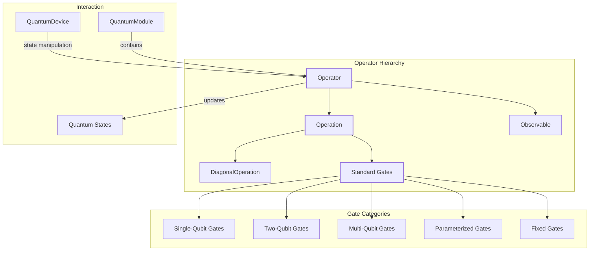
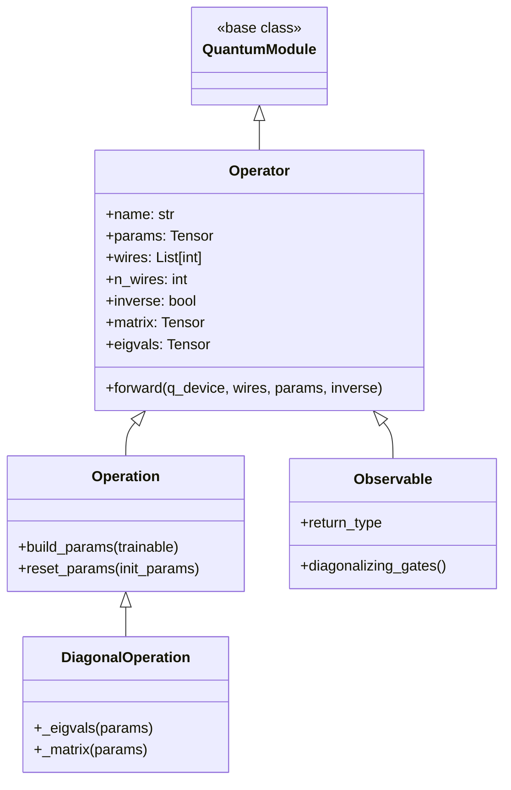
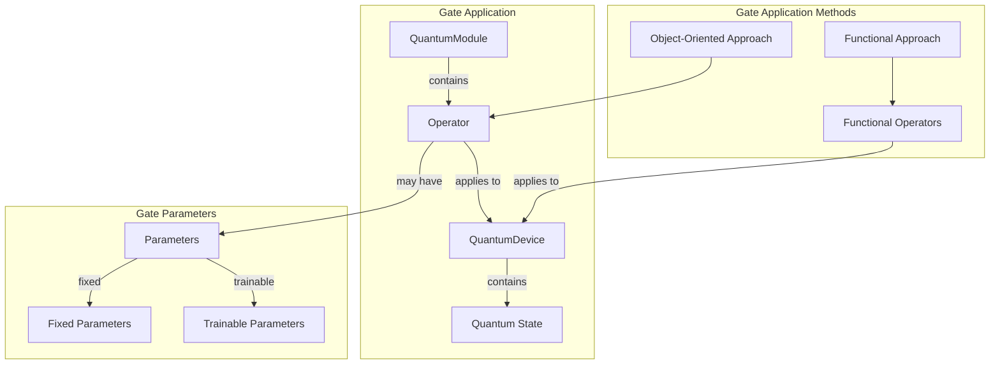

<!-- source: DeepWiki mcp.deepwiki.com · repo mit-han-lab/torchquantum · page 2.2 Operators and Gates · fetched 2026-10-30 -->

# Operators and Gates

<details>
<summary>Relevant source files</summary>

The following files were used as context for generating this wiki page:

- [test/operator/test_op.py](test/operator/test_op.py)
- [torchquantum/algorithm/vqe.py](torchquantum/algorithm/vqe.py)
- [torchquantum/functional/functionals.py](torchquantum/functional/functionals.py)
- [torchquantum/graph/graphs.py](torchquantum/graph/graphs.py)
- [torchquantum/macro.py](torchquantum/macro.py)
- [torchquantum/operator/op_types.py](torchquantum/operator/op_types.py)
- [torchquantum/operator/standard_gates/__init__.py](torchquantum/operator/standard_gates/__init__.py)

</details>


This page documents the quantum operators and quantum gates available in TorchQuantum, how they are implemented, and how they can be used in quantum circuits. For information about constructing full quantum circuits, see [Circuit Construction](#3), and for details about applying quantum operations, see [Functional API](#2.4).

## Overview

Quantum operators and gates are the fundamental building blocks of quantum circuits in TorchQuantum. They represent unitary transformations that act on quantum states, enabling the manipulation of qubits to perform quantum computations. TorchQuantum provides a comprehensive set of quantum gates modeled after those found in real quantum computers and quantum programming frameworks.



Sources: [torchquantum/operator/op_types.py:53-267](), [torchquantum/operator/standard_gates/__init__.py:25-162]()

## Operator Class Hierarchy

TorchQuantum implements quantum operators through a hierarchical class structure, with the base `Operator` class serving as the foundation for all quantum operations.



Sources: [torchquantum/operator/op_types.py:53-444]()

### Operator Base Class

The `Operator` class serves as the base class for all quantum operators in TorchQuantum. It inherits from `QuantumModule` and provides core functionality for quantum operations:

- Managing operator parameters
- Tracking which qubits (wires) the operation acts on
- Providing matrix representations of operations
- Applying operations to quantum states
- Supporting inverse operations

Key properties and methods:

- `name`: Name of the operator (e.g., "Hadamard", "PauliX")
- `matrix`: Unitary matrix representation of the operator
- `eigvals`: Eigenvalues of the operator
- `forward()`: Method to apply the operator to a quantum device

Sources: [torchquantum/operator/op_types.py:53-267]()

### Operation and Observable Classes

TorchQuantum differentiates between two main types of operators:

1. **Operations**: Standard quantum gates that transform quantum states
   - Implemented by the `Operation` class
   - Includes methods for parameter initialization and management
   - Examples: Pauli gates, rotation gates, controlled gates

2. **Observables**: Quantum operators used for measurements
   - Implemented by the `Observable` class
   - Used to calculate expectation values or sample measurement outcomes
   - Examples: Pauli observables for energy measurements in VQE algorithms

The `DiagonalOperation` class is a specialized operation where the unitary matrix is diagonal and can be represented by its eigenvalues.

Sources: [torchquantum/operator/op_types.py:270-444]()

## Available Gates

TorchQuantum provides a comprehensive set of quantum gates, ranging from simple single-qubit operations to complex multi-qubit gates.

### Gate Categories

The gates can be categorized based on the number of qubits they operate on and whether they are parameterized:

1. **Single-qubit gates**: Act on one qubit (e.g., Pauli-X, Hadamard)
2. **Two-qubit gates**: Act on two qubits (e.g., CNOT, SWAP)
3. **Multi-qubit gates**: Act on three or more qubits (e.g., Toffoli, MultiRZ)
4. **Fixed gates**: Gates with no adjustable parameters (e.g., Pauli gates, Hadamard)
5. **Parameterized gates**: Gates with adjustable parameters (e.g., rotation gates)

The following table shows some of the commonly used gates in each category:

| Category | Examples |
|----------|----------|
| Single-qubit fixed | PauliX (X), PauliY (Y), PauliZ (Z), Hadamard (H), S, T |
| Single-qubit parameterized | RX, RY, RZ, PhaseShift, U1, U2, U3 |
| Two-qubit fixed | CNOT, CZ, SWAP |
| Two-qubit parameterized | CRX, CRY, CRZ, RXX, RYY, RZZ |
| Multi-qubit fixed | Toffoli (CCX), CCZ, CSWAP |
| Multi-qubit parameterized | MultiRZ, C3X, C4X |

Sources: [torchquantum/operator/standard_gates/__init__.py:25-162](), [test/operator/test_op.py:42-100]()

### Common Single-Qubit Gates

Here are some of the most common single-qubit gates in TorchQuantum:

| Gate | TorchQuantum Class | Description | Matrix Representation |
|------|-------------------|-------------|-------------------------|
| Pauli-X | `PauliX` | Bit-flip gate | [[0, 1], [1, 0]] |
| Pauli-Y | `PauliY` | Phase and bit-flip | [[0, -i], [i, 0]] |
| Pauli-Z | `PauliZ` | Phase-flip gate | [[1, 0], [0, -1]] |
| Hadamard | `Hadamard` or `H` | Creates superposition | 1/√2 * [[1, 1], [1, -1]] |
| S | `S` | Phase gate (π/2) | [[1, 0], [0, i]] |
| T | `T` | Phase gate (π/4) | [[1, 0], [0, e^(iπ/4)]] |
| RX | `RX` | Rotation around X-axis | [[cos(θ/2), -i*sin(θ/2)], [-i*sin(θ/2), cos(θ/2)]] |
| RY | `RY` | Rotation around Y-axis | [[cos(θ/2), -sin(θ/2)], [sin(θ/2), cos(θ/2)]] |
| RZ | `RZ` | Rotation around Z-axis | [[e^(-iθ/2), 0], [0, e^(iθ/2)]] |

Sources: [test/operator/test_op.py:42-75]()

### Common Two-Qubit Gates

TorchQuantum provides various two-qubit gates for entanglement and controlled operations:

| Gate | TorchQuantum Class | Description |
|------|-------------------|-------------|
| CNOT | `CNOT` | Controlled-NOT gate (flips target if control is 1) |
| CZ | `CZ` | Controlled-Z gate (applies Z if control is 1) |
| SWAP | `SWAP` | Swaps the state of two qubits |
| CRX | `CRX` | Controlled RX rotation gate |
| CRY | `CRY` | Controlled RY rotation gate |
| CRZ | `CRZ` | Controlled RZ rotation gate |
| RXX | `RXX` | Two-qubit rotation around XX axis |
| RYY | `RYY` | Two-qubit rotation around YY axis |
| RZZ | `RZZ` | Two-qubit rotation around ZZ axis |
| ISWAP | `ISWAP` | Swaps with an additional phase factor |

Sources: [torchquantum/operator/standard_gates/__init__.py:25-50](), [test/operator/test_op.py:52-69]()

### Multi-Qubit Gates

For operations involving three or more qubits, TorchQuantum provides:

| Gate | TorchQuantum Class | Description |
|------|-------------------|-------------|
| Toffoli | `Toffoli` or `CCX` | Controlled-controlled-X gate |
| CCZ | `CCZ` | Controlled-controlled-Z gate |
| CSWAP | `CSWAP` | Controlled-SWAP (Fredkin) gate |
| C3X | `C3X` | 3-controlled X gate |
| C4X | `C4X` | 4-controlled X gate |
| MultiRZ | `MultiRZ` | Multi-qubit rotation around Z-axis |

Sources: [torchquantum/operator/standard_gates/__init__.py:30-97](), [test/operator/test_op.py:63-97]()

## Using Gates in Quantum Circuits

Quantum gates can be used in TorchQuantum in several ways, depending on whether you're using the object-oriented or functional API.



Sources: [torchquantum/operator/op_types.py:182-264](), [torchquantum/functional/functionals.py:25-34]()

### Object-Oriented Approach

In the object-oriented approach, gates are instantiated as objects and then applied to a `QuantumDevice`:

1. Create a gate instance:
   ```python
   h_gate = tq.Hadamard(wires=0)
   rx_gate = tq.RX(has_params=True, trainable=True, wires=1)
   ```

2. Apply the gate to a quantum device:
   ```python
   h_gate(q_device)  # Apply Hadamard to wire 0
   rx_gate(q_device, params=torch.tensor([[0.5]]))  # Apply RX with parameter 0.5 to wire 1
   ```

3. Gates can also be used within a `QuantumModule` to build complex circuits:
   ```python
   class MyCircuit(tq.QuantumModule):
       def __init__(self):
           super().__init__()
           self.h = tq.Hadamard(wires=0)
           self.rx = tq.RX(has_params=True, trainable=True, wires=1)
       
       def forward(self, q_device):
           self.h(q_device)
           self.rx(q_device)
   ```

Sources: [torchquantum/operator/op_types.py:182-264]()

### Functional Approach

TorchQuantum also provides a functional API for applying gates:

```python
q_device = tq.QuantumDevice(n_wires=2)
tq.hadamard(q_device, wires=0)  # Apply Hadamard to wire 0
tq.rx(q_device, wires=1, params=torch.tensor([[0.5]]))  # Apply RX to wire 1
```

The functional approach is useful for more dynamic circuit construction and can be more concise in some cases.

Sources: [torchquantum/functional/functionals.py:25-34]()

### Parameterized Gates

Parameterized gates have adjustable parameters that can be trained in quantum machine learning applications:

1. Creating a parameterized gate with trainable parameters:
   ```python
   rx_gate = tq.RX(has_params=True, trainable=True, wires=0)
   ```

2. Initializing parameters:
   ```python
   rx_gate = tq.RX(has_params=True, trainable=True, init_params=torch.tensor([[0.1]]), wires=0)
   ```

3. Setting parameters during forward pass:
   ```python
   rx_gate(q_device, params=torch.tensor([[0.5]]))
   ```

Trainable parameters are implemented as PyTorch Parameters, allowing them to be optimized using PyTorch's automatic differentiation and optimizers.

Sources: [torchquantum/operator/op_types.py:116-120](), [torchquantum/operator/op_types.py:377-405]()

### Gate Inverse Operations

TorchQuantum supports inverse operations for quantum gates:

```python
# Create a gate with inverse=True
h_inv = tq.Hadamard(wires=0, inverse=True)

# Or set inverse during forward pass
h_gate = tq.Hadamard(wires=0)
h_gate(q_device, inverse=True)
```

When `inverse=True`, the gate applies the conjugate transpose of its unitary matrix to the quantum state.

Sources: [torchquantum/operator/op_types.py:198-200]()

## Gate Execution Modes

TorchQuantum supports two execution modes for quantum gates:

1. **Dynamic Mode**: Gates are applied sequentially to the quantum state
2. **Static Mode**: Gates are compiled into a quantum circuit graph for optimized execution

### Dynamic Mode

In dynamic mode, each gate directly modifies the quantum state when its `forward` method is called:

```python
q_device = tq.QuantumDevice(n_wires=2)
tq.hadamard(q_device, wires=0)  # State is immediately updated
tq.cnot(q_device, wires=[0, 1])  # State is immediately updated again
```

This mode is flexible and allows for dynamic circuit construction.

### Static Mode

In static mode, gates are collected into a quantum circuit graph and then executed together:

```python
class MyCircuit(tq.QuantumModule):
    def __init__(self):
        super().__init__()
        self.h = tq.Hadamard(wires=0)
        self.cnot = tq.CNOT(wires=[0, 1])
        self.static_mode = True  # Enable static mode
    
    def forward(self, q_device):
        self.h(q_device)  # Gate is added to the graph, not executed yet
        self.cnot(q_device)  # Gate is added to the graph, not executed yet
        # After all gates are added, the entire circuit is executed
```

Static mode can provide performance benefits for complex circuits, especially when running on GPU.

Sources: [torchquantum/graph/graphs.py:124-137](), [torchquantum/operator/op_types.py:231-234]()

## Comparison with Qiskit

TorchQuantum's quantum gates are compatible with those in Qiskit, making it easy to translate circuits between the two frameworks. The main difference is in the endianness convention:

- In Qiskit, higher qubit indices are more significant
- In TorchQuantum, higher qubit indices are less significant

This difference affects the matrix representation of multi-qubit gates. TorchQuantum provides utilities to convert between these conventions.

Sources: [test/operator/test_op.py:108-123]()

## Using Gates in Applications

Quantum gates in TorchQuantum are particularly useful for quantum machine learning applications. For example, in the Variational Quantum Eigensolver (VQE) algorithm:

```python
# Example of using gates in a VQE ansatz
class VQEAnsatz(tq.QuantumModule):
    def __init__(self, n_wires):
        super().__init__()
        self.n_wires = n_wires
        self.layers = 2
        
        # Create parameterized rotation gates
        self.rx_layers = nn.ModuleList([
            nn.ModuleList([
                tq.RX(has_params=True, trainable=True) 
                for _ in range(n_wires)
            ])
            for _ in range(self.layers)
        ])
        
        # Create entangling gates
        self.entangling = nn.ModuleList([
            tq.CNOT() for _ in range(n_wires - 1)
        ])
    
    def forward(self, q_device):
        # Apply parameterized layers with entanglement
        for l in range(self.layers):
            for i in range(self.n_wires):
                self.rx_layers[l][i](q_device, wires=i)
            
            # Add entanglement
            for i in range(self.n_wires - 1):
                self.entangling[i](q_device, wires=[i, i+1])
```

This circuit could then be used with VQE to find ground state energies of quantum systems.

Sources: [torchquantum/algorithm/vqe.py:36-133]()

---

