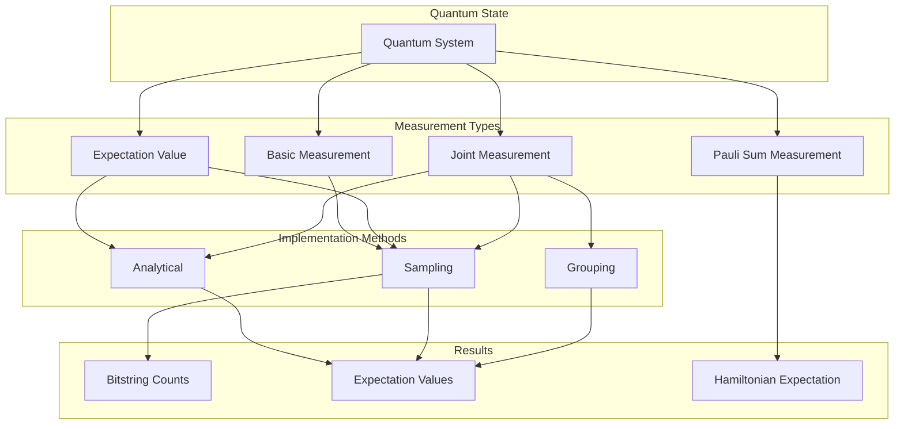
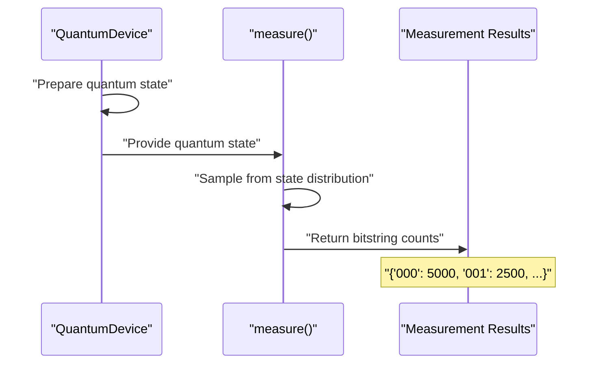
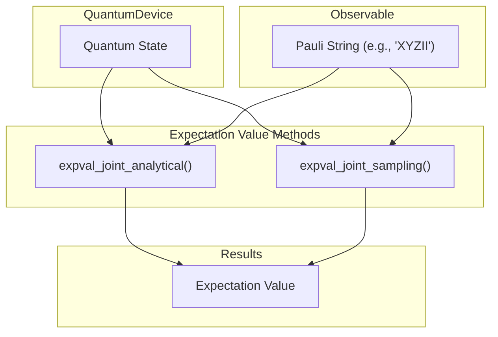
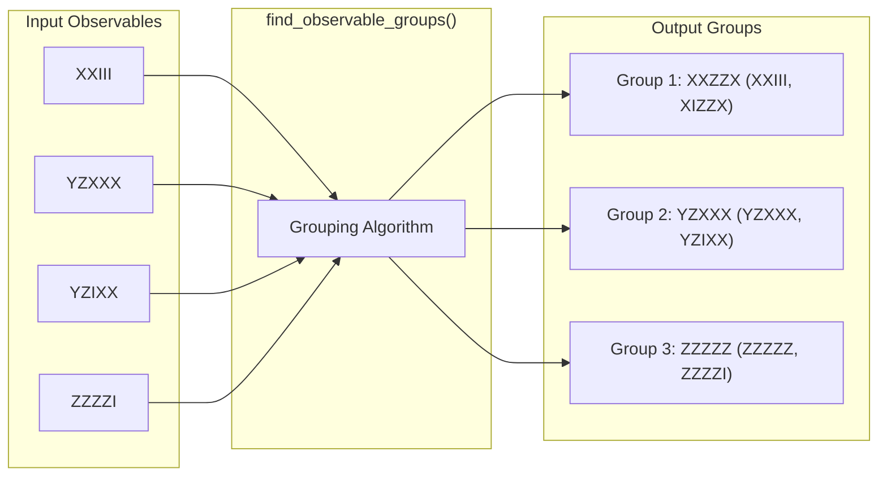
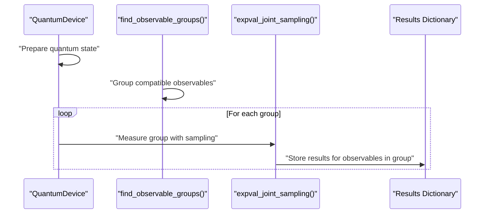
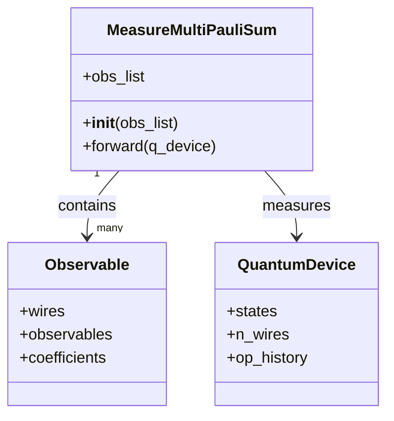
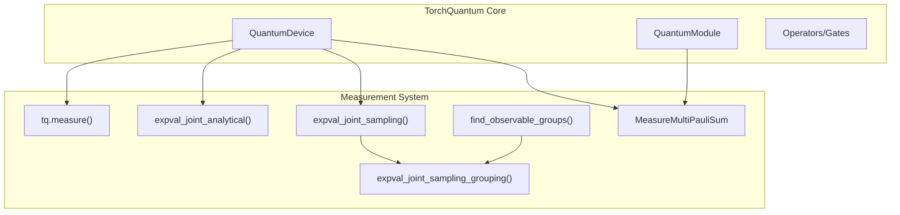

<!-- source: DeepWiki mcp.deepwiki.com · repo mit-han-lab/torchquantum · page 2.3 Measurement · fetched 2026-10-30 -->

# Measurement

<details>
<summary>Relevant source files</summary>

The following files were used as context for generating this wiki page:

- [examples/PauliSumOp/pauli_sum_op.py](examples/PauliSumOp/pauli_sum_op.py)
- [test/algorithm/test_hamiltonian.py](test/algorithm/test_hamiltonian.py)
- [test/hadamard_grad/test_hadamard_grad.py](test/hadamard_grad/test_hadamard_grad.py)
- [test/measurement/test_eval_observable.py](test/measurement/test_eval_observable.py)
- [test/measurement/test_expval_joint_sampling_grouping.py](test/measurement/test_expval_joint_sampling_grouping.py)
- [test/measurement/test_find_observable_groups.py](test/measurement/test_find_observable_groups.py)
- [test/measurement/test_measure.py](test/measurement/test_measure.py)
- [test/plugin/test_qiskit_plugins.py](test/plugin/test_qiskit_plugins.py)

</details>


## Purpose and Scope

This document covers the measurement functionality in TorchQuantum, which provides mechanisms to extract classical information from quantum states. Measurement is a crucial component of quantum computing, serving as the bridge between quantum and classical information. TorchQuantum offers various measurement techniques including basic state measurements, expectation value calculations, observable grouping for efficient measurements, and support for Pauli sum operator measurements.

For information about quantum operators and gates that can be measured, see [Operators and Gates](#2.2). For details on how to use the functional interface for applying quantum operations before measurement, see [Functional API](#2.4).

## Conceptual Overview

In quantum computing, measurement collapses a quantum state to a classical state according to quantum mechanical principles. TorchQuantum provides both analytical (exact) and sampling-based (stochastic) approaches to measurement, as well as functionality for measuring multiple observables efficiently.



Sources: `test/measurement/test_measure.py`, `test/measurement/test_eval_observable.py`, `test/measurement/test_expval_joint_sampling_grouping.py`, `examples/PauliSumOp/pauli_sum_op.py`

## Basic Measurement

The most fundamental form of measurement in TorchQuantum is implemented through the `tq.measure` function, which samples from the quantum state to produce bitstring outcomes with their corresponding counts.



### Example Usage

```python
# Create and prepare a quantum device
qdev = tq.QuantumDevice(n_wires=3, bsz=1)
qdev.x(wires=0)
qdev.h(wires=1)

# Measure the state with 1000 shots
counts = tq.measure(qdev, n_shots=1000)
```

Sources: `test/measurement/test_measure.py`

## Expectation Value Measurements

Expectation value measurements calculate the expected value of an observable with respect to a quantum state. TorchQuantum provides both analytical (exact) and sampling-based (stochastic) methods for calculating expectation values.

### Analytical Method

The `expval_joint_analytical` function calculates expectation values analytically, providing exact results without sampling errors.

### Sampling Method

The `expval_joint_sampling` function calculates expectation values using a finite number of measurements (shots), which introduces statistical noise but more closely resembles how measurements would be performed on real quantum hardware.



### Example Usage

```python
# Prepare quantum state
qdev = tq.QuantumDevice(n_wires=4, bsz=1)
# Apply some operations...

# Calculate expectation value analytically
expval_analytical = tq.measurement.expval_joint_analytical(qdev, observable="XYZZ")

# Calculate expectation value using sampling
expval_sampling = tq.measurement.expval_joint_sampling(qdev, observable="XYZZ", n_shots=10000)
```

Sources: `test/measurement/test_eval_observable.py`

## Observable Grouping

TorchQuantum provides functionality to group compatible observables together for more efficient measurement. Observables can be measured in the same group if they share a common eigenbasis, which reduces the number of circuit executions needed.

The `find_observable_groups` function analyzes a list of observables and returns groups that can be measured simultaneously.



### Example Usage

```python
observables = [
    "XXIII",
    "YZXXX",
    "YZIXX",
    "ZZZZI"
]
groups = tq.measurement.find_observable_groups(observables)
```

Sources: `test/measurement/test_find_observable_groups.py`

## Joint Measurements with Grouping

The `expval_joint_sampling_grouping` function combines observable grouping with sampling-based expectation value calculation, allowing efficient measurement of multiple observables.



### Example Usage

```python
# Prepare a list of observables
observables = ["XXII", "YYII", "ZZII", "XIXI"]

# Calculate expectation values for all observables efficiently
results = tq.measurement.expval_joint_sampling_grouping(
    qdev, 
    observables=observables, 
    n_shots_per_group=10000
)
```

Sources: `test/measurement/test_expval_joint_sampling_grouping.py`

## Pauli Sum Operator Measurements

TorchQuantum provides the `MeasureMultiPauliSum` class for measuring expectation values of multiple Pauli sum operators. This is particularly useful for algorithms like VQE (Variational Quantum Eigensolver) that require measuring the expectation value of a Hamiltonian.



### Example Usage

```python
# Define the measurement module
measure = tq.MeasureMultiPauliSum(
    obs_list=[
        {
            "wires": [0, 2, 3, 1],
            "observables": ["x", "y", "z", "i"],
            "coefficient": [1, 0.5, 0.4, 0.3],
        },
        {
            "wires": [0, 2, 3, 1],
            "observables": ["x", "x", "z", "i"],
            "coefficient": [1, 0.5, 0.4, 0.3],
        },
    ]
)

# Use in a quantum circuit
result = measure(q_device)
```

Sources: `examples/PauliSumOp/pauli_sum_op.py`

## Integration with TorchQuantum Core

The measurement system is tightly integrated with the core TorchQuantum components, particularly with the `QuantumDevice` class which stores the quantum state and operation history.



Sources: All files reviewed

## Integration with External Libraries

TorchQuantum's measurement system can be validated against and integrated with other quantum computing libraries like Qiskit.

### Comparison with Qiskit

The test files demonstrate how TorchQuantum's measurement results are compared with Qiskit's results for validation:

```python
# TorchQuantum measurement
tq_counts = tq.measure(qdev, n_shots=n_shots)

# Equivalent Qiskit measurement
circ = op_history2qiskit(qdev.n_wires, qdev.op_history)
circ.measure_all()
simulator = Aer.get_backend("aer_simulator")
circ = transpile(circ, simulator)
qiskit_res = simulator.run(circ, shots=n_shots).result()
qiskit_counts = qiskit_res.get_counts()
```

Sources: `test/measurement/test_measure.py`, `test/measurement/test_eval_observable.py`, `test/plugin/test_qiskit_plugins.py`

## Summary

TorchQuantum provides a comprehensive measurement system for quantum computing, ranging from basic measurements to advanced techniques like observable grouping and Pauli sum operator measurements. The system supports both analytical (exact) and sampling-based (stochastic) methods, making it suitable for both simulation and hardware-based quantum computing.

The measurement functionality is essential for extracting classical information from quantum states and is a crucial component in quantum algorithms like VQE, QAOA, and quantum machine learning applications.

---

